# Versio — Initial Plan

**Git-native version control for CODESYS projects: automatic export to reviewable text, a complete project-tree diff, and verified bi-directional sync.**

| | |
|---|---|
| Document | Architecture and implementation plan — **the design record** |
| Status | **Rev 10.** Phase 0 complete, Phase 1 largely complete. Implementation is under way and this document is kept in step with it |
| Where things stand | **[`STATUS.md`](STATUS.md)** — read that first |
| Measured findings | **[`PHASE0-FINDINGS.md`](PHASE0-FINDINGS.md)** — numbers, failures and dead ends |
| Target platform | Windows 11 desktop. Windows only, by decision (§13.7) |
| Repository | `C:\GIT\Versio` (nothing depends on this path — the tests and tools resolve it from their own location) |
| Reference environment | CODESYS 3.5.22.20, profile `CODESYS V3.5 SP22 Patch 2`, CODESYS Scripting 4.2.0.0, git 2.53 with LFS, .NET SDK 9.0.317 |

---

## Start here — for anyone picking this up

**Read in this order:** `README.md` (what it is, how to build) → [`STATUS.md`](STATUS.md) (where it is, what is next) → [`PHASE0-FINDINGS.md`](PHASE0-FINDINGS.md) (what was measured) → this document (why it is shaped this way).

**What this document is.** The design record and its reasoning. Every significant decision is here *with the argument that produced it*, including the ones that were later reversed — those are marked in place rather than deleted, because the reasoning that overturned them is usually more instructive than the conclusion.

**What it is not.** A task list. Sections describing work that is already built say so; §14's roadmap carries an execution-status banner.

### Decisions reversed by measurement — read these before re-opening them

| Was | Became | Why |
|---|---|---|
| Automatic export on save | **`On git action` is the default** (§7.4.6) | Cold start measured at 17–31 s; export-on-save runs CODESYS most of the working day |
| LibGit2Sharp for reads | **`git.exe` throughout** (§8.1) | Removes the native payload that breaks single-file publish, and credentials just work |
| Avalonia for a macOS build | **WPF, Windows only** (§13.7) | CODESYS has no macOS build, so a Mac client could only ever have been a review client |
| PLCopenXML as the export format | **ST + native XML** (§3.1.5) | `textual_declaration` gives the text directly; PLCopenXML is less readable, less complete and lossy on import |
| AvalonEdit for the diff view | **A tokenizer in `Versio.Core`** (§8.3) | Structured Text has no bundled definition, so a custom highlighter was needed regardless |
| Inno Setup | **Velopack** (§13.5) | Delta updates on a ~110 MB app, plus an MSI for managed sites |

### The disciplines that make the rest cheap

1. **`Versio.Core` touches nothing external.** No `System.IO`, no `Process`, no `DateTimeOffset.Now`, no UI framework — everything sits behind an interface in `Abstractions/`. This is why the lock model, the loop defences and the state machine are tested in ~50 ms instead of by causing real crashes.
2. **Distrust a green result until it can fail.** Four vacuous passes have already been caught this way: a round-trip that succeeded because the import silently did nothing; equivalence tests that "passed" by skipping; a tree spike that measured a collapsed tree; and a mutation that looked absent because the import had errored. Every measurement now asserts it stressed something.
3. **Write findings down with their evidence.** A number and the command that produced it, not a recollection.

### Revision history

Rev 10 diff view renders any text file, highlighted per language (§8.3) · Rev 9 LibGit2Sharp dropped for `git.exe` (§8.1), closing R19 · Rev 8 Phase 0 executed; sync-mode default, profile resolution and unknown-type handling all changed by measurement · Rev 7 explicit project↔export bindings, multi-project repos, orphan detection (§5.1–5.3); per-binding locks · Rev 6 Windows only, macOS dropped (§13.7); server-hosted CODESYS parked as Phase 5 (§13.8) · Rev 5 Velopack replaces Inno Setup (§13.5) · Rev 4 packaging and vendored dependencies (§13) · Rev 3 codescribe source harvested (§3.1.4); losslessness contract (§3.9); coverage tiers (§3.10); change detection (§7.4); design system (§9.0); testing strategy (§12)

---

## Table of contents

1. [The problem and the core idea](#1-the-problem-and-the-core-idea)
2. [CODESYS scripting research](#2-codesys-scripting-research--what-we-can-actually-do)
3. [The hard truths (read this before committing)](#3-the-hard-truths-read-this-before-committing)
   - [3.1 Format coverage, the codescribe harvest & the export strategy](#31-plcopenxml-does-not-cover-the-whole-project--and-the-gaps-are-covered-by-other-apis)
   - [3.8 CODESYS Git — evaluated and rejected](#38-codesys-git--evaluated-and-rejected)
   - [**3.9 What "truly lossless" means — the contract**](#39-what-truly-lossless-means--the-contract)
   - [**3.10 Diff coverage ≠ import coverage**](#310-diff-coverage--import-coverage--and-diff-can-be-complete)
4. [System architecture](#4-system-architecture)
5. [Repository layout on disk](#5-repository-layout-on-disk)
   - [**5.1 How the project ↔ export binding is stored**](#51-how-the-project--export-directory-relationship-is-stored)
   - [5.2 Multiple projects · 5.3 Orphan detection](#52-multiple-projects-at-the-same-level)
6. [The sync engine and the lock model](#6-the-sync-engine-and-the-lock-model)
7. [Workers, threading and the UI-freeze budget](#7-workers-threading-and-the-ui-freeze-budget)
   - [**7.4 Change detection — cadence, coalescing, commit gate**](#74-change-detection--cadence-coalescing-and-why-a-missed-event-cannot-hurt-you)
8. [Git layer](#8-git-layer)
9. [Front end specification](#9-front-end-specification)
   - [**9.0 Design system — one stylesheet**](#90-design-system--one-stylesheet-no-ad-hoc-styling)
   - [9.3 Project tree diff view](#93-main-split--the-project-tree-not-a-flat-file-list)
10. [Logging subsystem](#10-logging-subsystem)
11. [Technology choices](#11-technology-choices)
12. [**Code structure, contracts and testing**](#12-code-structure-contracts-and-testing)
13. [**Packaging, dependencies and distribution**](#13-packaging-dependencies-and-distribution)
    - [13.7 macOS — considered and dropped](#137-macos--considered-and-dropped-decision-record)
    - [13.8 Server-hosted CODESYS — documented for later](#138-server-hosted-codesys--documented-for-later-phase-5)
14. [Phased roadmap](#14-phased-roadmap)
15. [Risk register](#15-risk-register)
16. [Open questions for you](#16-open-questions-for-you)
17. [Sources](#17-sources)

---

## 1. The problem and the core idea

A CODESYS `.project` file is a **binary compound document**. Git can store it, but git cannot diff it, cannot merge it, and cannot tell you what changed between two commits. For a team doing PLC work this means version control degrades to "upload a zip with a date in the name".

PLCopenXML is CODESYS's textual interchange format. If we can keep a **textual mirror** of the project inside the same repo, kept automatically in sync, then git becomes genuinely useful: line diffs, blame, review, history.

Versio's job:

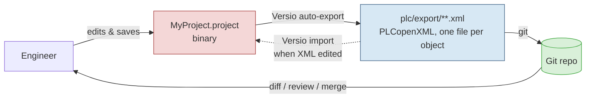

Both arrows exist, which is exactly where the danger is: an export triggers a file change, which could trigger an import, which changes the project, which triggers an export… forever. **Section 6 is the most important section of this document** — it defines the lock and hash model that makes the loop impossible.

### Non-goals for v1

- Merging PLCopenXML semantically (git text merge only; conflicts are surfaced, not auto-resolved)
- Anything on the PLC itself (download, online change, monitoring)
- Multi-user server component — Versio is a local desktop tool talking to a normal git remote
- Non-Windows platforms (CODESYS is Windows-only, so the constraint is inherent)

---

## 2. CODESYS scripting research — what we can actually do

### 2.1 The ScriptEngine

CODESYS ships an **IronPython 2.7-based scripting engine**. Scripts get an implicit `from scriptengine import *`, which exposes root objects:

| Root object | Purpose |
|---|---|
| `system` | messages, UI control, compiler messages, progress bar, exit |
| `projects` | open / create / save / close projects, navigate the object tree, **export/import** |
| `online` | login to device, gateway, scanning (not needed by Versio) |
| `librarymanager` | library repository management |
| `device_repository` | device description management |

Full API reference is in `ScriptEngine.chm` under the CODESYS `Online Help` directory of the installation — **that local file is the authoritative reference and should be consulted during Phase 0**, because the online docs are thinner than the CHM.

### 2.2 Export to PLCopenXML

The canonical, documented pattern:

```python
class ER(ExportReporter):
    def error(self, object, message):
        system.write_message(Severity.Error, "Error exporting %s: %s" % (object, message))
    def warning(self, object, message):
        system.write_message(Severity.Warning, "Warning exporting %s: %s" % (object, message))
    def nonexportable(self, object):
        system.write_message(Severity.Information, "Object not exportable: %s" % object)
    @property
    def aborting(self):
        return False

reporter = ER()
proj = projects.open(filename)
proj.export_xml(reporter, proj.get_children(False), outpath, recursive=True)
proj.close()
```

Key points:

- `export_xml(reporter, objects, path, recursive=True)` — `objects` is a **list**, so we control granularity. Passing `proj.get_children(False)` with `recursive=True` gives one giant XML. **Versio will not do that** (see §3.2).
- The `ExportReporter` callbacks are our channel for per-object diagnostics — every `error` / `warning` / `nonexportable` line gets forwarded to the Versio log with the object path attached.
- `aborting` is polled by CODESYS — this is our **cancellation hook**. A long export can be cancelled from the UI by having the script poll a sentinel file.

### 2.3 Import from PLCopenXML

```python
class IR(ImportReporter):
    def error(self, obj, message): ...
    def warning(self, obj, message): ...
    def resolve_conflict(self, obj):
        return ConflictResolve.Replace      # or .Rename / .Skip
    def added(self, obj): ...
    def replaced(self, obj): ...
    def skipped(self, obj): ...
    @property
    def aborting(self):
        return False

target.import_xml(reporter, r"C:\path\to\object.xml")
```

- `import_xml` is called **on a target object** (the node the objects get inserted under), not only on the project.
- `resolve_conflict` returns `ConflictResolve.Replace | Rename | Skip`. Versio's import always uses **`Replace`** — we are re-applying an edited version of an object that already exists. `Rename` would silently create `Main_1`, which would be a disaster in an automated pipeline. **This must be hard-coded and asserted, never made a user preference.**
- `added` / `replaced` / `skipped` callbacks give us a precise report of what the import actually did — Versio logs each and shows a summary before/after.

### 2.4 Relevant PLCopenXML options

CODESYS Tools ▸ Options ▸ PLCopenXML:

| Option | Versio setting | Why |
|---|---|---|
| Additionally export declarations as plain text | **ON** | Without it, CODESYS splits declarations into one XML element per variable and **loses comments and formatting**. For diffing, we want the declaration exactly as the engineer typed it. |
| Export folder structure | **ON** | Preserves the project tree; needed to reconstruct paths. CODESYS-specific extension to the standard. |
| Import folder structure | **ON** | Symmetric. |

These are IDE options, but they can also be set from the script/profile. Phase 0 must confirm they can be forced per-invocation rather than depending on the user's local IDE settings — **a pipeline that depends on a checkbox in someone's IDE is not a pipeline.**

### 2.5 Headless invocation

```bash
"C:\Program Files\CODESYS 3.5.22.20\CODESYS\Common\CODESYS.exe" --profile="CODESYS V3.5 SP22 Patch 20" --runscript="C:\...\versio_export.py" --scriptargs:"--project=C:\tmp\x.project --out=C:\tmp\out" --noUI
```

| Argument | Notes |
|---|---|
| `--runscript=` | path to the `.py` |
| `--profile=` | must match the profile string **exactly** as shown in Help ▸ About. Versio discovers this at setup and stores it per repo. |
| `--noUI` | suppresses the GUI; only script messages go to stdout |
| `--scriptargs:` | fills `sys.argv` (index 0 is the script path). Quoting rules are gnarly on Windows — Versio will pass a **single path to a JSON job file** instead of many arguments, to sidestep the escaping problem entirely. |
| `--enablescripttracing` | referenced in docs; evaluate in Phase 0 for verbose diagnostics |

`--noUI` still launches a full CODESYS instance. **Expect 10–60 s of startup per invocation.** This single fact drives most of the worker design in §7.

---

## 3. The hard truths (read this before committing)

These are the things that will kill the project if they are discovered in month three instead of week one. Phase 0 exists to test every one of them.

### 3.1 PLCopenXML does not cover the whole project — and the gaps are covered by other APIs

**Short answer: no, PLCopenXML alone cannot represent a full project, and you cannot edit PLCopenXML and import it back to reconstitute an entire project.** But PLCopenXML is not the only export mechanism CODESYS exposes. There are three others, and the right design uses more than one.

#### 3.1.1 Coverage matrix

| Project content | PLCopenXML | Native `.export` | Scripting API (we serialize) | CODESYS Git (JSON) |
|---|:--:|:--:|:--:|:--:|
| POUs (ST/LD/FBD/SFC/IL/CFC) | ✅ | ✅ | ✅ text | ✅ |
| DUTs, GVLs | ✅ | ✅ | ✅ text | ✅ |
| Actions, methods, properties, transitions | ✅ (property comments may be lost) | ✅ | ✅ | ✅ |
| Folder structure | ✅ (CODESYS extension) | ✅ | ✅ | ✅ |
| Task configuration | ⚠️ inconsistent across versions | ✅ | ✅ | ✅ |
| **Device tree / IO configuration** | ❌ | ✅ | ✅ readable | ✅ |
| **Visualizations** | ❌ | ✅ | ✅ (Visu Scripting API) | ✅ |
| **Library manager / versions** | ❌ | ⚠️ | ✅ (`librarymanager`) | ✅ |
| Symbol configuration | ❌ | ⚠️ | ⚠️ | ✅ |
| Text lists | ❌ | ⚠️ | ⚠️ | ✅ |
| Project settings / info | ❌ | ⚠️ | ⚠️ | ✅ |
| **Human-readable diff** | ✅ good | ⚠️ verbose | ✅ best | ⚠️ JSON, verbose |
| **Lossless round-trip** | ❌ | ✅ documented lossless | ❌ | ✅ |

Legend: ✅ supported · ⚠️ partial / needs Phase 0 verification · ❌ not supported

#### 3.1.2 Native export — the lossless path

CODESYS documents a second export format alongside PLCopenXML:

> The native export format is CODESYS-specific and less human-readable, but it is **lossless** — if you only use those exported objects for re-importing them into CODESYS later, use the native format.

```python
obj.export_native(reporter, destination, recursive=True, one_file_per_subtree=True)
obj.import_native(reporter, [filename], ...)   # NOTE: takes a LIST
```

- Extension `.export`, machine-parsable XML, "fully compatible with the CODESYS project format"
- `one_file_per_subtree=True` → `destination` must be a **directory**, and you get per-object files for free — exactly the granularity Versio needs
- Covers object types PLCopenXML refuses, including IO modules and devices

**Known pitfall to verify in Phase 0:** a SP21 Patch 2 report of `import_native` failing with *"Error in IEnumeratorOfTWrapper.Current. Could not cast: System.String in System.Char"*, where the same file imports fine through the IDE menu. That error signature is the classic IronPython symptom of **passing a bare string where a sequence of strings is expected** — IronPython iterates the string into characters. Try `import_native(reporter, [path])` before concluding the API is broken.

#### 3.1.3 The scripting API can serialize what neither format exports

For the configuration data that is genuinely absent from PLCopenXML, we don't need an export command — we can **read the model and write our own text**:

| Gap | API |
|---|---|
| Device tree, IO mapping, device parameters | `ScriptDeviceObject` → `.parameters`, `get_all_parameters()`, per-parameter `Identifier` / `VisibleName` / `Value` / `HasSubElements`, connectors with read-only host parameter sets defined by the device description |
| Library references and versions | `librarymanager` — list, versions, placeholder resolution |
| Any POU's source text | `textual_declaration` / `textual_implementation` on `ScriptObjectWithTextualDeclaration` / `...WithTextualImplementation` |
| Visualizations | **CODESYS Visualization Scripting API** (a separate documented API module) |

This is the most valuable option for diffing, because we control the output format. A device tree rendered as sorted YAML produces a diff a human can read at a glance:

```yaml
# plc/export/_config/devices.yaml   (generated by Versio, not by CODESYS)
- device: Device (CODESYS Control Win V3 x64)
  children:
    - device: EtherCAT_Master
      params:
        AutoconfigMaster: true
-       CycleTime: 4000
+       CycleTime: 2000
```

No CODESYS export format gives you that. We generate it.

CODESYS also ships further scripting API modules worth knowing about: **Application Composer, Communication, Git, Recipes, SVN, Trace, Visualization, Visualization Support, Automation Server Connector**.

#### 3.1.4 Prior art: codescribe — harvested in detail

[greenforge-labs/codescribe](https://github.com/greenforge-labs/codescribe) (Apache-2.0) has solved this problem once already, and its source has been read in full for this plan. It is the single most valuable input we have. What follows is what we take from it — and what we improve on.

**① The object-type GUID table.** CODESYS identifies object types by GUID, and there is no public list. codescribe's `object_type.py` carries a verified 30-entry mapping. **Versio adopts this table verbatim** (with attribution) — deriving it independently would cost days:

| GUID | Type | | GUID | Type |
|---|---|---|---|---|
| `6f9dac99-8de1-4efc-8465-68ac443b7d08` | POU | | `2bef0454-1bd3-412a-ac2c-af0f31dbc40f` | TextList |
| `2db5746d-d284-4425-9f7f-2663a34b0ebc` | DUT | | `63784cbb-9ba0-45e6-9d69-babf3f040511` | GlobalTextList |
| `ffbfa93a-b94d-45fc-a329-229860183b1d` | GVL | | `bb0b9044-714e-4614-ad3e-33cbdf34d16b` | ImagePool |
| `261bd6e6-249c-4232-bb6f-84c2fbeef430` | GVL (persistent) | | `adb5cb65-8e1d-4a00-b70a-375ea27582f3` | LibraryManager |
| `327b6465-4e7f-4116-846a-8369c730fd66` | EVC | | `ae1de277-a207-4a28-9efb-456c06bd52f3` | TaskConfiguration |
| `6654496c-404d-479a-aad2-8551054e5f1e` | Interface | | `085afe48-c5d8-4ea5-ab0d-b35701fa6009` | ProjectInformation |
| `98a2708a-9b18-4f31-82ed-a1465b24fa2d` | Task | | `8753fe6f-4a22-4320-8103-e553c4fc8e04` | ProjectSettings |
| `f8a58466-d7f6-439f-bbb8-d4600e41d099` | Method | | `225bfe47-7336-4dbc-9419-4105a7c831fa` | Device |
| `f89f7675-27f1-46b3-8abb-b7da8e774ffd` | Method (no return) | | `738bea1e-99bb-4f04-90bb-a7a567e74e3a` | Folder |
| `5a3b8626-d3e9-4f37-98b5-66420063d91e` | Property | | `413e2a7d-adb1-4d2c-be29-6ae6e4fab820` | CallToPOU |
| `792f2eb6-721e-4e64-ba20-bc98351056db` | PropertyMethod | | `f18bec89-9fef-401d-9953-2f11739a6808` | Visualisation |
| `8ac092e5-3128-4e26-9e7e-11016c6684f2` | Action | | `4d3fdb8f-…-d4bb9bb9a628` | VisualisationManager |
| `a10c6218-cb94-436f-91c6-e1652575253d` | Transition | | `bc63f5fa-…` / `0fdbf158-…` / `8e687a04-…` | Target / Web Visu, Visu Style |

**② The determinism answer — this closes risk R1.** codescribe's `write_native` scrubs volatile fields from the native XML with a regex, and carries this comment:

> `# XXX: Warning! Overwriting Id's broke visualisations`
> `# It's probably a bad idea to overwrite Id's and UUIDs, even if it is annoying to have them show up in the diff`
> `# Stick to just overwriting timestamps for now`

They tried GUID canonicalization, it broke visualizations, and they reverted it. The working rule is:

```python
re.sub(r'(^.+<Single Name="(?:Timestamp)" Type="long">).+(<\/Single>$)', r"\g<1>0\g<2>", lines, flags=re.MULTILINE)
```

**Only `Timestamp` is scrubbed. GUIDs and Ids are left alone — they are identity, and they are stable.** That is exactly the canonicalizer contract of §3.3, empirically confirmed by someone who shipped it. **Do not repeat their GUID experiment.**

**③ The per-type export strategy**, empirically derived and validated end-to-end on real hardware:

| Object type | On disk | Notes |
|---|---|---|
| POU (textual) | `Name.st` | declaration + `// --- BEGIN IMPLEMENTATION ---` delimiter + implementation, in one file |
| POU (graphical: LD/FBD/CFC/SFC) | `Name.xml` native | `has_textual_implementation` is the switch |
| DUT | `Name.st` | declaration only |
| GVL / EVL / NVL | **both** `Name.gvl.xml` + `Name.gvl.st` | native for structure, ST for a readable diff; import does native first, then overwrites the declaration from ST |
| Method | `Parent.Method.st` or `.xml` | |
| Property | `Parent.Prop.xml` native **recursive** | carries its getter/setter children |
| Action / Transition | `Parent.Name.action.st` / `.transition.st` | **implementation text only** — these objects have no textual declaration |
| Visualisation | `Name.vis.xml` | the `.vis` infix exists because a `Main` visu collides with a `Main` POU |
| Task configuration | `Name.xml` native recursive | |
| Communication / device-tree devices | `<device>/devices/<name>.xml` native recursive | |
| Visu manager, target/web visu, visu style | **deliberately not exported** | "exporting the manager makes every later import raise an interactive overwrite dialog" |
| Unmapped GUID | native fallback + keep walking children | they hit this with an LD nested inside a CFC |

**④ Hard-won pitfalls we inherit for free:**

- **`import_native` pastes as a child; it never replaces in place.** codescribe works around this by removing the object and re-importing. See ⑥ — we believe we can do better.
- **Devices fixed by the device package cannot be removed** (their example: `Local_IO`, `HMI` on IFM hardware). Their config has to come from a template project.
- **IronPython's `io.open` holds a .NET file lock** — a nested open of an already-open file fails with a sharing violation. Close before dispatching.
- **Python 2.7's builtin `open()` implicitly encodes as ASCII** and crashes on Cyrillic/accented/smart punctuation. Always `io.open(path, mode, encoding="utf-8")`.
- **Export to a staging folder and swap**, because the target folder gets locked by Explorer, antivirus, IDEs and git clients on Windows. Fall back to file-by-file copy, then to preserving the staging folder. (Versio already planned this for the project file; it applies to the export tree too.)
- **Create parents before children on import** — codescribe sorts filenames by `count(".")`, which is a hack that works.
- **POU vs DUT is disambiguated by scanning the ST for the first keyword** — `TYPE` → DUT, `PROGRAM`/`FUNCTION_BLOCK`/`FUNCTION` → POU. There is no extension that tells you.
- **Removing while iterating a live children collection skips entries** — snapshot with `list()` first.
- **`.strip() + "\n"` normalization on both export and import** is what makes export→import→export byte-identical.

**⑤ Where codescribe stops — the gaps Versio must close.** Types present in its `ObjectType` enum but absent from its export map: **Interface, ImagePool, TextList, GlobalTextList, LibraryManager, ProjectInformation, ProjectSettings, symbol configuration**. Plus: library-project import is unsupported, and it is validated only on **V3.5 SP11** with one vendor's device packages. Interface in particular is a real omission — an ST-exportable object type sitting right there.

**⑥ Two places Versio can genuinely improve on it**, both found in the SP11 API reference codescribe ships:

- **`NativeImportHandler.conflict(name, existingObject, newguid) → NativeImportResolve.replace`.** codescribe passes `handler=None` and therefore gets the default paste-as-child behaviour, which forces the destructive remove-then-recreate cycle. **A custom handler returning `replace` should allow in-place update** — removing the single most dangerous step in the whole import path, and possibly rescuing the "fixed devices cannot be removed" case.
- **`system.prompt_answers` + `PromptHandling.LogMessageKeys`.** The ScriptEngine can pre-answer interactive dialogs, and can log message keys so you can discover which keys to answer. **This is the direct mitigation for R4** (a hidden modal deadlocking `--noUI`) — far better than a timeout and a process kill, which was the best idea we had before reading this.

Both are Phase 0 experiments (0.17, 0.18).

#### 3.1.5 Versio's export strategy — revised after reading codescribe

Reading the source produced one significant simplification: **PLCopenXML is not needed on the critical path at all.**

The readable text does not have to be *extracted from* PLCopenXML — `textual_declaration.text` and `textual_implementation.text` hand it to you directly, and `.replace()` writes it back. Native export covers everything with no textual form. PLCopenXML sits awkwardly between the two: less readable than ST, less complete than native, and lossy on import. Its only real virtue is third-party interoperability. **It is therefore demoted to an optional interop export**, and the pipeline becomes per-object-type rather than three parallel trees.

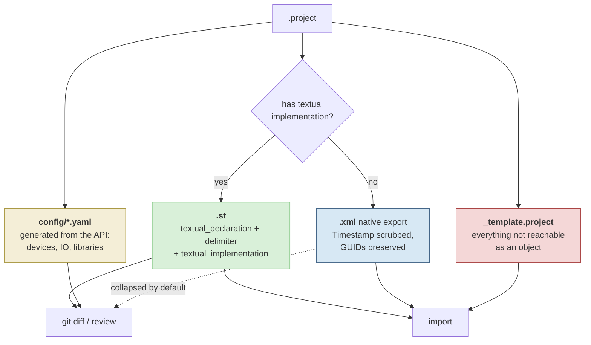

| Artifact | Content | Committed | Diffed | Import source |
|---|---|:--:|:--:|:--:|
| `*.st` | POUs, DUTs, GVL declarations, methods, actions, transitions, **interfaces** | ✅ | ✅ primary | ✅ |
| `*.xml` (native) | Graphical POUs, visualisations, properties, task config, devices | ✅ | ⚠️ collapsed | ✅ |
| `config/*.yaml` | Device parameters, IO mapping, library versions — generated by us | ✅ | ✅ primary | ❌ read-only |
| `_template.project` | Project settings, device packages, fixed devices — see §3.9 | ✅ LFS | ❌ binary | ✅ base |
| `*.plcopen.xml` | Optional interop, off by default | ⚙️ | ❌ | ❌ |

The key insight still holds — **the artifact you read and the artifact you restore from need not be the same file** — but the split is now per object type rather than three parallel trees, which roughly thirds both export time and repo size versus Rev 2.

The honest answer to "can I edit the text and import it back?" is now a precise one, and it gets its own section: **see §3.9.**

### 3.2 A single big XML is useless

A whole-project `export_xml` produces one enormous file with all POUs inside it, where the code is buried in XML wrapping. Line diffs on that file are unreadable.

**Design decision: Versio exports one file per object.** The exporter walks the project tree, and for each leaf object (POU, DUT, GVL, and their child actions/methods/properties) calls `export_xml` with a single-element list into its own file, mirroring the tree as folders. That is what makes `git diff` legible and what makes merge conflicts small and local.

Cost: N script operations. But they happen **inside one CODESYS session** — the project is opened once, then we loop. Startup cost is paid once, not N times.

### 3.3 The export is almost certainly not byte-stable

PLCopenXML carries a `fileHeader` with `creationDateTime`, `contentHeader` with `modificationDateTime`, and object GUIDs. If any of those change per export, **every export produces a diff on every file** and the tool is worse than useless.

**Design decision: a canonicalization stage sits between CODESYS and the repo.** Never write CODESYS's raw output into the repo.

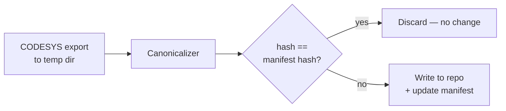

The canonicalizer:
- pins `creationDateTime` / `modificationDateTime` to a fixed sentinel value
- normalizes line endings and indentation
- sorts attributes into a deterministic order
- normalizes self-closing tags and whitespace-only text nodes
- **preserves GUIDs** (they are identity, not noise — but Phase 0 must verify they are stable across exports of an unchanged project; if they are not, they get mapped through a stable GUID table stored in the manifest)

The output hash is then compared to the manifest. **No hash change → no file write → no git noise → no watcher event.** This is both a correctness feature and the first line of loop defence.

### 3.4 Round-trip is not guaranteed lossless

Known issue: property comments may be lost on `import_xml`, and there are documented GUID-validity errors on scripted import. This is **PLCopenXML's** problem specifically — one of the reasons §3.1.5 removes it from the critical path. Native export is documented as lossless, and ST via `textual_*` is lossless by construction, but "documented as lossless" still has to be *measured* before anything depends on it (§3.9.4).

Consequence: the import direction (XML → project) is **strictly more dangerous** than export. Versio's rules:

- Every import operates on a **copy** of the `.project`, in a temp directory. Only on success is it swapped in.
- Before the swap, Versio takes a **timestamped backup** of the original into `.versio/backups/`.
- After import, Versio **re-exports** and diffs the result against the XML that was imported. If they do not match, that is a **round-trip fidelity warning** shown to the user, with the delta. This is the automated regression check that makes the feature trustworthy.
- Import is **never fully automatic on first release**. It is detected automatically and offered, with a diff preview and an explicit confirmation. Auto-import can become an opt-in setting later, once the fidelity check has been quiet for a while in real use.

### 3.5 The IDE holds the project file open

If the engineer has the project open in CODESYS, the file is locked and a second CODESYS instance on the same profile may refuse to start or may attach to the running one.

**Design decision: never touch the engineer's file directly.** The pipeline is:

1. FileSystemWatcher sees the save
2. Copy `.project` to a temp working dir (read-only copy; retry with backoff if sharing-locked)
3. Run headless CODESYS against **the copy**
4. Canonicalize, hash, write XML into the repo
5. Delete the temp copy

The engineer's IDE is never disturbed and never needs to be closed. Import (§3.4) writes to a temp copy too, and the swap-in step is the only moment the real file is touched — that step **requires the project to be closed in the IDE**, which Versio detects (lock probe) and prompts for.

### 3.6 Licensing

The installation contains `CODESYS Scripting 4.2.0.0.zip` under `Licenses`. Phase 0 must confirm whether scripting is fully available on the installed licence tier, and whether an unlicensed run degrades (demo timeout, nag dialog under `--noUI` that hangs the process). **A blocking modal in `--noUI` mode is a hang, not an error** — hence the mandatory timeout + process-tree kill in §7.

### 3.7 Version/profile drift

Opening an SP19 project with an SP22 profile triggers a project-update prompt. Under `--noUI` this may hang or silently upgrade the file. Versio pins a **profile per project** — on the binding in `.versio/repo.json` (§5.1), not on the repo, since two projects in one repo can legitimately target different SPs — and refuses to run if the detected project version and the pinned profile disagree, surfacing an explicit "this project needs profile X, you have Y" message instead of gambling.

> **Measured, Rev 8 — this is harder than it looked, and it is a blocking startup gate.**
>
> **① `--noUI` refuses to run at all without `--profile`.** It exits 1 with
> `When running in --noUI mode, you must specify a profile using --profile="profile name".`
> Profile resolution is therefore a *precondition for Versio doing anything*, not a setting. It belongs in the startup sequence (§7.3) with its own diagnostic screen, and the refusal string is matched explicitly so it becomes an actionable message rather than a bare exit code.
>
> **② The profile name cannot be derived from the install folder.** On this machine the folder is `CODESYS 3.5.22.20` but the profile is **`CODESYS V3.5 SP22 Patch 2`** — `22.20` means SP22 *Patch 2*, not Patch 20. Any attempt to synthesise the string from a version number produces a profile that does not exist. **It must be read from disk**: `…\CODESYS\Profiles\*.profile.xml`. Note the `Informational` subfolder holds historical `*.profile` files for old versions which are **not** usable and must be excluded.
>
> **③ Never guess between several.** With more than one profile installed, Versio asks. Picking the newest automatically risks silently upgrading a project to a service pack it was not written for. A pinned profile that is no longer installed fails loudly and lists what *is* installed, rather than falling back.
>
> Implemented as `Versio.Core.Codesys.ProfileResolver`, 13 unit tests.

### 3.8 CODESYS Git — evaluated and rejected

**Decision (yours, Rev 3): not pursued.** Recorded here so the reasoning survives and nobody re-opens it in six months.

**CODESYS Git** is an official plug-in that turns the IDE into a native Git client. For storage it does what Versio's export pipeline approximates:

> The use of a text format (**JSON**) ensures the readability of the content of the stored files… There is a clear allocation between a CODESYS object within the CODESYS project and the storage location of the object's data within the CODESYS Git project storage.

The repository working directory contains `.git`, a **`project/` subdirectory holding the objects of the CODESYS project**, plus `.gitattributes`, `.gitignore` and `.apsession`. The `.project` file lives *outside* the working copy — the docs call this "double data management". It has its own scripting API:

```python
git.clone(project_basepath, project_file_name, remote_repo_url_or_path, local_repo_path)
project.git.commit_complete("message", "user", "email")
project.git.checkout("branch_name");  project.git.merge("branch_name")
project.git.push();  project.git.pull();  project.git.remote_add("origin", path)
project.git.branch_show_current();  project.git.branch_set_upstream_to()
```
Requires CODESYS ≥ 3.5.19.30, CODESYS Git ≥ 1.6.0.0, and a local git installation.

#### Why it was rejected

| Constraint | Consequence for Versio |
|---|---|
| **"Editing of the stored files outside CODESYS Git should be avoided"** | Kills the entire bi-directional story. Versio could only ever *drive* the plug-in, never let you edit a file in VS Code and import it back. |
| **One Git repository can manage only one CODESYS project** | No multi-project repos, ever. |
| **"Double data management"** — the `.project` lives outside the working copy | Two locations to keep straight; the repo is not self-contained. |
| **Licensed** (CODESYS Store / Professional Developer Edition) | Every seat needs it. Versio would be an accessory to a paid plug-in rather than a standalone tool. |
| Functions live inside the IDE | The workflow stays trapped in CODESYS — the opposite of what Versio is for. |

The trade was: give up editing-outside-the-IDE and pay per seat, in exchange for the vendor owning the serialization risk. **The restriction is too tight for the product we want** — the whole point is to work with these projects the way you work with any other code.

Two things are still worth taking from it, and cost nothing: it **proves a full CODESYS project can be represented as per-object text files**, which is the core premise of this plan; and its scripting interface (`git.clone`, `project.git.commit_complete`, `checkout`, `merge`, `push`, `pull`) is available as an escape hatch if we ever need in-IDE git.

### 3.9 What "truly lossless" means — the contract

You asked for the conversion to be truly lossless. That is the right bar, but the word has to be pinned down, because there is a definition of it that is **impossible**, one that is **achievable and worth building**, and only one way to know which one you have: **measure it, continuously.**

#### 3.9.1 Three definitions, only one of which is real

| # | Definition | Achievable? | Why |
|---|---|:--:|---|
| L1 | `.project` → text → `.project` produces a **byte-identical** project file | ❌ **No** | The `.project` is a binary compound document holding save timestamps, compile caches, GUID allocation order and internal stream layout. Two saves of an *untouched* project are already not byte-identical. This is not a goal, it is a category error. |
| L2 | The reconstructed project is **semantically identical**: same objects, same names, same GUIDs, same declarations, same implementations, same device parameters, same task config, same library refs — compiles to the same code and downloads the same binary | ✅ **Yes** | This is what "lossless" must mean, and what we build and verify. |
| L3 | The text alone, with **no `.project` at all**, reconstitutes the project from empty | ⚠️ **Partially** | Some state is not reachable through the scripting object model, and some depends on the machine (installed device descriptions, library repository). See §3.9.3. |

**Versio targets L2, and closes the gap to L3 with a committed template project.**

#### 3.9.2 The template + delta model

This is codescribe's architecture and it is the correct one. Their README states it plainly: the export is "the implementation logic of the project, not a complete copy", and an empty-but-configured project file should also be committed.

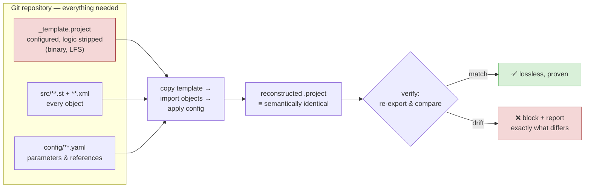

The template is a real `.project`, committed and versioned, regenerated when project-level configuration changes. It carries what the object model cannot hand us: project settings, installed device packages, and **fixed devices that cannot be removed or recreated** — codescribe hit exactly this with `Local_IO` and `HMI` on IFM hardware.

**The system is lossless. The text files alone are not.** That distinction has to be visible in the UI, not buried in documentation.

#### 3.9.3 Limits we will hit — stated up front

These are not risks to be mitigated away. They are properties of the platform, and the plan is honest about them:

| Limit | Nature | Versio's answer |
|---|---|---|
| **Machine-external dependencies** — device descriptions, library repository, compiler version | Not in the `.project` at all; it holds *references* | `config/environment.yaml` records required device packages and library versions; Versio verifies them on import and fails loudly with a list |
| **Fixed devices** cannot be removed or recreated | Device-package-imposed | Carried by the template; detected and skipped with an explicit message, never silently |
| **`import_native` pastes as a child, never replaces** | API behaviour | Custom `NativeImportHandler` returning `NativeImportResolve.replace` (Phase 0.17). If that fails, fall back to codescribe's remove-and-recreate |
| **Graphical layout** (CFC element positions, LD/FBD geometry) | Only in native XML, never in ST | Those objects export as native XML, not `.st` — layout survives, at the cost of a less readable diff. **A graphical POU is never exported as ST.** |
| **Compile artifacts, boot applications, online change data** | Regenerated by CODESYS | Deliberately not tracked. Not loss. |
| **Object GUIDs must be preserved** | Identity; rewriting them broke visualisations for codescribe | Never rewritten. Only `Timestamp` is scrubbed (§3.1.4 ②) |
| **User management, project encryption/signing** | Outside the object model | Template only. **Versio will refuse to manage encrypted or signed projects in v1** rather than silently degrade them |
| **CODESYS version drift** | Project format evolves per SP | Profile pinned per repo (§3.7); the verification harness is re-run per supported SP |
| **Unmapped object type GUIDs** | New CODESYS versions add types | Native-export fallback + a loud `UNKNOWN type GUID` warning in `_coverage.md`, never a silent drop (codescribe hit this with an LD nested in a CFC) |

#### 3.9.4 Losslessness is a test, not a claim

The only defensible way to assert L2 is to **prove it on every run**. Three mechanisms, all built in from Phase 0:

1. **Round-trip equivalence check (per sync).** After any import: re-export the result, canonicalize, compare to what was imported. Any delta blocks the swap-in and is shown to the user. This is the runtime guarantee — described in §3.4 and now the primary safety mechanism.
2. **Project equivalence oracle (per build).** A comparer over the *object model* rather than the file: walk both projects, compare object tree, GUIDs, types, declaration text, implementation text, device parameters, task config, library refs. Produces a structured difference report, not a boolean. This is the thing that tells you *what* was lost, which is what makes a failure actionable.
3. **Corpus regression suite (CI).** A set of real `.project` fixtures — small synthetic ones plus at least one full machine project — each of which must survive export → import → export with an empty diff, on every supported CODESYS SP. **When a case fails, it becomes a fixture.** This is how the coverage gaps of §3.9.3 get found rather than discovered by a user.

### 3.10 Diff coverage ≠ import coverage — and diff can be complete

A key asymmetry, and the answer to "can we get a truly complete diff even where import is partial?"

**Yes. Reading is a fundamentally easier problem than writing, and the two coverages should be tracked separately.**

- **Reading is complete by construction.** `export_native` works on *any* node in the object tree, and the object tree *is* the project — including `ProjectInformation` (`085afe48-…`) and `ProjectSettings` (`8753fe6f-…`), which are ordinary objects with GUIDs like everything else. Anything CODESYS shows you in the tree can be serialized, therefore hashed, therefore diffed. On top of that we generate readable YAML for the things whose native XML is unpleasant to read.
- **Writing is where the platform pushes back**: fixed devices can't be removed, `import_native` pastes rather than replaces, some objects can't be created from script, project-level settings aren't writable through the object model.

So the honest per-type picture is a **two-column** one, and it belongs in the UI, not just here:

> **Measured, Rev 8 — the type table is incomplete by nature, so treat unknowns as routine.**
> Probing a **25-object toy project** turned up two GUIDs missing from codescribe's table: `40b404f9-…` (**Plc Logic**) and `639b491f-…` (**Application**). If a project that small finds two, a real machine project will find more. Three consequences:
> - `UNKNOWN_TYPE_GUID` is an **expected event, not an edge case**. It gets a prominent line in `_coverage.md` and a badge in the Sync panel — not just a log entry.
> - **An unknown node that has children keeps its subtree shape** (`NativeWithChildren`). Both discovered types are structural; treating an unknown container as a plain leaf flattens its children into the parent folder and quietly destroys the tree.
> - **Never locate structural nodes by name.** codescribe uses `find("Application")`, which breaks the moment a project renames that node. Versio matches on type GUID.

| Tier | Types | Diffable | Importable | UI treatment |
|---|---|:--:|:--:|---|
| **1** | POUs, DUTs, GVLs, interfaces, methods, actions, transitions | ✅ full, as `.st` | ✅ | normal — edit anywhere |
| **2** | Graphical POUs (CFC/LD/FBD), visualisations, properties, task config, removable devices | ✅ native XML + generated YAML | ✅ with round-trip verification | normal, with a "verify on import" badge |
| **3** | **Fixed devices, project settings, project information, library manager, symbol config, user management** | ✅ **yes — fully diffable** | ❌ template-only | **read-only node**: 🔒 "diff only — change this in CODESYS" |
| **4** | Compile artifacts, boot applications, online-change data | ❌ deliberately excluded | ❌ | not shown; not loss |

**Tier 3 is the direct answer to "or partially?"** — those objects are visible in the diff, tracked in git, and reviewable in a pull request; they simply cannot be *written back* from text. Versio marks them with a lock glyph in the project tree and refuses to accept edits to them rather than importing something that will silently fail. A change to a Tier-3 object is made in CODESYS, and Versio then shows it in the diff like anything else.

This also means **Phase 2 (export only) is a genuinely complete product**: a full, structured, reviewable history of everything that changes in the project. Import is an enhancement on top, not a prerequisite for the tool being useful — which is why the phasing puts it last.

The corpus is the single most valuable asset this project will build, and it should start accumulating in Phase 0, before any C# is written.

---

## 4. System architecture

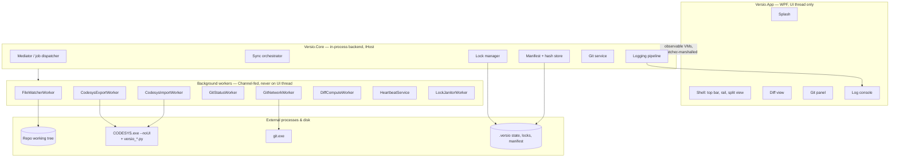

### Why "backend" is in-process, not a separate service

You asked for a front end and a backend. The clean way to get that separation **without** paying for IPC is:

- `Versio.Core` is a class library with **no reference to any UI type**. It is driven entirely through interfaces and message/event contracts. It could be hosted by a console app or a test harness tomorrow with zero changes.
- The desktop app hosts it via `Microsoft.Extensions.Hosting` — the same `IHostedService` model an ASP.NET backend uses.
- The genuinely out-of-process parts (`CODESYS.exe`, `git.exe`) are already separate processes with a hard boundary.

If a headless CI mode is wanted later (export-on-commit on a build server), `Versio.Cli` becomes a thin `Program.cs` over the same core. That is the payoff for the discipline of keeping Core UI-free — **enforced by an architecture test that fails the build if `Versio.Core` ever references `PresentationFramework`.**

---

## 5. Repository layout on disk

```
<repo-root>/
├─ .git/
├─ .gitattributes                 # *.project filter=lfs  -diff  -merge
├─ .gitignore                     # .versio/local/**
├─ plc/
│  ├─ MyMachine.project              # working copy — LFS, NOT the source of truth
│  ├─ MyMachine_template.project     # ← the template (§3.9.2), LFS, committed
│  └─ MyMachine/                     # ← the export tree, committed
│     ├─ _manifest.json              # object → path, GUID, type, canonical hash
│     ├─ _coverage.md                # generated: exported / skipped / UNKNOWN types
│     │
│     ├─ Device/                     # one folder per device entrypoint
│     │  ├─ application/
│     │  │  ├─ POUs/                 # folders mirror the CODESYS tree
│     │  │  │  ├─ Main.st            #   textual POU: decl + delimiter + impl
│     │  │  │  ├─ Main.Startup.action.st
│     │  │  │  ├─ Main.Cycle.action.st
│     │  │  │  ├─ Conveyor_FB.st
│     │  │  │  ├─ Conveyor_FB.Execute.st        # method
│     │  │  │  ├─ Conveyor_FB.Speed.xml         # property — native, recursive
│     │  │  │  └─ Interlocks.xml                # graphical (CFC/LD) — native
│     │  │  ├─ DUTs/E_State.st
│     │  │  ├─ GVLs/GVL_IO.gvl.st + GVL_IO.gvl.xml   # both, see §3.1.4 ③
│     │  │  ├─ Visu/HomeScreen.vis.xml
│     │  │  └─ Task_Configuration.xml
│     │  ├─ communication/<TopLevelDevice>/<child>.xml
│     │  └─ devices/EtherCAT_Master.xml          # device-tree siblings
│     │
│     └─ config/                     # generated by Versio from the scripting API
│        ├─ devices.yaml             #   device tree + parameters (readable diff)
│        ├─ io-mapping.yaml          #   channel → variable mapping
│        ├─ libraries.yaml           #   library refs, versions, placeholders
│        └─ environment.yaml         #   required device packages, compiler version
└─ .versio/
   ├─ repo.json                   # committed: THE BINDINGS (§5.1) + profile pins
   └─ local/                      # gitignored — machine-specific
      ├─ state.json               # per-binding direction locks, session id, baselines
      ├─ sync.lock                # OS-level lease file
      ├─ backups/                 # pre-import .project backups
      └─ logs/versio-*.log        # rolling Serilog files
```

The split is deliberate:

- **`_manifest.json` and `repo.json` are committed** — they are the shared, reproducible mapping and hash baseline. Anyone who clones gets a correct baseline immediately and does not trigger a spurious full re-export.
- **`.versio/local/` is gitignored** — locks, session state, logs and backups are machine-specific and must never travel through git. A lock that got committed and pulled onto a colleague's machine would be a bug factory.

`.gitattributes` marks `*.project` as LFS with `-diff -merge`, so git never attempts to text-diff or auto-merge the binary. Versio writes this file on repo initialization and warns if it is missing or has been edited away.

### 5.1 How the project ↔ export-directory relationship is stored

codescribe derives the export folder purely by convention — `dirname(project) + "/" + basename_without_extension`. That is a fine default and Versio keeps it as the default, **but convention alone is not a durable relationship**: rename the `.project` and the link silently breaks, leaving an orphan on both sides with nothing recording that they were ever related.

**So the binding is stored explicitly, in `.versio/repo.json` (committed), keyed by a stable id — not by path.**

```jsonc
{
  "schema": 1,
  "bindings": [
    {
      "id": "b-9f2c4a17",                          // generated once, NEVER changes
      "project":  "plc/MyMachine.project",
      "template": "plc/MyMachine_template.project",
      "export":   "plc/MyMachine",                 // default = convention; overridable
      "profile":  "CODESYS V3.5 SP22 Patch 20",    // per-project pin (§3.7)
      "enabled":  true
    },
    {
      "id": "b-3e88d051",
      "project":  "plc/PackagingLine.project",
      "template": "plc/PackagingLine_template.project",
      "export":   "plc/PackagingLine",
      "profile":  "CODESYS V3.5 SP22 Patch 20",
      "enabled":  true
    }
  ],
  "ignore": ["samples/**", "archive/**"]           // never offer to track these
}
```

**The `id` is the identity; the paths are attributes.** Renaming a project becomes a path update against a persistent identity, so history, baseline and lock state survive a rename intact.

**And the binding is recorded from both ends.** The export tree's `_manifest.json` carries a back-reference:

```jsonc
{ "schema": 1, "bindingId": "b-9f2c4a17", "project": "plc/MyMachine.project", "objects": [ … ] }
```

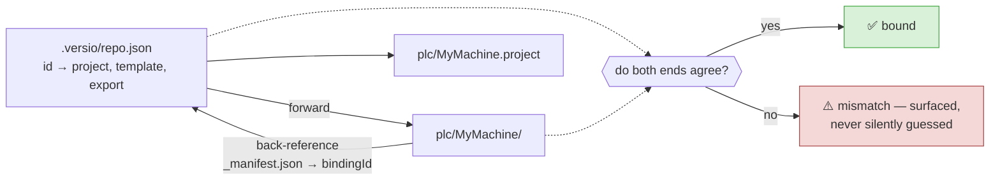

A two-way handshake means a disagreement is **detectable** rather than something the tool papers over by guessing. If `repo.json` says one thing and the manifest says another, Versio stops and asks; it never exports into a directory whose manifest claims a different project.

### 5.2 Multiple projects at the same level

Fully supported — `bindings` is a list, and the sibling-folder convention scales naturally because each export folder is named after its project:

```
plc/
├─ MyMachine.project          ├─ MyMachine/          ← bound: b-9f2c4a17
├─ MyMachine_template.project │
├─ PackagingLine.project      ├─ PackagingLine/      ← bound: b-3e88d051
└─ PackagingLine_template.project
```

Consequences that have to be designed for, not discovered:

| Concern | Design |
|---|---|
| **Locks become per-binding** | `.versio/local/state.json` holds a **map of `bindingId → LockRecord`**, not a single record. Project A can be `ProjectAuthoritative` while B is `Clean`. §6's state machine is unchanged; it is simply instantiated per binding |
| **Push/discard release** | Push is repo-wide, so a successful push releases **every** binding whose baseline it advanced — not just the active one |
| **CODESYS is still machine-serialised** | One CODESYS process at a time (§7.1). Saving two projects means two queued exports, each paying cold start. **N projects = N × export time**, which is a real argument for `On git action` sync mode (§7.4.6) on multi-project repos |
| **The commit gate** | Checks **all enabled bindings**, not just the one you were last looking at. Committing with project B stale is exactly the failure the gate exists to prevent |
| **UI** | The project tree gets a root node per binding when more than one exists; the top bar gains a project selector alongside the branch selector |
| **Per-project profile pins** | Two projects in one repo can legitimately target different CODESYS SPs, so `profile` lives on the binding, not the repo |

### 5.3 Orphan detection — yes, and there are four kinds

**Yes, an untracked `.project` with no partner directory is detected.** This was missing from Rev 6 and is a real gap: without it, someone adds a project, nothing happens, and they conclude the tool is broken.

On repo open, on every tier-3 rescan (§7.4.2), and after any pull or branch switch, Versio globs `**/*.project`, applies the `ignore` list, and classifies everything:

| State | Meaning | Versio's response |
|---|---|---|
| **Bound** | Binding exists; project and export both present; manifest back-reference agrees | Normal operation |
| **Orphaned project** | A `.project` with no binding | **Surfaces a "Track this project?" prompt** → creates a binding, generates a template, runs the first full export. One click |
| **Orphaned export** | An export tree with no matching project | Project was deleted, moved or renamed. **Never auto-delete the export** — it is committed history. Offer: re-link to an existing project, or archive the binding |
| **Broken binding** | `repo.json` references a path that no longer exists | Reported explicitly with the missing path; sync for that binding is halted, not silently skipped |
| **Renamed** | One orphaned project + one orphaned export in the same scan | **Propose the re-link.** The strongest signal is free: `git status` already reports `R plc/A.project -> plc/B.project` for a tracked rename. Confirm, then update the binding's `project` path — id, history, baseline and lock all survive |

Three details that matter:

1. **Template files must never be detected as trackable projects.** `MyMachine_template.project` is a `.project` file, and a naive glob would offer to track it — creating a binding that exports the template into its own tree, which is nonsense that would be genuinely confusing to unpick. The scanner excludes any path referenced as a `template` by an existing binding, **plus** the `*_template.project` naming convention as a belt-and-braces rule for templates that have no binding yet.

2. **Detect always; adopt on confirmation, not silently.** The user's instinct here is right — the tool should notice and offer. But *auto-exporting* an unknown project on sight is the wrong default: it launches CODESYS for 10–60 s unprompted, and the project may be a vendor sample, an archived copy, or a scratch experiment that nobody wants tracked. So: **always detect, prompt by default**, with `autoAdoptNewProjects: true` available as a setting for anyone who wants it, and the `ignore` list for things that should never be asked about again.

3. **Case sensitivity is a trap.** Windows paths are case-insensitive; git is case-sensitive. `MyMachine/` and `mymachine/` are one directory locally and two entries in the index. Binding paths are stored exactly as git records them, and comparisons are ordinal — with a startup check that flags any binding whose on-disk casing differs from the committed path.

---

## 6. The sync engine and the lock model

This is the heart of the request: *bi-directional, with per-session locks that prevent loops, survive app close and reboot, and clear on push or discard.*

### 6.1 Three independent loop defences

Layering matters — any one of these can fail without causing a runaway.

| # | Defence | Mechanism | Stops |
|---|---|---|---|
| 1 | **Content hash gate** | Nothing is acted on unless the canonical hash differs from the manifest baseline | Our own writes; no-op saves; touch-only mtime changes |
| 2 | **Self-write suppression** | Before writing, register `(path, expectedHash)` in a short-TTL set; matching watcher events are swallowed | Watcher echo of our own file writes |
| 3 | **Direction lock** | A persisted state machine that makes one direction authoritative and blocks the other | A genuine A→B→A oscillation, and concurrent contradictory edits |

Defence 1 is the strongest because it is **stateless and derived from content** — it works correctly even after a crash, a reboot, or a manual file copy, with no memory of what happened before.

### 6.2 The direction lock state machine

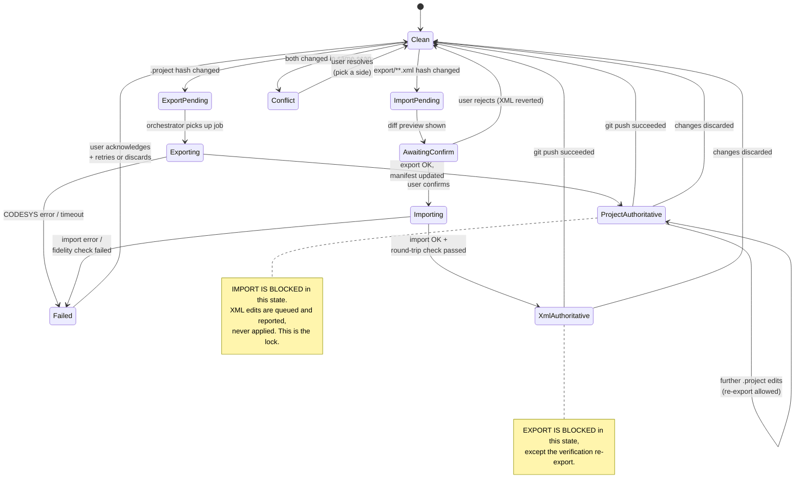

**The rule in one sentence:** once a direction has been taken, the opposite direction is refused until the working tree returns to a clean, pushed state.

### 6.3 The lock record

`.versio/local/state.json`:

**Locks are per binding (§5.2), so the file holds a map keyed by `bindingId`** — project A can be authoritative while B is clean:

```jsonc
{
  "schema": 2,
  "repoPath": "C:\\VERSIO\\machine-a",
  "owner": {                             // one owner per app session, shared by all bindings
    "machine": "DESKTOP-ABC",
    "user": "elli_",
    "sessionId": "a1f2...",              // new GUID per app launch
    "pid": 21884,
    "bootId": "2026-08-11T06:03:11Z",    // machine boot time — detects reboot
    "renewedUtc": "2026-08-11T14:41:12Z" // lease
  },
  "bindings": {
    "b-9f2c4a17": {
      "direction": "ProjectAuthoritative",  // Clean|ProjectAuthoritative|XmlAuthoritative|Conflict|Failed
      "acquiredUtc": "2026-08-11T14:22:07Z",
      "reason": "Saved plc/MyMachine.project",
      "baseline": { "headCommit": "9291d00…", "projectHash": "sha256:…", "manifestHash": "sha256:…" }
    },
    "b-3e88d051": { "direction": "Clean", "baseline": { "headCommit": "9291d00…", … } }
  }
}
```

### 6.4 Survival across app close and reboot

The lock is a **file**, so it survives by construction. The subtlety is telling a *live* lock from an *abandoned* one:

- On startup Versio reads `state.json` and compares `owner.bootId` to the current machine boot time.
  - **Different bootId** → the machine rebooted. The owning process is definitively gone.
  - **Same bootId, same machine, pid not alive** → the app crashed or was killed.
  - **Same bootId, pid alive and is a Versio process** → another Versio instance owns this repo. Refuse to take it; open read-only and say so.
- Crucially, **an abandoned lock is not auto-cleared.** The lock exists because there is *unsynced work*, and that work is still unsynced after a reboot. Versio re-validates by recomputing hashes:
  - hashes still differ from baseline → **re-adopt the lock** under the new session, log it prominently
  - hashes now match baseline (someone reverted externally) → release the lock, return to `Clean`
- `renewedUtc` is a **lease**, updated every 30 s while running. It is used only for UI ("held by a session last seen 3 days ago"), never for automatic expiry.

### 6.5 Release conditions

| Trigger | Effect |
|---|---|
| `git push` succeeds and working tree is clean | Release → `Clean`, baseline = new HEAD |
| User discards changes (`git restore` / `git checkout --`) | Release → `Clean`, baseline = HEAD |
| User explicitly clicks *Force release* | Release, with a confirmation dialog and a loud log entry |
| Commit **without** push | **No release** — the mirror is committed but not shared; the direction stays owned |

That last row is a judgement call worth confirming with you: your description says "removed until the user either pushes or discards". I have implemented it literally (push, not commit) because until the work is pushed, no one else can see it and the direction is still meaningfully "yours". See [§16](#16-open-questions-for-you).

### 6.6 End-to-end sequences

**Export: engineer saves in CODESYS**

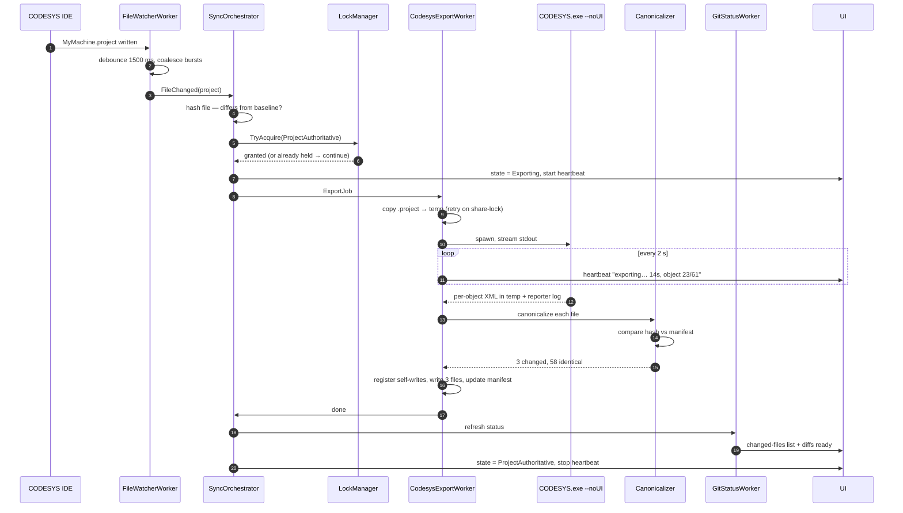

Note steps 15–17: **58 of 61 files are not written at all.** That is the hash gate doing its job — the watcher never fires for them, git never sees them, and the diff stays honest.

**Import: engineer edits the XML**

```mermaid
sequenceDiagram
    autonumber
    participant ED as Editor / merge
    participant FW as FileWatcherWorker
    participant OR as SyncOrchestrator
    participant LK as LockManager
    participant UI as UI
    participant IM as CodesysImportWorker
    participant CD as CODESYS.exe --noUI

    ED->>FW: plc/export/.../Main.POU.xml written
    FW->>OR: FileChanged(xml)
    OR->>OR: self-write suppression set? → no
    OR->>OR: hash differs from manifest? → yes
    OR->>LK: current direction?
    alt ProjectAuthoritative (lock held)
        LK-->>OR: BLOCKED
        OR->>UI: warn "XML edit ignored — project is authoritative.<br/>Push or discard to release."
    else Clean
        LK-->>OR: granted (XmlAuthoritative)
        OR->>UI: show diff preview + confirm
        UI-->>OR: user confirms
        OR->>IM: ImportJob
        IM->>IM: is .project open in IDE? → prompt to close
        IM->>IM: backup .project → .versio/local/backups/
        IM->>IM: copy .project → temp
        IM->>CD: spawn, import_xml(Replace) into temp copy
        CD-->>IM: added/replaced/skipped report
        IM->>CD: re-export temp copy (fidelity check)
        IM->>IM: canonicalize, diff vs imported XML
        alt identical
            IM->>IM: swap temp → real .project
            IM->>OR: OK
        else drift detected
            IM->>UI: FIDELITY WARNING + delta; do not swap without consent
        end
        OR->>UI: state = XmlAuthoritative
    end
```

Step 17 — **re-export and compare** — is what turns a risky feature into a defensible one. It is not optional.

---

## 7. Workers, threading and the UI-freeze budget

**Rule zero: the UI thread does layout and input. Nothing else.** No file IO, no hashing, no `Process.WaitForExit`, no git call, no XML parse — not even "small" ones, because "small" becomes 4,000 files on someone's repo.

### 7.1 Worker inventory

| # | Worker | Kind | Cardinality | Cancellable | Notes |
|---|---|---|---|---|---|
| 1 | `FileWatcherWorker` | Event → settle | 1 per watched root | n/a | `FileSystemWatcher` on the `.project` and the export tree. Buffer 64 KB, `NotifyFilter = LastWrite \| FileName \| Size`. Settle detection and coalescing per **§7.4**. Handles the `Error` event (buffer overflow) by triggering a full rescan. |
| 1b | `SafetyPollWorker` | Timer | 1 | n/a | Tier-2 detection (§7.4.2): `stat` the tracked files every **30 s** and compare to last known. Cheap insurance against dropped watcher events. |
| 2 | `SyncOrchestrator` | Single-consumer loop | **exactly 1** | yes | Reads `Channel<SyncJob>`. Serialises everything. Owns the state machine. |
| 3 | `CodesysExportWorker` | Process host | 1 at a time, **machine-wide** | yes | Guarded by a named `Mutex` (`Global\Versio.Codesys`) so two Versio windows can't launch competing CODESYS instances. |
| 4 | `CodesysImportWorker` | Process host | shares mutex with #3 | yes | Same guard. |
| 5 | `GitStatusWorker` | Debounced refresh | 1 | yes | LibGit2Sharp status + branch list. Triggered by watcher, by sync completion, and on a 5 s idle timer. Coalesces overlapping requests, dropping stale ones. |
| 6 | `GitNetworkWorker` | Long-running | 1 per operation | yes | `git.exe` for fetch/pull/push/clone. Parses progress from stderr. |
| 7 | `DiffComputeWorker` | On-demand | 1, latest-wins | yes | Computes diff for the selected file. Cancels the previous computation when selection changes — essential for arrow-key scrolling through a file list. |
| 8 | `HeartbeatService` | Timer | 1 | n/a | Any operation registered as long-running emits `"<op> still running — 12s"` every 2 s, with progress detail when available. |
| 9 | `LockJanitorWorker` | Timer | 1 | n/a | Renews the lease every 30 s; re-validates lock ownership; detects external state.json edits. |
| 10 | `LogPumpWorker` | Batching timer | 1 | n/a | Batches log events to the UI every 100 ms. Without this, a chatty export floods the dispatcher and freezes the window — the logger becomes the thing that breaks the UI it was meant to observe. |
| 11 | `HashScanWorker` | Parallel IO | 1, bounded parallelism 4 | yes | Full-tree canonical hash rescan on startup and on watcher-overflow. |

### 7.2 The concurrency contract

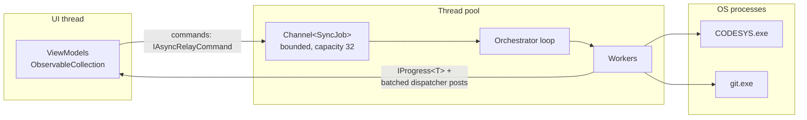

Non-negotiables:

1. **`Channel<T>` for every queue.** No `lock` + `Queue<T>`, no `Task.Run` fire-and-forget with no handle.
2. **`CancellationToken` threaded through every public async method** in `Versio.Core`. No exceptions.
3. **`IAsyncRelayCommand` (CommunityToolkit.Mvvm)** for every UI command, with `CanExecute` disabling the button while running. A button that can be double-clicked into two concurrent CODESYS launches is a defect.
4. **Bounded channels with `BoundedChannelFullMode.DropOldest`** for watcher events — a rebuild that touches 5,000 files must not queue 5,000 jobs.
5. **`ConfigureAwait(false)` everywhere in Core**; marshalling to the UI happens only at the ViewModel boundary.
6. **Process handling:** every `Process` gets a hard timeout (export: 10 min default, configurable), async stdout/stderr readers (never `WaitForExit` before draining the pipes — that's a classic deadlock), and **kill of the entire process tree** on timeout or cancel. A `--noUI` CODESYS sitting on a hidden modal dialog will hang forever otherwise.
7. **Reentrancy guard on the orchestrator**: it is a single consumer by construction, so no state-machine transition can interleave.

### 7.3 Startup sequence (why there is a splash)

The splash is not decoration — there is real work before the shell can be honest about what it shows:

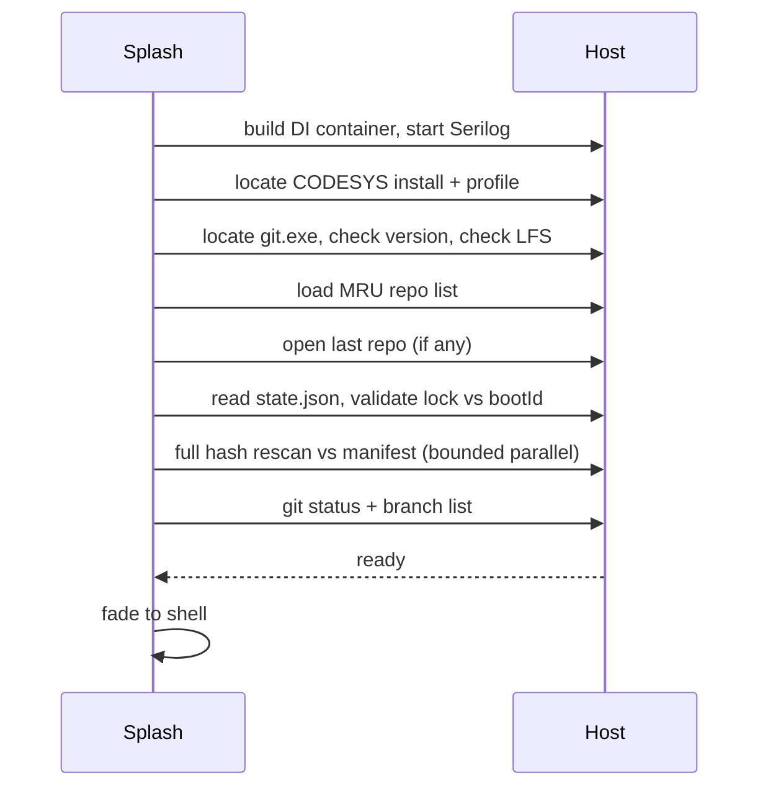

Every step above writes a log line with a duration. If startup is slow, the log says exactly which step.

### 7.4 Change detection — cadence, coalescing, and why a missed event cannot hurt you

Rev 2 said "FileSystemWatcher, debounce 1500 ms" and left it there. That is not enough of an answer, so this section specifies it properly.

#### 7.4.1 The thing that makes this tractable: CODESYS writes on Save

Typing in the CODESYS editor does not touch the `.project` file at all. **The file changes only when the engineer saves** — and a save rewrites the whole file at once. So the event stream is *discrete and sparse*: typically a save every few minutes, sometimes a burst of three in ten seconds (save, save-before-compile, save-before-download), never a continuous stream.

That reframes your concern. The risk is not "changes arriving faster than we can read them". It is **a save arriving while a 40-second export is already running**, which is a queueing problem, not a sampling problem.

#### 7.4.2 Three-tier detection

Not one mechanism, three — because each covers the others' failure mode:

| Tier | Mechanism | Latency | Purpose |
|---|---|---|---|
| **1. Watcher** | `FileSystemWatcher`, always on, push-based | ~instant | The normal path. **Not polling** — nothing is "checked every N seconds" in the happy case |
| **2. Safety-net poll** | `stat` (size + mtime) every **30 s**, compared to last known | ≤30 s | Catches anything tier 1 dropped: watcher buffer overflow, network/OneDrive paths, antivirus interference, suspend/resume |
| **3. Full rescan** | Canonical hash of the whole tree | on demand | On app start, on window focus regained, after pull/checkout/branch switch, and **before every commit** |

`FileSystemWatcher` genuinely does lose events — its internal buffer overflows under bursts and it raises `Error`, at which point the events are simply gone. Versio handles that event explicitly by triggering a tier-3 rescan. Tier 2 exists because that is not the only way it fails.

#### 7.4.3 Settle detection, not a fixed debounce

A fixed debounce is a guess. A save may produce several events (temp file, rename, attribute change), and the file may still be locked when the last one arrives. So:

1. On first event, start a **quiet timer of 750 ms**; any further event resets it.
2. When quiet, probe: is `(size, mtime)` unchanged since the last probe **and** can the file be opened for read?
3. If not, back off (250 ms → 500 ms → 1 s, capped) and retry, up to 30 s.
4. Only then is the change considered *settled* and a job created.

This is strictly better than a longer debounce: fast when the write is fast, patient when it isn't.

#### 7.4.4 Coalescing — why N saves never mean N exports

The critical rule: **the queue holds at most one pending job, not a list.**

Because an export always reads the *current* file, five saves during a running export do not need five exports. They need **one** export after the last of them. So the pending slot is a flag, not a queue — later requests overwrite it and are logged as coalesced.

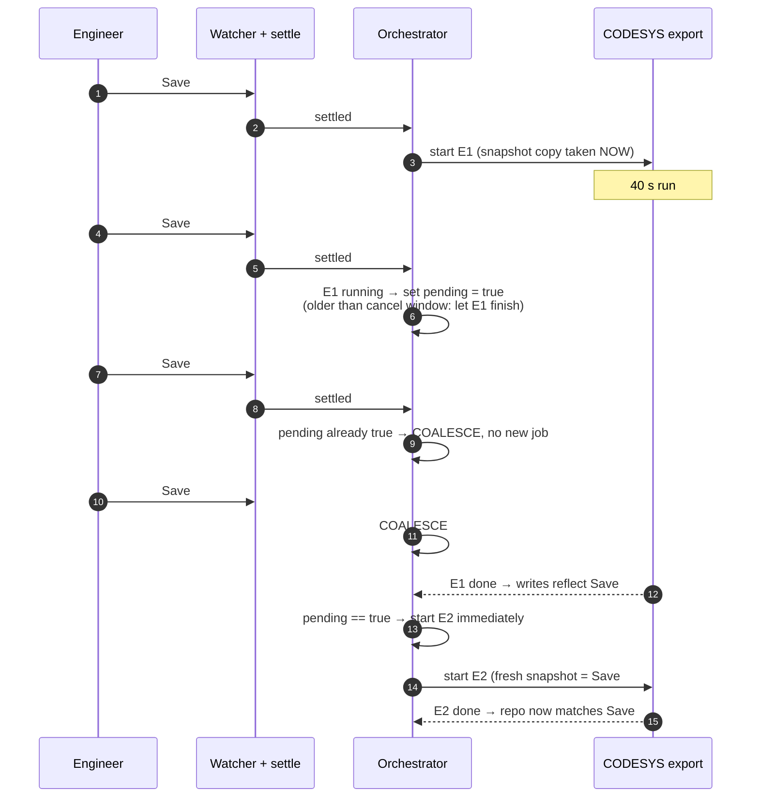

Four saves, two exports, correct final state. The intermediate states were never separately committed and nobody wanted them.

Three refinements that make this behave well under abuse:

- **Cancel window.** If a new save arrives within the first **5 s** of a running export, cancel and restart instead of queueing — restarting is cheap that early, and it avoids doing 40 s of work you already know is stale. After 5 s, let it finish and queue.
- **Minimum export interval (30 s).** If saves keep arriving, exports start no more often than every 30 s. Prevents a save-happy engineer from pinning a CODESYS process permanently. A final export always runs after quiescence, so the end state is still correct.
- **Snapshot-on-start.** The `.project` is copied to temp at job start (§3.5). E1 therefore exports a *consistent* snapshot even though the file changes underneath it — no torn reads, ever.

#### 7.4.5 The commit gate — what makes missed detection a non-issue

Even with three detection tiers, the honest answer is that detection can lag or drop. So the plan does not rely on it for correctness:

> **You cannot commit while the export is known-stale.** Before any commit, Versio runs a tier-3 rescan; if the project hash differs from the manifest baseline, it runs a **synchronous, blocking export** with a progress dialog, and only then lets the commit proceed.

This converts detection latency from a **correctness** problem into a **UX** problem. The worst case of a completely broken watcher is "the diff appears when I commit instead of when I save" — annoying, never wrong. The same gate runs before push and before a branch switch.

#### 7.4.6 What the user sees

Automatic background work must never be mysterious. The status bar always shows one of:

`● Watching` · `● Change detected — settling…` · `● Exporting… 14s (23/61)` · `● Exporting… 14s · 2 saves queued` · `● Up to date · 7 changed` · `⚠ Export failed — click for log`

Plus a **Sync mode** setting, because one policy will not suit everyone:

| Mode | Behaviour |
|---|---|
| **On git action** — **DEFAULT (measured, Rev 8)** | Export only at the commit/push gate. No background CODESYS launches at all |
| **Automatic** | Export after every settled save. Opt-in |
| **Manual** | Export button only; the gate is still enforced |

> **Changed by measurement.** Phase 0.7 measured cold start on a real project at **31.5 s first run, 17.6 s warm** — every export pays it, and this is a *small* project (25 objects). Automatic-on-save would mean a CODESYS process spinning up every few minutes all day, for changes nobody looks at until commit time.
>
> **So `On git action` is the default and `Automatic` is opt-in** — the reverse of Rev 7. This makes the commit gate (§7.4.5) the *primary* path rather than a safety net, which raises its UI bar: it needs a real progress dialog, a cancel, and a clear reason it is running. It also means the changed-files view is legitimately empty between commits, and the status bar must say **"3 saves not yet exported"** rather than implying everything is in sync.

---

## 8. Git layer

### 8.1 Hybrid strategy — deliberate

> **Revised in Rev 9, during implementation: `git.exe` for everything. LibGit2Sharp is not used.**
> The hybrid below was the original design. Building it, three things argued against the split:
> 1. **It removes R19 outright.** LibGit2Sharp carries native `git2-*.dll` binaries, which are the documented way `PublishSingleFile` breaks. A pure-CLI client has no native payload.
> 2. **`git.exe` is already a hard dependency** — PortableGit is vendored for credentials, LFS and network operations regardless. The CLI costs nothing extra; LibGit2Sharp adds a second thing to keep in step with it.
> 3. **Porcelain v2 is a stable machine format**, guaranteed across versions. Parsing it is bounded and testable, and is now covered by unit tests over real output shapes plus integration tests against real `git.exe` — more verification than the library path would have had.
>
> Cost: a process spawn per status refresh (~20–50 ms), irrelevant beside a 17–31 s export, and the refresh is debounced. `IGitClient` is the seam if that ever changes.

| Concern | Implementation | Why |
|---|---|---|
| status, branches, log, diff, stage, commit, stash, checkout | ~~LibGit2Sharp~~ → **`git.exe` + porcelain v2** | One code path, no native binaries, machine-stable format |
| **fetch / pull / push / clone** | **`git.exe` subprocess** | Credentials. Git Credential Manager, SSH agents, 2FA, corporate proxies and enterprise SSO all work out of the box with the real client |
| Git LFS | **`git.exe`** | LibGit2Sharp has no LFS support at all |

Two implementation details that cost real debugging time and are now pinned by tests:

- **`-z` is mandatory for status.** Without it git quotes and escapes paths containing spaces or non-ASCII, and CODESYS object names routinely contain both — `Device/Plc Logic/Application/Kühlschrank Regelung.st` is an ordinary path here.
- **`StandardOutputEncoding` must be UTF-8.** .NET otherwise decodes using the console codepage (CP1252 on a typical Windows box) and mangles exactly those paths. This is the same class of bug as the UTF-8 BOM that broke IronPython's `json.load`: an encoding assumption at a process boundary.
- **`GIT_TERMINAL_PROMPT=0`**, or an auth failure blocks forever on a credential prompt under a redirected console, with nothing on screen to explain the hang.

### 8.2 Operations

| UI action | Implementation |
|---|---|
| Verify clone URL | `git ls-remote --heads <url>` with a 15 s timeout — real reachability + auth check, no clone |
| Clone | `git clone --progress`, stderr parsed for percentages, into a user-chosen folder |
| List branches | LibGit2Sharp, local + remote-tracking, ahead/behind counts |
| Create branch | LibGit2Sharp create + checkout; blocked if working tree dirty (offer stash) |
| Switch branch | **Blocked while a direction lock is held** — switching branches under an unsynced project is how people lose work |
| Stage / unstage | LibGit2Sharp index ops |
| Commit | LibGit2Sharp, signature from git config; validated non-empty message |
| Stash / pop / list | LibGit2Sharp |
| Pull | `git pull --ff-only` by default (surface conflicts rather than auto-merging PLCopenXML); rebase/merge selectable in settings |
| Push | `git push --progress`; on success → **release direction lock** |
| Discard | LibGit2Sharp `Reset`/`Checkout --force` on selected paths → **release direction lock** |

### 8.3 Diff view

- `git diff` via LibGit2Sharp patch → **DiffPlex** for line/word-level diff model
- **AvalonEdit** for rendering, with a side-by-side and inline toggle
- XML syntax highlighting; **an ST-aware highlighter for the code inside `<ST><xhtml>` CDATA blocks** — this is the detail that makes the diff feel native rather than like reading raw XML. Worth the effort; it is where users spend all their time.
- Binary files (`.project`) show "binary — N KB → M KB, tracked by LFS" plus a link to the corresponding XML changes, which is the actually-useful diff

---

## 9. Front end specification

### 9.0 Design system — one stylesheet, no ad-hoc styling

The app must look modern, clean and consistent, which is a discipline problem before it is a taste problem. **The rule: no view file ever contains a literal colour, font, size or margin.** Everything comes from a token. This is enforceable and will be enforced (§12.6).

#### 9.0.1 Resource dictionary structure

WPF's equivalent of a stylesheet is a set of merged `ResourceDictionary` files. The structure separates *tokens* (values) from *styles* (how controls consume them), which is what makes a theme swap a one-line change.

The tokens below are framework-agnostic by design — colours, type scale, spacing and motion would survive a UI-framework change unchanged. Only the style files would need rewriting.

```
src/Versio.App/Theme/
├─ Theme.xaml                  # the only entry point; merges everything below
├─ tokens/
│  ├─ Palette.Light.xaml       # raw colour ramps — light
│  ├─ Palette.Dark.xaml        # raw colour ramps — dark (SAME key names)
│  ├─ Semantic.xaml            # semantic aliases → palette (Brush.Text.Primary, …)
│  ├─ Typography.xaml          # font families, sizes, weights, line heights
│  ├─ Spacing.xaml             # spacing scale, radii, border thicknesses
│  └─ Motion.xaml              # durations, easing functions
├─ controls/
│  ├─ Button.xaml   TextBox.xaml   ComboBox.xaml   TreeView.xaml
│  ├─ ListView.xaml Panel.xaml     ScrollBar.xaml  Tooltip.xaml
│  └─ SplitButton.xaml  Rail.xaml  Badge.xaml      LogRow.xaml
└─ ThemeManager.cs             # runtime light/dark swap + Windows preference watch
```

Two rules make this work:

1. **`Palette.Light.xaml` and `Palette.Dark.xaml` define identical key names.** Swapping the theme replaces one dictionary; nothing else changes.
2. **Every theme-dependent brush is consumed with `{DynamicResource}`, never `{StaticResource}`.** `StaticResource` resolves once at load and will not follow a theme switch. This is the single most common way a WPF theme system silently half-works.

#### 9.0.2 Colour tokens

The palette is neutral-heavy with one accent — correct for a tool where the *content* (code, diffs, status) should carry the colour, not the chrome.

| Semantic token | Light | Dark | Use |
|---|---|---|---|
| `Brush.Surface.Sunken` | `#F3F4F6` | `#16181D` | app background, gutters |
| `Brush.Surface.Base` | `#FFFFFF` | `#1D2026` | panels, lists |
| `Brush.Surface.Raised` | `#FFFFFF` | `#252932` | dialogs, popups, log console |
| `Brush.Surface.Hover` | `#F0F1F3` | `#2B303B` | row hover |
| `Brush.Surface.Selected` | `#E4EDFB` | `#2C3B55` | row selection |
| `Brush.Border.Subtle` | `#E5E7EB` | `#2E333D` | dividers, panel edges |
| `Brush.Border.Strong` | `#CBD0D8` | `#3D4451` | inputs, focus containers |
| `Brush.Text.Primary` | `#14161A` | `#E8EAED` | body |
| `Brush.Text.Secondary` | `#5B6270` | `#9AA2B1` | labels, metadata |
| `Brush.Text.Disabled` | `#9BA1AC` | `#5C6472` | disabled |
| `Brush.Accent.Default` | `#2563EB` | `#4F8DF7` | primary actions, focus ring, branch chip |
| `Brush.Accent.Hover` | `#1D4FD7` | `#6BA0F9` | |
| `Brush.Accent.Muted` | `#DCE8FD` | `#1E3462` | selected-tab wash, badges |

Status colours are shared by git state, sync state and log severity — one vocabulary across the whole app:

| Token | Light | Dark | Meaning |
|---|---|---|---|
| `Brush.Status.Added` | `#1A7F45` | `#4ADE80` | `A` added · log `INF` success |
| `Brush.Status.Modified` | `#B45309` | `#FBBF24` | `M` modified · log `WRN` |
| `Brush.Status.Deleted` | `#BE2D2D` | `#F87171` | `D` deleted · log `ERR` |
| `Brush.Status.Renamed` | `#6D3FC4` | `#C4A0FF` | `R` renamed/moved |
| `Brush.Status.Conflict` | `#C2410C` | `#FB923C` | conflict state, lock denial |
| `Brush.Status.Neutral` | `#6B7280` | `#8B93A1` | unchanged, `DBG` |
| `Brush.Diff.AddedBg` | `#E6F6EC` | `#12301F` | diff line background |
| `Brush.Diff.DeletedBg` | `#FCEAEA` | `#331617` | diff line background |
| `Brush.Diff.AddedWord` | `#BBEBCB` | `#1B5334` | intra-line word highlight |
| `Brush.Diff.DeletedWord` | `#F9CFCF` | `#5C2326` | intra-line word highlight |

**Accessibility rule: colour is never the only signal.** Every status carries a glyph (`A` `M` `D` `R`, `+`/`−` in diffs, severity letters in logs). Roughly 8% of men have a red/green deficiency, and this is a red/green-heavy problem domain. All text pairs meet 4.5:1 against its surface in both themes; this is checked in the test suite, not by eye (§12.6).

#### 9.0.3 Typography

| Token | Value | Use |
|---|---|---|
| `Font.UI` | Segoe UI Variable Text → Segoe UI → system | all chrome |
| `Font.Mono` | Cascadia Mono → Consolas → monospace | diffs, ST code, logs, hashes, paths |
| `Font.Size.Caption` / `Body` / `Subtitle` / `Title` | 11 / 13 / 16 / 22 | |
| `Font.Size.Code` | 13 | user-adjustable via Ctrl+scroll in the diff pane |
| `Font.Weight.Regular` / `Medium` / `Semibold` | 400 / 500 / 600 | Semibold for headers only |

Monospace for anything that is data — paths, hashes, branch names, GUIDs, log lines. It makes misalignment visible, which is the point.

#### 9.0.4 Spacing, shape, motion

- **Spacing scale** (`Space.1`…`Space.7`): `2 · 4 · 8 · 12 · 16 · 24 · 32`. Nothing off-scale.
- **Radii**: `Radius.Control` 4 · `Radius.Card` 6 · `Radius.Dialog` 8.
- **Density**: this is a data-dense tool. Tree/list row height **24 px**, log row **20 px**, button height **28 px**. Not a marketing site.
- **Elevation**: borders over shadows. One soft shadow, reserved for genuinely floating surfaces (popups, the git side panel).
- **Motion**: `Motion.Fast` 120 ms (hover, focus), `Motion.Base` 200 ms (panel slide, log expand), easing `CubicEase/EaseOut`. Nothing longer than 200 ms — animation in a tool is feedback, not decoration. Honour the system "show animations" setting.

#### 9.0.5 Theming behaviour

Follows the Windows app theme by default, with an explicit Light / Dark / System override in settings. `ThemeManager` watches `SystemParameters` / the registry personalization key and swaps the palette dictionary at runtime; because everything binds with `DynamicResource`, the whole window re-themes without a restart. Dark is the expected default for this audience — verify both on every screen, every phase.

#### 9.0.6 Component inventory

Built once, in `controls/`, used everywhere: **Button** (primary / secondary / ghost / danger) · **SplitButton** (the Open ▾ control) · **ComboBox** (repo, branch) · **TextBox / SearchBox** · **TreeView row** (glyph + label + badge) · **StatusGlyph** · **CountBadge** · **Chip** (branch, ahead/behind, lock state) · **Toolbar / Rail button** · **Panel header** (collapsible) · **DiffLine** (gutter, marker, code) · **LogRow** (timestamp, level, category, message) · **ProgressBar / HeartbeatIndicator** · **Toast** · **Dialog shell** · **EmptyState** (used properly: "No repository open", "No changes — everything is pushed").

The three states most tools forget, specified here so they get built: **empty**, **loading**, **error** — every panel needs all three, and the log console is not a substitute for an error state in the UI.

### 9.1 Shell layout

```
┌──────────────────────────────────────────────────────────────────────────────────┐
│ Versio    [ repo: C:\work\machine-a  ▾ ] [ Open ▾ ]  [ branch: feature/x ▾ ] [⟳] │  top bar
├──┬───────────────────────────────────────────────────────────────────────────────┤
│  │ PROJECT TREE   [changed only ▾] │  DIFF — Application ▸ POUs ▸ Main (ST)      │
│📄│  ─────────────────────────────  │  ─────────────────────────────────────────  │
│  │ ▾ 📦 MyMachine            ● 7   │   11   VAR bStart : BOOL; END_VAR           │
│🔀│   ▾ 🖧 Device             ● 2   │   12   IF bStart THEN                       │
│  │     ▾ 🔌 EtherCAT_Master  ● 2   │  -13       nSpeed := 100;                    │
│🔄│         ⚙ CycleTime      M     │  +13       nSpeed := nSetpoint;             │
│  │   ▾ 📱 Application        ● 5   │   14   END_IF                                │
│⚙ │     ▾ 📁 POUs             ● 3   │                                             │
│  │        ▣ Main            M ◀   │  ─────────────────────────────────────────  │
│  │        ▣ Conveyor_FB     M     │  [ ST | PLCopenXML | native ]               │
│  │        ▣ New_Axis_FB     A     │  [ inline | side-by-side ]  [stage] [discard]│
├──┴───────────────────────────────────────────────────────────────────────────────┤
│ ▾ LOG                                                        [filter ▾] [⏸] [🗑] │
│ 14:22:07.113 INF [UI]     Click ▸ TopBar.BranchDropdown                          │
│ 14:22:07.640 INF [Sync]   Project change detected — plc/MyMachine.project        │
│ 14:22:09.002 INF [Codesys] Spawn PID 21884 — CODESYS.exe --noUI --runscript=…    │
│ 14:22:11.010 INF [Codesys] ♥ export running — 2s — opening project               │
│ 14:22:13.010 INF [Codesys] ♥ export running — 4s — object 23/61 (Conveyor_FB)    │
├──────────────────────────────────────────────────────────────────────────────────┤
│ ● ProjectAuthoritative · 7 changed · ↑2 ↓0 · exporting… 14s          [heartbeat] │  status bar
└──────────────────────────────────────────────────────────────────────────────────┘
```

Rail icons (top to bottom): 📄 Changed files · 🔀 Git · 🔄 Sync/CODESYS · ⚙ Settings.

### 9.2 Top bar

- **Repo dropdown** — MRU list persisted to `%AppData%\Versio\recent.json`; shows path, branch, and a dot for dirty state; missing paths shown greyed with a *Remove* action.
- **Open ▾** — split button: *Open existing repository…* (folder picker, validates `.git` presence) / *Clone new repository…* (modal: URL field, **Verify** button running `git ls-remote`, destination folder, then Clone with progress). The Clone button stays disabled until verification passes.
- **Project selector** — shown only when a repo has more than one binding (§5.2). Lists each project with its own sync state, and badges any orphan the scanner found (§5.3).
- **Branch dropdown** — local branches with ahead/behind; *Create new branch…* inline at the bottom; switching is disabled with a tooltip explaining why when **any** direction lock is held.
- **⟳ Refresh** — forces a full rescan (status + hash + orphan scan).

### 9.3 Main split — the project tree, not a flat file list

Because the export mirrors the CODESYS structure (§3.2), the left pane should show **the project as the engineer thinks about it**, not as paths on disk. A flat list of `plc/export/src/Application/POUs/Main.POU.st` is a regression from what CODESYS itself shows.

**Design: a virtualized `TreeView` reconstructing the CODESYS object tree, with change state rolled up.**

> ⚠️ **WPF `TreeView` virtualization is off by default — and the cost is not marginal.**
> **Measured** on a 5,002-node CODESYS-shaped tree (devices → applications → folders → POUs → methods), fully expanded:
>
> | | bind | containers realised |
> |---|---|---|
> | `IsVirtualizing=True` + `VirtualizationMode=Recycling` + `ScrollUnit=Pixel` | **94.7 ms** | 23 |
> | WPF defaults | **10,635 ms** | 5,002 |
>
> **112× slower** at the defaults. All three attributes must be set on the `TreeView` itself, with a `VirtualizingStackPanel` as its `ItemsPanel`.
>
> Note how the first version of this spike lied: it reported a pass at **13 containers for both trees**, because a collapsed tree realises only its roots and stresses nothing — a comparison that could not fail. The measurement now asserts the unvirtualized tree realised most of its nodes before it will trust the result. Spike lives in `src/Versio.App/Spikes/`, runnable via `Versio.exe --measure`.

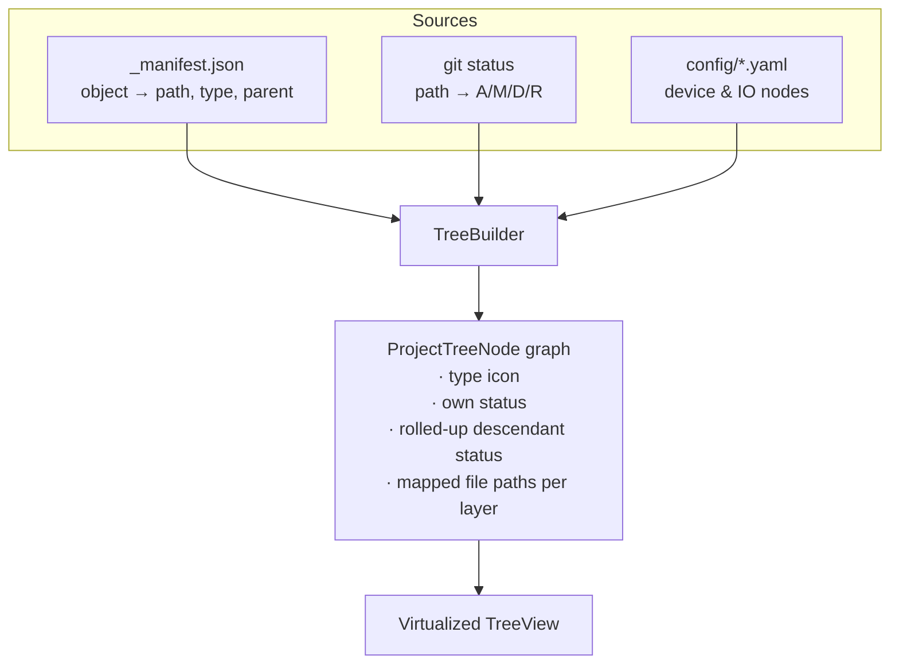

Behaviour:

| Aspect | Design |
|---|---|
| **Control** | `TreeView` with virtualization explicitly enabled (see above) and a templated row: glyph · label · status · roll-up badge. Must stay smooth at 5,000+ nodes |
| **Node identity** | The CODESYS object (GUID from the manifest), not the file. One node can map to several files — `.st`, `.xml` — surfaced as a layer switcher in the diff pane, not as extra tree rows. |
| **Roll-up badges** | A folder shows `● 5` when five descendants changed; colour reflects the strongest child status. Changes are never hidden behind a collapsed node. |
| **Status glyphs** | `A` added · `M` modified · `D` deleted · `R` renamed/moved, on the node itself |
| **Filter** | `changed only` (default) / `full tree` toggle. Default keeps the tree small; the toggle gives context — *where* in the machine did this change? |
| **Device & config nodes** | `config/*.yaml` is parsed back into tree nodes, so a changed EtherCAT cycle time appears **under the device that owns it**, not as "config/devices.yaml modified". This is the payoff for generating our own YAML. |
| **Binary `.project`** | A single root-level node, "binary — see objects below" |
| **Read-only (Tier 3) nodes** | Fixed devices, project settings/info, library manager, symbol config (§3.10) carry a 🔒 glyph and the tooltip "diff only — change this in CODESYS". Their diffs are shown normally; edits to their files are rejected with an explanation rather than attempted and silently lost. |
| **Renames/moves** | Detected via GUID stability in the manifest, so moving a POU between folders shows as a move, not delete+add — something git alone cannot infer from PLCopenXML |
| **Selection → diff** | Selecting a node loads the diff for its default layer (ST for logic, YAML for config), cancelling any in-flight diff computation (§7.1 worker 7) |
| **Context menu** | Stage · Discard · Open in CODESYS · Reveal in Explorer · History · Copy object path |
| **Search** | Filter box matching object names, with ancestors auto-expanded |
| **State persistence** | Expansion state persisted per repo, so a refresh doesn't collapse the tree you were reading |

Right pane: the diff view (§8.3), with a **layer switcher** (`ST | PLCopenXML | native`) — defaulting to ST because that is the readable one — plus inline/side-by-side toggle and per-hunk stage/discard once the basics work.

**Implementation note:** the tree is built on a background worker from manifest + git status + parsed YAML, then handed to the UI as an immutable snapshot. Rebuilding a whole tree on the UI thread on every git status refresh is the most likely source of jank in this app, so the builder diffs the new snapshot against the old and applies only the changed nodes.

### 9.4 Git side panel

Opened from the rail; slides over the left region (the changed-file list is duplicated here intentionally, as you described, because the panel is a self-contained git workspace):

- Current branch header with ahead/behind and remote name
- Staged / Unstaged sections with drag-free stage/unstage buttons
- Commit message box (subject + body, character guide at 50/72, Ctrl+Enter to commit)
- Buttons: Commit · Commit & Push · Pull · Push · Fetch · Stash ▾ (stash all / stash staged / apply / pop / drop)
- Recent commits list with click-to-diff

### 9.5 Sync panel (CODESYS)

Not in your original description, but the lock model needs somewhere to live and be understood. Without it, the lock is invisible magic that blocks the user with no explanation:

- Current state with a plain-English sentence: *"The project file is authoritative. XML edits will not be imported until you push or discard."*
- Last export / last import time, duration, object counts
- *Export now* / *Import now* manual triggers
- The `_coverage.md` report — per layer, what was exported and what could not be, so the gaps of §3.1 are always visible rather than silently assumed
- Round-trip fidelity check results
- Profile pin and CODESYS path, with a *Test* button

### 9.6 Log console

Bottom dock, collapsible via header chevron or `Ctrl+\``, height persisted. Covered in §10.

---

## 10. Logging subsystem

You asked for a really good logger. The requirements: everything is logged, it's visible on screen, it's collapsible, and long operations prove they're alive.

### 10.1 Pipeline

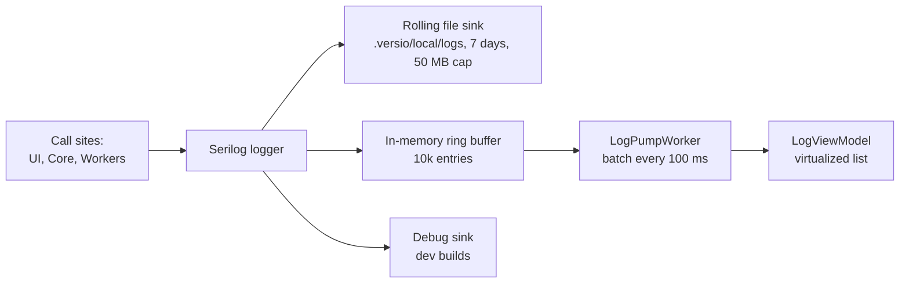

### 10.2 What gets logged

| Category | Examples |
|---|---|
| `UI` | **every** button/menu/keyboard command: `Click ▸ GitPanel.PushButton`, with the source control name — this is your "which button and where" requirement, implemented as a global `CommandInvoked` interceptor on `IAsyncRelayCommand` rather than a line copy-pasted into every handler |
| `Sync` | state transitions with old→new, hash comparisons, files written vs skipped |
| `Lock` | acquire, deny, renew, re-adopt after reboot, release with reason |
| `Codesys` | full command line, PID, exit code, every stdout/stderr line, every reporter callback |
| `Git` | every command with args, exit code, duration, parsed progress |
| `Fs` | watcher events, debounce coalescing, suppression hits |
| `Perf` | duration of every operation over 250 ms |

### 10.3 Correlation

Every operation gets an **`OperationId`** pushed onto Serilog's `LogContext` at the boundary. Every line from that operation — across threads, across workers, across the CODESYS subprocess — carries it. The UI can filter to one operation with a single click, which is how you debug "why did that export do that" in 20 seconds instead of 20 minutes.

### 10.4 Heartbeat

Any operation registered with `HeartbeatService` emits every 2 s:

```
14:22:11.010 INF [Codesys] ♥ export running — 2s — opening project           {op:7f3a}
14:22:13.010 INF [Codesys] ♥ export running — 4s — object 23/61 Conveyor_FB  {op:7f3a}
```

Progress detail comes from the Python script writing structured progress lines to stdout (`system.write_message`), which the worker parses. When there is no detail, elapsed time alone still proves liveness. The status bar mirrors the latest heartbeat, and heartbeat lines are collapsed into one updating row in the UI (all of them stay in the file) — otherwise a 10-minute operation buries the log in 300 identical lines.

### 10.5 UI features

Level filter · category filter · text search · pause/auto-scroll toggle · clear (view only) · copy selected · *Open log folder* · *Export diagnostic bundle* (logs + state.json + manifest + versions, zipped, for bug reports).

Virtualized list — a 10,000-entry log must scroll at 60 fps.

---

## 11. Technology choices

| Concern | Choice | Rationale |
|---|---|---|
| Runtime | **.NET 9** (LTS-track, or .NET 10 if released and stable at start) | Needs installing — no SDK on this machine yet |
| UI framework | **WPF** — *settled, Rev 6* | Briefly moved to Avalonia in Rev 5 for a macOS build; **macOS is now out of scope (§13.7)**, so WPF stands. Windows-only is inherent — CODESYS is Windows-only — so cross-platform bought nothing but cost. WPF has the deepest ecosystem for this app shape (AvalonEdit, virtualized trees, MVVM), and its `TreeView` virtualizes natively, which matters because a large hierarchical tree is this app's primary control |
| Project tree control | **WPF `TreeView`**, virtualization explicitly enabled | §9.3 — off by default, must be turned on and measured |
| MVVM | **CommunityToolkit.Mvvm** | Source-generated observable properties and `IAsyncRelayCommand` with built-in `CanExecute` |
| DI / host | **Microsoft.Extensions.Hosting** | Same `IHostedService` model as a server backend; makes the Core/UI split real |
| Git (all operations) | **`git.exe` + porcelain v2 parser** | *Changed Rev 9 (§8.1).* One code path, no native binaries, credentials just work |
| Diff model | **DiffPlex** | Small, reliable, line + word level |
| Editor / diff render | **AvalonEdit** | Virtualized, syntax highlighting, custom colorizers for the ST-in-XML case |
| Logging | **Serilog** + custom in-memory sink | Structured, `LogContext` for correlation, mature sinks |
| Hashing | **SHA-256** over canonical bytes | Collision-safe, fast enough |
| State files | **System.Text.Json** | No DB needed; state is small and human-inspectable, which matters when debugging a stuck lock |
| Scripts | **IronPython 2.7** (whatever CODESYS embeds) | Not our choice — dictated by the ScriptEngine |
| Tests | **xUnit** + **NSubstitute** + **FsCheck** (property) + **NetArchTest** (dependency rules) + **Stryker.NET** (mutation, scoped) + **pytest** (Python) | Full strategy in §12.5 |
| Theming | Merged `ResourceDictionary` + `DynamicResource` | §9.0 — no third-party theme library; the token set is small and owning it avoids fighting someone else's opinions |
| Packaging | **Self-contained publish**, no trimming (unsupported for XAML/reflection UI) | §13.2 |
| Installer + updates | **Velopack** — Setup.exe, MSI (WiX 5, per-machine), **delta updates** | §13.5. Replaces Inno — delta updates are decisive for a ~110 MB app, and the decision stands independently of the dropped macOS plan |
| Vendoring | `third_party/` + SHA-256 pinned manifest + offline NuGet + Git LFS | §13.3 — offline, reproducible builds from Phase 1 |

---

## 12. Code structure, contracts and testing

The structure exists to serve one goal: **make the risky logic pure, so it can be tested without CODESYS, without git, without a clock and without a UI.** Everything that touches the outside world sits behind a narrow interface; everything that decides anything sits behind none.

### 12.1 Solution layout

```
Versio.sln
├─ src/
│  ├─ Versio.App/                    WPF. The ONLY project referencing PresentationFramework.
│  │   ├─ Views/                     XAML only. No logic, no code-behind beyond InitializeComponent.
│  │   ├─ ViewModels/                Observable state + IAsyncRelayCommand. No file/process/git calls.
│  │   ├─ Theme/                     §9.0 design system
│  │   ├─ Controls/                  Custom controls (TreeRow, DiffLine, LogRow, HeartbeatIndicator)
│  │   ├─ Converters/                IValueConverter — pure, unit tested
│  │   └─ Composition/               DI wiring, IHost setup, splash bootstrap
│  │
│  ├─ Versio.Core/                   Domain + orchestration. NO UI types. NO WPF. NO direct IO.
│  │   ├─ Abstractions/              IFileSystem IClock IProcessRunner IGitClient
│  │   │                             ICodesysRunner ILockStore IEnvironmentProbe
│  │   ├─ Model/                     ProjectObject, ObjectType, ObjectId(GUID), Manifest,
│  │   │                             SyncState, LockRecord, CoverageReport, DiffModel
│  │   ├─ Sync/                      SyncOrchestrator, SyncStateMachine, HashGate,
│  │   │                             SelfWriteSuppressor, CircuitBreaker
│  │   ├─ Serialization/             Canonicalizer, StTextCodec (split/join),
│  │   │                             NativeXmlScrubber, ConfigYamlWriter, PathMapper
│  │   ├─ Equivalence/               ProjectComparer — the losslessness oracle (§3.9.4)
│  │   ├─ Locking/                   LockManager, LeaseRenewer, BootIdProvider
│  │   ├─ Codesys/                   JobBuilder, ScriptHost, JsonLineParser, ProfileResolver
│  │   ├─ Git/                       GitStatusService, GitNetworkService, DiffService
│  │   ├─ Watching/                  Debouncer, Coalescer, WatcherFacade
│  │   ├─ Tree/                      ProjectTreeBuilder (manifest + status + yaml → nodes)
│  │   └─ Logging/                   OperationScope, HeartbeatService, InMemorySink
│  │
│  ├─ Versio.Infrastructure/         The only place with real IO. Thin, dumb, untested by design.
│  │   ├─ FileSystem/                System.IO implementation of IFileSystem
│  │   ├─ Processes/                 Process spawn, pipe draining, tree-kill
│  │   ├─ Git/                       LibGit2Sharp + git.exe implementations
│  │   └─ Codesys/                   CODESYS.exe invocation, script extraction
│  │
│  ├─ Versio.Scripts/                Python, embedded as resources, written to temp at runtime
│  │   ├─ versio_main.py             entry: read job.json, dispatch, emit JSON lines
│  │   ├─ versio_export.py           tree walk + per-type dispatch table
│  │   ├─ versio_import.py           per-type import + NativeImportHandler(replace)
│  │   ├─ versio_config.py           device/IO/library/task → YAML
│  │   ├─ versio_types.py            the object-type GUID table (§3.1.4 ①)
│  │   ├─ versio_text.py             PURE: ST split/join, scrubbing, filename codec
│  │   └─ versio_probe.py            version, profile, licence, coverage probe
│  │
│  └─ Versio.Cli/                    Headless entry point for CI. Phase 5.
│
└─ tests/
   ├─ Versio.Core.Tests/             Unit — pure, fast, no IO. The bulk of the suite.
   ├─ Versio.Core.Scenarios/         Orchestrator vs fakes: crash, reboot, loop, storm
   ├─ Versio.App.Tests/              ViewModels, converters, theme contrast
   ├─ Versio.Arch.Tests/             NetArchTest dependency rules
   ├─ Versio.Integration.Tests/      Real CODESYS + real git. Tagged, slow, nightly.
   ├─ Versio.Equivalence.Tests/      The corpus regression suite (§3.9.4)
   ├─ scripts/                       pytest for Versio.Scripts pure functions
   └─ fixtures/
      ├─ projects/                   .project corpus (LFS)
      ├─ exports/                    golden export trees
      └─ recordings/                 captured CODESYS stdout + outputs for replay
```

### 12.2 Dependency rules — enforced, not documented

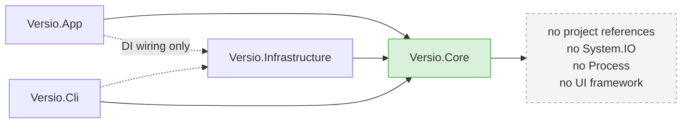

`Versio.Arch.Tests` fails the build if any of these are violated:

1. `Versio.Core` must not reference `PresentationFramework`, `System.Windows`, or `Versio.Infrastructure`. Worth keeping even though the app is Windows-only: it is what keeps a future UI-framework change, a CLI, or a test harness a view-layer job rather than a rewrite.
2. `Versio.Core` must not use `System.IO.File`, `Directory`, `Process`, `DateTime.Now`, or `Guid.NewGuid` directly — all are behind abstractions, which is what makes time, filesystem and identity controllable in tests.
3. `Versio.App.Views` must not reference `Versio.Infrastructure`.
4. No type in `Views/` may contain a literal `Color`, `Brush`, `FontFamily`, or hard-coded margin (§9.0) — a XAML lint rule.
5. Every `public async` method in `Core` must accept a `CancellationToken`.

### 12.3 The core contracts

Small and few, because every one of them is a seam that has to be faked:

```csharp
public interface IFileSystem {
    Task<byte[]> ReadAsync(string path, CancellationToken ct);
    Task WriteAsync(string path, byte[] content, CancellationToken ct);
    bool Exists(string path);  IEnumerable<string> Enumerate(string root, string pattern);
    Task CopyAsync(string from, string to, CancellationToken ct);   // retrying on share-lock
}

public interface ICodesysRunner {                       // the whole CODESYS surface
    Task<CodesysResult> RunAsync(CodesysJob job, IProgress<CodesysProgress> progress,
                                 CancellationToken ct);
}
// Deliberately stateless and file-in/file-out. LocalCodesysRunner spawns CODESYS.exe;
// a RemoteCodesysRunner talking to a server-hosted agent drops in unchanged (§13.8).

public interface ILockStore {                           // persistence of the direction lock
    Task<LockRecord?> ReadAsync(CancellationToken ct);
    Task WriteAsync(LockRecord record, CancellationToken ct);
    Task ClearAsync(CancellationToken ct);
}

public interface IClock { DateTimeOffset UtcNow { get; } DateTimeOffset MachineBootTime { get; } }

public interface IGitClient {                           // status/branch/commit/stash + network
    Task<GitStatus> StatusAsync(CancellationToken ct);
    Task<IReadOnlyList<BranchInfo>> BranchesAsync(CancellationToken ct);
    Task<GitResult> PushAsync(IProgress<GitProgress> p, CancellationToken ct);
    /* … */
}
```

With those five, `SyncOrchestrator`, `SyncStateMachine`, `LockManager`, `Canonicalizer`, `HashGate`, `ProjectTreeBuilder` and `ProjectComparer` — every piece of logic that can lose someone's work — become **pure and fully unit-testable**.

### 12.4 The C# ↔ Python contract

**JSON in, JSON-lines out.** One file path on the command line, so Windows `--scriptargs` escaping (which is genuinely awful) is never load-bearing:

```jsonc
// job.json — handed to the script as the single --scriptargs value
{ "op": "export", "schema": 1, "operationId": "7f3a",
  "profile": "CODESYS V3.5 SP22 Patch 2",
  // A LIST, not a single project. See below.
  "projects": [
    { "bindingId": "b-9f2c", "project": "C:\\tmp\\w\\A.project", "out": "C:\\tmp\\w\\A" },
    { "bindingId": "b-3e88", "project": "C:\\tmp\\w\\B.project", "out": "C:\\tmp\\w\\B" }
  ],
  "scrubTimestamps": true, "emitPlcopen": false }
```

> **Batch, because startup dominates.** Cold start is 17–31 s; exporting one small project takes about a second of actual work. A job therefore carries **a list of projects**, and the script opens, exports and closes each in turn inside **one CODESYS session**. Two projects cost ~19 s batched versus ~35 s sequentially, and the saving grows with the number of bindings. This matters most at the commit gate, which now checks every enabled binding (§5.2).

```jsonc
// stdout — one JSON object per line, never scraped prose
{"t":"progress","done":23,"total":61,"obj":"Application/POUs/Conveyor_FB"}
{"t":"object","guid":"a1b2…","type":"POU","path":"Device/application/POUs/Main.st","form":"st"}
{"t":"warning","obj":"Application/Visu/VisuManager","code":"SKIPPED_SERVICE_OBJECT"}
{"t":"warning","obj":"Application/X","code":"UNKNOWN_TYPE_GUID","guid":"9f…"}
{"t":"result","exported":58,"skipped":3,"unknown":1,"elapsedMs":41230}
```

Every warning carries a **stable machine code**, not just a message — that is what lets `_coverage.md`, the UI and the tests all agree about what happened.

### 12.5 Testing strategy — "unit tests for everything", made concrete

The honest version of that goal: **everything that decides something is unit-tested; everything that merely does IO is thin enough to be verified by integration.** The structure above exists precisely so that the first category is as large as possible.

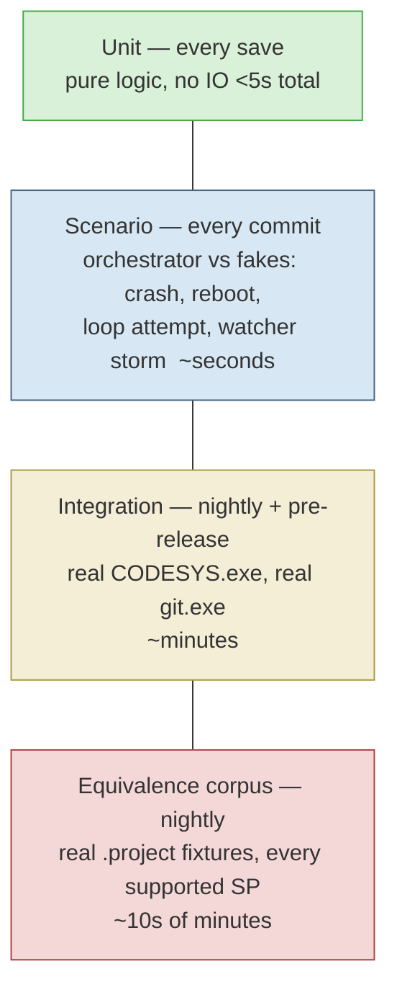

**Layer 1 — Unit (`Versio.Core.Tests`).** No IO, no sleeping, no real clock. Covers:

| Component | Representative cases |
|---|---|
| `SyncStateMachine` | every transition in §6.2, plus every *illegal* transition rejected; import blocked while `ProjectAuthoritative` |
| `LockManager` | acquire/deny/renew/release; different bootId → re-adopt; same bootId + dead pid → recover; live pid → refuse; hashes back at baseline → auto-release |
| `Canonicalizer` | timestamp scrubbed, **GUIDs untouched** (§3.1.4 ②), attribute order, line endings; **property test: idempotent** — `canon(canon(x)) == canon(x)` |
| `StTextCodec` | **property test: `join(split(x)) == x`** for arbitrary declaration/implementation text, including the delimiter appearing inside a comment, CRLF/LF mix, UTF-8 (Cyrillic, accents, smart quotes), empty implementation |
| `HashGate` | unchanged content → no write; changed → write; touch-only mtime change → no write |
| `SelfWriteSuppressor` | our own write swallowed; a real edit at the same path not swallowed; TTL expiry |
| `PathMapper` | object → filename and back for every type in §3.1.4 ③; **`Main` POU vs `Main` visu collision**; names with dots, spaces, non-ASCII, reserved Windows names (`CON`, `PRN`) |
| `ProjectTreeBuilder` | roll-up badges; GUID-stable move → rename not add+delete; config YAML → device nodes |
| `ProjectComparer` | detects a lost property comment, a changed device parameter, a reordered task, a dropped object |
| `CircuitBreaker` | halts after N syncs of one object in a window |
| `Debouncer`/`SettleDetector` | burst of 500 events → one job; file-locked → backoff then settle; `IClock` driven, **no `Task.Delay` anywhere in tests** |
| `JobCoalescer` (§7.4.4) | 4 saves during one export → exactly 2 exports; save inside the 5 s cancel window → restart, not queue; save at 30 s → queue; minimum-interval throttle respected; **final state always reflects the last save** |
| `CommitGate` (§7.4.5) | stale hash → commit blocked until synchronous export completes; fresh hash → commit proceeds untouched; export failure → commit stays blocked with a clear reason; **with two bindings, a stale B blocks the commit even while A is fresh** |
| `BindingResolver` (§5.1) | convention default derives the right export path; explicit `export` override wins; **manifest back-reference disagreeing with `repo.json` raises a mismatch, never a guess**; renamed project keeps its `id`, baseline and lock |
| `OrphanScanner` (§5.3) | orphaned project detected and offered; orphaned export never auto-deleted; broken binding reported not skipped; **`*_template.project` and any bound template are excluded from adoption**; `ignore` globs honoured; one-orphan-each-side + a git rename → re-link proposed; casing mismatch flagged |

**Layer 2 — Scenario (`Versio.Core.Scenarios`).** The orchestrator wired to `FakeFileSystem`, `FakeClock`, `FakeCodesysRunner`, `FakeGitClient`, `InMemoryLockStore`. These prove the guarantees that matter:

- Export writes files → watcher fires → **no import is triggered** (all three loop defences, individually disabled to prove each one independently stops it)
- Kill the process mid-export → restart → state recovered, no duplicate work, no corrupt manifest
- Simulate a reboot (bootId changes) with unsynced work → lock re-adopted, not silently cleared
- Simulate a reboot with work externally reverted → lock released
- Push succeeds → lock released, baseline advanced. Commit **without** push → lock retained (§6.5)
- CODESYS returns a fidelity mismatch → **swap-in does not happen**, backup intact
- Two Versio instances on one repo → second opens read-only

**Layer 3 — Python (`tests/scripts`, pytest).** The pure functions in `versio_text.py` and `versio_types.py` are written **2/3-compatible** and tested on CPython outside CODESYS: ST split/join, the timestamp-scrub regex, filename encode/decode, the GUID→type table. A `fake_scriptengine` module lets the dispatch tables be tested without the IDE. This is the layer codescribe has no equivalent of, and it is cheap.

**Layer 4 — Integration (`Versio.Integration.Tests`).** Real `CODESYS.exe` and real `git.exe` against fixture repos. Tagged `[Trait("Category","Integration")]`, excluded from the inner loop. Includes a **record mode** that captures real CODESYS stdout and output trees into `fixtures/recordings/`, which `FakeCodesysRunner` then replays — so scenario tests run against *real* CODESYS behaviour at unit-test speed.

**Layer 5 — Equivalence corpus (`Versio.Equivalence.Tests`).** The losslessness proof of §3.9.4. Each fixture project must satisfy `export → import → export ≡ ∅`, judged by `ProjectComparer`, on every supported SP. **Rule: every bug found in the field is added here as a fixture before it is fixed.**

**Cross-cutting:**

- **Property-based testing** (FsCheck) for the codecs and canonicalizer — the round-trip invariants are exactly what property tests are for.
- **Golden-file tests** for export output, with a `--update-goldens` switch. Golden diffs are reviewed in PRs, which makes an accidental format change visible instead of silent.
- **Mutation testing** (Stryker.NET) scoped to `Sync/`, `Locking/` and `Serialization/`. If a mutant survives in the lock manager, the test suite is lying to you. Nothing else in the codebase warrants the runtime.
- **ViewModel tests** for command `CanExecute` gating (a disabled Push while pushing), state → UI mapping, and cancellation on selection change.
- **Theme tests**: every `Brush.Text.*` / `Brush.Surface.*` pair computed for WCAG contrast ≥ 4.5:1, in both palettes. A failing colour fails the build (§9.0.2).
- **Coverage gates**: `Versio.Core` ≥ 85% line overall, **≥ 95% on `Sync/` and `Locking/`**. `Versio.Infrastructure` and `Views/` excluded — measuring them would only incentivise fake tests.
- **CI** (GitHub Actions, Windows runner): unit + scenario + arch + pytest on every push; integration + equivalence nightly on a self-hosted runner with CODESYS installed.

**What cannot be unit-tested, and is honestly labelled as such:** CODESYS's own behaviour, `FileSystemWatcher` OS semantics, UI rendering, git credential prompts, and real filesystem locking. These are covered by integration tests and by keeping `Versio.Infrastructure` thin enough that reading it is a viable review.

---

## 13. Packaging, dependencies and distribution

**Goal: a machine with nothing but Windows and CODESYS installed can run Versio.** No .NET install, no Python install, no "please install Git first", no NuGet restore from the internet at build time. Every dependency is either compiled in, vendored in the repo, or explicitly detected and reported.

### 13.1 Four classes of dependency

There is exactly one thing we cannot package, and it is worth naming first:

| Class | Examples | Strategy |
|---|---|---|
| **1. Managed runtime** | .NET 9, WPF | **Self-contained publish** — the runtime ships inside our output |
| **2. NuGet packages** | LibGit2Sharp, AvalonEdit, Serilog, DiffPlex, CommunityToolkit.Mvvm | **Vendored** as `.nupkg` in `third_party/nuget/`, restored offline with a committed lock file |
| **3. External tools** | `git.exe`, `git-lfs.exe`, Git Credential Manager | **Vendored** as a pinned portable distribution in `third_party/git/` |
| **4. Not packageable** | **CODESYS itself** | Licensed, multi-GB, machine-installed. **Detected, verified, and reported** — never bundled. Versio's first-run check finds the install and profile, and refuses to run with a clear message if absent |
| — | Python | **Not a dependency.** CODESYS ships its own IronPython 2.7; our scripts are embedded resources in the exe |

### 13.2 Publish profile — what "a single .exe" actually means

```xml
<PropertyGroup>
  <RuntimeIdentifier>win-x64</RuntimeIdentifier>
  <SelfContained>true</SelfContained>              <!-- bundles the .NET runtime -->
  <PublishSingleFile>true</PublishSingleFile>
  <IncludeNativeLibrariesForSelfExtract>true</IncludeNativeLibrariesForSelfExtract>
  <EnableCompressionInSingleFile>true</EnableCompressionInSingleFile>
  <PublishReadyToRun>true</PublishReadyToRun>      <!-- faster cold start -->
  <PublishTrimmed>false</PublishTrimmed>           <!-- MUST stay false — see below -->
  <SatelliteResourceLanguages>en</SatelliteResourceLanguages>
</PropertyGroup>
```

Two constraints that are not negotiable and are better known now than discovered in Phase 4:

- **Trimming is not supported for WPF.** XAML resolves types by reflection at runtime; the trimmer cannot see those references and will strip types the app needs, producing failures that appear only at runtime, only on some screens, and only in the published build. `PublishTrimmed` stays `false`.
- **NativeAOT does not support WPF either.** Rule it out entirely.

*(Avalonia supports both — that was a genuine upside of the Rev 5 detour, and it is given up along with the macOS plan. Worth knowing, not worth reopening.)*

The practical consequence: expect roughly **70–110 MB** compressed and ~180 MB extracted. That is the normal size of a self-contained WPF app and is not worth optimising — especially since Velopack's delta updates (§13.5) mean the full size is only paid on first install.

`IncludeNativeLibrariesForSelfExtract` matters specifically because **LibGit2Sharp carries native `git2-*.dll` binaries**. Without it, single-file publish produces an exe that fails the moment you touch a repository. This is the most common way this configuration goes wrong.

### 13.3 Vendoring — `third_party/` with hash pinning

```
third_party/
├─ manifest.json            # name, version, URL, sha256, license, why we need it
├─ THIRD-PARTY-NOTICES.txt  # generated; shipped in the installer
├─ nuget/                   # *.nupkg — every transitive package, offline restore
└─ git/                     # PortableGit — git.exe, git-lfs.exe, GCM
tools/
├─ fetch-deps.ps1           # download → verify sha256 → extract. Fails on mismatch.
└─ verify-deps.ps1          # CI: recompute hashes, fail if drifted
```

```jsonc
// third_party/manifest.json
{ "schema": 1, "dependencies": [
  { "id": "PortableGit", "version": "2.53.0",
    "url": "https://github.com/git-for-windows/git/releases/download/…/PortableGit-2.53.0-64-bit.7z.exe",
    "sha256": "…", "license": "GPL-2.0", "target": "third_party/git" },
  { "id": "LibGit2Sharp", "version": "0.30.0", "sha256": "…", "license": "GPL-2.0-with-linking-exception" }
]}
```

**The hash is the point.** A vendored dependency without a pinned hash is just a slower download; with one, a substituted or corrupted artifact fails the build instead of shipping. `verify-deps.ps1` runs in CI on every push.

Offline NuGet restore is three settings, all committed:

- `global.json` pins the exact .NET SDK version — so the build is the same on every machine and in CI
- `nuget.config` declares `third_party/nuget/` as a **local source with `<clear/>` first**, so nothing silently comes from nuget.org
- `Directory.Packages.props` (central package management) + `packages.lock.json` with `RestorePackagesWithLockFile=true`, restored using `--locked-mode`

Net effect: **`git clone` then `dotnet build` works with the network cable unplugged**, and produces a bit-for-bit equivalent build.

Vendored binaries are tracked with **Git LFS** (`third_party/**/*.nupkg`, `third_party/**/*.7z.exe`) so the git history does not carry ~150 MB of blobs in its object database.

### 13.4 Git: which distribution, and a licence flag

§8.1 chose `git.exe` for network operations specifically because **Git Credential Manager** makes HTTPS, SSH, 2FA, corporate proxies and SSO just work. That decision constrains what we can vendor:

- **MinGit** is the minimal embeddable Git distribution, and is explicitly stripped to keep size down — **it does not appear to include GCM**. Vendoring MinGit alone would break the exact capability we chose git.exe for.
- **PortableGit** (the self-extracting 7z from the same release page) is the full portable distribution and includes GCM and Git LFS.

**Recommendation: vendor PortableGit and always prefer the vendored copy**, so behaviour is identical on every machine regardless of what the engineer has installed. GCM writes to the Windows Credential Manager, which is the same store a system Git would use, so credentials are shared rather than duplicated. A settings override can point at a system Git for anyone who needs it. *Confirm the GCM/LFS contents of the chosen archive during Phase 1 — do not take the above on trust.*

> ⚠️ **Licence flag — worth knowing before the installer exists.** **Git is GPLv2.** Bundling it in an Inno Setup installer is *distribution*, which triggers the GPL's source-availability obligation. This is entirely manageable and standard practice — GitHub Desktop bundles Git — but it requires shipping the GPL text and a written offer pointing at the corresponding source. It costs an afternoon if handled deliberately and is unpleasant if discovered late. LibGit2Sharp is GPLv2 **with a linking exception**, so it does not impose the same obligation on Versio's own code. AvalonEdit and CommunityToolkit.Mvvm are MIT; Serilog and DiffPlex are Apache-2.0; codescribe is Apache-2.0. `THIRD-PARTY-NOTICES.txt` is generated at build time and shipped.

### 13.5 The installer

**Decision (Rev 5): Velopack, not Inno.** You said updates will definitely need to be pushed to users, and that single requirement settles it.

#### Why Velopack wins here

**The decisive argument is delta updates.** Versio is a self-contained app of ~110 MB (§13.2). With Inno, *every patch is a full 110 MB download for every user* — for a one-line bug fix. Velopack ships **binary deltas**: it stores previously downloaded packages in `%LocalAppData%\{packId}\packages` and applies deltas sequentially, falling back to a full download when that would be faster or when more than `MaximumDeltasBeforeFallback` (default 10) would have to be applied. A typical patch becomes single-digit MB. Over a year of releases to a plant full of engineers, that is the difference between updates being routine and updates being avoided.

The objection I had against Velopack in Rev 4 — *"per-user install to `%LocalAppData%` only, which AppLocker often blocks in industrial IT"* — **turns out not to hold.** Velopack can emit an **MSI built with WiX 5** (`--msi`), giving full Windows Installer integration: per-machine install to `Program Files`, **Group Policy deployment**, and proper Add/Remove Programs entries. `--instLocation` selects `PerUser`, `PerMachine`, or `Either`.

So Velopack is not a trade against Inno; it is a superset for this use case:

| | Inno Setup | **Velopack** |
|---|---|---|
| Delta updates | ❌ none | ✅ **built in, with fallback** |
| In-app update API | ❌ DIY | ✅ `UpdateManager` |
| Per-machine / GPO deployment | ✅ | ✅ via `--msi` (WiX 5) |
| Per-user, no-admin install | ✅ | ✅ `Setup.exe` → `%LocalAppData%` |
| Release channels (stable/beta) | ❌ | ✅ `releases.{channel}.json` |
| macOS packaging | ❌ Windows only | ✅ `.pkg` + `.app` — *not needed; macOS is out of scope (§13.7)* |
| Custom install wizard pages | ✅ rich Pascal scripting | ⚠️ limited |
| Maturity | 25+ years | newer, actively developed |

The only real loss is a customisable install wizard, which this app does not need.

#### Configuration

| Concern | Decision |
|---|---|
| Windows default | `Setup.exe`, per-user to `%LocalAppData%` — no admin rights |
| Windows managed | `--msi --instLocation PerMachine` for GPO/Intune/SCCM sites |
| macOS | Not built. Velopack supports it if that ever changes (§13.7) |
| Feed hosting | Any HTTPS location holding `releases.{channel}.json` + the nupkgs — S3, Azure Blob, Backblaze B2, IIS, or GitHub/GitLab releases. **Needs a decision (§16 q16)**; for a private industrial tool, Azure Blob or a plain internal HTTPS share is the obvious fit |
| Channels | `stable` and `beta`. **Roll out to one machine before a plant-wide push** — for a tool that writes to people's project files, staged rollout is a safety feature, not a nicety |
| Version | Single source of truth in `Directory.Build.props`, injected into assembly metadata and `vpk pack` |
| Uninstall | Removes the program; **never** touches repos, `.versio/local/`, or logs |

#### Update policy — do not silently restart this app

Velopack exposes the update lifecycle explicitly (`CheckForUpdatesAsync` → `DownloadUpdatesAsync` → `ApplyUpdatesAndRestart`), and Versio must use that control rather than updating silently:

> **Never apply an update while a direction lock is held or a sync is running.** An update that restarts the app mid-export leaves a half-written export tree and an orphaned lock. The updater checks the sync state machine (§6.2) first, and defers with *"Update ready — will install when the current sync finishes"*.

Download in the background, notify in the status bar, apply on the user's click or at next launch. Combined with channels, that also gives a rollback path if a bad build reaches users.

#### Code signing — still required, still the real blocker

Velopack signs the installer when configured, but it does not remove the need for a certificate. Unsigned Windows installers trigger SmartScreen's "Windows protected your PC", and industrial IT blocks them. An OV certificate must accumulate reputation; an **EV certificate gets SmartScreen trust immediately** and costs meaningfully more. Procurement lead time, not engineering time: start it early.

### 13.6 Phasing — you get a runnable exe early

| Phase | Packaging deliverable |
|---|---|
| **1** | `dotnet publish` → **self-contained single-file `Versio.exe`**. Copy the folder anywhere and double-click. This satisfies "start with a .exe that launches the app" in week one |
| **2** | `third_party/` + `fetch-deps.ps1` + lock files + `verify-deps.ps1` in CI. **Offline build works**. First `vpk pack` producing `Setup.exe` |
| **3** | Vendored PortableGit wired in, system-Git override, first-run environment check (CODESYS install, profile, LFS) with a clear diagnostic screen. **Update feed stood up; in-app update flow wired to the sync state machine** (§13.5) |
| **4** | MSI variant for managed sites, `THIRD-PARTY-NOTICES.txt`, **code signing**, GPL compliance package, `beta`/`stable` channels |
| **5** | Nothing further. macOS is out of scope (§13.7); server-hosted CODESYS (§13.8) has no client-side packaging impact |

**Build reproducibility is a Phase 1 concern, not a Phase 4 one.** Pinning the SDK and lock files at the start costs nothing; retrofitting them once dependencies have drifted across machines is genuinely painful.

### 13.7 macOS — considered and dropped (decision record)

**Decision (Rev 6, yours): Windows only. No macOS build. WPF stands.** Recorded here so the reasoning survives and the question does not get re-opened from scratch.

**Why it was never going to be the same app:** CODESYS does not run on macOS — there is no macOS build of the Development System. Since Versio drives CODESYS as an external process for every export and import, **the sync engine cannot run on a Mac at all.** A Mac build could only ever have been a **review client**: full git, full project-tree diff, full history — but no export, no import. Useful for someone reviewing PLC changes, useless for anyone editing them.

**What it would have cost:** one expensive item and several small ones. The expensive one is the UI framework — **WPF → Avalonia**, because WPF is Windows-only. `Versio.Core` would have needed *zero* changes (it is UI-free and IO-free by construction, enforced by the arch tests in §12.2 — the payoff for that discipline). `Versio.Infrastructure` would need per-OS process-tree kill, boot time and mutex. File watching would have been fine: macOS FSEvents is lower-fidelity than Windows, but §7.4.2's tier-2 poll and tier-3 rescan exist precisely because watchers are unreliable. Packaging is free via Velopack; **signing is not** — Apple Developer Program plus notarization is mandatory, and Gatekeeper *hard-blocks* rather than merely warning.

**Why WPF is the right call for Windows-only:** the deciding factor is specific rather than a general preference. **This app's primary control is a large hierarchical tree**, and WPF's `TreeView` virtualizes natively while Avalonia's does not virtualize at all — the documented Avalonia answer is `TreeDataGrid` instead. The one place Avalonia is weakest is the exact place Versio is heaviest. Add a deeper ecosystem, better tooling and more answers when stuck — all of which convert directly into velocity on a small team — and WPF wins.

**What was given up, honestly:** Avalonia supports **trimming and NativeAOT**; WPF supports neither. Avalonia is actively developed where WPF is effectively in maintenance. And Linux would have come free. None of that outweighs a Windows-only target where the tree is the product.

**If this is ever revisited**, two things to know: (1) `Versio.Core` staying UI-free (§12.2 rule 1) means a port would be a view-layer rewrite, not an app rewrite — expensive but bounded; (2) the common real-world pattern is **CODESYS in a VM** on a Mac, in which case the simplest answer is to run Versio inside that Windows VM, where it is fully functional.

### 13.8 Server-hosted CODESYS — documented for later (Phase 5)

**Status: not scheduled. Documented so the option stays open and cheap.** Nothing in Phases 0–4 needs to change to preserve it.

The idea: run CODESYS on a Windows server and have clients reach it, so no local install is needed. **The architecture is already shaped for this** — and although it was raised as a macOS workaround, its real value is elsewhere and it should be justified on those terms.

#### 13.8.1 The architecture already has the seam

`ICodesysRunner` (§12.3) is the entire CODESYS surface, and the C#↔Python contract is already **stateless and file-in/file-out** (§12.4: a JSON job in, JSON lines plus a file tree out). Nothing in `Versio.Core` knows or cares whether that runs locally or over a wire:

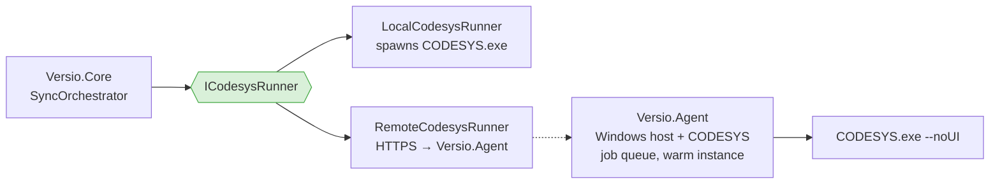

**A second `ICodesysRunner` implementation is the whole client-side change.** That is the payoff for the interface discipline in §12.2 — this was not designed for remoting, and it is remotable anyway.

#### 13.8.2 What it actually unlocks — PLC continuous integration

The valuable flow has nothing to do with client platforms:

> Push `.st` changes → **the server imports them into the template, compiles, and reports whether the code is valid** → optionally commits the resulting `.project`.

That is **continuous integration for PLC code**. Today nobody discovers that a merge broke the build until an engineer opens the IDE and finds out.

| Unlocked | Value |
|---|---|
| **Compile-check on every push** | Catches broken ST before anyone opens the IDE. Today nobody knows a merge broke the build until an engineer tries it |
| **Cold-start cost removed from the engineer's machine** | A **warm** server-side CODESYS instance kills R5 and makes automatic-on-save viable (§7.4.6) |
| Centralised profile/version management | One place decides which SP a repo builds against (§3.7) |
| `Versio.Cli` in CI | Same agent, no new plumbing |
| Thin clients generally | A machine without CODESYS could still sync — relevant if that ever matters again |

#### 13.8.3 The three things that could kill it

| # | Issue | Severity |
|---|---|---|
| **1** | **⚠️ CODESYS licensing.** The Development System is licensed per seat/machine. Running one server instance to serve several engineers is very likely a licence question — it may require per-user licences anyway, a specific server licence, or be disallowed. **This is a phone call to CODESYS, not an engineering task, and it must happen before any work starts.** It can kill the idea outright | **Blocking** |
| **2** | **Concurrency.** §7.1 already serialises CODESYS machine-wide behind a named mutex, because it is a desktop IDE, not a server product. A shared agent either queues (users wait behind each other) or runs N instances (N licences, N profiles, a heavy VM). CODESYS is not built for concurrent headless invocation | High |
| **3** | **Data movement and auth.** A `.project` can be hundreds of MB; shipping it per job is slow. The sane design is for the agent to **clone from git itself** — which means the agent needs credentials for the user's repos, i.e. a real auth story (service account, or token pass-through) | Medium |

#### 13.8.4 Recommendation

**Worth doing, later — as CI, not as a platform workaround.**

Build the local pipeline first: you cannot remote a process you have not built, and every hard problem (determinism, coverage, round-trip fidelity, the manifest) is identical either way. Then:

- **Phase 5**, as `Versio.Agent` + `RemoteCodesysRunner`, justified as **PLC CI and compile-checking**, with warm-instance startup (killing R5) as the second prize
- **Whenever convenient**: make the licensing call (§16 q19). It costs a phone call and it is the gate on the whole idea. No rush — nothing before Phase 5 depends on it

**Nothing in Phases 0–4 changes to keep this open.** The `ICodesysRunner` seam already exists and costs nothing to preserve — which is the entire reason this is safe to defer.

---

## 14. Phased roadmap

### Phase 0 — Feasibility spike ⚠️ **do this before anything else**

Pure Python + a throwaway console app. **No UI, no architecture.** Every one of §3's hard truths gets an answer:

| # | Question | Pass criteria |
|---|---|---|
| 0.1 | Does headless export work on a real project of yours? | Files produced, exit code 0, no hidden dialog |
| 0.2 | **Is export deterministic?** Export the same untouched project 3× | Byte-identical after scrubbing `Timestamp` only. codescribe says this works — confirm on SP22 |
| 0.3 | Confirm GUIDs are stable and **must not be rewritten** | Same GUIDs each run. **Do not repeat codescribe's rewrite experiment — it broke visualisations** |
| 0.4 | Per-object export granularity via the tree walk | One file per object, correct folder mirror, acceptable total time |
| 0.5 | **Is round-trip lossless (L2)?** export → import into template copy → re-export → compare | Empty structured diff from a first-cut `ProjectComparer`, or a *bounded, listed* delta |
| 0.6 | What is missing? | `_coverage.md` from a real project, including every `UNKNOWN_TYPE_GUID` |
| 0.7 | Cold-start cost of `--noUI` | Measured; decides one-session-per-sync vs a warm instance |
| 0.8 | Licence check | Scripting runs without a nag dialog or demo timeout |
| 0.9 | Can the project be copied while open in the IDE? | Copy succeeds, or a documented retry/backoff works |
| 0.10 | Does the SP11 API still match on **SP22**? | Signatures for `export_native`, `import_native`, `textual_*` verified against the local `ScriptEngine.chm` |
| **0.11** | **Port codescribe's exporter to SP22 and run it on a real project** | **The fastest possible answer to "does this whole idea work" — reuse before rewrite** |
| 0.12 | `ScriptProject.export_native(objects, dest, recursive, one_file_per_subtree, …)` | Per-object files; compare against the per-object `ScriptObject.export_native` loop |
| 0.13 | `import_native` argument binding | Confirm the SP21 `IEnumeratorOfTWrapper` error is the string-vs-list overload trap; document the working call |
| 0.14 | Config serialization | Device tree, IO map, libraries dumped to stable YAML via `ScriptDeviceObject` / `librarymanager` |
| 0.15 | ST round-trip via `textual_declaration` / `textual_implementation` | `join(split(x)) == x` on real POUs incl. non-ASCII; confirms PLCopenXML is unnecessary |
| 0.16 | **Close codescribe's gaps**: Interface, TextList, GlobalTextList, ImagePool, LibraryManager, ProjectInformation, ProjectSettings, symbol config | Each either exports+imports, or is documented in §3.9.3 as template-only |
| **0.17** | **Custom `NativeImportHandler` returning `NativeImportResolve.replace`** | In-place update works → removes the destructive remove-and-recreate cycle entirely |
| **0.18** | **`system.prompt_answers` + `PromptHandling.LogMessageKeys`** | Interactive dialogs pre-answered under `--noUI` → R4 mitigated properly instead of by timeout-and-kill |
| 0.19 | Generate a template project (`Save As Template` equivalent) | Template + export reconstitutes a working project that compiles |
| 0.20 | **Stand up the equivalence corpus and `ProjectComparer` v0** | At least 3 fixtures green, including one real machine project. This is the asset everything later depends on |

**Timebox: 3 weeks.** Deliverable: a findings memo appended to this document, the seeded equivalence corpus, and a working per-object export/import round-trip on your own project. **Start from codescribe's code (Apache-2.0, attribute it) — porting is days, rewriting is weeks.**

> **0.2, 0.5, 0.16 and 0.20 are gates, not tasks.**
> - If export is non-deterministic beyond `Timestamp` scrubbing, the diff feature is dead as designed.
> - If round-trip is lossy in an unbounded way, import drops to advisory-only and the lock model simplifies dramatically.
> - If the gap types (0.16) cannot be exported *or* carried by the template, "truly lossless" is not reachable and the contract in §3.9 must be renegotiated before any C# is written.
> - Without the corpus (0.20) there is no way to know any of the above is still true next month.

> ## 📍 Execution status — 2026-08-11
>
> **Phase 0 is complete and every gate passed.** The findings — including the ones that reversed decisions in this plan — are in [`PHASE0-FINDINGS.md`](PHASE0-FINDINGS.md).
>
> **Phase 1 is largely complete.** `Versio.Core` (391 tests, 43 ms), `Versio.Infrastructure` driving real CODESYS and real `git.exe` (21 integration tests), the §9.0 design system, the §10 logging subsystem, and a shell that opens a repository and shows real git state. **R25 closed with a measurement**: 94.7 ms virtualized versus 10,635 ms at the WPF defaults.
>
> **Next milestone: wire the shell to `SyncOrchestrator`.** Everything beneath it exists, so this is assembly rather than invention. Current state and the full route to completion live in [`STATUS.md`](STATUS.md).
>
> Three decisions were reversed by measurement, each recorded where it was originally made: `On git action` became the default sync mode (§7.4.6), LibGit2Sharp was dropped for `git.exe` throughout (§8.1), and macOS was cut so WPF could stay (§13.7).

### Phase 1 — Foundations, shell + git (4–5 weeks)
Solution skeleton with the dependency rules and arch tests in place **from commit one**; **pinned SDK, lock files and a self-contained single-file `Versio.exe` publish from the first week** (§13.6); **a virtualized-`TreeView` spike at 5,000 synthetic nodes before any other UI work** (R25); the §9.0 design system built before any screen; splash, shell, top bar with repo MRU / open / clone-with-verification, branch dropdown, **tree pane in path-hierarchy mode**, diff view, git side panel, full logging with heartbeat, collapsible log console. **No CODESYS at all.** You end with a usable git client — independently valuable, and it de-risks the UI before the hard sync logic lands. The tree is built against plain file paths now and re-pointed at the manifest in Phase 2, so the control is proven before the data model lands on it.

### Phase 2 — Export pipeline (4–5 weeks)
Watcher, orchestrator, CODESYS process host, canonicalizer, manifest, hash gate, self-write suppression, sync panel, template generation, `.gitattributes`/LFS setup, the full per-type export of §3.1.5, and the **project-tree view driven by the manifest** including config nodes parsed from YAML. **One direction only.** Ship it — a one-way tool that gives readable, structurally-organized diffs is already most of the value.

### Phase 3 — Import + locks (4–5 weeks)
The full state machine, persisted lock with boot-id survival, import with backup + swap, `NativeImportHandler` in-place replace, the round-trip equivalence check, diff preview and confirmation, conflict state, release on push/discard, stale-lock recovery UI. The Layer-2 scenario suite (§12.5) is written **alongside** this, not after — it is the only thing standing between this feature and lost work.

### Phase 4 — Hardening (3 weeks)
Large-project performance, ST syntax highlighting in the diff, per-hunk staging, settings UI, diagnostic bundle, mutation testing pass on `Sync/` and `Locking/`, crash-recovery testing (kill mid-export, kill mid-import, pull the plug), installer, docs.

### Phase 5 — Optional
**`Versio.Agent` + `RemoteCodesysRunner` (§13.8)** — server-hosted CODESYS, justified as **PLC CI / compile-on-push**, with warm-instance startup (killing R5) as the second prize. Gated on the licensing answer (q19). Also: `Versio.Cli`, merge assistance, multi-project repos, and a real CODESYS add-in (in-IDE, avoiding the `--noUI` startup cost entirely).

**Total to a shippable Phase 3: roughly 4–5 months** of focused solo work, assuming Phase 0 comes back green. The increase over Rev 2 is the test infrastructure and the design system — both bought deliberately, because the alternative is a tool nobody can trust with their project files.

---

## 15. Risk register

| # | Risk | Impact | Likelihood | Mitigation |
|---|---|---|---|---|
| R1 | Export non-deterministic beyond canonicalization | Fatal to core value | **Low** ↓ | **Largely retired by codescribe's evidence**: scrub `Timestamp` only, never touch GUIDs (§3.1.4 ②). Phase 0.2 confirms on SP22 |
| R2 | Round-trip lossy | Kills import direction | **Medium** ↓ | Phase 0.5/0.16 gates; native export for non-textual objects; template carries the rest; **continuous equivalence checking** (§3.9.4); backups; import stays confirm-only |
| R2b | **"Lossless" is claimed but never measured**, and silently rots | Data loss, discovered late | **High if unmanaged** | The corpus regression suite (§12.5 layer 5) is the whole mitigation. Every field bug becomes a fixture |
| R3 | Coverage gaps confuse users into thinking the export is a backup | Data loss perception, or real loss | High | Template + delta model (§3.9.2); explicit `_coverage.md`; the UI states the contract; `.project` and template both in LFS |
| R3b | Export time and repo size | Slow syncs, bloated repo | **Low** ↓ | Per-type export (Rev 3) replaced the three-tree model; only changed objects are written |
| R4 | `--noUI` hangs on a hidden modal | Stuck jobs | **Low** ↓ | **`system.prompt_answers` pre-answers dialogs, and `PromptHandling.LogMessageKeys` discovers the keys** (Phase 0.18). Timeout + process-tree kill remains as backstop |
| R5 | Cold start too slow to feel automatic | Poor UX | **Confirmed** — 31.5 s cold / 17.6 s warm, measured | **`On git action` is now the default** (§7.4.6); jobs batch all bindings into one CODESYS session (§12.4); a resident-session script and the Phase 5 add-in remain the paths to sub-second |
| R31 | **Profile cannot be resolved** — none installed, several installed, or a pinned one missing | Versio cannot export or import at all; `--noUI` exits 1 | **Medium** | Blocking startup gate with its own diagnostic screen (§3.7); `ProfileResolver` reads profiles from disk, never synthesises a name, never guesses between several, and fails loudly on a missing pin |
| R32 | **A newer CODESYS adds object types we do not know** | Objects flattened or exported without structure | **Medium-high** — 2 found in a 25-object project | Native fallback never drops an object; unknown-with-children keeps its subtree (`NativeWithChildren`); unknown GUIDs surfaced in `_coverage.md` and the UI so the table can be extended |
| R6 | CODESYS version/profile drift silently upgrades a project | Corrupted project | Medium | Profile pinned per repo, mismatch refuses to run |
| R7 | Scripting licence restrictions | Blocks automation | Low-medium | Phase 0.8 |
| R8 | Merge conflicts inside native XML are unreadable | Team friction | Medium | Textual objects are `.st` and merge like normal code; native XML is per-object so conflicts stay local; `--ff-only` default; Phase 5 merge assist |
| R12 | **The `.st` ↔ object mapping is filename-encoded** (`Parent.Child.action.st`) and object names can contain dots, spaces or non-ASCII | Silent mis-import into the wrong object | **Medium** | Explicit `PathMapper` with round-trip unit tests over adversarial names (§12.5); the manifest carries GUID→path so the filename is a convenience, not the source of truth |
| R13 | Only one person understands the CODESYS scripting layer | Bus factor | Medium | The Python pure functions are unit-tested and documented; `_coverage.md` and the corpus encode the knowledge in executable form |
| R14 | Repo inside a cloud-synced folder (OneDrive / Dropbox / Google Drive) | Corrupt/duplicated state, phantom watcher events, sync conflicts on `.git` | **Low** ↓ *mitigated* | Synced folders generate their own file events, may use placeholder files, and syncing a `.git` directory is a known corruption source — on top of the LFS traffic. **Resolved for this project: moved to `C:\GIT\Versio` on 2026-08-11, outside OneDrive.** The same rule applies to every CODESYS repo Versio manages, so **the repo-open warning stays in scope** — teammates will hit this |
| R15 | Save storm during a long export → thrash or starvation | Pinned CPU, stale exports | Medium | Single pending slot, 5 s cancel window, 30 s minimum export interval (§7.4.4); `On git action` mode as the escape hatch |
| R16 | Detection silently degrades (watcher drops, path becomes network/synced) | Stale diffs, false confidence | Medium | Tier-2 poll + tier-3 rescan; **the commit gate (§7.4.5) makes it a UX problem, not a correctness one**; watcher `Error` events logged at WARN, never swallowed |
| R17 | **Unsigned installer blocked by SmartScreen / industrial IT** | Cannot deploy to the people who need it | **High** | Code-signing certificate procured **before** external distribution; EV for immediate SmartScreen trust. This is a lead-time and budget item, not a technical one (§13.5) |
| R18 | **GPL obligations from bundling Git** discovered after the installer ships | Compliance exposure | Medium | Handled deliberately in Phase 4: GPL text + written source offer + `THIRD-PARTY-NOTICES.txt`. Standard practice (GitHub Desktop does the same) — the risk is only in finding out late (§13.4) |
| ~~R19~~ | ~~`PublishSingleFile` breaks LibGit2Sharp's native `git2-*.dll`~~ | — | **Closed** | **Resolved Rev 9: LibGit2Sharp dropped in favour of `git.exe` (§8.1).** There is no native payload left to break. The published-exe smoke test is still worth having, but this specific failure is gone |
| R20 | Trimming or NativeAOT attempted for size | Runtime XAML failures on isolated screens | Low | Documented as unsupported (§13.2); `PublishTrimmed=false` asserted in `Directory.Build.props` |
| R21 | **Update applied mid-sync** → half-written export tree, orphaned lock | Corrupt state, lost work | **Medium if unguarded** | The updater queries the sync state machine and defers while a lock is held (§13.5). Covered by a scenario test |
| R22 | A bad release auto-updates everyone at once | Fleet-wide breakage on a tool that writes project files | Medium | `beta`/`stable` channels + staged rollout to one machine first; user-triggered apply, never silent restart |
| ~~R23~~ | ~~Avalonia chosen for a macOS build nobody uses~~ | — | **Closed** | **Resolved Rev 6: macOS dropped, WPF confirmed (§13.7).** The risk existed only while the decision was open |
| ~~R24~~ | ~~macOS notarization / Apple Developer account~~ | — | **Closed** | No macOS build |
| ~~R25~~ | ~~Project tree not virtualized~~ | — | **Closed — measured** | **Confirmed real, then fixed.** 5,002 nodes fully expanded: virtualized **94.7 ms / 23 realised**, defaults **10,635 ms / 5,002 realised** — 112× slower. The three attributes in §9.3 are what close it, and the spike stays in the repo as a regression check |
| R26 | **CODESYS licensing forbids a shared server** | Kills §13.8 — no PLC CI, no warm instance | Medium | Ask CODESYS whenever convenient (q19). **Nothing before Phase 5 depends on it**; the `ICodesysRunner` seam keeps the option open for free |
| R27 | Server-hosted CODESYS serialises the whole team behind one instance | Engineers queue behind each other; worse than local | Medium | CODESYS is a desktop IDE, not a server product (§13.8.3). Measure with a realistic job before committing; N instances means N licences and a heavy host |
| R28 | **A `_template.project` gets adopted as a trackable project** | A binding that exports the template into its own tree — nonsense, and confusing to unpick | **Medium if unguarded** | Two independent exclusions (§5.3): any path referenced as a `template` by a binding, **plus** the `*_template.project` naming convention for templates with no binding yet. Covered by `OrphanScanner` tests |
| R29 | **Project renamed → binding breaks, history and lock lost** | Looks like a delete + a brand-new project; baseline resets and the diff shows the whole project as added | **Medium** | Identity is the binding `id`, never the path (§5.1); git's own rename detection on the `.project` supplies the match; the manifest back-reference confirms it |
| R30 | Path casing differs between disk and the git index | Two entries in the index, one directory on disk; exports land in the wrong place | Low-medium | Ordinal comparison against the committed path, with a startup check that flags a mismatch (§5.3) |
| R9 | Lock model wrong in an edge case → sync loop | Repo spam, data churn | Low | Three independent defences (§6.1); loop-detection circuit breaker: >5 syncs on one object in 60 s → halt and alert |
| R10 | Git LFS not installed / not configured on a teammate's machine | Broken clones | Medium | Detect at startup, offer to configure, block if absent |
| R11 | Two Versio instances on one repo | Corrupt state | Low | Named mutex + lock ownership check on startup |

R9's circuit breaker deserves emphasis: no matter how confident the state machine is, **a hard counter that halts sync after N cycles in a window is the seatbelt**. It costs 20 lines and prevents the one failure mode that could churn a repository.

---

## 16. Open questions for you

1. **Release on push, or on commit?** §6.5 releases the lock only on a successful push, per your wording. Confirm — committing without pushing is common when working offline, and it would leave the lock held.
2. **How automatic should import be?** This plan makes import *detected automatically, applied only on confirmation*, because of the fidelity risk (R2). Do you want a "trust it, just import" mode once Phase 0.5 comes back clean?
3. ~~**One project per repo, or several?**~~ — **resolved Rev 7: several are supported** (§5.2). Locks are now per binding. Remaining sub-question: with N projects in one repo, a save-all means N queued exports each paying CODESYS cold start, which may make `On git action` the right default there (see q11).
4. **Does the working `.project` stay in the repo alongside the template?** Committing both is belt-and-braces but doubles LFS traffic. codescribe recommends committing **only** the template. My recommendation: commit both during Phases 2–3 while trust is being established, then drop the working copy.
5. **Which CODESYS versions must be supported?** You have 3.5.22.20. Note codescribe is validated only on **SP11** — the port to SP22 is Phase 0.11 and API drift is possible. Supporting several SPs side by side multiplies the corpus by N.
6. **Team size / concurrent editors?** Affects how much effort merge-conflict handling deserves.
7. **Do visualizations need to be diffable, or only preserved?** They export as native `.vis.xml` either way, but a *readable* visu diff is a whole sub-project.
8. **What is your real project's shape?** Number of POUs, whether it uses CFC/LD heavily, whether it is a compound/safety project, which vendor's device packages. Export time, tree performance and the coverage gaps all scale with this, and one real project answers more than any amount of estimating.
9. **How much does graphical (CFC/LD/FBD) code matter to you?** Those objects can only be native XML — their diffs will never be as good as ST. If your codebase is mostly graphical, the value proposition of the whole tool shrinks and that should be known now.
10. **Is a licence check on codescribe's Apache-2.0 terms acceptable?** We would be porting substantial portions. Attribution in `NOTICE` plus the licence header is all that is required, but it should be a conscious decision.
11. ~~**Which sync mode should be the default?**~~ — **answered by measurement (Rev 8): `On git action`.** Cold start is 31.5 s / 17.6 s warm, so automatic-on-save would run CODESYS most of the working day. Automatic is now opt-in. Remaining sub-question: is a **resident CODESYS session** (a script that stays alive polling a job file) worth building to get sub-second exports and make Automatic viable again? It would eliminate the cost entirely but adds a long-lived process to babysit.
12. ~~**Will you move the repos out of OneDrive?**~~ — **answered 2026-08-11: moved to `C:\GIT\Versio`.** Remaining: the CODESYS repos themselves must follow the same rule when they are created, and the repo-open warning stays in scope for teammates.
13. **Who else will run Versio, and on what kind of machine?** This decides packaging seriousness. Just you → the published folder is enough indefinitely. Colleagues on locked-down industrial IT → **per-user install and a signed installer are hard requirements**, and the certificate has procurement lead time (R17).
14. **Is there budget and an entity for a code-signing certificate?** EV gets immediate SmartScreen trust and costs meaningfully more than OV; OV requires reputation to accumulate. Needed before anyone outside this machine installs it.
15. **Bundle Git, or require Git for Windows?** This plan bundles PortableGit so the app is genuinely self-contained, at the cost of ~120 MB and the GPL compliance work (§13.4, R18). Requiring a system Git is smaller and simpler but breaks the "runs on a clean machine" promise you asked for. **My recommendation is to bundle**, but it is a real trade.
16. **Where will the update feed live?** (§13.5) Any HTTPS location works — Azure Blob, S3, Backblaze B2, an internal IIS share, or GitHub/GitLab releases. For a private industrial tool, Azure Blob or an internal HTTPS share is the natural fit. This needs to exist before Phase 3.
17. ~~**Does anyone actually need macOS?**~~ — **answered 2026-08-11: no. Windows only, WPF confirmed.** Decision record in §13.7.
18. **Silent auto-update, or notify-and-confirm?** This plan says notify-and-confirm, and never restart mid-sync (R21). Silent updating is friendlier right up until it isn't, and this app writes to people's project files.
19. **Can CODESYS legally run on a shared server serving multiple engineers?** (§13.8) A **licensing call to CODESYS, not an engineering question**. It gates the server-hosted idea — including PLC CI, likely the most valuable thing in Phase 5. **No urgency**: nothing before Phase 5 depends on it, and the `ICodesysRunner` seam keeps the option open for free.

---

## 17. Sources

- [Using Scripts to Access CODESYS Functionalities](https://content.helpme-codesys.com/en/CODESYS%20Scripting/_cds_access_cds_func_in_python_scripts.html)
- [Starting Scripts from the Command Line](https://content.helpme-codesys.com/en/CODESYS%20Scripting/_cds_starting_script_via_command_line.html)
- [Command: Export PLCopenXML](https://content.helpme-codesys.com/en/CODESYS%20Development%20System/_cds_cmd_export_plcopenxml.html)
- [Command: Import PLCopenXML](https://content.helpme-codesys.com/en/CODESYS%20Development%20System/_cds_cmd_import_plcopenxml.html)
- [Dialog: Options: PLCopenXML](https://content.helpme-codesys.com/en/CODESYS%20Development%20System/_cds_dlg_options_plcopenxml.html)
- [Using the Command-Line Interface](https://content.helpme-codesys.com/en/CODESYS%20Development%20System/_cds_commandline.html)
- [CODESYS Forge — Snippet: Export as PLCopen XML](https://forge.codesys.com/tol/scripting/snippets/5/)
- [CODESYS Forge — PLCopen XML import via Python script](https://forge.codesys.com/forge/talk/Engineering/thread/0f91d8928f/)
- [CODESYS Forge — Import XML (ImportReporter / resolve_conflict)](https://forge.codesys.com/forge/talk/Engineering/thread/f169c9777c/)
- [CODESYS Forge — Export for use with version control](https://forge.codesys.com/forge/talk/Engineering/thread/ef849265e5/)
- [CODESYS Forge — GUID Not Valid Error When Importing Via Scripts](https://forge.codesys.com/forge/talk/Engineering/thread/b67f6ead18/)
- [CODESYS Forge — Library is not exported to PLCopenXML](https://forge.codesys.com/forge/talk/Engineering/thread/a7a19eead8/)
- [tkucic/codesys_workflow_automation (GitHub)](https://github.com/tkucic/codesys_workflow_automation)
- [CODESYS Scripting API — module index](https://content.helpme-codesys.com/en/CODESYS%20Scripting/_script_api_documentation.html) — lists the Core, Application Composer, Communication, **Git**, Recipes, SVN, Trace, **Visualization**, Visualization Support and Automation Server Connector APIs
- [ScriptObject reference](https://content.helpme-codesys.com/en/ScriptingEngine/ScriptObject.html) — `export_native` / `import_native` / `textual_declaration` / `textual_implementation`
- [ScriptDeviceParameters reference](https://content.helpme-codesys.com/en/ScriptingEngine/ScriptDeviceParameters.html) — device parameter access for the generated config YAML
- [CODESYS Forge — Unable to re-import native XML exported via the Script API](https://forge.codesys.com/forge/talk/Engineering/thread/f750ef8666/) — the `IEnumeratorOfTWrapper` error (Phase 0.13)
- [CODESYS Forge — Import of IO modules using .export files](https://forge.codesys.com/forge/talk/Engineering/thread/cacce4eddd/)
- **[CODESYS Git — product page](https://www.codesys.com/ecosystem/release-lifecycle/releases-updates/git/)** · [Store](https://us.store.codesys.com/codesys-git.html) · [News: text/JSON storage format](https://www.codesys.com/company/news-center/latest-news/codesys-git-connection-of-the-version-management/)
- [CODESYS Git — Placing a Project in Git Management](https://content.helpme-codesys.com/en/CODESYS%20Git/_git_setting_up_repositories.html) — repo layout, `project/`, `.apsession`, "double data management"
- [CODESYS Git — Using the Git Scripting Interface](https://content.helpme-codesys.com/en/CODESYS%20Git/_git_using_scripting.html) — `git.clone`, `project.git.commit_complete`, `checkout`, `merge`, `push`, `pull`
- [CODESYS Git — Best Practices](https://content.helpme-codesys.com/en/CODESYS%20Git/_git_best_practises.html) — one project per repo, JSON format, crash recovery
- **[greenforge-labs/codescribe (GitHub)](https://github.com/greenforge-labs/codescribe)** — Apache-2.0. Source read in full for Rev 3; the primary technical input to this plan. Specifically:
  - `src/object_type.py` — the 30-entry object-type GUID table (§3.1.4 ①)
  - `src/import_export.py` — per-type export/import dispatch, the `Timestamp`-only scrub and the *"overwriting Id's broke visualisations"* warning (§3.1.4 ②③)
  - `src/device_tree_import_export.py`, `src/communication_import_export.py` — device handling, fixed-device limits
  - `src/util.py` — staging-folder swap, UTF-8 `io.open`, iteration-snapshot pitfalls
  - `README.md` / `CHANGELOG.md` — the template + delta model (§3.9.2), validated on V3.5 SP11 with IFM CR711S
  - **`docs/references/codesys_scriptengine_v3.5_sp11_api_reference.md`** — a 282 KB ScriptEngine API dump; source of the exact `export_native` / `import_native` / `NativeImportHandler` / `NativeImportResolve` / `PromptHandling` signatures used above
- Local: `C:\Program Files\CODESYS 3.5.22.20\CODESYS\Online Help\en\` — **`ScriptEngine.chm` is the authoritative API reference for Phase 0**

**Packaging (§13)**

- [MinGit — Git for Windows for applications](https://gitforwindows.org/mingit.html) — the minimal embeddable distribution; deliberately stripped, so **verify GCM/LFS presence before choosing it over PortableGit**
- [Git for Windows releases](https://github.com/git-for-windows/git/releases) — source of both `MinGit-*.zip` and `PortableGit-*.7z.exe`
- [Git Credential Manager](https://github.com/git-ecosystem/git-credential-manager) — standalone releases, if GCM has to be vendored separately
- **[Velopack](https://velopack.io/)** · [docs](https://docs.velopack.io/) · [Installers — Setup.exe, MSI/WiX 5](https://docs.velopack.io/packaging/installer) · [Delta updates](https://docs.velopack.io/packaging/deltas) · [Distributing & channels](https://docs.velopack.io/distributing/overview)
- [Avalonia UI](https://avaloniaui.net/) · [Improving Performance](https://docs.avaloniaui.net/docs/guides/development-guides/improving-performance) · [TreeView Performance (issue #369)](https://github.com/AvaloniaUI/Avalonia/issues/369) — **evaluated and not chosen (§13.7)**. Kept for the record: Avalonia's `TreeView` does not virtualize, which was a factor in confirming WPF
