# Versio — how the app actually works

This is a walkthrough of the running application. It is written so you can follow one
path at a time: a file changes, a button is pressed, a dialog appears.

It is **not** the live status page, the defect log, or a vendor driving audit. Those stay
where they are:

| File | What it is |
|---|---|
| [`STATUS.md`](STATUS.md) | Where the project is, and what is next |
| [`FINDINGS.md`](FINDINGS.md) | Defects with evidence, newest first |
| [`SAFEGUARDS.md`](SAFEGUARDS.md) | Why Versio refuses, asks, or waits — the design record |
| [`vendors/codesys/DRIVING.md`](vendors/codesys/DRIVING.md) | CODESYS ScriptEngine, measured APIs, the standing audit |
| [`vendors/tia/DRIVING.md`](vendors/tia/DRIVING.md) | TIA Portal driving notes |
| [`vendors/twincat/DRIVING.md`](vendors/twincat/DRIVING.md) | TwinCAT driving notes |

If a word is jargon, it is defined the first time it appears.

---

## Contents

1. [What Versio is](#1-what-versio-is)
2. [The four layers](#2-the-four-layers)
3. [Startup, in order](#3-startup-in-order)
4. [What lives on disk](#4-what-lives-on-disk)
5. [The vendor seam](#5-the-vendor-seam)
6. [How a script actually runs](#6-how-a-script-actually-runs)
7. [Change detection and the sync loop](#7-change-detection-and-the-sync-loop)
8. [Roundtrip of a changed file](#8-roundtrip-of-a-changed-file)
9. [Git, end to end](#9-git-end-to-end)
10. [Safeguards, as they actually fire](#10-safeguards-as-they-actually-fire)
11. [Rendering](#11-rendering)
12. [Logging](#12-logging)
13. [The rest of the shell](#13-the-rest-of-the-shell)
14. [Tests and how to run them](#14-tests-and-how-to-run-them)
15. [Where to read next](#15-where-to-read-next)

---

## 1. What Versio is

A PLC project file is a **binary**. Git can store it. Git cannot show you what changed
inside it, cannot merge it as text, and cannot blame a line of Structured Text that lives
only inside that blob.

Versio keeps a **textual mirror** of the same project in the same repository: one file per
object (`.st` for text, native `.xml` for things that have no honest text, YAML for
libraries / tasks / devices), plus a **manifest** (`_manifest.json`) that says which GUID
owns which path and what hash it had last time.

Both directions run automatically:

- The project file changes → Versio **exports** it into the mirror.
- A mirror file changes → Versio **imports** it back into the project, after a person
  confirms.

A **direction lock** decides which side is allowed to write so the two do not fight. Once
you have edited the project, imports are refused until that work is pushed or discarded.
Once you have edited the mirror, exports are refused the same way. Commit does **not**
release the lock. Push (or discard) does.

```
  MyMachine.project  ──── export ────►  MyMachine/
  (binary, often LFS)                    ├─ Application/PLC_PRG.st
        ▲                                ├─ FB_Motor.st
        │                                ├─ Glob_Var.gvl.st + .gvl.xml
        └──────────── import ────────────┤ _manifest.json
                                         └─ _coverage.md
```

CODESYS is the first vendor pack. TIA Portal and TwinCAT plug into the same seam. This
document explains that seam fully, walks every CODESYS Python script, and leaves TIA /
TwinCAT as placeholders pointing at their driving notes.

---

## 2. The four layers

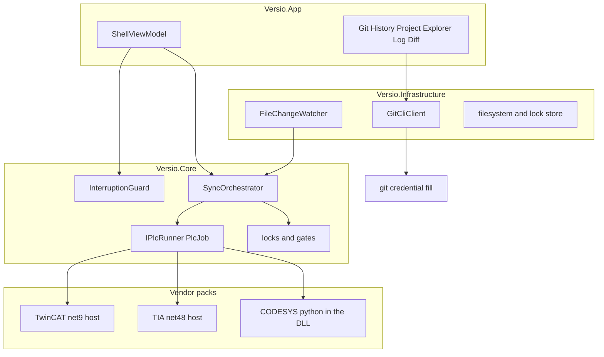

**[`src/Versio.Core`](../src/Versio.Core)** — decisions only. No `System.IO`, no
`Process`, no `DateTimeOffset.Now`, no UI. Sync, git models, locking, hashing, IEC 61131-3,
and the vendor **contracts** (`IPlcRunner`, `PlcJob`, `PlcFormats`). This is why the lock
model can be unit-tested in under a second.

**[`src/Versio.Infrastructure`](../src/Versio.Infrastructure)** — the outside world:
`git.exe`, the Windows filesystem, file watchers, `repo.json`, the JSON lock store, the
rolling log file.

**[`src/Versio.App`](../src/Versio.App)** — WPF window, view models, dialogs, theme.

**`Versio.Plc.*` packs** — one vendor each, split in two:

| Project | Job |
|---|---|
| `Versio.Plc.Codesys` | Pure: GUID table, import planner, wire protocol, path rules |
| `Versio.Plc.Codesys.Infrastructure` | Driven: find `CODESYS.exe`, extract scripts, launch the process |
| `Versio.Plc.TiaPortal` + `.Infrastructure` + `.Host` | Same split; the Host is a net48 exe that loads Openness |
| `Versio.Plc.TwinCat` + `.Infrastructure` + `.Host` | Same split; the Host is a net9 exe that talks COM to XAE |

`Versio.Core` has **no project reference** to any pack. The compiler enforces that.
Architecture tests (`VendorSeamTests`) read assembly metadata on top.

Adding a vendor is:

1. A new pair of projects implementing `IPlcRunner`, `IPlcProjectFormat`, `IPlcToolchain`.
2. One `ProjectReference` from `Versio.App`.
3. One `Register()` call in [`App.xaml.cs`](../src/Versio.App/App.xaml.cs).

Nothing in `Sync/`, `Git/`, `Locking/`, `Watching/`, `Projects/` or `Diff/` may learn a
vendor's name. If it does, vendor knowledge has leaked past the seam, and the leak is the
bug.

---

## 3. Startup, in order

Read [`App.xaml.cs`](../src/Versio.App/App.xaml.cs). The order is not decorative.

1. **Theme**, so the first frame is the right colour. Follows Windows until settings say
   otherwise, and keeps following it.
2. Optional `--spike` runs a tree-performance window instead of the shell. Left in the
   shipped app on purpose.
3. **Logger**, then the **file sink**, then crash handlers. A startup crash must already be
   on disk. Attaching the file log later used to mean the banner and the crash lived only
   in memory.
4. **Vendor registration**, before any window and before any scan:
   `CodesysPack.Register()`, `TiaPortalPack.Register()`, `TwinCatPack.Register()`. Opening
   a repository looks at every known format. A shell built first would scan for none.
5. Settings from `%LOCALAPPDATA%\VersioUser\settings.json` (theme, panel sizes, recent
   repositories). Read **before** the window shows, so it does not paint the wrong size and
   jump.
6. `ShellViewModel` is constructed. It owns git auth, sync, remotes, history, explorer.
7. `MainWindow` is shown.
8. Git presence is probed in the background (`ProbeGitAsync`) so a machine without git
   gets a sentence, not a Win32Exception.
9. Recent list is loaded, then a repository is opened: CLI path, then the working
   directory if it is a clone, then the most recent path that still exists.

Windows logoff does **not** go through the close guard. The process has a few seconds.
`AbandonForShutdown` kills the toolchain tree so a hidden IDE is not left holding the
project. Direction locks are already on disk and recovered next time. A session Job Object
reaps CODESYS.exe and git.exe if Versio is killed; the TIA/TwinCAT hosts watch the parent
PID and Quit COM.

### Opening a repository

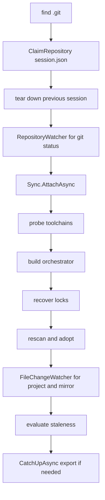

[`ShellViewModel.OpenAsync`](../src/Versio.App/ViewModels/ShellViewModel.cs):

1. Locate `.git`, build a `GitCliClient` over `git.exe`.
2. **`ClaimRepository`** — one Versio per clone. Marker:
   `.versio/local/session.json`. A second instance is told which window already has it. A
   crashed instance never locks anybody out: the marker is checked against a live process.
3. Tear down the previous session (`ResetForRepositoryChange`).
4. Attach git auth, ensure local git excludes, start a **`RepositoryWatcher`** (git status
   only — not PLC sync).
5. Refresh the changes list.
6. **`Sync.AttachAsync`** — probe toolchains, build the orchestrator, **recover locks**,
   rescan and adopt projects into `repo.json`, start PLC file watchers, evaluate staleness.
7. **`Sync.CatchUpAsync`** — export what changed while Versio was closed. Same path as the
   commit gate.

That order matters. Exporting in step 6 would run against a lock that has not been read
yet.

---

## 4. What lives on disk

A clone Versio is managing looks like this:

```
MyRepo/
├─ .git/
├─ .gitattributes          written on adoption (binaries, optional LFS, mirror eol=lf)
├─ .gitignore              .versio/local/ and vendor .opt files
├─ MyMachine.project       the binary (often LFS)
├─ MyMachine/              the textual mirror
│  ├─ Application/
│  │   └─ PLC_PRG.st
│  ├─ _manifest.json       GUID → path → hashes, skips, warnings
│  └─ _coverage.md         human report of what reached the mirror
└─ .versio/
   ├─ repo.json            committed: which projects, where their mirrors are, vendor
   └─ local/               gitignored
      ├─ state.json        direction locks
      ├─ session.json      one-Versio-per-clone
      ├─ autostash.json    auto-stash sidecar
      └─ backups/          copies of the project taken before import
```

**`repo.json`** is the binding list. A **binding** is: this project file ↔ this export
directory ↔ this vendor ↔ this profile. Adoption is automatic. Versio finds projects; you
do not register them. An ignore glob or a template project can be left out.

**`_manifest.json`** is not the direction lock. The lock hashes the **whole mirror tree**
(`MirrorHash`). Hashing the manifest file alone missed a hand-edited `.st`.

**Baseline vs LastSynced** (both in `state.json`, [`LockRecord.cs`](../src/Versio.Core/Locking/LockRecord.cs)):

- **LastSynced** moves on every successful export or import. Answers: "has anything
  changed since the last sync?"
- **Baseline** moves on push or discard. Answers: "is there work that has not been
  released?"

**A push moves Baseline only.** Until 2026-09-14 it rewrote `LastSynced` too, recording the
project's current hash as exported — so a save no export had run for (the IDE holding a
directory project, a dropped event) was forgotten by the next push of anything. Discard and
failure acknowledgement still reset `LastSynced`, to an empty project hash that forces the
next event to export.

Conflating those two was a real bug: an export either re-exported forever or dropped the
lock that still guarded unpushed work.

---

## 5. The vendor seam

The orchestrator never names CODESYS, TIA, or TwinCAT. It builds a **`PlcJob`** and hands
it to **`IPlcRunner.RunAsync`**.

[`PlcJob.cs`](../src/Versio.Core/Plc/PlcJob.cs) — three operations only:

| Operation | Meaning |
|---|---|
| `Probe` | Is this toolchain installed and usable? |
| `Export` | Write the project out as reviewable text |
| `Import` | Apply edited text back into the project |

A job carries:

- One or more projects (no runner batches today; CODESYS refuses more than one).
- A **profile** string the orchestrator does not interpret (CODESYS profile name, TIA
  version, …).
- For import, an **`ImportPlan`** — the same object the confirmation dialog showed.

`PlcFormats` answers "is this path a project of mine?" and "where is the open-in-IDE
marker?" `PlcToolchains` builds a runner for a vendor.

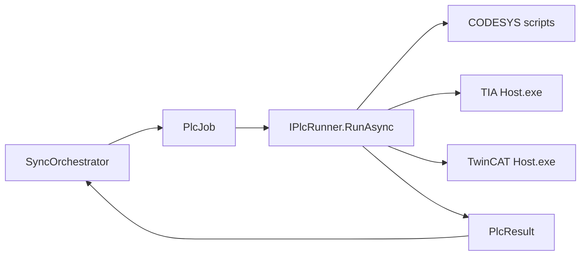

### Who plans vs who executes

For CODESYS, C# [`CodesysImportPlanner`](../src/Versio.Plc.Codesys/CodesysImportPlanner.cs)
reads the manifest and the mirror **before** CODESYS starts. It decides create / update /
delete / rename / move / skip. The dialog names that plan. The Python importer
**does not decide**. It executes the plan it was given.

`LocalCodesysRunner.ToNative` copies `Plan` onto the CODESYS job. Dropping that field is
a silent defect: the import still "works", still runs from a plan, and runs from a
**different** plan than the person agreed to.

### TIA Portal — placeholder

`LocalTiaPortalRunner` spawns `Versio.Plc.TiaPortal.Host.exe` with a job JSON. Product
ops are Probe / Export / Import. A fourth op, `hwprobe`, is **tools-only**
(`tools/tia/Probe-Hardware.ps1`) and is not product Export — see
[`vendors/tia/DRIVING.md`](vendors/tia/DRIVING.md) §4.4. Host files: `Program.cs`,
`HostApp.cs`, `HostExport.cs`, `HostImport.cs`, `HostHardwareProbe.cs`,
`HostDeviceCatalog.cs`, `JobReader.cs`, `OpennessLoader.cs`. Hardware Comments
are `*.devices.yaml` (form `DEVICE_COMMENT`); PlugNew is not this slice.
*Still developing — fill later.*

### TwinCAT — placeholder

`LocalTwinCatRunner` spawns `Versio.Plc.TwinCat.Host.exe`. Product ops are Probe /
Export / Import. A fourth op, `ioprobe`, is **tools-only**
(`tools/twincat/Probe-Io.ps1`) and is not product Export — see
[`vendors/twincat/DRIVING.md`](vendors/twincat/DRIVING.md) §4.5. Host files:
`Program.cs`, `HostApp.cs`, `HostExport.cs`, `HostImport.cs`, `HostDeviceCatalog.cs`,
`HostIoProbe.cs`, `HostCom.cs`, `HostText.cs`, `MessageFilter.cs`. I/O catalogs are
`*.devices.yaml` (form `DEVICES`, export-only); CreateChild is not this slice.

### Studio 5000

Not started.

---

## 6. How a script actually runs

This chapter is CODESYS. The Python lives in
[`src/Versio.Plc.Codesys.Infrastructure/Scripts/`](../src/Versio.Plc.Codesys.Infrastructure/Scripts/)
and is **embedded in the DLL**. Editing a `.py` and running tests with `--no-build` tests
the script from the last build, not the one on disk.

For ScriptEngine API spellings, measured defects, and the protocol audit, read
[`vendors/codesys/DRIVING.md`](vendors/codesys/DRIVING.md) §12. This section is what the
files do, in order, in ordinary words.

### 6a. From C# to Python

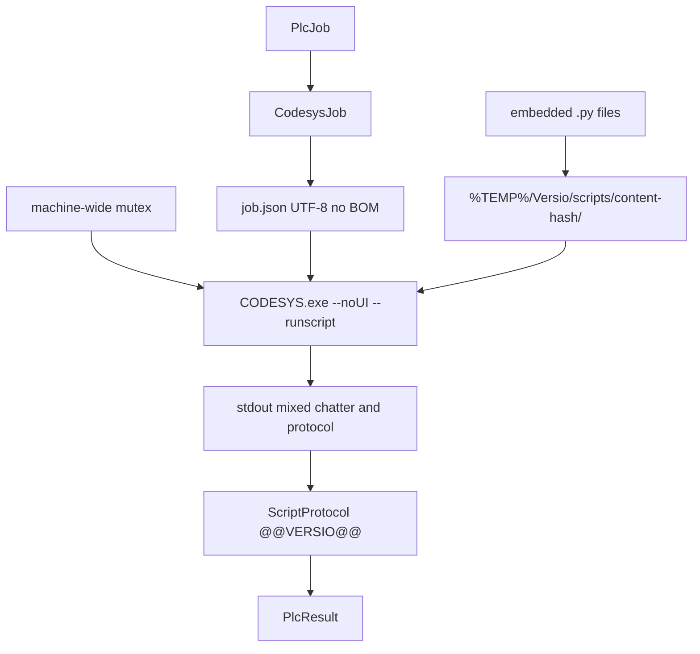

1. **Embed.** The `.csproj` has `<EmbeddedResource Include="Scripts\*.py" />`.
2. **Extract.** [`ScriptExtractor`](../src/Versio.Plc.Codesys.Infrastructure/ScriptExtractor.cs)
   writes them to `%TEMP%\Versio\scripts\<content-hash>\`. The folder is versioned by
   content hash so an upgrade cannot pick up yesterday's files.
3. **Job file.** [`LocalCodesysRunner`](../src/Versio.Plc.Codesys.Infrastructure/LocalCodesysRunner.cs)
   writes `job.json` as UTF-8 **without a BOM**. IronPython 2.7's `json.load` fails on a
   BOM with "No JSON object could be decoded". Only one path crosses `--scriptargs`.
   Windows quoting of that flag is unreliable, which is why a file is used at all.
4. **Mutex.** `Global\Versio.Codesys.SingleInstance`. Two headless CODESYS on one profile
   are not safe. Wait up to 15 minutes.
5. **Launch.** `CODESYS.exe --profile=… --noUI --runscript=… --scriptargs:<job.json>`. No
   window: `CREATE_NO_WINDOW` **and** `SW_HIDE` (different subsystems). Stdout and stderr
   are drained **while** the process runs. A 2.5 MB visualisation export fills the pipe;
   reading only after `WaitForExit` deadlocks.
6. **Timeout.** Kill the **process tree**. Children outlive a plain `Process.Kill`.
7. **Protocol.** Every structured line is `@@VERSIO@@` plus JSON.
   [`ScriptProtocol`](../src/Versio.Plc.Codesys/ScriptProtocol.cs) splits those from
   CODESYS chatter (licence notices, localised messages). A line with the marker but bad
   JSON is kept, not thrown — a dying script is when diagnostics matter.
8. **Translation.** Object events become paths. Warning events become sentences. The
   orchestrator never sees a CODESYS warning code.

Export job, roughly: `{ "project": "...", "out": "<mirror>", "bindingId": "b-…" }`.

Import job, roughly: `{ "schema": 2, "project": "...", "src": "<mirror>", "save": true,
"plan": { "files": [ { "path", "action", … } ] } }`. Schema is checked **before** the
project is opened. An unexpected schema is refused outright.

### 6b. How the Python files connect

Two families:

- **Entry scripts** import `scriptengine`. They only run inside CODESYS.
- **Pure modules** import no `scriptengine`. Parity tests run them on ordinary CPython.

Shared modules do **not** import each other. The entry scripts import them.

```mermaid
flowchart TB
  exportPy[versio_export.py]
  importPy[versio_import.py]
  probePy[versio_probe.py]
  probeNat[versio_probe_native_import.py]
  deletePy[versio_delete_objects.py]
  exportPy --> text[versio_text.py]
  exportPy --> types[versio_types.py]
  exportPy --> equiv[versio_native_equiv.py]
  exportPy --> libs[versio_libraries.py]
  exportPy --> tasks[versio_tasks.py]
  exportPy --> devices[versio_devices.py]
  exportPy --> yaml[versio_yaml.py]
  importPy --> decl[versio_decl.py]
  importPy --> text
  importPy --> types
  importPy --> equiv
  importPy --> tree[versio_tree.py]
  importPy --> yaml
  probePy --> se[scriptengine only]
  probeNat --> se
  deletePy --> se
```

Two helpers appear in almost every entry script:

- **`emit(obj)`** — print `@@VERSIO@@` plus JSON. That is the only structured channel
  back to C#.
- **`safe(fn)`** — call `fn`, return a default if it throws. ScriptEngine throws for
  properties that do not apply (for example `has_textual_implementation` on a folder).
  Probing is normal control flow here, not error handling.

Open projects are remembered in a module-level `_OPEN` so a failure can still close them.
CODESYS writes a `<project>.~u` sidecar while it holds a file. A script that dies between
open and close leaves that marker for the next run to reason about.

### 6c. Dual language — who is the truth

At run time **Python decides**: object form, file name, how a `.st` is split, how native
XML is scrubbed, what kind of object a declaration creates, whether two XML payloads are
"the same".

C# copies exist so tests can compare both sides, and so a future runner that is not
CODESYS has a spec. They are **not** what runs inside the toolchain.

| Python | C# counterpart | What it is |
|---|---|---|
| `versio_types.py` | `CodesysObjectType` | GUID table, form decision |
| `join_st` / `split_st` | `StTextCodec` in `Versio.Core/Iec` | One `.st` file, two halves |
| `parse_declaration` | `StDeclarationParser` | What factory creates this object |
| `versio_native_equiv.py` | `CodesysNativeXmlNormalizer` | Same XML after masking churn |
| `safe_file_stem` / `file_name_for` | `CodesysPathMapper` | Legal file names |
| `scrub_native_xml` | `CodesysNativeXmlScrubber` | Strip timestamps from XML |

`split_st` trims a **named** set of whitespace characters. Python's default `strip` and
.NET's `Trim` disagree on four ASCII separators. Those four would make a renamed POU hash
differently on the two sides, so no rename would be detected and the object would be
destroyed and rebuilt. The set is Python's, because the exporter is the writer and every
committed hash came from it.

### 6d. Every script

#### `versio_export.py` — product Export

Walks the project tree and writes one file per object into a **staging** folder, then
swaps that folder onto the live mirror.

`main`, in order:

1. Read `job.json`. Need `project` and `out`.
2. Staging path is `out + ".versio_staging"`. Trash path is `out + ".versio_trash"`. If
   either still exists, a previous run was killed. They are cleared and the script says
   so. Staging leftover = export died during the walk. Trash leftover = export died
   **during the swap**, which is the window this design exists to make harmless. If the
   mirror is missing, look in trash.
3. Create staging empty.
4. Open the project. Remember it so `finally` can close it.
5. **Count** objects first (`count_objects`) so the progress bar has a denominator.
   Descent matches `handle` using type GUIDs only — it does not ask the expensive
   `has_textual_*` properties.
6. Walk each root child with `Exporter.handle` into staging.
7. Write `_manifest.json` and `_coverage.md` into staging.
8. Swap staging onto `out`. Preferred: three-rename (mirror → trash, staging → mirror,
   delete trash). If a process has a handle inside the mirror so the directory cannot be
   renamed, **`replace_contents`** moves files instead of directories.
9. Close the project.

`Exporter.handle` — one object:

1. Read name. No name → warn `UNNAMED_OBJECT` and stop. That object never reaches the
   records or the skips, so coverage must still report it.
2. Read type GUID → `type_of`. Unknown GUID → warn `UNKNOWN_TYPE_GUID`, then **still
   export** natively. A newer CODESYS adding a type must not silently lose objects.
3. Read children once. Reuse that list.
4. `decide_form(...)`. A **form** is how this object is written to disk: one `.st`,
   native XML, YAML, a folder, or skip. The full table is under `versio_types.py` below.
5. Then the form table below. Path length is checked **before** the write: Windows
   `IOError` names the path and not the reason. Names are never shortened based on the
   checkout path — that would make two clones produce different file names for one object.

After the primary file, members (methods, actions, properties) are walked into a
**directory named after the owner**. The path is what the IDE shows. `parent` GUID in the
manifest answers a question the path cannot: is `FB_Alarm/M_Reset.st` the POU's method, or
an object that happens to sit in a folder of the same name?

`NATIVE_R` and `TASK_BOTH` do **not** recurse as members: the recursive XML already holds
the children.

Native export uses **`preserve_equivalent`**: if the freshly exported XML is the same as
the file already on disk (after in-memory normalisation), keep the old bytes. Otherwise
every export churns visualisations and git sees a fake diff.

#### `versio_import.py` — product Import

Executes a plan. Files the plan does not mention are warned (`NOT_IN_PLAN`) and never
touched.

`main`:

1. Read job. Schema must be **2**. Anything else is fatal **before** open.
2. A schema-2 job must carry a `plan`. Missing plan is fatal.
3. Open project. Run `Importer.run()`.
4. Save if anything actually wrote (updates, native, partial, removed, renamed,
   retargeted). A delete-only import that skipped save would put the object back on close.
5. Close in `finally`.

`run` order is load-bearing:

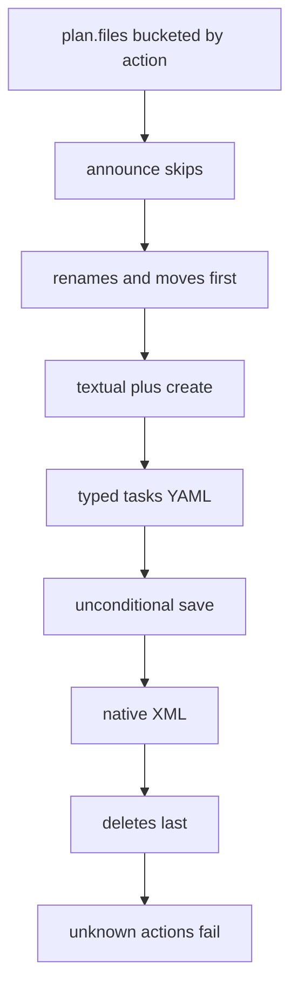

1. **Renames and moves first.** Later phases find objects **by name**. If you apply
   content first and rename after, the content lands in the object that is about to be
   renamed, and the rename then moves somebody else's edit. Swapping two names in one
   commit cannot work from here: deletes run last, so the destination name is still taken.
   That fails out loud. Two imports, not a silent swap.
2. **Textual + create.** Locate by the plan's path chain. Replace declaration /
   implementation **in place**. GUID kept. Creates use `versio_decl` so `PROGRAM Foo` in
   `Bar.st` creates `Foo`, not `Bar`.
3. **Typed.** Today: `.tasks.yaml` through property assignment, never `import_native`.
4. **Unconditional save.** Creating objects mutates CODESYS's name dictionary. Running
   `import_native` in the same session enumerates that dictionary while it is being
   modified and throws "Collection was modified". The exception is swallowed by
   `import_native`'s progress callback, so the import **looks successful and does
   nothing**. One save per import is cheaper than a condition that forgets a new phase.
   Renames also mutate that dictionary and used to be omitted from the old "save if
   created or updated" test.
5. **Native.** `import_native([path], filter, handler)` — a **list**. A bare string can
   be iterated as characters (`Could not cast: System.String in System.Char`). Custom
   handler returns replace-in-place. GUID kept. The default handler pastes, which is why
   older tools deleted the object first.
6. **Deletes last.** `remove()` takes a referenced object out with no exception, no
   cascade, no warning. Last means the project is otherwise complete. Before removing, the
   script checks the live object still matches the last export: ST is compared byte for
   byte; native is compared by **`nhash`** (normalised hash — under the current normalisation
   and each older one an export may have recorded it with, `normalized_forms`, since the
   normaliser changed on 2026-10-24 and 2026-10-25). An object edited in the IDE
   since export is **kept**. A missing file says a file was deleted, not that the object
   was abandoned.
7. Unknown plan actions → `UNKNOWN_PLAN_ACTION`. A newer C# verb must be heard refusing,
   not silently ignored.

#### `versio_types.py` — GUID table and forms

Pure. Maps CODESYS type GUIDs to names (`POU`, `DUT`, `GVL`, `METHOD`, `DEVICE`, …) and
decides the **form**: how that type is written to disk.

| Form | What it means |
|---|---|
| `ST_FULL` | Declaration + delimiter + implementation, one `.st`. Importable. |
| `ST_DECL` | Declaration only (GVL text half, DUT, …). Importable. |
| `ST_IMPL` | Implementation only (action, transition). Importable. |
| `GVL_BOTH` | Decision: write `.gvl.st` (importable) **and** `.gvl.xml` (export-only, recorded as `GVL_NATIVE`). |
| `GVL_NATIVE` | Recorded, never decided by `decide_form`. The XML half of a GVL. |
| `TASK_BOTH` | Decision: `.tasks.yaml` is importable; recursive `.xml` is `TASK_NATIVE` (export-only). |
| `TASK_NATIVE` | Recorded, never decided. Native XML used to rewrite CPU affinity (`Core2`) and throw on the second import. |
| `PROPERTY_BOTH` | Recursive `.xml` imports; readable `.st` is `PROPERTY_TEXT` and does **not** import (reassembling emptied every accessor). |
| `PROPERTY_TEXT` | Accessor body for reading. |
| `NATIVE` | Native XML, this object only. |
| `NATIVE_R` | Native XML, recursive (children live inside this file). |
| `NATIVE_WITH_CHILDREN` | Unmapped type that has children: write this node, then walk children into a subdirectory. |
| `CONTAINER` | Folder: a directory, no payload file. |
| `LIBRARIES` | YAML of library references. Export-only. Change libraries in the IDE. |
| `DEVICES` | YAML of connectors / parameters / empty slots. Export-only. |
| `EXTERNAL_NATIVE` | External-file object. Export-only: `import_native` **duplicates** it. |
| `SKIP` | Deliberately not exported, with a reason. |

**Export-only** means: written for review, never applied back. The panel shows a lock
glyph. Editing it does not reach the project.

`can_verify` is the deletion check: textual forms can be rebuilt byte for byte; native
forms need `nhash` (manifest schema 5+).

#### `versio_text.py` — ST files, hashes, names

Pure. Shared by export and import.

- **`join_st` / `split_st`.** One file, two halves, split on
  `// --- BEGIN IMPLEMENTATION ---` (a legal ST comment). If a declaration **contains**
  that marker, it is escaped with `//!VERSIO-ESC!` first. Without that, a randomised
  round-trip test moved code from the declaration into the implementation.
- **`content_hash`.** Canonical hash stored in the manifest.
- **`scrub_native_xml`.** Strip timestamps and similar churn so a no-op export does not
  dirty git.
- **`safe_file_stem`.** Characters Windows will not allow in a file name.
- **`too_long_for_any_machine` / `too_long_for_this_machine`.** Path-length guards.
  Shortening based on total path would make names depend on checkout location.
- **`line_sketch` / `sketch_similarity`.** Fingerprint used when a rename also edited the
  body, so git HEAD has no matching hash.

Must stay identical to `StTextCodec`.

#### `versio_decl.py` — what factory creates this

Pure. Reads an ST declaration header (comments and attributes stripped) and returns
PROGRAM / FUNCTION_BLOCK / FUNCTION / INTERFACE / DUT (struct, enum, alias, union).

Unknown → `UNKNOWN`. Creating the wrong kind of object is worse than creating none. The
importer reports instead of guessing.

Mirrors `StDeclarationParser.cs`.

#### `versio_native_equiv.py` — is this XML the same?

Pure. Native export → import → re-export is semantically lossless but **not byte-stable**.
Three kinds of churn, masked **in memory for a comparison**. Disk keeps real GUIDs.
Rewriting GUIDs in the file broke visualisations in other tools.

1. Counters (`UniqueIdGenerator` advances).
2. Unordered collections serialised in a different order.
3. Reference GUIDs reminted on import.

Two product callers, both inside CODESYS where C# cannot be reached:

- Export: keep existing bytes if equivalent (`preserve_equivalent`).
- Import delete: do not delete if the live object no longer matches.

#### `versio_yaml.py` — tiny YAML, no PyYAML

Pure. No third-party libraries: IronPython inside CODESYS has no `pip install pyyaml`,
and `Versio.Core` stays dependency-free.

Subset: mappings of scalars, nested mappings, lists of scalars, lists of mappings. No
anchors, no multi-line, no tags. Caller supplies key order. IronPython 2.7 and CPython 3
do not agree about dict iteration order; depending on it would churn every export.

C# reader: `LibraryCatalog` / `TaskCatalog` / `DeviceCatalog` in `Versio.Core/Projects`.
`MemberTable` is the same kind of pane model, produced by a format on open rather than
read from a sidecar.

#### `versio_libraries.py` — library manager → YAML

No `scriptengine` import. Export hands it objects and `safe`.

Use `libman.references`, not `get_libraries()` (that API returns names only). Iterate the
collection; do not index by `refs[0]` — it is keyed by id, and id 0 is often missing.

Do **not** record `ref.id`. It is reminted on every open. Two consecutive exports of an
untouched project differed in dozens of lines, all ids.

Version / company / title are parsed from the **reference name**. Reading them off
`managed_library` reports what **this PC has installed**, and raises for a library it
does not have.

Export-only. Change libraries in the IDE.

#### `versio_tasks.py` — task configuration → YAML, and back

Same contract as libraries. Also **applies** a `.tasks.yaml` through typed properties on
import.

Exists because native XML round-trip:

- Rewrote `Core2` (CPU affinity) without being asked.
- Threw on every import after the first (stale precompile cache).

So YAML is the importable half. Native XML is export-only.

Fields were measured on a real task: `priority` is a string, `interval` is a string in
inconsistent formats (record verbatim), `core_binding` is the XML `Core2`.

A task's POU list is stored **by name**. Renaming a POU does not update it. The importer
retargets those lists when it renames.

#### `versio_devices.py` — device tree → YAML

Connectors, host parameters, empty IO-Link slots. Export-only: change devices in the IDE.
The YAML lives **inside** the device directory (`Device/Device.devices.yaml`). A file beside
the folder would draw two sibling rows named Device.

Empty slots are eight siblings all named `<Empty>`. Native export collided them onto one
`%3CEmpty%3E.xml`. They are listed in the parent YAML instead of written as files.

Parameter ids were stable across opens (unlike library `ref.id`). Duplicate names are
real; collisions are keyed `name#id`, then `name#2` / `name#3` if that still collides.

A failed YAML write warns `EXPORT_FAILED` and still walks children. Device used to be a
folder with no file; gating the walk on the write would drop Plc Logic from the swapped
mirror.

#### `versio_tree.py` — find an object by name

Used by import. Walk by `get_children` / `get_name` / `is_folder`.

- Direct child by name, or
- Through **folders only**, never through a POU — a method must not answer a lookup meant
  for a program.
- Returns a **list**. Two hits means ambiguous. The caller must not guess which method
  body to overwrite.
- Depth cap 32, same as the other walks: a cycle would hang with no output.

`versio_delete_objects.py` and `versio_probe_native_import.py` keep their **own** strict
walk on purpose: a probe, and a delete of a path a human typed, should refuse to be
helpful.

#### `versio_probe.py` — product Probe

Walks the tree and writes a capability report (`report.json`). Invoked by
`PlcOperation.Probe`.

Has its **own** copy of the GUID table. That copy can drift from `versio_types.py`. Do
not merge them in passing; treat it as a known trap. The live table for export/import is
`versio_types.py`.

#### `versio_probe_native_import.py` — lab only

Answered "does `import_native` replace in place?" The app never runs it. It is still
embedded because the glob embeds every `.py`.

#### `versio_delete_objects.py` — test helper

Deletes named objects so recreate tests have a hole to fill. Not a product path. Strict
name walk: the path is what a human typed.

### 6e. Export forms, as the walk hits them

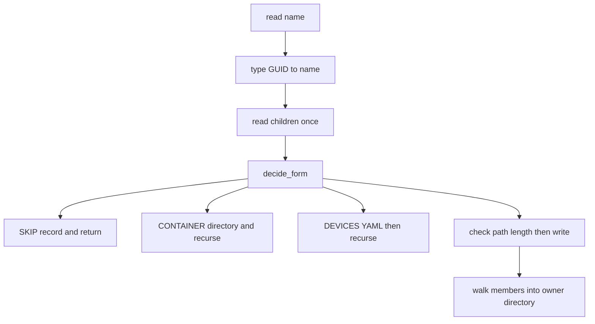

Order inside `handle` after `decide_form`:

1. `SKIP` — record reason, emit skip, return.
2. `CONTAINER` — make a directory, recurse (keep incoming `parent_guid` through folders
   inside a POU).
3. `DEVICES` — write YAML inside the device directory, recurse the same way.
4. Path-length check on the primary file.
5. `ST_FULL` / `ST_DECL` / `ST_IMPL` — join or normalise, write, record.
6. `GVL_BOTH` — XML then ST. XML recorded `GVL_NATIVE`.
7. `TASK_BOTH` — recursive XML as `TASK_NATIVE`, then `.tasks.yaml`.
8. `PROPERTY_BOTH` — recursive XML as `NATIVE_R` (that is the importable half), ST as
   `PROPERTY_TEXT`.
9. `PROPERTY_TEXT` — implementation only.
10. `LIBRARIES` — YAML.
11. `NATIVE` / `NATIVE_R` / `NATIVE_WITH_CHILDREN` / `EXTERNAL_NATIVE` — native export;
    only `NATIVE_R` is recursive into its own file.
12. If `NATIVE_WITH_CHILDREN`, walk children with **no** parent GUID (they are objects,
    not members).
13. Else if not `NATIVE_R` or `TASK_BOTH`, walk members into `owner/` with this object's
    GUID as `parent`.

### 6f. Import plan actions

C# `PlannedAction` on the wire as the script's `action` field:

| Action | What the script does |
|---|---|
| `skip` | Announce why. Do not touch the file. Includes bookkeeping, export-only, stray files, rename targets, "would destroy members". |
| `text` | Replace declaration/implementation in place. |
| `create` | Create from the declaration, then apply text. Name comes from the plan, not the file stem. |
| `typed` | Apply `.tasks.yaml` through properties. |
| `native` | `import_native` with the replace handler. |
| *(renames)* | Separate list on the plan. Run first. |
| *(deletes)* | Separate list. Run last, after the live-object check. |

Anything else → `UNKNOWN_PLAN_ACTION`, counted failed.

A graphical POU that also has textual members: importing its `.xml` would replace the POU
and **delete the members**. That file is skipped (`WouldDestroyMembers`). The member `.st`
files still import. Change the graphical body in the IDE.

---

## 7. Change detection and the sync loop

Two watchers. Do not mix them up.

| Watcher | File | What it is for |
|---|---|---|
| `FileChangeWatcher` | [`Infrastructure/Watching/FileChangeWatcher.cs`](../src/Versio.Infrastructure/Watching/FileChangeWatcher.cs) | Project file + mirror tree → `SyncOrchestrator` |
| `RepositoryWatcher` | [`Infrastructure/Watching/RepositoryWatcher.cs`](../src/Versio.Infrastructure/Watching/RepositoryWatcher.cs) | `.git` metadata → refresh the changes list |

`FileChangeWatcher` has three tiers:

1. `FileSystemWatcher` — push, near-instant. The happy path.
2. A ~30 second safety poll — watchers drop events (buffer overflow, cloud folders,
   antivirus).
3. Overflow rescan — the watcher said its buffer overflowed; everything is re-checked.

It waits until the file is **quiet and readable**, not a fixed debounce. A save produces
several events (temp file, rename, attributes) and may still be locked when the last one
arrives.

Windows coalesces change notifications **per directory**. A test that asserts one event
per file is asserting something Windows does not guarantee.

None of this is relied on for correctness. The commit gate re-checks hashes before a
commit. A missed event is a delay, not a wrong commit.

The **hash gate** drops a change whose content matches what we last synced. A save that
changed nothing must not look like a lock scare. The **coalescer** holds one pending job
per project so a burst of saves costs one toolchain start, not one per keystroke.

### Gate order

[`SyncOrchestrator.AttemptAsync`](../src/Versio.Core/Sync/SyncOrchestrator.cs). Each
early gate returns "stop" or "keep going". Re-read the method if you reorder anything.

1. **Unknown / disabled binding**
2. **Circuit breaker already tripped** — too many failures in a window (default 5 / 60 s).
   Sticky until a person resets. Stop trusting our own reasoning.
3. **Git is rewriting the tree** — pull or checkout in flight. Do not export/import into
   a tree git is replacing.
4. **Self-write suppressor** — we are currently writing that path.
5. **Nothing actually changed** (`NothingActuallyChangedAsync` / `HashGate`) — content
   hash matches last synced. A no-op save must not look like a lock violation.
6. **Echo of our own export** — path **and** hash, ~10 s TTL. A real concurrent edit is
   not suppressed.
7. **Unresolved conflicts**
8. **Direction lock** (`SyncStateMachine` in [`SyncState.cs`](../src/Versio.Core/Sync/SyncState.cs)).
   There is no class named `DirectionLock`.
   8b. **Pending mirror edit** (`MirrorEditStillPendingAsync`) — a project save on a
   Clean binding whose mirror differs from the last synced mirror is refused
   (`BlockedByPendingEdit`): the export would write over an edit nothing has imported,
   and an uncommitted mirror edit has no backup. The lock cannot see this one, because
   gates 9 and 10 refuse without claiming a direction. Confirm or discard the edit to
   get past it. Since 2026-10-25.
9. **Import confirmation** — `Confirmed = false` → banner, no write.
10. **IDE occupancy** — import waits; export may copy (`ExportHeldViaCopy`).
11. **Coalescer + 10 s minimum interval** — N saves cost one toolchain start. Skipped for
    a synchronous job (commit gate must run now).
12. **Breaker just tripped** — this run is the one that crossed the threshold.
13. **Claim the direction, then run the toolchain.**

The lock is written to `.versio/local/state.json` **before** CODESYS starts.

| Direction | Meaning |
|---|---|
| `Clean` | Either side may be claimed |
| `ProjectAuthoritative` | Project changed. Exports OK. Imports blocked. |
| `TextAuthoritative` | Mirror changed. Imports OK. Exports blocked. |
| `Conflict` | Both sides changed. Person picks. **Nothing enters it**: `EnterConflict` has no caller, and "both sides changed" is answered by gate 8b without a persisted state — the two acts that resolve it (confirm, discard) already exist, a third does not. |
| `Failed` | Last op failed. Acknowledge before retry. |

Refused or coalesced work does **not** flash the progress bar. A real run announces
itself (`SyncRunNotice`) and heartbeats. Background fetch does not raise `BusyTracker`.

---

## 8. Roundtrip of a changed file

### A. You save in the IDE (export)

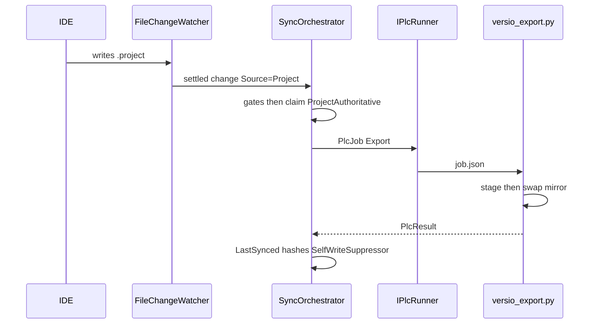

1. IDE writes the project file.
2. Watcher settles.
3. Orchestrator: `ChangeSource.Project`.
4. Gates (section 7). If the lock is `TextAuthoritative`, export is refused.
5. Claim **`ProjectAuthoritative`** first.
6. If the IDE holds the project, export a **copy** (`ExportHeldViaCopy`). Import cannot
   do this: the IDE would revert it on the next save.
7. `PlcJob(Export)` → `versio_export.py` (or TIA/TwinCAT host).
8. Staging tree, `_manifest.json`, `_coverage.md`, atomic swap.
9. Register written paths on the self-write suppressor.
10. Update `LastSynced`. Direction **stays** `ProjectAuthoritative` until push or discard.
11. Project tree **reconciles** — same row objects, selection stays.

### B. You edit a `.st` in the mirror (import)

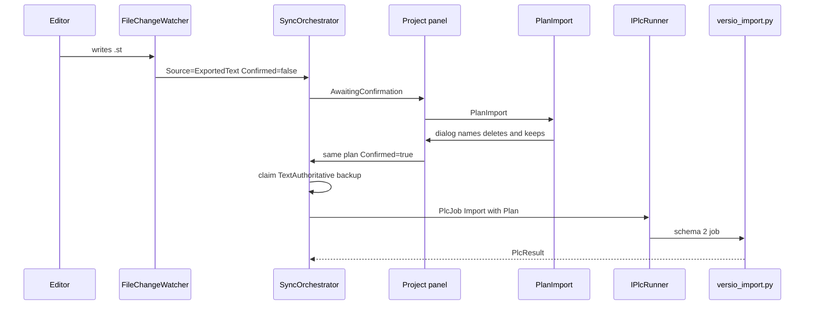

1. Edit lands. Watcher / tree hash sees it.
2. First pass: `Confirmed = false` → **`AwaitingConfirmation`**. Nothing is written. The
   project row says which project is waiting.
3. `IPlcProjectFormat.PlanImport` builds the plan from the manifest + the mirror.
4. Dialog names what will really go and what will really stay (including deletions the
   in-process check will refuse).
5. Second pass: **the same plan**, `Confirmed = true`. The plan is not recomputed after
   the click.
6. Claim **`TextAuthoritative`**.
7. Copy the project aside first ([`BackupCatalog`](../src/Versio.Core/Sync/BackupCatalog.cs)).
   Keep 10. A failed backup **aborts** the import. Restore keeps a copy of what it
   replaced, so going back one too far is recoverable. Refused while the IDE holds the
   project.
8. `PlcJob(Import, Plan)` → `versio_import.py`.
9. Success: `LastSynced` updated. **No product re-export of the whole mirror.** A native
   object may be re-exported *inside* import only to compute `nhash` for the delete check.
10. State stays `TextAuthoritative` until push or discard.

### Commit vs push

- **Commit** does not release the lock.
- **Push** calls `ReleaseAfterPushAsync` / `PushSucceeded`.
- **Discard** of a mirror file releases too (`ReleaseAfterDiscardAsync`) — but only when
  the mirror is back at the last synced state. A discard of one of several edits keeps the
  lock and the record as they are; releasing unconditionally recorded the surviving edits
  as synced and the next export wrote over them (FINDINGS 2026-10-24, item 3).

**Commit gate** ([`CommitGate.cs`](../src/Versio.Core/Sync/CommitGate.cs)): if the project
hash ≠ `LastSynced`, export and stage first. You cannot commit a project whose text
disagrees with it.

- A commit belongs to a project when it includes the pointer, a file in the mirror, or —
  for a directory project — a file in the payload folder (`System/PEData.plf`). Before
  2026-09-14 only the first two counted, so a commit of the program store alone skipped the
  export.
- **A wait is not an export.** If the export before the commit does not complete — the IDE
  holds a directory project (`BlockedByOpenProject`), the direction lock refuses — the commit
  is refused with that sentence (`CommitGate.StillStaleAfterExport`). Before 2026-09-14 only a
  *failed* export stopped it, and a TIA Portal project open all day committed its old mirror.
  Untick that project's files to commit the rest.

Pull is `git pull --ff-only`. A named merge that touches a tracked project or mirror uses
`MergePreflight` and then requires import (the merge made the text authoritative).

---

## 9. Git, end to end

Everything is **`git.exe`**. Interface:
[`IGitClient`](../src/Versio.Core/Abstractions/IGitClient.cs). Implementation:
[`GitCliClient`](../src/Versio.Infrastructure/Git/GitCliClient.cs) plus partials
(`Credentials`, `Branches`, `Conflicts`). No LibGit2Sharp.

**Identity is not credentials.** `user.name` / `user.email` is who a commit is attributed
to. Credentials are how the remote is reached. A machine can have one and not the other.

### Credentials

Versio stores **nothing**. No token store, no password box.

| Call | git | When |
|---|---|---|
| Is one stored? | `git credential fill` with prompts suppressed | Repository open — panel can say "sign in needed" |
| Sign in | `git credential fill` **allowed to prompt** | User pressed the button. Only call permitted to prompt. |
| Sign out | `git credential reject` | Stale token the helper keeps returning |

The helper is whatever git is configured to use (Git Credential Manager, a corporate
helper, `store`). Versio never launches `git-credential-manager` by name.

**Never log stdin/stdout of `git credential`.** The protocol is `key=value` and one of
those keys is `password`. `Redact` does not catch it.

SSH has no credential helper. A refused key is a different failure (`SshKeyRefused`).
HTTPS URLs with embedded user:password are stripped before logging or opening a browser.

Almost every other git call sets `GIT_TERMINAL_PROMPT=0` so a missing credential fails
fast instead of hanging the UI.

A rejected credential **halts** the background poller. Retrying every few seconds can
lock an account. The circuit-breaker threshold is for things that might recover; this is
not one.

### Button to git.exe

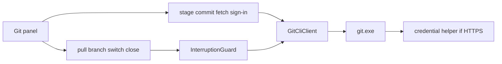

`InterruptionGuard` sits on actions that rewrite the working tree or leave the repository
(pull, branch switch, close, switch repo). Stage, commit, fetch, and sign-in do not go
through it. One operation at a time (`BusyTracker`).

| Action | What runs |
|---|---|
| Stage / unstage (background, at commit) | `git add` / `git restore --staged` of the include set |
| Stage hunk | Copy the hunk verbatim, `git apply --cached` (working tree untouched) |
| Commit | Commit gate first, then `git commit -m` |
| Discard | Names the file. Untracked is refused with an explanation. |
| Fetch | `git fetch --progress` |
| Pull | Guard, then `git pull --ff-only --progress`. Watcher suppressed while the tree rewrites. |
| Push | `git push --progress`, then release direction locks |
| Publish | `git push -u` |
| Clone | `GitCliClient.CloneAsync` — **static**, not on `IGitClient`. Clone stays disabled until `ls-remote` succeeds. Editing the URL disables it again. |

History is lazy at four levels: log is not read until the panel opens, then a page at a
time (50), a commit's files when expanded, a patch when a file is clicked.

### Background remote watch

[`RemotePoller`](../src/Versio.App/ViewModels/RemotePoller.cs) +
[`RemotePollPolicy`](../src/Versio.Core/Sync/RemotePollPolicy.cs):

1. `git ls-remote` (cheap, no objects). Default ~10 s, backs off to 60 s.
2. Compare to local `origin/branch`.
3. If the remote moved, **fetch**. Never pull.

Automatic pull would rewrite the project and the mirror under the watcher. That is the
corruption scenario the safeguards call §5.A.

The poller:

- Does not raise `BusyTracker`.
- Suspends while anything else runs, including a guard prompt.
- Stops dead on a terminal auth failure.

### Forge / merge-request button

[`Forge.cs`](../src/Versio.Core/Git/Forge.cs). Opens the forge's page with both branches
filled in. Submits nothing. Stores no API token.

Auto-detect by hostname: `github.com`, `gitlab.com`, `dev.azure.com` /
`ssh.dev.azure.com`, `bitbucket.org`. **Gitea is not guessed from the host.** Set
`"forge"` in `repo.json` for Gitea or any self-hosted instance. Unknown host → **no
button**, never a guess.

"Does a PR already exist?" for GitHub/GitLab is `ls-remote` of hidden refs
(`refs/pull/*/head`, `refs/merge-requests/*/head`). Not an API.

### Branch switch and auto-stash

[`InterruptionGuard`](../src/Versio.Core/Guarding/InterruptionGuard.cs) first. If the tree
is dirty, offer stash (and for branch switch, discard).

[`AutoStash`](../src/Versio.Core/Guarding/AutoStash.cs) pushes a stash with marker
`versio-autostash <branch> @ <shortHead>`, records it in `.versio/local/autostash.json`
**with the direction locks it released**. Returning to the branch offers restore / leave /
discard.

Creation is verified by a set difference on `git stash list`. `git stash push` on a clean
tree exits 0 and creates **nothing**. Believing the exit code would check out over
unsaved work.

### `.gitattributes` / LFS

On adoption ([`GitAttributesPlan.cs`](../src/Versio.Core/Git/GitAttributesPlan.cs)):

- Project binaries: `binary -diff -merge`.
- LFS (`filter=lfs diff=lfs`) **only if** `git lfs` is actually installed. Writing the
  filter without LFS makes every later checkout fail.
- **Never** `merge=lfs`. That overrides `-merge` and text-merges pointer files.
- Existing patterns are never overwritten.
- Mirror directories: `text eol=lf` so `core.autocrlf=true` clones stay hash-identical to
  the exporter.

---

## 10. Safeguards, as they actually fire

The direction lock, hash gate, suppressor and breaker sit **below** the UI. Mouse actions
— switch branch, switch repository, close the window — used to reach none of them.
[`InterruptionGuard`](../src/Versio.Core/Guarding/InterruptionGuard.cs) is that missing
gate. Pure, so every combination is a unit test.

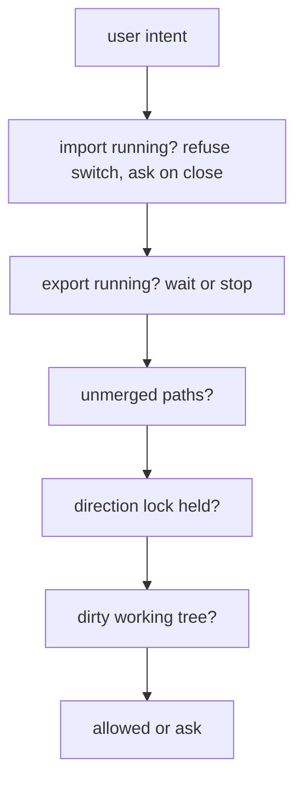

Check order (do not invent a nicer one):

1. **Uninterruptible work** — an import is writing the binary project. Branch-switch and
   pull: not yet. Closing asks Stop / Wait / Don't close.
2. **Cancellable work** — an export. Offer wait or stop. Export stages and swaps; stopping
   it is honest. Import stays `MustFinish` for a switch; Stop and CloseApp may kill it.
3. **Unmerged paths** — before the lock, because git will refuse anyway and a lock
   sentence would send the user to the wrong remedy.
4. **Direction lock** — before the dirty tree. Stashing does not fix a held lock.
   "Stash and switch" for a lock would be a button that cannot work.
5. **Dirty tree** — the one case with a real choice (stash / discard / cancel).

Every refusal names its remedy ([`GuardNarrative`](../src/Versio.Core/Guarding/GuardNarrative.cs)).

Other guards in the running app:

| If you… | What happens |
|---|---|
| Close during export | Wait or stop it. Used to orphan a hidden CODESYS. |
| Close during import | Wait or stop it (restore a backup if the project will not open). Used to refuse until timeout. |
| Status-bar Stop | Kills whatever is running, including an import. Try again lights after cancel. |
| Switch repository | Same guard. Dropdowns snap back if the switch does not happen. |
| Open the same clone twice | `RepositorySession` / `session.json`. Second window is told who has it. Stale pid → free. Corrupt marker → open anyway. |
| Confirm import | Banner on the project row, then a dialog naming the project and the plan. Declining leaves the offer up. |
| Restore a backup | Lists last 10 by local time. Restoring keeps a copy of what it replaced. Refused while the IDE holds the project. |
| Pull with local commits | `--ff-only` refuses. Divergence is not auto-merged. |
| Mid-merge | Sync and commit blocked. Panel can resolve ours/theirs. |

**Not built:** a repository that disappears while it is open (SAFEGUARDS §5.H). Costed and
deliberately deferred. Detection is easy; classifying a mid-run toolchain failure against
a vanished share as "environment" rather than feeding the circuit breaker is not a side
quest.

The full argument lives in [`SAFEGUARDS.md`](SAFEGUARDS.md). This section is what fires.

---

## 11. Rendering

### Project tree

Pipeline:

1. `_manifest.json` → [`ProjectManifest`](../src/Versio.Core/Projects/ProjectManifest.cs)
2. [`ProjectTreeBuilder`](../src/Versio.Core/Projects/ProjectTreeBuilder.cs) — nest members
   by `parent` GUID; attach library / task / device catalog rows
3. [`WorkspaceTreeBuilder`](../src/Versio.Core/Projects/WorkspaceTreeBuilder.cs) — every
   tracked project plus other changed files
4. `SyncViewModel.RefreshTreeAsync` (off the UI thread)
5. [`TreeRow`](../src/Versio.App/ViewModels/TreeRow.cs) — what WPF binds to

**Children are built on first access**, not in the constructor. Cost is proportional to
what is on screen, not to every object in the project.

**`Reconcile`** keeps the same row object when an export lands. WPF keeps the expander and
the selection because `SelectedItem` is a reference to that instance. Clear-and-refill
dropped all three on every export.

A project with a clean mirror is hidden unless it needs attention (never exported,
behind, locked, failed).

### Changed files named as objects

Same manifests → [`ObjectIndex`](../src/Versio.Core/Projects/ObjectIndex.cs). Display is
**object name + type chip** (the docs shorthand "FB_Motor · POU" is not a single string in
the UI). A path the manifest does not describe stays a path. Never guessed.

Library YAML is export-only: the row shows a lock. Editing it does not import.

### Repo explorer vs project panel

| | Project panel | Repo explorer |
|---|---|---|
| Shortcut | Ctrl+1 | Ctrl+4 |
| Builder | `WorkspaceTreeBuilder` | `RepoExplorerBuilder` |
| Job | Review: change glyphs, diffs, stage/discard | Browse the clone as folders, PLC trees grafted in |
| Diffs | Yes | **No** — visualize only |

### Diff

Git produces unified diff. Versio does not run a second diff algorithm.

- Parse: [`UnifiedDiffParser`](../src/Versio.Core/Diff/UnifiedDiffParser.cs)
- Side-by-side: fold of the same lines ([`SideBySideDiff`](../src/Versio.Core/Diff/SideBySideDiff.cs))
- Word emphasis: common prefix/suffix at **token** boundaries, not LCS
- UI: [`DiffView`](../src/Versio.App/Views/DiffView.cs) — virtualized `ListBox`. Rows are
  built when a container is realised, not pre-built as 33,000 WPF elements. Parse runs off
  the UI thread.

Languages (from the path): ST (also `.scl`), C#, Python, XML/XAML, JSON, YAML, Markdown,
PowerShell, JS/TS, SQL. Unknown → plain text.

New files diff as entirely added (`--no-index` against empty), not as "no diff available".
"Show full file" is a large `-U` so it stays a diff. Hunk buttons copy the hunk onto the
index.

Layer chips in the header: ST / native / tasks / libraries.

Rendered vs Raw is a pane dispatch, not a second diff. Catalogs (`LibraryCatalog`,
`TaskCatalog`, `DeviceCatalog`) and a data-block `MemberTable` (a format parses the
native file; App never sees who) draw as bordered tables (name, type, start
value, external access, comment). Everything else is highlighted
source. The table does not write back.

### Theme and progress

Tokens in [`src/Versio.App/Theme/`](../src/Versio.App/Theme/). Light, dark, follow
Windows. Switching at runtime repaints open windows.

[`BusyTracker`](../src/Versio.App/Mvvm/BusyTracker.cs) — one bar for git, export, and
import. Export walks the tree once for a denominator and names the object it is on.
Everything else is indeterminate. Heartbeat ~2 s during a long run so silence does not
look like a hang.

---

## 12. Logging

[`VersioLogger`](../src/Versio.Core/Logging/VersioLogger.cs). Categories: `UI`, `Sync`,
`Lock`, `Plc`, `Git`, `Fs`, `Watch`, `Perf`, `App`. Vendor chatter stays in the vendor
pack.

- **Ring buffer** → log panel (`LogViewModel`). Batched ~100 ms.
- **Rolling file** → `%LOCALAPPDATA%\VersioUser\logs`, local day, kept a few days. Attached at
  process start.
- **Correlation ids** via `BeginOperation`. Heartbeat lines share the same id as the run.
- Filter chips are a **set**, not a minimum level. "Warnings and errors only" is a request
  a threshold cannot express.
- Idle status polls collapse into one periodic line. Refused or coalesced sync says
  nothing, because nothing happened.
- **Stop is loud.** The bar names what it cancelled; an import Stop is Error and says
  to restore. Runners then say mutex-wait cancel, host stdin-close, CODESYS pid kill, or
  leftover Portal/XAE reap. Logoff is the only line that says `the session is ending`.
  A cancelled git.exe is Warning, not silent.

A silent failure is a bug even when the code is correct. Quiet when idle, loud when
working.

---

## 13. The rest of the shell

Easy to leave out of a sync document. Still how the app works.

**Rail.** Project Ctrl+1, Git Ctrl+2, History Ctrl+3, Explorer Ctrl+4 (and the numpad
keys). F5 refreshes. Ctrl+Enter commits from the message box. Ctrl+Shift+P pushes.
**Ctrl+F puts the caret in the active panel's find box** — all four rails have one since
UX-6 (2026-08-25; the explorer's was always there). Escape closes the settings popup and
the ahead/behind preview. The git panel also offers **Amend** while HEAD is unpushed
(message-only, UX-12), and a history commit's context menu copies its id, subject or
whole message (UX-8).

**Settings.** `%LOCALAPPDATA%\VersioUser\settings.json` — theme, panel sizes, last ten
repositories. A vanished recent repo offers clone-again / remove / cancel, not a blank
folder picker. Startup falls back to the most recent path still on disk.

**System information.** Settings → Help: Versio product version (the same `VersioVersion`
the installer packed), toolchain, git version, profile. A failure sits
on the **project row** with Try again. No permanently disabled buttons.

**Prompts.** `NotificationCenter`, `WindowPrompts`, `GuardPromptWindow`,
`BackupRestoreWindow`, clone / branch / merge dialogs.

**Adoption.** [`Adoption.Plan`](../src/Versio.Core/Bindings/Adoption.cs) then
[`RepoSetup.AdoptAsync`](../src/Versio.Infrastructure/Bindings/RepoSetup.cs). Scan via
`PlcFormats.All`. Ignore globs and templates stay out. [`OrphanScanner`](../src/Versio.Core/Bindings/OrphanScanner.cs)
finds broken bindings. `.gitignore` covers `.versio/local/` and vendor `.opt` files,
project-scoped, never repository-wide.

**Occupancy.** The vendor's open-project marker (CODESYS: `.~u` sidecar).
[`ProjectOccupancy`](../src/Versio.Core/Plc/ProjectOccupancy.cs): a stale marker from a
**dead process** is ignored; a marker from **another machine** is believed. Import waits
and retries when the marker is deleted (the IDE letting go **is** the retry). A rewrite
of the marker while the IDE works stays silent. Export of a held project uses a copy.

**Swap recovery.** Leftover `.versio_staging` / `.versio_trash`. The window a killed
export must not leave a project with no mirror. See also
[`SwapRecovery.cs`](../src/Versio.Core/Sync/SwapRecovery.cs).

**Conflicts.** Pull is fast-forward only. Mid-merge blocks sync and commit. Panel can
resolve ours/theirs. `MergePreflight`: if the merge touches a tracked project/mirror,
proceed and then require import.

**Commit button.** [`CommitPlan`](../src/Versio.Core/Git/CommitPlan.cs) — one button, two
intents: commit the ticked files, or the whole list when nothing is ticked. Caption is
`Commit` or `Commit (N)`. Blocks on conflicts, missing identity, empty message. Then a
**preflight**: the PLC commit gate is scoped to bindings the include set actually
touches, and the index is not rewritten until that answer is proceed / export-these /
exclude-these-and-ask. A failed project's files can be left out so the rest still
commit; they no longer veto every other file in the repository.

**IEC layer.** [`src/Versio.Core/Iec`](../src/Versio.Core/Iec) — ST codec, declaration
parser, the standard's object-type names. Shared by every vendor that speaks IEC 61131-3.
Not CODESYS-owned.

**Export coverage.** `_coverage.md` plus `skipped` in the manifest. An old manifest
reports "unknown", never "complete". An object the export could not write at all is
reported rather than counted as covered — it reaches neither the records nor the skips.

**Draft commit subject.** Counted by object, not by file (one GVL is two files and one
edit). Draft refuses to overwrite anything you have typed.

---

## 14. Tests and how to run them

Counts live in [`STATUS.md`](STATUS.md) and [`README.md`](../README.md). Re-derive; do not
trust a copied number.

The loop to work in (no real CODESYS):

```
C:\Users\elli_\AppData\Local\Microsoft\dotnet\dotnet.exe test tests\Versio.Core.Tests
C:\Users\elli_\AppData\Local\Microsoft\dotnet\dotnet.exe test tests\Versio.Integration.Tests
C:\Users\elli_\AppData\Local\Microsoft\dotnet\dotnet.exe test tests\Versio.Arch.Tests
C:\Users\elli_\AppData\Local\Microsoft\dotnet\dotnet.exe test tests\Versio.Plc.Codesys.Pure.Tests
C:\Users\elli_\AppData\Local\Microsoft\dotnet\dotnet.exe test tests\Versio.Plc.Codesys.Parity.Tests
C:\Users\elli_\AppData\Local\Microsoft\dotnet\dotnet.exe test tests\Versio.Plc.TiaPortal.Pure.Tests
C:\Users\elli_\AppData\Local\Microsoft\dotnet\dotnet.exe test tests\Versio.Plc.TwinCat.Pure.Tests
```

`dotnet` on PATH here is runtime-only. Use the user-local SDK path above.

- **Python edits need a rebuild.** The scripts are embedded.
- **Parity tests** need `python` on PATH and skip cleanly without it. Check the **count**,
  not the colour.
- **`Versio.Plc.Codesys.Tests`** is the ~30 minute gate: real CODESYS, every test launches
  it. Run before a commit that touches driving or scripts.
- TIA / TwinCAT test projects skip cleanly without the install.
- Never run the integration suite with `-v q`: quiet verbosity prints FAIL and swallows
  the assertion.

`Versio.App.Tests` shells own watchers — `using var shell`, never construct one inline as
an argument.

---

## 15. Where to read next

| File | When |
|---|---|
| [`STATUS.md`](STATUS.md) | Where the work is, what is next |
| [`FINDINGS.md`](FINDINGS.md) | A defect and its evidence |
| [`SAFEGUARDS.md`](SAFEGUARDS.md) | Why a refusal is shaped that way |
| [`vendors/codesys/DRIVING.md`](vendors/codesys/DRIVING.md) | ScriptEngine internals, protocol, §12 audit |
| [`vendors/tia/DRIVING.md`](vendors/tia/DRIVING.md) | TIA host and Openness |
| [`vendors/twincat/DRIVING.md`](vendors/twincat/DRIVING.md) | TwinCAT host and XAE |
| [`phase1/PLAN.md`](phase1/PLAN.md) | Why the architecture was shaped this way (archived) |
| [`phase1/GIT-PANEL-PLAN.md`](phase1/GIT-PANEL-PLAN.md) | Git panel as planned (built) |
| [`phase1/IMPORT-PLAN.md`](phase1/IMPORT-PLAN.md) | Import gaps as closed (archived) |
