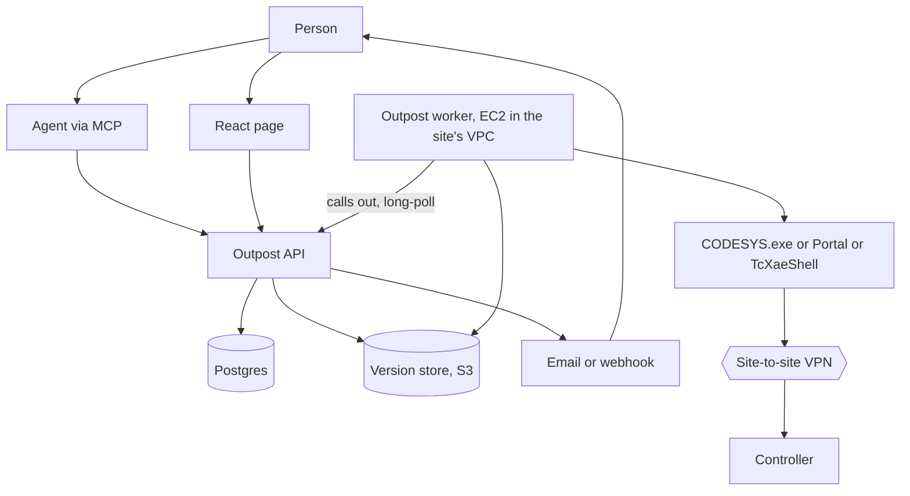
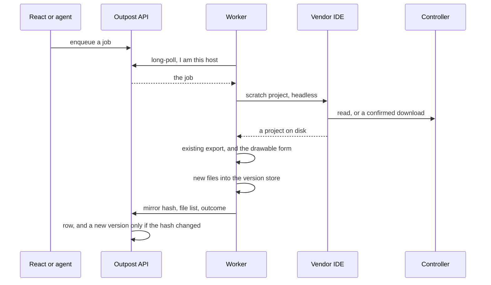
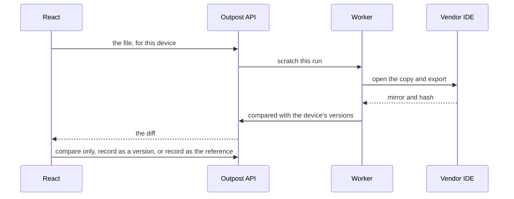
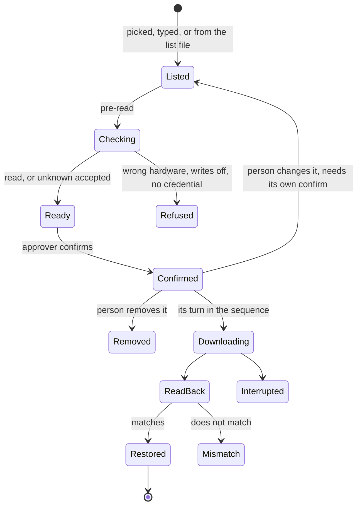
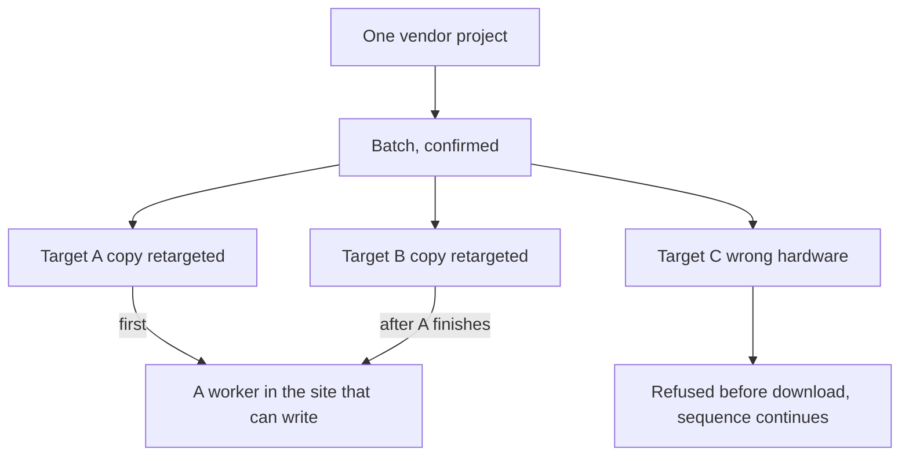
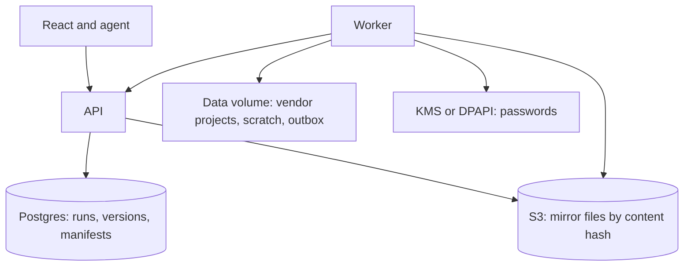

# Versio Outpost

**Date:** 2026-10-04, revised 2026-10-05 with the fixes from a review of the write path, the
EC2 host, and the removal of git: Outpost keeps its own versions and compares them with each
other.
**This is a design record, not the live queue.** What Versio is today
lives in [`../STATUS.md`](../STATUS.md). This document is how Outpost should be built, and why
each piece sits where it does. Nothing here is implemented.

| | |
|---|---|
| Document | The Outpost design: scheduled backup of the program on a controller, every changed backup kept as a version, a rendered diff between any two versions, and a confirmed restore |
| Sibling of | The Versio desktop app. Same vendor runners and the same export. A different window, a different verb |
| First measurement | A CODESYS `upload_source` against a controller that already holds `Archive.prj`, before any of the product is built |
| Where the worker runs | A Windows EC2 instance per site, reaching the plant's controllers over a site-to-site VPN (§13). A plant PC is the fallback shape |
| Out of scope until measured | TwinCAT target recovery. Writing to a controller from a schedule |

---

## Start here

Read [`../STATUS.md`](../STATUS.md) for where Versio is. Read this for the product that talks to
controllers. The desktop app's job is the file on disk and the git mirror. Outpost's job is the
other copy of the program: the one running in the plant, and how it has changed over time.

The argument, in the order a builder needs it:

1. Why it is not a button inside Versio.
2. Which processes exist, and which one is allowed to touch a PLC.
3. What a backup does, what a restore does, and what an agent is allowed to start.
4. Where the history, the vendor file, and the password live.
5. The order to build it, which starts with a measurement rather than a web page.
6. What is still open (§16). Those items are not decisions, and a builder does not choose them.

---

## 1. Why this exists

The program on a controller is the one the machine is running, and it changes whenever someone
goes online, loads from a USB stick, or downloads from a laptop. Nobody else may know it
changed. Whatever copy the engineers keep, wherever they keep it, says what somebody meant to
ship, not what is running. Versio already turns a project file into a reviewable mirror. It
cannot see the controller, because the engineer's laptop is not on the plant network at 02:00,
and the desktop app was built to refuse a download.

Copia DeviceLink and octoplant already sell the missing half. DeviceLink is a Windows agent on
a PC that can reach the PLC and has the vendor IDE licensed. It polls for jobs, uploads into a
temp folder, and a server compares that with git. A difference can auto-commit onto a
`DeviceLink/…` branch, never the branch people develop on. octoplant keeps the same shape in
its own database: scheduled upload, compare, notify, restore. Some of its vendors also have a
checksum mode that can say "changed" and cannot put the program back.

Outpost takes the half Versio is already good at — the mirror, the diff and how it is drawn,
the refusal to record a lie — and points it at the controller. Every backup that differs from
the last is kept as a **version** of that device. A person compares any two: the latest
against the one before, against three versions back, or against the device's reference copy.
The diff is drawn the way the desktop app draws it: SCL and ST as highlighted text, ladder as
networks, data types as member tables.

Outpost does not use git. The customer's engineers keep their projects wherever they keep
them, and Outpost neither reads that nor writes to it. The git repository Versio's own fixtures
live in is a test asset, not a place Outpost touches. Versions are files stored by content
hash, with an index in a database (§8). The list of runs is that database too. The file you
would load onto a replacement controller stays with the worker, with a second copy beside it.

### Why it is not the desktop app

The founding plan lists "anything on the PLC itself (download, online change, monitoring)" as a
non-goal ([`../phase1/PLAN.md`](../phase1/PLAN.md)). That non-goal stands for Versio. A download
stops a controller. Putting that verb in the same window as committing Structured Text means a
person who opened the app to review a diff can stop a line. Outpost is the sibling that is
allowed to do it, behind a confirmation the schedule can never give.

They share code. [`IPlcRunner`](../../src/Versio.Core/Plc/PlcJob.cs) is file-in / file-out on
purpose, and the remarks on it already say a remote runner and a local one are interchangeable.
[`docs/phase1/PLAN.md`](../phase1/PLAN.md) §13.8 parked that seam for compile-on-push. Outpost
uses the same seam for a different host: a PC on the plant network, not a build server. The
React page never implements a vendor.

A separate codebase would reimplement the CODESYS, TIA, and TwinCAT export. A separate product
name does not. The name is **Versio Outpost**. "Deployment" was rejected because it names only
the sharp edge. The thing a person opens every day is the backup and the diff. A download is
one confirmed verb inside that.

### What was decided, so it is not re-opened by accident

| Decision | Why |
|---|---|
| Outpost, not a mode of the WPF app | A download that stops a PLC does not live next to Commit |
| The worker is an EC2 instance, one or more per site | It is the realistic deployment: a clean machine nobody uses interactively, built from one image, replaceable. It reaches the controllers over a site-to-site VPN that the site owns. The pain this costs is written down in §13, not discovered later |
| The worker calls out to the API | Nothing dials the worker. The VPN is the one route into the controller network, and it carries vendor protocols from the worker's private addresses only (§13) |
| A version store holds the text that changed, not git | The mirror is what a person reads and diffs; a `.project` does not diff. Git was the first design, with a device branch per controller pushed to a repository. It was rejected on 2026-10-05: customers' engineers do not keep their projects where Outpost can see them, there is no engineering branch to compare against, and a push credential, a clone, branch clutter, and a "pushed or not" outcome all existed only to serve git. §8 |
| Any two versions can be compared | Latest against the previous version, against N versions back, or against the device's reference copy. That is the question a person brings: what changed since last night, and since it was commissioned. §8 |
| The diff is drawn the way the desktop app draws it | One set of renderers in `Versio.Core`, HTML, used by the page. Ladder already is (`LadderHtml`). Text and member tables join it. §8 |
| The vendor project stays with the worker, and a second copy in S3 | That is the file you restore. A text mirror is not that file |
| A database holds every run | "Up to date" at 02:00 is a row. An empty nightly version would bury the real ones |
| Passwords stay in DPAPI on the worker | A password in the database, in the version store, or in an agent chat is a password in a log. The API holds only copies sealed to a worker's key, which it cannot read (§8) |
| The schedule only reads | Restore is a different verb, confirmed by a person, for an exact file and the exact controllers they were shown |
| An open IDE does not skip the backup | On a plant-PC worker, the worker uses a scratch project and does not take the person's window. An EC2 worker has nobody's IDE on it (§4) |
| The agent uses the same API as the page | It cannot confirm a different file from the one the person was shown |
| No vendor DLLs in the installer | Versio already locates CODESYS, Portal, and XAE. Shipping them would be the leak the seam exists to prevent |
| The same log the desktop app writes | A silent failure is a bug even when the run row is right. The worker uses `VersioLogger`: operation id, heartbeat, a daily file |
| A person sets when, the program sets the order | Twenty backups due at 02:00 on one worker that runs one at a time are twenty runs in a row, not twenty IDEs and not a choice anyone has to make. §3 |
| Workers and devices belong to a site | An IDE version says what a worker can open, not what it can reach. A password goes only to the site that needs it. §2 |
| Writes are switched on at the worker, not from the page | The worker trusts the API's word that a batch was confirmed. An API that can stop a PLC is a target; the switch means a stolen API cannot reach a controller whose PC never agreed. §6 |
| An agent prepares, a person confirms on the page | The agent holds the person's token. A confirm tool would let it agree on their behalf. §7 |
| A batch downloads one controller at a time, and a failure does not stop it | The first read-back is seen before the second line stops. A failed target is reported straight away and the next one starts; the person can Stop the batch. Pausing on failure was rejected. §6 |
| Until its download starts, a controller can still be changed or removed | Removing needs no new confirm; a change or an addition is confirmed on its own. Once started, it finishes. §6 |
| A download is never killed | Cancel and the job timer stop at the download. Killing the IDE mid-download is how an Interrupted controller is made. §6 |
| The file you restore from exists twice | A backup that lives on one machine dies with it, an EC2 instance is expected to be replaced, and the text mirror cannot be loaded onto a controller. §8 |
| The API notices silence | A worker that stopped running writes no log and no row. Only the API can see that a backup is overdue. §8 |

---

## 2. The pieces

Five processes. Only one of them opens a vendor IDE, and only one of them opens a session to a
controller.

| Piece | Runs where | Talks to | Never does |
|---|---|---|---|
| React page | A browser | The API over HTTPS | Open an IDE, open a PLC session, store a password, write a version |
| Outpost API | AWS, beside the database (§13) | Postgres, the version store, the worker's outbound connection | Load Openness, spawn `CODESYS.exe`, route to a PLC, reference a vendor pack |
| MCP server | Beside the API, or in it | The same API, with the person's token | A second path to the worker or the PLC |
| Outpost worker | A Windows EC2 instance in the site's VPC, built from the worker image (§13). A plant PC is the fallback | The API, outbound. The vendor IDE, locally. The controller, through that IDE and the site's VPN | Accept a connection from the internet. Rewrite a person's open project |
| Vendor IDE | That same instance, installed in the image, licensed the way §13 says | The controller | Get shipped inside the Outpost installer |

The page and the agent are clients. The worker is the only machine that can see both the IDE
and the PLC. A cloud VM that cannot route into the plant has nothing to upload. On EC2 that
route is the site's VPN, from the worker's private addresses to the controllers' addresses on
the vendor's ports and nothing else (§13). The worker still calls out to the API, the way
Copia's agent polls; nothing dials the worker.

A job takes minutes. CODESYS cold start alone is 17–31 seconds
([`../vendors/codesys/DRIVING.md`](../vendors/codesys/DRIVING.md)). The page's call is "start
this" and a later "here is the outcome". One HTTP request must not wait on the controller.

### Which worker runs the job

The page does not call a server that has TIA Portal. Nothing dials a worker.
Each worker calls out, and the API gives a run to a worker that can open that project.

Eligibility starts with the site. A worker is enrolled into one site, with that site's
enrollment code, and a device belongs to one site. A worker in plant A is never eligible for a
device in plant B, whatever IDE it has. Without this, the "once each" rotation below would
spend an IDE cold start on every worker in the company that cannot route to the address, and
§8 would send a plant's passwords to PCs in other plants.

Within the site, eligibility is the version, not a single pin. `PlcFormats` reads the project
and names the vendor. A worker's heartbeat reports what it can open without upgrading it: Portal
V21, the CODESYS profile, TwinCAT XAE 4026. A TIA V21 run may go to any worker in that device's
site that reported Portal V21 and holds the password slot for that device. It may not go to Portal V18, and it may not go
to a worker that reported only CODESYS. The person can mark a preferred worker. That one is
offered the run first. Preference is not ownership.

Each worker has two numbers, set on that PC:

- **Concurrency.** How many toolchain runs it will execute at once. The default is 1. CODESYS
  on one profile, and one Portal process, are the reason. Raising it is allowed only where
  that PC has been shown to run two of that IDE. The worker refuses to start a run past the
  number it was given.
- **Queue depth.** How many claimed runs it will hold behind the ones already executing. The
  queue is on the worker, first in first out, one scratch directory per run.

A run stays **Pending** until a worker claims it. The preferred worker claims it when it has a
free concurrency slot or a free queue slot. When that worker is at both limits, or its
heartbeat is stale, the next eligible worker may claim it. A claim is a lease. Two workers
never upload the same controller for the same run. A lease whose worker dies before the IDE
has started can be claimed by another eligible worker. Once the IDE has started, the run is
**Running** and it is not moved.

A worker with the right IDE and no password slot is not eligible. Saving a password seals one
copy to each eligible worker in the site, and each worker collects its own (§8). A worker that
has not collected its copy is not eligible yet. The page lists those machines.

The vendor file stays on the worker that produced the run, and its second copy is wherever the
site keeps second copies (§8). A later restore of that hash prefers the worker that holds it. If
it is at capacity, or off, another eligible worker can take the restore from the second copy,
checked against its hash first. A restore waits only when neither copy can be reached.

If the worker that claimed the run cannot reach the controller, the row records that attempt
and the run goes back to **Pending** for the next eligible worker, once each. When every
eligible worker has failed the reach, the outcome is **Unreachable** and it names the workers
that were tried. It does not rotate forever.

A batch uses the same rule per target, one target at a time (§6). What a confirm is bound to,
beyond each target's own fingerprint, is open (§16). An address added after the confirm is
confirmed on its own either way.

---

## 3. A scheduled backup

This is the daily path. It only reads.

1. The schedule is a row on the device: the times a person chose (see *When it runs, and in
   what order*, below), the site's time zone, the vendor, the project, the device's name as the
   project tree spells it, the address, and which worker is preferred.
2. When the time comes, the API inserts a run in **Pending**. It does not ask whether a worker
   is free. If the device was offline or every eligible worker was busy across several ticks,
   those ticks collapse into one run. The night does not owe one upload per missed slot.
3. An eligible worker claims the run, within its concurrency and its queue depth, preferred
   worker first. It moves the run to **Running** when a concurrency slot takes it. Each run
   has its own scratch directory so two jobs cannot mix files.
4. The worker starts the vendor IDE against that scratch directory. It does not open the project
   a person has open, and it does not log in with an online-change option. A backup must not
   download.
5. The IDE reads the controller. What comes back depends on the vendor, and is spelled out in
   §10. The result is either a vendor project in scratch, or a named failure.
6. On a project, the worker runs the export Versio already has. The export must be deterministic:
   the same project exported twice produces the same bytes. That rule already exists because a
   spurious diff destroys the reason the mirror exists. The worker exports once. Only when step 7
   finds a different hash does it export the same upload a second time, before anything is kept.
   If the two disagree, the outcome is **Unstable export** and nothing is kept. An unchanged
   run pays for one export; a change, which is rare, pays for two.
7. The worker compares the mirror hash with the hash of the device's latest version, which the
   API sends with the job. The API is the only place that knows it: with several workers in a
   site, no single worker's disk does.
   - Same hash: outcome **Up to date**. A database row. No new version. The tray stays quiet.
   - Different hash: the worker keeps the vendor project under `backups/<device>/<hash>/`,
     starts the second copy (§8), parses the drawable form (§8), puts into the version store
     the files it does not already hold, and posts the version's manifest. The API checks every
     file is there and records the version, with the run id and the source. Outcome
     **Modified**. The site's channels say a new version is available, naming the device, if
     the site asked for that (§8); on a plant-PC worker, the tray says it too.
8. Scratch is deleted after a successful export. A failed export keeps the vendor project for a
   retention window (**Conversion failed**) and does not record a half mirror.
9. The worker then reports the row. If the API does not accept it, the worker keeps the result
   in a local outbox and retries. A backup the page never shows is a lost backup.

Nothing the engineers keep is touched. The desktop app's working tree, direction lock, and
`.project` are not on this path. Adopting an upload into a project someone has open would be the
merge hole already measured as `P-M2` in [`../STATUS.md`](../STATUS.md), with a PLC attached.

Each version records how its mirror was obtained: scheduled read, run-now, a file a person
recorded, or the read-back after a restore. The next scheduled read still talks to the
controller. If a recorded file was not what is running, the next run shows the difference.

### When it runs, and in what order

A person decides when. The program decides the order.

The schedule belongs to the device, and a person sets it on the page: how often, at what times,
on which days. Every night at 02:00, every four hours, Saturdays only, or no schedule at all and
only Run now. Two devices can share a time or not; that is the person's choice, and nobody has
to stagger them by hand to make the night work. The times are evaluated in the site's time
zone, not the server's and not UTC. A local time that does not exist because the clock went
forward runs at the next minute that does. A local time that happens twice because the clock
went back runs once.

A schedule may carry a window end: "start between 01:00 and 05:00". A run that has not started
by then is **Missed**, says so, and the next scheduled time tries again. A site that does not
want a backup starting as the morning shift arrives sets one. Without a window end, a run waits
as long as it has to.

Firing is the person's decision. Starting is the queue's. The queue is the API's list of Pending
runs for a site, and a worker takes from the front of it whenever it has a free slot under its
own concurrency and queue depth (§2). The order is:

1. Runs a person is waiting on: Run now, a dropped file, and the pre-read before a restore. A
   person at the page does not wait behind the night's backups. These go to the front. They do
   not stop a run that is already executing.
2. Scheduled runs, earliest due time first.
3. Among runs due at the same moment, the device whose last good backup is oldest goes first,
   so a device that failed last night is not last again tonight.

Twenty backups scheduled for 02:00 on a site with one worker that runs one at a time are twenty
runs in sequence. The worker claims the first, and, with a queue depth of three, the next three
behind it. The other sixteen stay Pending in the API, where they are not lost if the worker
restarts. When the first finishes, the next starts, and the worker claims one more. A worker with
a concurrency of two runs two at a time and the night takes half as long. A second worker in the
site that comes online at 02:10 takes from the same list. The person configured twenty times;
nobody configured the order, and nobody has to.

A run already sitting in a worker's own queue is not reshuffled when a person's run arrives. The
person's run takes the next free slot of any eligible worker, so with a queue depth of three it
can wait behind the run executing and three claimed runs. That is what queue depth costs, and it
is why the default is short.

The page shows each Pending run's place in the queue and what is ahead of it, with an estimate
from that vendor's recent run times. "Why has device 17 not backed up yet" has an answer on the
screen. Twenty runs that cannot all finish before their window ends are a warning on the
schedule page when the person saves it, not a surprise the next morning.

One device has at most one active run. A run that is Pending or Running for a device absorbs a
new request for the same device. A second tick coalesces, as in step 2. Run now on a device that
is already Pending returns that run, moved to the front. Run now on a device that is Running is
queued behind it. Two workers never read one controller at once, and two versions of one device
are never recorded in a race. A device that is a target in an unfinished restore batch takes no
backups at all until the batch is done with it (§6).

---

## 4. The IDE is already open

**This section is the plant-PC shape.** An EC2 worker has no person's IDE on it, so nothing here
happens there. Its tray is not installed; new versions and failures reach people through the
site's notification channels (§8). The rest of this section stands for a site that runs the
worker on an engineering PC.

Versio today treats an IDE holding a project as a reason to wait or to skip an import. That is
correct for the desktop app, because an import would write the file the person is editing, and
TIA in particular cannot export the project the GUI has open
(`ExportHeldViaCopy` is false; [`../vendors/tia/DRIVING.md`](../vendors/tia/DRIVING.md)).

Outpost is not editing that file. The backup is a scratch project and a session to the
controller. The person's CODESYS, Portal, or XAE window is not the session the worker uses, and
it is not a reason to drop the job. The worker does not close their window and does not write
their document.

When the run records a new version, the tray on **that** PC notifies the person looking at it:
which device, and that a new version is available. The notice opens the diff in the page. It
does not import into the project they have open. An unchanged run does not notify.

Whether a headless Portal or a second CODESYS can sit beside the GUI on one machine is not yet
measured. Versio serialises CODESYS behind a machine-wide mutex because two instances on one
profile are not safe, and a Portal window is occupancy. The product rule is still that the
backup is not skipped and their document is left alone. The measurement is part of building the
worker, vendor by vendor. If a vendor refuses a second process, the outcome is open (§16). The
finding is written down before anyone softens the rule into a skip. Another profile is not, by
itself, that outcome. The CODESYS runner's lock is one for the whole machine
(`Global\Versio.Codesys.SingleInstance` in
[`LocalCodesysRunner`](../../src/Versio.Plc.Codesys.Infrastructure/LocalCodesysRunner.cs)).

A controller that already has another engineering session online is a different case
(**Busy controller**). The worker does not log that person off, does not online-change, and does
not download. That run waits for the next schedule.

---

## 5. A file a person supplies

**Run now** is a normal device run. The worker reads the controller. The row says so.

Dropping a `.project`, a CODESYS archive, a TIA archive, or a TwinCAT tree on the page is a
different source. The file did not come off the PLC, so it is not recorded as a version of the
device as though a read had produced it, unless a person says it should be.

The bytes go to the worker's scratch directory. They are not stored in the database. The worker
has to be online; the page refuses the drop when it is not, because the export needs the IDE.
The export, the hash, the drawable form, and the diff are the same as for a fetched project. The
diff is against the device's latest version by default, and against any of its versions if the
person picks one. The vendor project is kept on disk under its hash either way, so it can still
be opened. A partial export is **Conversion failed**, not a version.

The person chooses after seeing the diff:

- **Compare only.** No version. The device's versions still mean "what we read from the
  controller", plus what people explicitly recorded.
- **Record as a version.** They are saying this file is the one that was on the controller. It
  is recorded the same way as a modified run, marked as supplied. The next scheduled read still
  checks the PLC.
- **Record as the reference copy.** The file is recorded as a version, marked as supplied, and
  becomes the device's reference: the copy every later backup can be compared against (§8).
  The usual case is the program the machine was commissioned with.

Either way of recording makes the file the device's **latest** version. That is intended: an
engineer who records a baseline means "compare from here". The next scheduled backup is compared
against it, and if the controller is not running that file, the backup is **Modified** and the
diff shows exactly how the controller differs from the baseline. Because that changes what every
later comparison means, recording is gated. Before it is accepted, the page shows the diff
between the file and the device's current latest version, and says in words that this file will
become the latest backup and the next read will be compared against it. The engineer accepts or
cancels. The version records who accepted.

A project whose name, or whose device name in the tree, does not match the device record is
refused before either choice. A Versio text mirror dropped on its own can be diffed and cannot
be recorded as a backup, because there is no vendor project to restore. An archive that asks for
a password uses the same host-side slot as a controller password, sealed to the worker's key the
same way (§8) and not stored in the row.

The page says, before it accepts the file, that the worker will open it in the IDE on that PC.

---

## 6. Putting a version back

A write sends a vendor project: a version Outpost already holds from a backup, or a program copy
a person uploads for this write (*One program, many controllers*, below). The text mirror is not
enough, and neither is a compare-only drop that was never kept as a vendor file.

**Only a complete backup can be sent.** A version marked **Partial** (know-how-protected blocks
without source, safety blocks, unknown modules) or **Stale source** is never offered for a
restore, and an uploaded program whose export comes back partial is refused for a batch. The
picker shows only versions whose vendor project is complete and still held. A version that is
not offered says why. The file is
copied into scratch. The stored copy is not modified, so a failed restore cannot damage the
version you meant to send.

Two writes exist, and the page names which one the person picked:

| Write | What the controller does | What the row may say |
|---|---|---|
| Replace the running program | A full download. The PLC stops. CODESYS application download, TIA `DownloadProvider` with an address, TwinCAT activate on the target | **Restored**, and only after a read-back matches |
| Put the source on the device | CODESYS `download_source` writes `Archive.prj` and leaves the running program alone | That the source is now on the device. Never that the machine is running that version |

An online change is the wrong tool for a restore. It applies a delta against whatever happens to
be running, and it can refuse or land halfway. Restore is a full download of a known project.

### Writes are switched on at the worker

A worker refuses every write until an administrator of that worker turns writes on. The setting
lives under `%ProgramData%\Versio\Outpost`. On EC2 it is set through an SSM session, or as an
image or launch parameter. On a plant PC it is set in the tray or as an installer option. The API
cannot change it, and the page shows it read-only. A site can also give that worker a list of
addresses it may write to.

The reason is the API. The worker downloads a run because the API says it was confirmed. An API
on the internet that can stop a PLC is worth attacking, and a stolen API token, or a bug in the
confirm, would otherwise reach every controller every worker can route to. With the switch, a
controller whose worker never agreed cannot be written to. On EC2 that is only true if the
worker's administrators are not the API's: a separate AWS account (§13, item 8).
A worker with writes off is not eligible for a restore. A batch with a target that no eligible
worker may write says so before the confirm, not after it (**Writes disabled**).

### The confirm

Before the download, the worker reads the controller and the page shows that diff against the
version about to be written. If the read fails, the download stays blocked until the person
confirms they are overwriting a controller whose current program is unknown. The confirmation
names the version, every controller, and that the PLC will stop. The row records who confirmed.

The confirmation also says what a full download does to the machine's data. Retained and
persistent variables, and the actual values in TIA data blocks, can be reinitialised by the
vendor's download. Outpost backs up the program. It does not back up process data (§17), and the
confirm says so rather than letting a restore look like it puts the machine back the way it was.

Only a person with the approver role may confirm (§8), on the page, with a sign-in no older
than a few minutes. A site can require a second approver for writes.

A confirm is good for thirty minutes after the pre-reads finish; the site can change the
number. After that the batch is **Expired**, and confirming means reading the controllers
again. What the person agreed to includes what they were shown about each controller: each
target's pre-read hash, or "unknown", is part of the fingerprint. A controller that changes
between the read and a confirm the next morning is not overwritten on the strength of a diff
nobody is looking at any more.

### One program, many controllers

This is the person's flow, in five steps:

1. **The program.** A version Outpost already holds, or a program copy the person uploads. An
   uploaded copy goes to a worker in the site on its outbound channel (§14), is exported so the
   page can show what it is, and is kept under `batches/<hash>/` with a second copy (§8), for as
   long as the batch exists and afterwards as the version those controllers were restored to.
2. **The controllers.** Picked from the site's devices, typed as a list of addresses, or
   uploaded as a CSV or Excel list. Any mix of the three.
3. **The preview.** One row per controller: where the program is going, and what is on each
   controller now.
4. **The confirm.** Once, for the list as shown.
5. **The sequence.** Downloads one after another. Until a controller's download has started,
   its row can still be changed or removed. Once it has started, it finishes.

#### The list file

A CSV, or the first sheet of an `.xlsx`, with a header row. One column is required, `address`.
The others are optional: `name`, `device` (an existing device's name), `credential slot`, and one
column per override the vendor has (a PROFINET name, a station name). Excel cells are read as
their stored values. Formulas are not evaluated, and a workbook with macros (`.xlsm`) is
refused.

Every row is checked and shown with its line number: an address that does not parse, the same
address twice, an address in no site, an override column this vendor does not have, a device
name that does not exist. A bad row is listed, not dropped quietly. The person fixes the file or
removes the row on the page.

There is no password column, and a file with a column that looks like one is refused whole. A
list file is emailed, left in Downloads, and opened by whoever finds it; a password in it is a
password in a log. The file names a credential slot. Slots are filled on the page the usual way
(§8).

An address that matches a device record becomes that device: its site, its slots, its versions.
An address that matches none is an ad-hoc target. It must fall inside a site, by the site's
address ranges or because the person picked the site, because the site decides which worker can
reach it. It has no versions. After the batch, the page offers to add the ad-hoc targets as
devices, so the next backup schedule can include them.

#### The preview

Each controller is read before anything is confirmed: the pre-read in *The confirm*, above.
Rows fill in as the reads come back. Fifty controllers take a while to read, and the person sees
the first row without waiting for the last. A row shows:

- the address and name, and whether it is a known device or ad-hoc,
- the site and the worker that will download it,
- whether the hardware matches the program,
- what is on it now: the diff against the program, or "unknown, could not read",
- its overrides, and whether its credential slot is filled,
- if it will be refused, why: wrong hardware, writes off at that PC, identity mismatch, no
  credential.

The order of the rows is the order of the downloads, and the person can reorder them before
confirming: the line that can be stopped first goes first. Confirm becomes available when every
row has a read, an accepted "unknown", or a refusal. Refused rows stay on the page, marked, and
are not part of what is confirmed.

#### Changing the list after the confirm

The confirm covers each controller as it was shown. Each target carries its own fingerprint:
the program's hash, the address, the overrides, and its pre-read hash. A change to one target
touches that target only.

- **Remove** a controller whose download has not started: always allowed, and no new confirm,
  because removing only means writing to less. The row says **Removed** and who removed it.
- **Change** a controller whose download has not started (its address, an override, its slot):
  it leaves the confirmed set and goes back to the preview. It is read again and confirmed on
  its own by an approver. The sequence carries on with the others meanwhile. The changed target
  keeps its place if its turn has not come, and goes to the end if it has.
- **Add** a controller: the same as a change. It is previewed and confirmed on its own.
- **Swap the program**: not a change, a new batch. Every target would be receiving something
  nobody confirmed.
- **Stop the batch**: every target that has not started becomes **Removed**. The one that is
  downloading finishes, and its read-back still runs.
- A controller whose download **has started** cannot be changed, removed, or stopped. *A download
  is never killed*, below.

#### The sequence

One download at a time, in the order the person set, across the whole batch, even when several
workers could each take a target. A batch that stops ten lines is safer one line at a time,
where the first read-back can be seen before the second line stops. Each next target is queued
when the one before it finishes, at the front of the site's queue, because a person is waiting on
it (§3). Downloading several at once is not offered (§17).

If more time than the confirm window has passed since a target's pre-read, the worker reads it
again just before downloading. If the controller is the same as the person saw, the download
proceeds. If it has changed, that target stops at **Changed since confirm** and waits for its own
confirm, and the sequence moves on to the next.

A failure does not stop the sequence. A target that ends **Interrupted** or **Read-back
mismatch**, or is refused (wrong hardware, writes off, unreachable, a busy controller), is
reported as failed with its reason, and the next target starts. The failed target is not
retried. The site is notified the moment a target fails (§8), not when the batch ends, and the
page shows it at the top of the batch. The person can still **Stop** the batch at any time,
which removes every target that has not started.

Pausing the batch on a failed download was considered and rejected on 2026-10-05 by the owner:
the batch carries on and reports. The case that argued for a pause is a bad program, where the
next nine controllers would get the same program. The guard against that is the person: the
first failure is in front of them straight away, and Stop is one click.

A target that ends **Restored** on a known device has its read-back handled like any backup
(§3). If it differs from the device's latest version, it is recorded as a new version, marked as
a restore and naming the batch. If it is the same, because the program sent was already the
latest, no version is recorded and the run points at the existing one, still marked as a
restore. Either way, the device's history shows the restore, and the next scheduled backup
compares against what was read back. An ad-hoc target gets the row only.

**Backups of a device pause while it is being restored.** From the moment a device is a target
in a batch that has not finished with it (pre-read, waiting its turn, downloading, read-back),
its scheduled backups and Run now wait. They do not run against a controller in the middle of
being replaced, and they do not count as **Missed**: the page says "paused, restore in
progress". When the target ends, whatever the result, backups resume, and missed ticks coalesce
into one run as usual (§3). A removed target, or a stopped batch, releases the device the same
way.

#### Each target's copy

Each target is its own run, its own address, and its own credential slot. The project file has
an address inside it, so each run gets a copy with the communication path pointed at that
controller. The saved device record is not rewritten unless the person asked for that
separately.

That copy is a different file from the one in the batch. Each target has its own hash, and
**Restored** compares the read-back against that target's copy, not the batch file. So before
downloading, the worker exports each target's adjusted copy the same way a backup is exported,
and records its mirror hash on the target. That is one more export per target, paid during the
preview, and it is the hash the read-back must match. Only the
path the IDE uses to reach the controller is changed. Anything the download would write into the
controller's own network identity — a TIA station's IP address or PROFINET name, a CODESYS device
address — is either already that target's, or listed in the batch as an override for that
target, shown on the confirm, and part of the fingerprint. A target whose identity would change
without an override is refused before download, the same way as wrong hardware. Ten identical
machines are ten addresses and ten sets of overrides, not one file loaded ten times onto the
same IP.

A target whose hardware type does not match the project is refused before download and does not
cancel the others. Each target is claimed by an eligible worker in its site with writes switched
on. One target failing does not roll back a target that already succeeded, and it does not
retry itself.

A download that started and did not finish is **Interrupted**. The controller may be stopped on
neither the old program nor the new one. The next step is a person. The worker does not try
again on its own.

### A download is never killed

A run that writes has phases: prepare, pre-read, download, read-back. Up to the download, Cancel
and the job timer behave as in §9: the process this run started is killed and scratch is
removed. Once the download has begun, neither does.

- Cancel is refused, with a sentence saying the download has started and why stopping it now
  would leave the controller on neither program.
- The job timer stops killing. A download past its limit becomes **Needs a person**, notifies
  (§8), and the IDE is left to finish or fail on its own. If it then finishes, the read-back
  still decides the row.
- The worker service does not restart, upgrade, or shut down while a download is running. An
  upgrade waits for it. A power cut is not preventable; it is **Interrupted**, found when the
  worker comes back and sees a download phase with no end.

Killing the IDE mid-download is the most direct way to make an Interrupted controller, and the
timeout in §9 was written for reads, where killing is safe.

A run is **Restored** only after a read-back matches the version that was sent. The download API
returning is not that. Busy, rejected, gateway down, would-upgrade, and needs-a-person apply
here too. A busy controller is left alone rather than logged off.

A schedule cannot start either write.

---

## 7. An agent on the same API

The page and an agent are two clients. Cursor connects through an MCP server whose tools are the
API. The token is the person's, with the agent scope: everything that person may read and
prepare, and nothing they may confirm. The run row records that an agent prepared it and which
person confirmed it.

The agent can, without stopping a controller:

- List devices, hosts, schedules, and runs.
- List a device's versions and read the diff between any two of them, or against the device's
  reference copy.
- Start a backup read.
- Submit a program and a list of controllers (devices, addresses, or a list file) as a batch
  **in waiting**.
- Remove a controller from a batch before its download starts. Removing writes to less, so it
  needs no confirm. It cannot change or add a controller to a confirmed batch; that goes back
  through a person.

There is no tool that accepts a password. A missing slot comes back as **No credential**, and
the agent tells the person to enter it on the page. A password in the chat is a password in a
log.

"Download this file to these controllers" is four steps, and the third one is the person:

1. The agent uploads the file and the controllers. The API returns a batch id, the file hash,
   and every target it understood. The addresses belong to that batch.
2. The worker reads each controller it can. The agent shows the diff, the addresses, and that
   each PLC will stop. A target that cannot be read stays blocked behind the same
   unknown-program confirmation as the page.
3. The person agrees, on the page. The agent's last call returns a link to that batch. The
   person opens it, sees the same diff, the addresses, the overrides, and that each PLC will
   stop, and confirms there under §6's rules. A controller changed or added after that is not
   covered by the confirm and waits for its own. Swapping the file is a new batch. What each
   target's fingerprint contains, beyond the file, the address, the overrides and the pre-read,
   is open (§16).
4. The worker downloads, one controller at a time, in the person's order. The agent reports
   each target as it ends: Restored, refused, Interrupted, or Read-back mismatch. It does not
   retry a failed target.

The agent has no confirm tool, and an agent-scoped token is refused by the confirm endpoint. A
fingerprint stops the file being swapped after the person saw it. It does not stop an agent that
holds the person's token from agreeing on their behalf; only taking the verb away does. The
confirm is the page, a person with the approver role, and a fresh sign-in.

---

## 8. Where each thing lives

Three stores, plus a secret store. None of them does another's job.

### Postgres, beside the API

The history the page lists. SQLite is only acceptable if one box is both the API and the only
worker, which is a development layout and not a plant.

| Table | Holds | Does not hold |
|---|---|---|
| `site` | customer id (§16), name, time zone, address ranges, enrollment code hash, KMS key and S3 bucket (EC2), expected offline hours, patching window, retention defaults for new devices, the bucket's grace period for deleted objects, where the second copy goes, confirm window, whether a write needs a second approver, notification channels | A password |
| `person` | identity from the sign-in provider, role per site | A password. Sign-in is the company's provider, not a table here |
| `host` | id, site, display name, shape (EC2 or plant PC), EC2 instance id, image version, last seen, token hash, public key (plant PC), which IDEs the installer found and their versions, whether writes are switched on (reported, read-only) | A password, a project |
| `device` | site, preferred worker, vendor, project name, name in the project tree, address (unique within the site), mirror scope, profile, schedule times and window end, retention settings (§8), credential **slot names** and which workers have collected them, the oldest a good backup may be, its reference version, who set it and when | The secret itself |
| `version` | device, number (1, 2, 3 … per device), mirror hash, source (scheduled read, run now, recorded file, restore read-back), the run that made it, image version of the worker, Versio exporter version, complete or partial, who accepted it when it was a recorded file, created at, where its vendor project is | The files themselves |
| `version_file` | version, path in the mirror, content hash, size, kind (text, ladder, member table, other) | The bytes, which are in S3 under the content hash |
| `drawable` | text file's content hash, parser version, where its JSON is in S3 | Anything a version's hash covers. It is a cache (§8) |
| `run` | device, batch if any, source, priority, state, outcome, phase, times, error sentence, mirror hash, the version it made or matched, path of the vendor file on that host, where its second copy is, identity JSON when there is no project, who acted, who confirmed, the confirm fingerprint | File bytes |
| `batch` | program hash, where the program came from (a held version or an upload), state `waiting` / `confirmed` / `expired` / `running` / `done` / `stopped`, expiry, who confirmed | A second copy of the project, a list file |
| `batch_target` | batch, order, address, device or ad-hoc, site, overrides, credential slot name, list-file line number, pre-read hash, state (§6 diagram), its own fingerprint, who confirmed it, who removed or changed it, its run | A password. The list file is parsed into these rows and not kept |
| `sealed_secret` | slot, and either the site's KMS key (EC2) or one worker (plant PC), ciphertext sealed to that key, expiry for the per-worker kind | Anything the API can decrypt |

A run and a version are different things. Most runs make no version: "Up to date" at 02:00 is a
run row that points at the version it matched. The row exists so the page can say the run
happened when nothing changed.

### Where everything lives, and what survives a crash

| What | Where | If that machine is lost |
|---|---|---|
| Vendor projects, the files a restore sends | The worker's data volume under `backups/`, and a second copy in the site's S3 bucket | A replacement worker restores from the S3 copy (*The second copy*, below) |
| Versions, the text a diff is drawn from | The site's S3 bucket, stored by content hash | Kept by S3, which is built to survive the loss of a data centre |
| The drawable form | S3, beside the versions | A cache. Regenerated by a worker from the version's text |
| Which files make up which version, runs, devices, sites, people, sealed passwords | Postgres on RDS | **The database backups below** |
| Logs | The worker's data volume, copied to CloudWatch | CloudWatch keeps the copy |

The database is the piece whose loss would hurt most. Without it, S3 still holds every file, and
nothing says which files make up which version of which device. So:

- **RDS automated backups with point-in-time restore**, kept for 35 days, the longest RDS
  allows. Any minute in that window can be restored, so a bad migration or a mistaken bulk edit
  is undone by restoring to the minute before it.
- **Multi-AZ.** The database runs with a standby in a second availability zone. A failed
  server, or a zone outage, fails over in a minute or two without a restore.
- **A manual snapshot before every schema migration**, kept until the next release has been
  running for a week.
- The API is stateless. Losing the API server means deploying it again; nothing is restored.

The owner chose this on 2026-10-05 as enough. Stronger protection was considered and left for
later (§17): copies that cannot be deleted (S3 Object Lock), a copy in a separate AWS account
(AWS Backup), a copy in a second region, writing each version's file list into S3 too so the
database could be rebuilt from the bucket, and a scheduled restore drill. What is not covered
today, said plainly: someone with delete rights on the site's bucket can still delete it, and
losing a whole AWS region loses the site until the region returns.

On a plant-PC worker, the second copy is another worker or a share. The database is the same
RDS either way.

### People and what they may do

Sign-in is the company's identity provider (OIDC). A development layout may use local accounts.
Roles are per site:

| Role | May |
|---|---|
| Viewer | See devices, runs, logs, and diffs |
| Operator | Run now, change schedules, drop a file to compare |
| Engineer | Record a dropped file as a version, set a device's reference copy, prepare a batch, manage password slots |
| Approver | Confirm a write. With a sign-in a few minutes old, on the page, never through an agent |
| Admin | Create and edit sites and devices, issue enrollment codes, retire workers, invite people and give them roles, set a site's settings: notification channels, confirm window, second approver, retention defaults |

The first four roles add up: an approver can do everything an engineer can. A site that sets "a
write needs a second approver" also needs a second approver, who is not the person who prepared
the batch. Stopping a line is not a permission that comes free with being able to read a diff.

Admin is a separate line, not a fifth step on that ladder. Setting things up is not the same
trust as stopping a line, and an admin is not an approver unless someone gave them that role.
An admin can give roles to themselves, so every role change is logged and sent to the site's
notification channels: a new approver is news the site should hear about, not something it
finds out later.

### The version store, for the text that changed

A changed export becomes a new **version** of the device. A version is the mirror: `.st`, SCL,
native XML, YAML, the manifest. Exactly the files the export wrote, and nothing derived from
them; the drawable form below is kept to one side. A `.project` or a TIA tree does
not diff, which is the reason Versio exists. The vendor project, the large file a restore needs,
is not in the version store. It is on the worker's disk and in its second copy (below).

Git is not used, and nothing about this store needs it:

- **Files are stored by content.** Each file of a mirror goes to the site's S3 bucket once,
  under the hash of its content. A version is a `version` row and a list of `version_file` rows:
  path, content hash, size, kind. A nightly backup in which one block changed adds one file to
  S3, not a copy of the project. An unchanged backup adds nothing at all: no version, only the
  run row that matched the latest one. That is the one thing git would have given, and storing
  by content hash gives it without a repository.
- **A version's hash is the hash of its file list**, and that list holds only the exported
  files. That is the mirror hash §3 compares. Anything Outpost computes from those files, such
  as the drawable form, is outside the hash, so improving how Outpost reads a file can never make
  an unchanged controller look changed.
- **Recording a version is two writes in order.** The worker puts the files S3 does not have
  yet; content-addressed writes are safe to repeat. Then it posts the file list, and the API
  checks every file is present before it inserts the `version` row. The row is the moment the
  version exists. A failure before it leaves files nobody points at, which cost nothing and are
  swept later, never a version with a missing file.
- **Versions are numbered per device**, 1, 2, 3 …, and each one records its source: scheduled
  read, run now, a file a person recorded, or the read-back after a restore.

Mirror scope stays. One CODESYS project can hold several applications, and one TIA project
several stations. The device record names the part of the mirror that belongs to this
controller: the whole mirror for a one-PLC project, and the station's part for one TIA station.
An upload records only that part, so a station's version never appears to have "deleted" the
other nine stations.

### Comparing versions

The question a person brings is "what changed?", asked against something. The page offers:

- **Latest against the previous version.** The default, and what a new-version notice opens.
- **Latest against N versions back**: two, three, any number, picked from the list.
- **Latest against the reference copy.** Each device has one reference version: by default its
  first version, or one a person sets. Usually it is the program the machine was commissioned
  with, recorded from a file (§5). Moving the reference is an engineer's action, and the device
  records who moved it and when. It answers "what has changed since it was commissioned?"
- **Any two versions** of the device, picked by number or date.

**A Versio upgrade can look like a program change.** When a new release changes how the mirror is
written, a new YAML field or a different ordering, every device's next backup differs from its
last one without anything changing on a controller. Each version records the exporter version
that wrote it. The first run after the exporter changes is flagged like an image change (§9),
not announced as a new program. When two versions being compared were written by different
exporter versions, the page says so above the diff, so a person reading a comparison against a
reference from two years ago knows some of what they see may be format, not program. Where the
older version's vendor project is still held, a worker can re-export it with the current
exporter for that comparison, and the page offers that. The re-export is compared like a
compare-only drop; it does not replace or renumber the old version.

Comparisons stay inside one device. Comparing one device's version against another device's was
considered and rejected on 2026-10-05 by the owner: each device is its own controller, at its
own address, with its own history, and that is the question Outpost answers. A device is
identified by its address, which is unique within its site. Two device records cannot hold the
same address in one site, and the page refuses the second.

Two things are compared that are not versions: a dropped file someone chose to compare only
(§5), and a controller's pre-read before a restore (§6). Their files go into the store the same
way, by content, and the comparison runs the same way. No `version` row points at them, so they
never appear in the device's history. How long they are kept is a retention setting (below); a
pre-read is kept at least until its batch ends.

### How a diff is computed

The API loads both versions' file lists. A path with the same content hash on both sides is the
same file and is not opened. A path on one side only is added or removed. A path whose hash
differs is compared by its kind:

| Kind | Compared by | Drawn by |
|---|---|---|
| Ladder and FBD | `LadderDiff` in `Versio.Core`, network by network, the comparison the desktop app already uses | `LadderHtml`, which already exists, and whose remarks already name the Outpost page as its second caller |
| Data types and FB interfaces | `MemberTableDiff` in `Versio.Core`, as the desktop app does | A member-table HTML renderer, **new** (§12) |
| SCL, ST, XML, YAML, and anything else readable | A line diff in .NET that emits the unified diff format. `UnifiedDiffParser`, `SideBySideDiff`, and `IntralineEmphasis` read it unchanged | A text-diff HTML renderer on `SyntaxTokenizer`, **new** (§12) |

**The text line diff is the one piece the desktop app gets from git**, which prints the unified
diff that `UnifiedDiffParser` reads. Outpost produces the same format from a .NET diff library
instead, so everything after the parser is shared. Running `git diff --no-index` on the API
host to match the desktop app's hunks exactly was considered and rejected: it brings git back
as a dependency for alignment parity nobody asked for. The two may place a hunk boundary
differently in rare cases. They never disagree about which lines changed.

The rule in `SideBySideDiff`'s remarks still holds: one diff source per view, so the unified and
side-by-side views cannot show different changes. In Outpost that one source is the library.

### The drawable form, and who parses it

Ladder and member tables are not diffed as text. They are parsed into the neutral models in
`Versio.Core`, and parsing is vendor knowledge: each vendor's format implements
`TryParseLadder` and `TryParseMemberTable`
([`IPlcToolchain.cs`](../../src/Versio.Core/Plc/IPlcToolchain.cs)). The API has no reference to
a vendor pack (§11), so the API cannot parse.

So the worker parses. It references the packs already, the way `Versio.App` does. When it
records a version, it also parses each drawable file into its neutral model and stores that as
JSON. It is stored **to one side**, not in the version: in S3, indexed by the `drawable` table,
keyed by the text file's content hash and the parser's version. The API compares and draws those models
with code that is all in `Versio.Core`.

The text is the truth, and the drawable form is a cache of it that can be thrown away and made
again at any time. That is why it is outside the version's hash. The first design stored the
JSON as files of the version. Then a parser improvement would have changed every version's file
list, so the next nightly backup of every controller in the fleet would have reported
**Modified** with nothing changed on any of them.

When a parser improves, its version number changes, and the cache for the new number starts
empty. A diff that needs a drawable form the cache does not have yet shows that file as
highlighted text, says the drawing is being prepared, and asks a worker in the site to parse it,
a short job like any other. The next view draws it. A worker can also re-parse a device's whole
history in the background after an image upgrade. Nothing about any version changes.

### Rendering

The page shows what the desktop app shows: highlighted SCL and ST, ladder and FBD as networks,
data types and interfaces as member tables, side by side or unified. The renderers live in
`Versio.Core` and produce HTML fragments, the way `LadderHtml` does. The API serves them and
React places them. React does not reimplement them, for `LadderHtml`'s own reason: one renderer,
tested in one place, cannot drift between two products. Everything that came from a file is
escaped. No text from a controller reaches the page as markup.

The desktop app draws text and member-table diffs in WPF today. Moving it onto the new HTML
renderers would leave one renderer for both products. That is worth doing, and it is not this
plan.

"Download the project" from the page is a request the API forwards to a worker that holds the
file. The second copy below exists so a restore survives a dead PC, not so the page becomes a
place to download binaries; that is still later (§17).

### Disk on the worker

| Path | Lifetime |
|---|---|
| `scratch/<run id>/` | The upload or the dropped file. Deleted after a successful export. Kept on conversion failure for the device's *Failed conversions* setting (below) |
| `backups/<device>/<hash>/` | One copy of the vendor project per distinct hash. This is what a restore copies from |
| `outbox/` | A finished result the API has not accepted yet |

Unchanged runs store nothing new. **Disk full** fails before the version is recorded, and the
worker does not delete the vendor file of the device's latest version in order to make room.

### The second copy

The vendor project is the only thing a controller can be restored from. The text mirror cannot
be loaded onto a PLC. If the vendor project lives on one machine, the backup dies with it,
and an EC2 instance is a machine that is expected to be replaced. So every new hash is copied to
a second place, chosen per site:

- on EC2, an S3 bucket for the site: versioned, encrypted with the site's KMS key, written by
  the worker's instance role and readable only by worker roles of that site. This is the
  default;
- on a plant PC, another worker in the same site, which receives it on its own outbound
  connection, or a file share the site names.

The row is **Modified** once the version is recorded. Until the vendor file's second copy is
confirmed, the page shows that version as restorable from one place only. A device whose latest
version has been in one place for more than a day is flagged the same way as an overdue backup.
A restore may use either copy; the copy is checked against its hash before it is used.

### Retention, set by whoever adds the backup

How much is kept, and for how long, differs between deployments and between machines. A press
line that changes weekly and a utility PLC that changes once a year do not want the same
numbers. So retention is configured per device, by whoever adds or edits that device, beside its
schedule: how often, when, how many, and for how long. The site holds the defaults a new device
starts with. Nothing here is a constant in the code.

| Setting | What it keeps | Default the site starts with |
|---|---|---|
| Restorable versions | How many of the device's latest versions keep their vendor project, so they can be sent back to the controller | 10 |
| Restorable for | How long a version's vendor project is kept, whatever the count | 90 days |
| History | How long versions themselves, the text a diff is drawn from, are kept: forever, the last N, or N days | Forever |
| Compared files | How long compare-only drops and their vendor files are kept (§5) | 30 days |
| Failed conversions | How long scratch from a **Conversion failed** run is kept for someone to look at | 14 days |

When a count and an age both apply, a file is kept while either one says keep. Being generous
is the right mistake for a backup product.

Some things are kept whatever the settings say, because pruning them would lose something the
product exists to protect:

- The device's latest version, and its vendor project.
- The reference version, and its vendor project. It is the one a person is most likely to want
  back on the machine.
- Any version a batch that has not finished names, and every pre-read until its batch ends;
  **Changed since confirm** compares against them.
- The last version each controller was restored to.
- Any vendor project until a newer one exists in two places.

Pruning a vendor project deletes it from both places, writes a log line, and marks the version.
The page says that version can still be compared and can no longer be restored. Pruning a
version from the history removes it from the pickers; its number is not reused, so "version 12"
always means one thing. A comparison against "N versions back" counts the versions that still
exist.

Lowering a setting is shown before it is saved: the page lists what the new numbers would delete,
and the person confirms. It is logged, and the site is told. A retention change that quietly
deletes three years of history is the same failure as a lost backup, only slower.

**Deleting in a versioned bucket.** The S3 buckets are versioned (§13), so a delete only hides an
object behind a delete marker, and the bytes stay, and are paid for, forever. Each bucket has a
lifecycle rule that permanently removes hidden object versions after a grace period, seven days
by default and set per site. Pruning therefore means what the page says it means, and a pruning
mistake can still be undone inside that week.

The order on a changed run is: write the vendor file, put the mirror's files in the store, then
ask the API to record the version, and mark the row **Modified** only once the `version` row
exists. Export succeeded and the version was not recorded is **Not recorded**. The vendor file
and the stored files stay, and the outbox retries.

### Passwords

One secret per device and slot: device user, application password, know-how password. The
database stores the slot name. Where the readable secret lives differs by shape. On EC2 it lives
nowhere: the worker decrypts the sealed copy through KMS for the run that needs it, writes it
into that run's job file, and drops it when the run ends. On a plant PC it is Windows
Credential Manager, protected with DPAPI.

**On EC2, the key is the site's, in KMS, not the instance's.** DPAPI keys belong to one Windows
install. An instance rebuilt from the image, or replaced after a failure, cannot read what the
old one stored, and on EC2 that is a Tuesday, not a disaster. So each site has an asymmetric
KMS key. The page seals a password to that key's public half, in the browser. Only the site's
worker instance role has `kms:Decrypt` on it; the API's role does not, and nor does anyone's
console role by default. The sealed copy is kept in `sealed_secret` and is not deleted when
collected, because a replacement worker must be able to collect it again. Replacing a worker
then costs nothing: the new instance, with the same role, reads the same slots. Everything
below about one key pair per worker is the plant-PC shape.

Each plant-PC worker makes a key pair at enrollment. The private key stays in DPAPI on that PC;
the public key goes to the API. When a person saves a password on the page, the page seals one copy
to the public key of each eligible worker in the site, in the browser, and posts only those
sealed copies. The API stores them in `sealed_secret` until each worker collects its own on its
next poll, and deletes each one when it is collected. A sealed copy nobody collects expires after
seven days, and the page lists that worker as still missing the slot. An API restart loses
nothing, and the API never holds anything it can read. The worker unseals the password into
Credential Manager.

This is weaker than it looks in one way, and that is written down rather than hidden: the page's
code is served by the API, so a compromised API could serve a page that leaks the password as it
is typed. It closes the stored copy and the log, which is what the rule is about. It does not
make the API trusted.

The worker writes the job file the script reads with a locked-down ACL, outside scratch and the
backups directory, and deletes that file when the process exits. Logs follow the rule already in
[`GitCliClient`](../../src/Versio.Infrastructure/Git/GitCliClient.cs): a credential never reaches
a line.

A new worker in a site starts with no slots. Rather than retyping every password, an engineer
can ask a worker that holds a slot to seal it to the new worker's key. The request is made on the
page, the copy travels sealed through the API like any other, and the row records who asked.

The worker authenticates to the API with its own token, stored as a hash. Reinstalling the
worker without preserving the credential store means the passwords are collected again. An
upgrade of the package must leave that store in place.

**Retiring a worker** is a verb on the page, not a PC that stops answering. It revokes the token,
deletes the sealed copies waiting for it, and takes it out of every device's eligible set. On its
next poll the worker is refused, deletes its credential store and its private key, and logs that
it did. Versions that existed only on it are listed before the retire is confirmed, with the
second copy named, so a retire never quietly takes the only restorable copy with it.

A rejected password is one failure and then a backoff. A tight retry can lock the account on the
PLC. Versio already refuses that loop for git credentials.

### Logs

The desktop rule applies unchanged: every operation says what it is doing, against what, and how
it ended. A run row that says **Unreachable** with no log is the same defect as the rolling file
sink that was written and never instantiated. Outpost uses `VersioLogger`, `BeginOperation`, and
`RollingFileSink`. It does not invent a second format.

What that means on the worker:

- One operation id per run, the same id `PlcJob` already carries. Every line from the queue, the
  IDE, and the export carries it, including lines from the CODESYS or Portal process. Filtering
  to that id is how a failed backup is explained.
- A heartbeat on `LogCategory.Perf` for anything long enough that silence looks like a hang.
  CODESYS cold start is 17–31 seconds; the log names the phase and the elapsed time the way the
  desktop panel does.
- Quiet when idle. A long-poll that finds no job collapses into one periodic line. A refused,
  coalesced, or up-to-date run still writes the outcome once. It does not write one line per
  unchanged file.
- Levels stay the four the desktop uses: Debug, Information, Warning, Error. Categories stay the
  neutral ones (`Plc`, `Git`, `Fs`, `Perf`, `App`). A vendor name appears in the message when it
  matters. It does not become a category. `VendorSeamTests` already fails the build on a
  `Codesys` constant in the neutral logger.
- The file is under `%ProgramData%\Versio\Outpost\logs`, next to the backups and the credential
  store, not under `%LOCALAPPDATA%\VersioUser\logs`. The desktop path is per user because the
  app is. The worker has to keep logging when nobody is logged on, and an upgrade must not
  delete the evidence. One file per process per local day, `outpost-<date>.log`, with the
  process id in the name when a second process is already holding the file. That is the defect
  `RollingFileSink` already fixed for two Versio windows. Rendered timestamps are in the site's
  time zone, so the file and the page agree. An EC2 instance's clock is UTC, and "local" there
  would be nobody's local. The stored timestamp stays UTC.
- On EC2, the same lines also go to CloudWatch Logs, so the evidence outlives the instance. The
  file on the data volume is still written; CloudWatch is a copy, not the sink.
- Fourteen days kept, not five. The desktop window is five because someone is sitting at the
  machine. A plant backup is often looked at days later, from somewhere else.
- A password, a host token, and an enrollment code never reach a line. The redaction is the
  same rule as `GitCliClient`: strip the secret before the logger sees the text, including a
  URL that has userinfo in it.

The page shows the log of a run, not a second copy of the whole file. While the run is going,
the worker sends that operation's lines with its progress posts, heartbeats included, so the
page is not silent for the half minute the IDE is starting. When the run ends, those lines are
stored on the run row. Debug stays in the file on the worker; Information and above, and every
heartbeat, travel with the run. If the run fails, the worker also attaches the Debug tail for
that operation id, because that is the detail that explains a failure and it is useless once
the file has rolled off. The row is not a log database. Lines that belong to no run — startup,
enrollment, a poll that found nothing — stay in the file only.

The tray has **Open logs folder**, and it opens the folder the sink is actually writing. The
desktop app once opened the directory the logs would have used, after the real sink had failed
to open. The API process writes its own daily file beside the server, same shape, for the
person running the service. The page does not mix those lines into a controller's run.

### Noticing silence

The logging rule above covers a run. It cannot cover a run that never happened. A worker that
has been off for three weeks writes no line and no row, so the worker cannot be the one to raise
it. The API does. On a timer of its own, which logs like anything else, it checks:

- **Overdue backup.** Each device has an oldest acceptable good backup, defaulting to twice the
  longest gap in its schedule. Past that, the device is red on the page, whatever the reason:
  worker off, every run failing, or runs missed outside their window. A device with no
  schedule, only Run now, is never overdue unless a person set the age by hand.
- **Worker offline.** No heartbeat for longer than the site allows.
- **One copy.** A version that has had no second copy for more than a day.

These, and every run that ends in a state that needs a person (**Needs a person**,
**Interrupted**, **Not recorded**, **Wrong program**, **Stale source**), go to the site's
notification channels: email or a webhook into the plant's own chat. **Modified** goes there too
if the site asks. The tray on the worker's PC still says a new version is available; it is just
not the only voice any more, because the person in front of that PC is rarely the person who
owns the backup.

---

## 9. What a run can end as

The page shows one of these. A partial mirror is never recorded as a clean version. A manual file uses the same
list, with the source on the row.

**The job has not finished**

| Outcome | Meaning |
|---|---|
| Pending | The schedule fired, someone pressed run, or a file has reached the worker and the toolchain has not taken it. The page shows its place in the site's queue (§3) |
| Running | The worker holds its toolchain queue and is in upload or export |
| Cancelled | A person stopped it. Kill the process this run started. Leave no scratch. **Not once a download has begun** (§6): then Cancel is refused |
| Missed, coalesced | Several scheduled times passed while the worker was offline or busy. When it returns it runs once |
| Missed | The schedule's window ended before the run started. The next scheduled time tries again |
| Paused, restore in progress | The device is a target in a batch that has not finished with it. The run waits and is not counted as Missed (§6) |
| Timed out | The toolchain did not finish inside the job limit. Kill the process this run started, the way Versio's Stop reaps a CODESYS or Portal PID. Leave no scratch. **Not once a download has begun** (§6): then it is Needs a person, and nothing is killed |

**The read finished**

| Outcome | Meaning |
|---|---|
| Up to date | Hash matches the device's latest version. A row only, pointing at that version. The tray stays quiet |
| Modified | Hash differs. Vendor file kept under the new hash. A new version recorded, and the row points at it. The site is told a new version is available (§8) |
| Modified, worker image changed | As Modified, on the first run after the worker's image version or Versio's exporter version changed. The page says the difference may be the image's libraries, its device descriptions, or the export format rather than the controller, and does not announce it as a new program (§8, §13) |
| Compared | A person supplied a file and did not record it. Vendor file kept. The device's versions are unchanged |
| Recorded from a file | They confirmed the supplied file stands for this device. Recorded as a version like Modified, marked as supplied, and as the reference copy if they chose that (§5) |
| Identity only | The controller answered and there is no project to export. CODESYS without `Archive.prj` is this. Record the code identity on the row. No version, no invented diff |
| Stale source | CODESYS returned `Archive.prj`, and the running application's identity does not match it. The archive is the last source download, which can be older than an online change. Keep the file, show the diff, do not call the row up to date. If a version is recorded, it is marked: the source and the running code disagree |
| Partial | The upload finished and some of it has no source: know-how protection, safety blocks, TwinCAT without type information, or a module whose device description was not on that worker. Record only the readable mirror as a version marked partial, and list what was missing. Not a clean backup |
| Conversion failed | A vendor project arrived and the export did not. Keep it for a retention window. Do not record a half mirror |
| Unstable export | The same upload exported twice did not match. Do not record noise |

**The result would have been a lie, so it was refused**

| Outcome | Meaning |
|---|---|
| Wrong program | The project name or the device name in the tree does not match the device record. A scheduled read can hit this when someone loaded a different program. No version is recorded for this device |
| Would upgrade | Opening the project would convert it to this PC's service pack, or the IDE is the wrong version. Refuse. A backup that rewrites the program is a different program |
| Needs a person | The IDE stopped on a question the script cannot answer: a project-update prompt, a TIA language mismatch, a safety upload that was never enabled, or a device description that no eligible worker has. Name the question and, for a description, the workers that were tried. This is not a generic timeout |

**The job should not have started, or should not touch the controller**

| Outcome | Meaning |
|---|---|
| IDE open is not an outcome | The backup still runs. See §4. The tray speaks only when a new version was recorded |
| Unreachable | No session to the controller. The row names the address that was tried |
| Gateway down | The worker's own CODESYS gateway or TwinCAT route is not running. The fix is on the PC, not at the PLC |
| Busy controller | Another engineering session is online on the PLC. Do not log them off. Retry next schedule |
| No credential | The device requires a password and the slot is empty. Do not start the IDE |
| License | Scripting or Openness is not licensed. Do not retry on the timer |
| Writes disabled | A restore target has no eligible worker with writes switched on at the PC, or the address is not on that PC's list. Refused before the confirm (§6) |
| Expired | The batch was not confirmed inside its window. Nothing was written. Confirming means reading the controllers again |
| Identity mismatch | The download would change a target's own network identity and the batch has no override for it. Refused before download, without cancelling the other targets |
| Incomplete | The transfer ended early or the archive does not open. Do not export a truncated project |

**The backup happened and the record did not**

| Outcome | Meaning |
|---|---|
| Not recorded | The export succeeded and the version was not recorded: the store write or the `version` row failed. The row must not say Modified unless the version exists. The vendor file and the stored files stay, and the outbox retries |
| Row not written | The API did not take the row. The worker's outbox retries it |
| Disk full | Fail before the version is recorded. Do not delete the vendor file of the device's latest version |

**The write to the controller**

| Outcome | Meaning |
|---|---|
| Restored | Read-back matches that target's copy of the version that was sent (§6). What a CODESYS read-back compares is open (§16). A full download does not write `Archive.prj` |
| Interrupted | The download started and did not finish. Do not retry. A person looks at the controller |
| Source stored | `Archive.prj` was written. The running program was not replaced |
| Read-back mismatch | The download finished and the read-back is not the version that was sent. Not Restored. Reported as failed; the batch continues with the next target |
| Removed | A person took this controller out of the batch before its download started. Nothing was written |
| Changed since confirm | Just before its download, the controller was not what the person was shown. It waits for its own confirm; the sequence moves on |

A batch as a whole is **Done** when every target has ended, with the failed ones listed, and
**Stopped** when a person stops it. A failed target does not stop the batch. Stopping does not
touch a download that is already running.

One run has one claim. A second worker does not upload that controller while the claim is
alive. Another eligible worker may take the run when the preferred one is at its concurrency
and its queue depth, or when the claim dies before the IDE starts. The desktop Versio on an
engineer's laptop is not in the eligible set.

---

## 10. What each controller will actually give up

This is the part that cannot be designed past. The first build measures CODESYS. TIA is second.
TwinCAT waits.

### A missing device description

An upload reads the program off the controller and then asks the IDE on that PC to build a
project. The IDE can only build a device it has a description for: a GSD or GSDML in TIA's
catalog, a CODESYS device description, an EtherCAT ESI in TwinCAT. Without it the upload
fails, or it finishes with that module as an unknown device and the I/O configuration is not
in the project. Both are real. Neither is **Unreachable**, and neither is **Up to date**.

The worker quotes the IDE. The row names the description that was asked for, as the IDE
spelled it, and which worker was missing it. That worker is not eligible for this run
anymore. Another worker with the same Portal or CODESYS version may already have the file
installed, so the run goes back to **Pending** for the next eligible worker, once each, the
same way a worker that cannot reach the controller does. When every matching worker has
failed on the description, the outcome is **Needs a person**. The page lists the missing
name and the workers that were tried. It does not say the backup succeeded.

The worker does not download or install a device description itself. A GSD is something the
IDE loads. Putting one on the machine is a person installing it into that IDE's catalog.
The next run can then use that worker. An upload that finishes with unknown modules is
**Partial**: the readable project is kept, the unknown modules are listed, and the row is
not a clean backup of the hardware.

### CODESYS

The PLC holds source only after someone has done File → Source Download, which writes
`Archive.prj`. Copia documents that as a one-time step in the IDE. ScriptEngine can then
`upload_source` to a local archive. The worker opens that archive and exports it with the
exporter Versio already has.

Without that archive, the honest result is **Identity only**: reachable, application present, a
code id if one can be read. That is octoplant's checksum mode. There is no line diff and no
restore of the program. The probe in §12, step 0, is what decides whether a code id is actually readable.

If the archive's identity and the running application's identity disagree, the outcome is
**Stale source**. An online change after the last source download produces exactly that.

Branded CODESYS (WAGO and the like) needs that vendor's `CODESYS.exe`. The device record stores
the path the installer found. Stock CODESYS will not open their project.

Login for a backup uses a mode that does not download and does not online-change. The script is
read for that before it is trusted. The log of the probe is the evidence.

### TIA Portal

Openness `StationUploadProvider.StationUpload` pulls the station into a project from an address.
Blocks live on the CPU, so there is no separate source-download prerequisite. Know-how-protected
blocks come back without source, which is **Partial**. Safety upload depends on an option that
was set at download time; without it the run is **Needs a person** or a named failure, not a
silent skip.

A password or upload-inhibit callback that is not answered hangs Portal the same way a `--noUI`
modal hangs CODESYS. Every callback the host does not have a slot for is **Needs a person**,
with the question in the row. A language mismatch between the offline project and the online
project fails the upload the same way; Copia's TIA notes describe that failure, and the row
should quote it rather than say "timed out".

The worker needs the matching Portal plus Openness. Versio already refuses to load Openness
inside the net9 process
([`LocalTiaPortalRunner`](../../src/Versio.Plc.TiaPortal.Infrastructure/LocalTiaPortalRunner.cs));
Outpost uses that net48 host, it does not grow a second one.

An engineer may have Portal open on the same PC. The backup still runs, against scratch, and
does not take their window. §4 is the measurement.

### TwinCAT

The recoverable object is the project on the target (Open Project from Target, or the boot
folder), and only when type information was included at build. Without it, symbols come back as
raw memory, which is not a Versio diff. Leave this vendor until the CODESYS path has been
measured. The host that would drive it is the one Versio already has, COM into
`TcXaeShell.DTE.17.0`.

---

## 11. How it sits on the code that exists

`PlcOperation` today is Probe, Export, Import
([`PlcJob.cs`](../../src/Versio.Core/Plc/PlcJob.cs)). **It stays that.** This section first
added Upload, Download, and StoreSource to that enum. That was superseded on 2026-10-05 by
[`../project/PLAN.md`](../project/PLAN.md) §6: a controller verb in `PlcOperation` is one every
sync caller can see, and Versio Project needs the same verbs at the desk. So both products call
one vendor-neutral **online-session contract** in `Versio.Core`, implemented once per vendor
pack. Outpost puts its batch confirmation in front of it; Project puts its dialog in front of
it. Neither implements a second download.

The verbs Outpost needs from that contract, and what each returns:

| Verb | Neutral result | Who implements it |
|---|---|---|
| Upload | A project appeared in this scratch directory, or a named failure: unreachable, no source, identity only, stale source, needs a person | The vendor pack. CODESYS first |
| Download | Read-back matches, or interrupted, or a named refusal | The vendor pack, only after the API says the batch is confirmed |
| StoreSource | `Archive.prj` written, running program untouched | CODESYS only, and the row must not say Restored |

`PlcResult` stays small. A vendor-neutral outcome enum lives next to it. The strings `Archive.prj`,
`StationUpload`, and `TcXaeShell` do not. `VendorSeamTests` already fails the build on a leak;
the new enum and the session contract have to pass it. Nothing in `Sync/`, `Git/`, `Locking/`,
`Watching/`, or `Diff/` learns a vendor's name. The desktop orchestrator does not grow a call to
Download.

The export the worker runs after a successful upload is the existing Export operation. Outpost
does not write a second exporter.

Suggested projects, beside the ones Versio already has:

| Project | What it is |
|---|---|
| `Versio.Outpost.Api` | ASP.NET. Postgres, the job API, the version store, comparing two versions and serving the rendered diff, enrollment. References `Versio.Core` only. No ProjectReference to a vendor pack, and no git |
| `Versio.Outpost.Worker` | Windows service, session agent, tray, queue, secrets, scratch and backups, writing to the version store, and parsing the drawable form (§8). References the vendor infrastructure projects the way `Versio.App` does, and registers packs in one place |
| `Versio.Outpost.Mcp` | A thin MCP server. Every tool is an API call. No vendor reference |
| `web/outpost` | The React page. Schedule, devices, run history, versions, the comparison picker, the rendered diff it embeds, confirm |

`Versio.Core` grows two renderers for this, beside `LadderHtml`: a text diff and a member-table
diff, both as HTML (§8). They are pure, so they are tested in `Versio.Core.Tests` the way the
ladder drawing is.

The worker is not `Versio.App` without a window. The app's direction lock, watcher, and commit
gate are for an engineer editing a working tree. Pulling them into the worker would let an
upload adopt into a checkout. The worker calls `IPlcRunner` and the online-session contract,
and stops there.

---

## 12. How to build it

The order is the safety argument. A web page built before `upload_source` has been seen is a
page for a product that may not exist.

### Step 0 — Measure CODESYS before any product

One script, one real controller that already has `Archive.prj`, launched the way
[`LocalCodesysRunner`](../../src/Versio.Plc.Codesys.Infrastructure/LocalCodesysRunner.cs)
already launches `CODESYS.exe`.

1. `upload_source` into a temp archive. Confirm it opens as a project.
2. Export that project with the existing exporter and diff it against the repo mirror.
3. Repeat against a controller that was never source-downloaded, and write down what identity
   comes back. That decides whether **Identity only** is a real code id or a guess.
4. Where both the archive and the running application expose an identity, compare them. That
   decides whether **Stale source** can be detected or only documented.
5. Read the log. The script must not have downloaded and must not have online-changed.

If step 1 fails, there is no CODESYS backup product, only the question in step 3. Do not build
the page on top of a failed probe. Write the finding in [`../FINDINGS.md`](../FINDINGS.md).

Rehearse the script first against CODESYS Control Win, the soft PLC, on this machine: source
download into it once from the IDE, then run steps 1–5. That costs no plant time, and if it
works it becomes the live test target for `Versio.Plc.Codesys.Tests`, which a real controller
cannot be. It does not replace the real controller. A soft PLC is not a WAGO, and the
measurement is the one against hardware.

TIA `StationUpload` is the second probe, on a copy of a project, with the password callback
answered in the host so Portal cannot sit on a dialog. Check whether PLCSIM Advanced accepts a
station upload before booking a real S7; if it does, it plays the soft PLC's role for TIA.
TwinCAT is not this step.

### Step 0b — The same, from EC2, over a VPN

The product runs on EC2, so the probe has to be seen from there, not only from a PC on the
plant LAN. One Windows instance, with the IDE installed by hand, a site-to-site VPN to one
controller subnet, and the same five steps. Write down:

1. Whether CODESYS reaches the controller by address with no network scan, through the gateway
   running on the instance.
2. Whether TIA `StationUpload` works against a plain IP with no PROFINET discovery.
3. How long each upload takes against the same upload on the LAN. The job limits in §9 are
   set from this number, not from the LAN one.
4. Which ports actually crossed the VPN. That list is what the site's firewall is asked for.
5. Whether the licence survived a stop and a start of the instance (§13).

If 1 or 2 fails, EC2 is not the shape for that vendor, and the finding says so before any image
is built. The plant-PC shape stays available.

### Step 1 — The operation, behind the seam

Add Upload to the online-session contract shared with Versio Project
([`../project/PLAN.md`](../project/PLAN.md) §6), not to `PlcOperation`. If Project's 14.1 has
already defined the contract, Outpost adds nothing but its caller. Implement it in the CODESYS
pack only. The neutral result is a
scratch project or a named failure. Tests in `Versio.Plc.Codesys.Pure.Tests` for the plan and
the refusal to download. A live test joins `Versio.Plc.Codesys.Tests` and is not part of the
fast loop. `VendorSeamTests` stays green.

### Step 2 — The API and the database

Sites, people, hosts, devices, runs, batches. No file bytes, no passwords. A run can be
inserted, moved through Pending and Running, and finished with one of the outcomes in §9.
Recording a version is a function the API exposes once a worker posts a file list whose files
are in the store. An unchanged hash records nothing. This step has no IDE and no git in it. The
tests cover the version store: a second identical post records nothing; a file list naming a
file the store lacks is refused, and the row stays **Not recorded**; an unchanged file is stored
once across many versions; versions are numbered per device; the mirror scope keeps one
station's version from showing nine stations deleted; the reference version can be moved, and
records who moved it.

The comparison is tested here too, because it is pure once the versions exist: latest against
previous, against N back, against the reference; a file with the same hash on both sides is not
opened; added and removed files are listed. A second device with an address already used in its
site is refused. A new parser version leaves every version's hash unchanged, and a missing
drawable form falls back to text and asks for a parse rather than failing the diff.

### Step 2b — The two renderers

The text-diff and member-table HTML renderers in `Versio.Core` (§8), and the .NET line diff
that feeds `UnifiedDiffParser`. Tested in `Versio.Core.Tests` the way `LadderHtml` is: a known
pair of files renders a known fragment; every character from a file is escaped; the unified and
side-by-side views of one pair show the same changed lines. This step is the biggest piece of
new code in the product that is not about controllers, so it is a step of its own and is
estimated on its own.

The queue is tested here, without a worker, because it is pure: twenty runs due at one time
against one simulated worker of concurrency one come out one at a time, earliest due first and
oldest good backup breaking a tie; a Run now jumps the Pending list and does not touch the run
executing; a second request for a device that is already active joins that run; a window end
turns a run that never started into **Missed**; a local time inside a clock change runs once.
The silence timer is tested the same way, with a clock the test controls: a device past its
oldest acceptable backup goes red, and a worker with no heartbeat is offline.

### Step 3 — The worker, unpackaged, on one instance

A console process is enough. It enrolls, long-polls, runs Upload, runs Export, parses the
drawable form, writes the vendor file, puts the mirror's new files in the store, and only then
asks for the version to be recorded. It deletes scratch. DPAPI slots, collected sealed. Outbox when the API is down. Concurrency and queue depth are the worker's own
limits, defaulting to one run executing and a short queue behind it. A run the worker cannot
take stays pending in the API for another eligible worker. The second copy, to S3. Passwords
through the site's KMS key. Retiring the worker deletes its store.

Prove a scheduled read end to end against the controller from step 0b, on the instance from
step 0b. Then terminate that instance, launch a new one, and prove the next read works with no
password typed again and no version lost: that is the EC2 shape's whole promise. Then, for the
plant-PC shape only, prove it again while the IDE GUI is open on that PC, and write down whether
the second process was allowed. The log
file has to contain the operation id, the heartbeat, and the outcome, and it has to contain no
password. The tray can be a line in that log until step 5. The product rule in §4 is not
relaxed if the second process fails. The finding names what the vendor actually did. The outcome
when it refuses is §16, not a choice made in this step.

### Step 4 — The page

Devices, a schedule, run history, and the device's versions. The comparison picker: latest
against previous, against N back, against the reference, or any two. The diff is the HTML the
API rendered with step 2b's renderers and `LadderHtml`; the page places it and draws nothing
itself. Run now. Passwords are a form that posts once and is not echoed back.

### Step 5 — The image, the package, and the tray

§13. The worker image is built by a pipeline, not by hand: Windows, the pinned IDE versions,
the site's device descriptions and libraries, and the Outpost package. A new instance from it
enrolls itself and appears on the page with nobody logging on to it. A site can be stood up from
the image and its infrastructure template alone. The write switch is an instance setting,
off by default, and the page shows it but cannot set it.

For the plant-PC shape: a person can install the worker, enroll it, and see it on the page
without copying a folder next to Portal. A new version recorded while they are at that PC
raises the tray notice. The write switch is in the tray and in the installer.

### Step 6 — A file a person supplies

§5. Compare only, and record. Wrong project refused. Text mirror without a vendor project
refused as a backup.

### Step 7 — Restore

§6. One controller first, on a machine that is allowed to stop. Read-back is the success
condition. Then a batch of several, including one wrong hardware type that must refuse without
cancelling the others, and one interrupted download that must not retry.

The write path has tests that nothing else would catch: with writes off at the PC, the target
is refused before confirm; Cancel during the download phase is refused; the job timer expiring
during the download kills nothing and leaves **Needs a person**; a batch past its window is
**Expired**; a target whose network identity would change without an override is refused; a
confirm from a person without the approver role is refused. Break each one deliberately and
see the test go red.

The many-controller flow is tested without a controller, because most of it is pure: a list
file with a bad address, a duplicate, an unknown override column, or a password column; an
`.xlsm` refused; a formula read as its value. After the confirm: removing an unstarted target
needs no confirm; changing or adding one leaves it waiting for its own; a started target refuses
change, removal and stop; stopping the batch removes the unstarted ones and leaves the running
one alone; an Interrupted, mismatched, or wrong-hardware target is reported failed and the next
target starts, without a retry of the failed one. With hardware: two controllers, in order, the second waiting for the first's read-back.

### Step 8 — The agent

§7. MCP tools over the API. A test that confirm rejects a fingerprint that does not match the
batch. A test that the tool list has no confirm, and that an agent-scoped token is refused by
the confirm endpoint. No password parameter on any tool.

Stop after step 0 if the probe fails, and after step 0b for any vendor that cannot be reached
from EC2. Steps 1–3 are the product. Steps 4–5 are how a person
reaches it. Steps 6–8 are the verbs that write, and they wait until a read has been seen to
work.

---

## 13. The host and the package

The worker runs on a Windows EC2 instance, one or more per site, in AWS. That is the shape
being built. A plant PC is the fallback for a site that cannot have a VPN, and the differences
are named where they matter. The package is the same in both shapes. On EC2 nobody runs the
installer by hand; it is baked into the worker image.

One package, the same shape as Versio's installer (unsigned `Setup.exe` and MSI from
`Build_Package.bat` today; Outpost gets its own package id so an upgrade of one does not touch
the other). What it lays down:

| Piece | Why |
|---|---|
| A Windows service | Starts with the machine. Long-polls the API. Holds the queue. Does not start an IDE itself: a service in session 0 cannot reliably start a desktop program |
| A session agent | Runs in the interactive session of the worker's own Windows account, starts the IDEs, and talks to the service over a local named pipe. *Nobody is logged on*, below |
| A tray program | Plant-PC shape only. The on-screen notice in §4, whether the link to the API is up, and the logs folder |
| The runners | The code that starts `CODESYS.exe`, the net48 Openness host, and the TwinCAT host. Built from the projects Versio already has |
| A self-contained runtime | The host should not need a separate .NET install for Outpost. The TIA host stays net48, which Windows already has |

What the package does not lay down: Siemens, Beckhoff, or CODESYS binaries. On EC2 the image
pipeline installs those from the vendor's own installers; on a plant PC they are already there.
The worker checks that each IDE it is meant to drive is present, records the path and the
version, and refuses to call itself ready if the one it was enrolled for is missing. A missing
Portal is a sentence in the log and a sentence on the page, naming what to install. It is not a
host that sits online and fails every job the same way.

### Enrollment

On EC2, the instance enrolls itself on first boot. Its instance role can read the site's
enrollment code from Secrets Manager, and a tag on the instance names the site. It exchanges the
code for a host token and reports its instance id. Nobody types anything, which is what lets a
replaced instance come back without a person.

On a plant PC, the installer asks for the API address and an enrollment code, or takes both on
the command line for a silent rollout, plus whether writes are switched on (§6, off unless
given). The service makes its key pair, sends the public key, and stores the token and the
private key with DPAPI.

From then on the service calls out. The page sees the host come online. Nothing dials the
worker.

### Upgrades

On EC2 an upgrade is a new image and a replaced instance, not an installer run. The old instance
drains first: it stops claiming runs, finishes what it holds, and never stops during a download
(§6). Then it is terminated and the new one enrolls.

On a plant PC an upgrade replaces the service, the session agent, the tray, and the runners. It
waits while a download is running. It leaves the enrollment, the key pair, the write switch,
the backups directory, the log files, and the credential store in place. Those live under
`%ProgramData%\Versio\Outpost`, outside the install directory, for the same reason Versio's
settings live outside the Velopack directory: an upgrade must not take the passwords or the
evidence with it.

### The EC2 shape, and what will hurt

This is the plan, and it is going to be built. Each item below is a known pain: what it is, why
it hurts, and what the design does about it. None of them is a reason not to. All of them are
reasons standing up a site takes weeks rather than a day, and they are written here so that
nobody discovers them in the first plant.

**1. The VPN, and the people who must agree to it.** This hurts most, and it is a separate
conversation at every site. EC2 can only reach a controller if a site-to-site VPN (or Direct
Connect) routes from the worker's VPC into the plant's controller network. The plant-PC argument
was "only HTTPS leaves the plant". This one is "a route from AWS reaches the controllers", and
OT security teams working to IEC 62443 zones and conduits are right to treat that as a conduit
that needs justifying. What the design does:

- The VPN is the site's, terminated on the site's firewall, and the site can switch it off.
  Outpost does not own the plant end.
- Routes go from the worker subnet to the site's controller address ranges (§8, `site`) and
  nowhere else in the plant. Security groups allow outbound only to those ranges, only on the
  vendor ports measured in step 0b. Nothing else in the AWS account routes to the tunnel.
- Nothing in the plant initiates a connection to the worker, with one named exception: TwinCAT
  ADS needs a route on the controller back to the worker (item 2). That exception is the
  site's to approve when TwinCAT arrives, not a default.
- A site readiness checklist comes out of step 0b: subnets, ports, who owns the tunnel, who to
  call when it is down. **Gateway down** in §9 covers a tunnel that is down, and it is not
  retried on the timer.

**2. Vendor protocols across a router.** Anything that relies on layer-2 discovery does not cross
a VPN. CODESYS's network scan, TIA's accessible-devices search, and PROFINET DCP all stop at the
first router. The device record already holds an IP address; the worker connects by address
and never scans. Assigning a PROFINET name over the VPN is impossible, and Outpost does not need
to. Further pain points:

- An upload over IPsec is slower than on the LAN. The job limits in §9 come from step 0b's
  numbers, not the LAN's.
- IPsec shrinks the path MTU, and a large upload that stalls partway for no visible reason is the
  classic symptom. The tunnel clamps TCP MSS, and the site checklist says so.
- TwinCAT ADS identifies peers by AMS Net ID and expects a route both ways. NAT anywhere in the
  path breaks it. TwinCAT waits (§10) partly for this reason.

**3. Licences on a cloud VM.** Each vendor licenses a machine, and an EC2 instance is not one
machine for long: a stop and start can land it on different hardware, and it has no USB port
for a dongle.

- The CODESYS Development System itself is free to install. Branded IDEs and add-ons that need a
  CodeMeter licence are the pain. The worker uses a network licence served over the VPN or from
  inside AWS, or a vendor cloud licence where one exists. Never a soft licence bound to the
  instance, because that breaks on the first stop and start.
- TIA Portal is licensed through the Automation License Manager. On a VM, that means a floating
  licence from a licence server the worker can reach. Whether Siemens' terms allow that licence
  in AWS is a contract question for each customer, and the answer is written down per site
  before its image is built. The worker account must also be in the TIA Openness Windows group,
  which the image sets.
- EC2 offers Windows **Server** on shared tenancy. Windows 10 or 11 needs dedicated hosts and
  your own licence. So each IDE version in the image must be one the vendor supports on that
  Windows Server version. Check it per version, not once.
- A licence that fails is **License** in §9: named, notified, and not retried on the timer. Step
  0b stops and starts the instance on purpose to find this before a customer does.

**4. Nobody is logged on.** CODESYS, Portal, and XAE are desktop programs, and an EC2 instance has
no person at it, ever. The worker has its own local account. The instance logs it on
automatically at boot into the console session. The session agent runs there and starts the
IDEs. The device catalog, the libraries, and the GSDs are that account's, installed by the image.
This answers *Who starts the IDE* for EC2 (§16). The pains:

- Automatic logon keeps that account's password as an LSA secret. That is a security exception
  to write down and justify, and the account has no other rights.
- Anyone who opens RDP as that account takes over its session, and logging off kills the IDE.
  Administrators use their own accounts through SSM Session Manager. RDP as the worker account is
  denied by policy. During a download, the session agent blocks logoff and shutdown with a
  reason (`ShutdownBlockReasonCreate`). A forced logoff can still win, and when it does the run
  is **Interrupted**, as a power cut would be.

**5. The image, and keeping it identical.** Every worker of a site is built from one versioned
image by a pipeline (EC2 Image Builder): Windows Server, the pinned IDE versions and their
updates, the site's device descriptions and libraries, the Outpost package. This one hurts in
build time. The IDE installers run to tens of gigabytes, unattended installs of Portal are
fiddly, importing GSDs has to be scripted, and a build takes hours. A new GSD is a new image
version, not a person on RDP. The payoff:

- Workers in a site are interchangeable in fact, not only by version number.
- This closes most of *A hash that moved because the worker did* (§16). The heartbeat reports
  the image version. A hash that changes on the first run after an image change is flagged
  **Modified, worker image changed**, so a different library set is not announced as a new
  program on the controller.

**6. Replacing an instance is routine.** The design assumes any instance can disappear:

- Passwords sit behind the site's KMS key, not on the instance (§8).
- Every version is in S3 before it counts as safe (§8). Logs are copied to CloudWatch.
- Backups, scratch, and the outbox are on a data volume that is kept when the instance is
  replaced. If it is lost anyway, the cost is the outbox: results the API never accepted. The
  next scheduled read takes them again.
- A replacement instance enrolls as a new host. The API checks the old host's instance id
  against EC2. Once that instance is terminated, the host is retired automatically. Nothing only
  it held is lost, because the versions are already in S3.
- Termination protection and stop protection are on. Spot instances are not used. A worker that
  can vanish in the middle of a download is a worker that makes **Interrupted** controllers.

**7. Reboots that are not Outpost's.** Windows Update, SSM Patch Manager, and AWS scheduled
maintenance all restart machines, and a restart during a download is the same harm as killing the
IDE (§6). The rule that an upgrade waits for a download does not cover any of them by itself:

- Patching runs in a window the site sets, outside its backup windows. The patch job's first
  step asks the worker to drain, then waits until no run is active and no batch target is next.
- A running download blocks shutdown, as in item 4.
- An AWS scheduled event on a worker instance is notified to the site (§8). The instance is
  drained and replaced on the site's terms before AWS's date.

**8. "At the PC" now means "in the AWS account".** The write switch (§6) exists so that a
compromised API cannot write to a controller whose host never agreed. On EC2 the host is a
VM. Anyone with administrator access to it, through SSM or the console, can flip the switch. The
protection is only real if those people are not the people who can reach the API:

- Workers for a site live in an AWS account separate from the API's account. The API's roles
  have no EC2, SSM, or KMS-decrypt rights in it.
- Flipping the switch takes an SSM session, which CloudTrail records. The worker also logs it,
  and the site is notified.
- This is an organisational rule more than code, and it has to be set up per customer.

**9. Cost.** Portal wants something like 16–32 GB of RAM and fast disk. With licence-included
Windows, the instance is not small, and it runs all day for a job that mostly runs at night.
It stays running: Run now, a dropped file, and a restore all need it. A site that wants it
stopped outside its windows can set expected offline hours. During those hours the worker is
not reported offline (§8), and the page says Run now will wait.

**10. Where the API is.** Expected in AWS as well, in its own account (item 8): the API, Postgres
on RDS, the version store in the site's S3 bucket, and the MCP server. The worker reaches it
over HTTPS, through PrivateLink or a public TLS endpoint. Because the worker lives in AWS, the
plant's HTTP proxy is not in the path, which removes a pain the plant-PC shape has. There is no
git clone and no repository credential anywhere in the deployment. Whose AWS account that is,
ours or the customer's, and whether one service serves many customers, is open (§16).

### The plant-PC shape

The fallback, for a site that will not have a VPN. The worker runs on a Windows PC on the plant
LAN, often an engineering station, and only HTTPS leaves the plant. §4 applies: an engineer's IDE
may be open on the same machine. The tray is installed. Passwords use one key pair per worker in
DPAPI (§8). The second copy goes to another worker or a share. The worker must work through the
plant's HTTP proxy, and its long-poll must survive firewalls that drop idle connections: it
reconnects, and it does not read a dropped poll as an outage. Items 4 and 7 above apply here as
well. The patching window is the site's IT department's, not Outpost's.

One IDE seat on a worker covers the controllers it can route to. A shared server for many
engineers is the licence question in [`../phase1/PLAN.md`](../phase1/PLAN.md) §13.8 and is not
this design.

---

## 14. The API, in outline

Enough that the page, the worker, and the agent are one contract. Paths can change; the shapes
should not.

**Enrollment and presence**

- `POST /enroll` with the site's code and, on EC2, the instance id and image version, or, on a
  plant PC, the worker's public key. Returns a host token once.
- Drain a host: it stops claiming and finishes what it holds. Used by image upgrades and the
  patching window (§13).
- The worker holds a long-poll. Heartbeats update `last seen` and report the IDEs and the write
  switch. A job, and any sealed secret waiting for that worker, is delivered on that poll, not
  by the API dialling into the plant.
- Retire a host. Its next poll is refused and it deletes its store.

**People and sites**

- Sign-in through the company's provider. Roles per site (§8). The confirm endpoint checks the
  role, the sign-in age, and that the token is not agent-scoped.
- A site holds its time zone, its second-copy target, its confirm window, its notification
  channels, and whether a write needs a second approver.

**Devices and runs**

- Create and edit a device. Address, schedule times, window end, mirror scope, and the oldest
  acceptable backup are here. Slot names are here. A secret is a separate post of copies the
  page sealed to each eligible worker's key; the API cannot read them.
- `POST /devices/{id}/runs` with source `schedule` or `run-now`. Inserts Pending, or returns the
  device's run that is already active (§3).
- `GET` the site's queue: Pending runs in the order workers will take them, with estimates.
- The worker posts progress, including that operation's log lines and heartbeats, then a
  completion: outcome, mirror hash, the file list when the hash is new (its files already put in
  the store), identity JSON when there is no project, the vendor-file path on that host, and the
  lines that belong on the run row.
- The API records the version when the hash is new, after checking every listed file is in the
  store, and returns its number. The worker's completion is not **Modified** until that version
  exists.

**Versions and diffs**

- `GET /devices/{id}/versions`: number, date, source, whether its vendor project can still be
  restored, which one is the reference.
- `PUT /devices/{id}/reference` with a version number. An engineer's call; recorded with who and
  when.
- `GET /compare` with two versions of one device. Also by shorthand: `latest` against `previous`, `latest-N`, or `reference`. The body is the list of
  added, removed, and changed files, and for each changed file the rendered HTML fragment and
  its counts. The page asks for one file's fragment at a time when a version touches many.

**A supplied file and a batch**

- The file is uploaded to the API only long enough to hand it to the worker, or the page uploads
  it on the worker's outbound channel if the API should not hold the bytes. Either way the
  database stores a hash, not the file. Prefer the worker channel: a 500 MB TIA archive does not
  need to land on the API's disk.
- `POST /batches` creates `waiting`, with a held version's hash or an uploaded program (on the
  worker channel, as above).
- `POST /batches/{id}/targets` adds controllers: device ids, addresses, or a list file, which is
  parsed and answered row by row with its line numbers. The pre-reads run. Each target returns
  its fingerprint as its read comes back.
- `PATCH` and `DELETE /batches/{id}/targets/{target}`: change or remove a target whose download
  has not started. A change sends it back to preview. Either one is refused once the download
  has begun.
- `PUT /batches/{id}/order` before the confirm.
- `POST /batches/{id}/confirm` requires each listed target's fingerprint, an approver, and a
  fresh sign-in; the same call confirms a single changed or added target. A mismatch, expiry, or
  an agent-scoped token is a refusal, not a download.
- `POST /batches/{id}/stop`, a person's call. Stop removes every target that has not started.
- Each target becomes a run when its turn comes. The worker executes confirmed runs only, and
  only with its own write switch on.
- Cancel a run. Refused once its download phase has begun.

**Agent**

The MCP tools are these calls and nothing else: list devices, list runs, see the queue, list a
device's versions, compare two versions, start a read, create a batch, add targets to a batch that is not confirmed, remove a
target that has not started, get a batch. Getting a batch returns the link a person opens to
confirm it. There is no confirm tool. No tool takes a password. No tool takes a "force" flag
that skips the read or the confirm.

**Notifications**

- The API's own timer raises overdue backups, offline workers, and versions held in one place
  (§8), and sends them, with the runs that need a person, to the site's channels.

---

## 15. Rules that are not optional

These are the ones that lose a program or stop a line if they are relaxed.

- A backup does not download and does not online-change.
- A schedule does not restore and does not store source.
- Restore copies the vendor file. It does not edit the copy in the backup directory.
- Success of a restore is a read-back, not the download call returning.
- An interrupted download is not retried by the worker.
- Swapping the program is a new batch. A controller changed or added after the confirm is not
  covered by it and waits for its own. Removing one that has not started needs no confirm. What
  else a target's fingerprint contains is open (§16).
- A batch downloads one controller at a time, in the order the person set. A failed target is
  reported at once and not retried, and the next target starts.
- A list file never carries a password.
- A device's versions mean reads, plus files a person explicitly recorded, plus read-backs after
  a restore. A compare-only drop does not become a version.
- Outpost does not read or write the engineers' own copies of their projects, wherever they keep
  them, and does not use git.
- A version is recorded only after every file it lists is in the store. What is kept, and for
  how long, is the device's retention setting. The latest version, the reference, and anything
  an unfinished batch needs are kept whatever it says, and lowering a setting shows what it
  would delete first.
- Only a complete backup can be sent to a controller. A Partial or Stale source version is
  never offered for a restore.
- A device's backups pause while it is a target in an unfinished batch.
- Recording a file makes it the device's latest version, and only after the engineer has seen
  the diff and accepted the warning.
- A wrong project is not recorded as this device's version to keep the job green.
- A project the IDE would upgrade is not opened in a way that converts it.
- A partial mirror is not described as up to date. A missing device description is named, tried on the other workers that have the same IDE version, and then left for a person to install. The worker does not install a GSD itself.
- An unstable export is not recorded.
- Passwords do not enter the database in a form the API can read, and do not enter the version
  store, the tray text, the log, or the agent.
- No text from a controller reaches the page as markup. The renderers escape everything.
- A run writes a log with an operation id and a heartbeat. An idle poll does not write one line
  per poll. The page can show the lines for that run after the worker is off.
- The installer does not contain vendor binaries.
- One run has one claim. Spillover is only to a worker in the device's site whose version was
  eligible and which has the password slot. Two workers do not upload the same run.
- One device has one active run. Two reads of one controller never overlap.
- A person sets when a backup is due. The queue decides when it starts. A worker never runs more
  at once than its concurrency, however many backups fall due together.
- The outbox retries the row. It does not retry an interrupted download.
- Once a download has begun, nothing kills it: not Cancel, not the job timer, not an upgrade.
- A worker writes to a controller only if writes were switched on by that worker's own
  administrator. The API cannot switch them on.
- An agent cannot confirm. A confirm is an approver, on the page, with a fresh sign-in.
- A confirm expires. What the person was shown about each controller is part of what they
  agreed to.
- A download does not change a controller's own network identity unless the batch names that
  override and the person saw it.
- A vendor project is not pruned until a newer one exists in two places, and the reference
  version's is not pruned at all. A worker is not retired without listing the vendor projects
  only it holds.
- An overdue backup is noticed by the API, not left for the worker to report.
- The database runs Multi-AZ with automated backups and point-in-time restore, and a snapshot
  is taken before every migration.
- A version's hash covers only the exported files. Nothing Outpost computes from them is part of
  it.
- A worker instance is never a Spot instance, and termination and stop protection are on.
  Nothing restarts it during a download: not an upgrade, not patching, not an AWS event Outpost
  could see coming.
- Workers of a site are built from one image, and the image version is on every run.
- The worker connects to controllers by address and only over the site's routes and ports. It
  never scans a network.
- Worker instances live in an AWS account the API's roles cannot administer.

---

## 16. Open

These are not decisions. A builder does not pick one while implementing. Step 0, the CODESYS
measurement, does not depend on them. The package and a restore do.

### Who starts the IDE

§13 lays down a Windows service that starts with the machine, long-polls, and holds the queue.
CODESYS, Portal, and XAE are desktop programs. A service in session 0 often cannot start them.
When it can, it does not see the device catalog of the user who is logged on, which is the
catalog the missing-description rule in §10 depends on. The backup this product exists to take
is the one at 02:00, which is the hour nobody is logged on. What is not decided: which process
starts the IDE, as which Windows user, and where the tray notice goes until someone logs on.
The service calling out to the API is decided. That is not this item.

**Decided for EC2, 2026-10-05:** a session agent in the automatically logged-on session of the
worker's own account, and no tray (§13, item 4). **Still open for the plant-PC shape**, where
that machine may be an engineer's, and automatic logon of a second account may not be
acceptable.

### ~~Where the API commits~~

~~§8 puts the device-branch commit in the repository the desktop app already uses, and the API
does the commit. If that commit is made in an engineer's working tree, the desktop watcher and
the direction lock see a change that person did not make. What is not decided: where the API's
checkout lives, and what its git credential is allowed to push.~~

**Gone, 2026-10-05.** The premise was wrong. Customers' engineers do not keep their projects in a
repository Outpost uses, and the repository the desktop app's fixtures live in is a test asset.
Outpost does not use git. Versions live in its own store (§8), and there is no commit, clone, or
push credential left to place.

### A hash that moved because the worker did

The compare in §3 is against the device's latest version. That baseline is decided.
What is not decided is a second worker, eligible because it has the same IDE version, exporting
different bytes because its libraries or its device descriptions are not the same set. The row
would be **Modified** and the site would be told about a new version of a program the controller did
not change. **Unstable export** covers two exports of one upload on one worker. It does not
cover a worker switch.

**Mostly closed for EC2, 2026-10-05:** workers of a site share one image, and a change right
after an image change is flagged rather than announced (§13, item 5). **Still open** for two
images during a rollout, where one site's workers briefly differ, and for the plant-PC shape.
One candidate for the rollout case: a device is only eligible on workers with the image version
its baseline was taken with, until the rollout completes. It is not chosen.

### What a CODESYS restore is compared against

**Restored** is a read-back that matches the version that was sent. A full CODESYS download
replaces the running program and does not write `Archive.prj`. The next upload is then
**Identity only**, which has no source hash to match. What is not decided is the thing the
read-back compares. Step 0 measures upload. It does not measure this. Step 7 cannot define
success for CODESYS until it is decided.

### ~~Where a password waits~~

~~§8 sends a password to the API, which forwards it on the worker's outbound connection and then
forgets it. The worker may be in the middle of a long-poll, so the secret has to exist
somewhere until that poll returns, once per eligible worker that is online. What is not
decided is that hold: how long it lives, what happens when the worker never collects it, and
what an API restart does while it is still there.~~

**Decided 2026-10-05.** The page seals a copy to each eligible worker's public key, the API holds
only ciphertext it cannot read, each copy is deleted when collected and expires after seven days
if it is not, and an API restart loses nothing (§8). What it does not close, a compromised API
serving a page that reads the password as it is typed, is written in §8 rather than claimed.

### The IDE is open and will not share the machine

**Plant-PC shape only.** An EC2 worker has nobody's IDE on it.

The backup is not skipped, and the person's document is left alone. Both are decided. A second
profile, or a second instance, is not known to be available.
[`LocalCodesysRunner`](../../src/Versio.Plc.Codesys.Infrastructure/LocalCodesysRunner.cs) takes
`Global\Versio.Codesys.SingleInstance` because two headless instances on one profile are not
safe, and that lock is the whole machine, not one profile. What is not decided is the outcome
when the vendor will not start a second process beside the window that is open. Killing that
window is not an option. Recording a skip is not an option. §9 has no row for the wait. The
measurement in §12 step 3 writes down what the vendor did. It does not choose the outcome.

### What a confirm is bound to

Two bindings are in play, and neither is chosen. One is the file hash, the address list, and
the set of worker versions eligible at confirm time, so a worker outside that set cannot pick
the run up. The other is the file hash and the address list only. Spillover to another worker
of an already-eligible version is decided in §2 and does not depend on which binding wins.
Swapping the file is a new batch under both. That part is decided. So, since 2026-10-05, is the
shape: each target has its own fingerprint, with the program hash, its address, its overrides
and its pre-read hash in it; a changed or added target is confirmed on its own; and the confirm
expires (§6). The worker-version set is still the open question. On EC2 it would be the image
version set.

### Whether each vendor's licence may live in AWS

§13, item 3. Technically, a network or floating licence served to an EC2 instance works. Whether
each vendor's terms allow it, especially Siemens' for TIA Portal in a public cloud, is a contract
question for each customer, not one Outpost can answer once. What is not decided: what Outpost
tells a customer whose terms say no. The plant-PC shape is the fallback. Whether a site can be
half one shape and half the other, for example TIA on a plant PC and CODESYS on EC2, is not
designed.

### Each IDE version on Windows Server

EC2 offers Windows Server on shared tenancy. Every IDE version the image pins must be supported
by its vendor on that Windows Server version. This is checked per version and is not known yet
for the versions the existing fixtures use. If a needed version is client-only, the choice is
between dedicated hosts with our own Windows client licence (expensive) and the plant-PC shape
for that version. It is not chosen.

### Where the page and the API are deployed, and for whom

Decided: the page is used by many people, each signed in through their company's provider, each
with their own roles per site (§8). Every action they take is recorded with their name. What is
not decided is who runs the service those people sign in to. Three shapes are possible:

| Shape | What it is | What it costs |
|---|---|---|
| One shared service | We run one Outpost for every customer. Each customer is a tenant above its sites | Every query, bucket, key, and log has to be separated by customer, and a mistake shows one customer's programs to another. The cheapest to run, the most expensive to get right |
| One deployment per customer, run by us | The same stack, stood up once per customer, in an AWS account per customer that we operate | No mixing between customers by construction. More accounts to patch and watch |
| One deployment per customer, in their AWS | The customer runs it in their own account. We ship the templates and the image | Their OT and IT keep the data and the keys, which plant security teams often require. We do not see their logs when something fails |

The data model is the same for all three: the top of it is a site, and a site belongs to one
customer. A shared service would add a customer level above the site and a customer id on
every row. That is easy to add now and hard to add later, so `site` carries a customer id from
the start whichever shape is chosen.

What depends on this choice: where sign-in is configured, who holds the KMS keys and the
buckets, who can read the API's logs, whether the "workers in a separate AWS account" rule
(§13, item 8) means the customer's account or ours, and how an upgrade of the page reaches
customers. The recommendation, if one is needed, is one deployment per customer. It keeps every
customer's programs, passwords, and keys apart without relying on a filter in every query.
Whether we run it or they do can then be decided per customer. It is not chosen.

### Per-site prerequisites, not design

These do not change the design. Each one blocks a site until it is done, and each is tracked
per site, not here: the OT security approval of the VPN conduit, the firewall rules from step
0b, the separate AWS account for that site's workers, the licence server, and the patching
window.

---

## 17. Later, on purpose

| Left out | Until |
|---|---|
| TwinCAT Open Project from Target | The CODESYS upload has been seen, and a target with type information is available to measure |
| The page handing out the vendor file while the worker is off | A site actually needs that. The second copy (§8) exists so a restore survives a dead PC; it is not a download site |
| Downloading to several controllers of one batch at once | A site shows that one at a time is too slow for a real rollout, and says how many lines it is willing to stop together |
| Backing up process data: retained and persistent variables, recipes, TIA data block actual values | The program backup works. A restore's confirm says this data is not covered (§6) |
| Compile-on-push, the §13.8 server | A different product, and a licensing question |
| The desktop app drawing text and member-table diffs with the HTML renderers | Outpost's renderers have shipped. Then one renderer serves both products, as `LadderHtml` already does |
| Publishing a device's versions to a customer's own repository | A customer asks for it. It would be an explicit export with its own credential, never the store |
| Checksum-only as a product mode | Step 0 says whether an identity can be read. Until then it is not a screen |
| Retargeting a saved device's address from an agent | The batch carries addresses. Changing the stored device is a separate, explicit edit |
| Stronger protection of backups: S3 Object Lock, a copy in a separate AWS account, a copy in a second region, version file lists written into S3, a scheduled restore drill | A customer requires it, or an incident shows the database backups are not enough. The database backups in §8 are the baseline |
| Signing the worker package | Versio's own installer is still unsigned ([`../STATUS.md`](../STATUS.md) item 5). Outpost does not get ahead of that |
