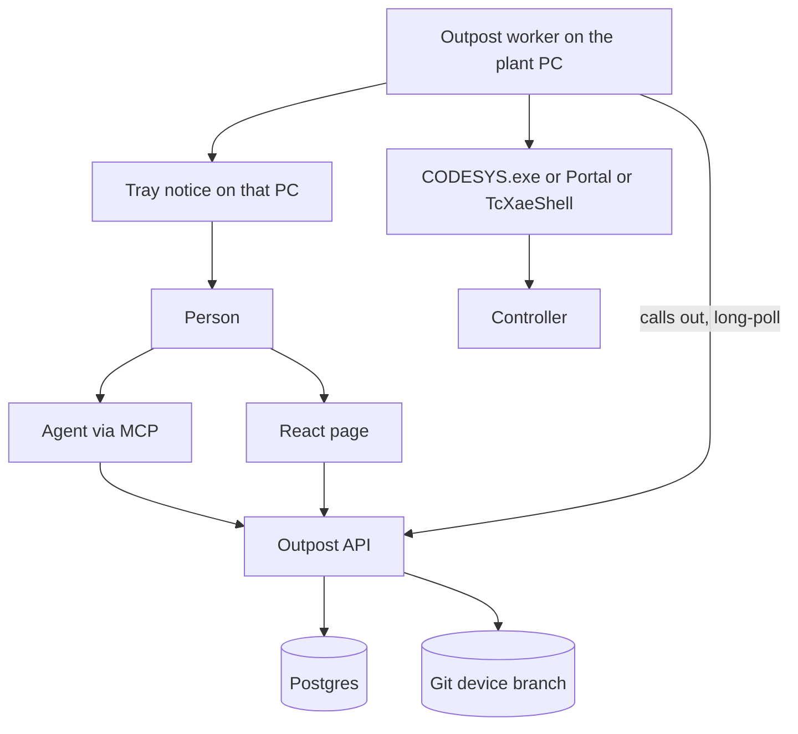
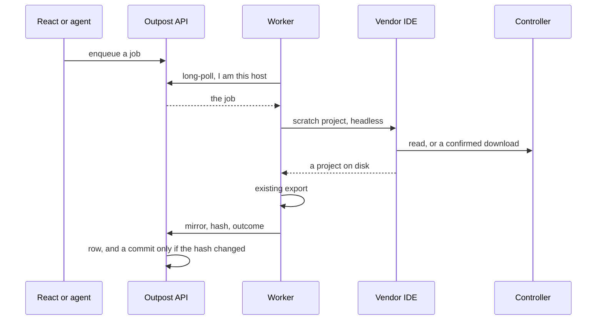
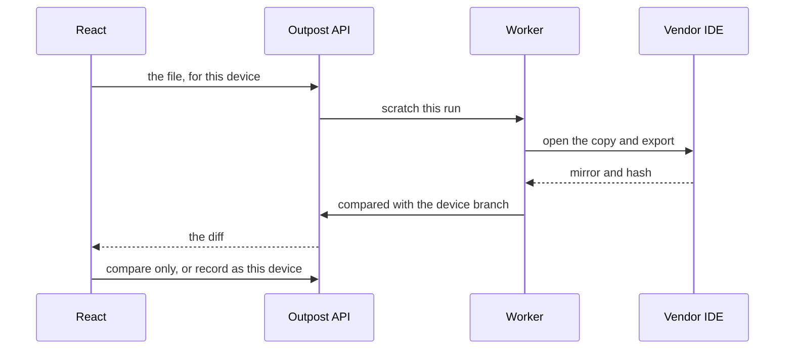
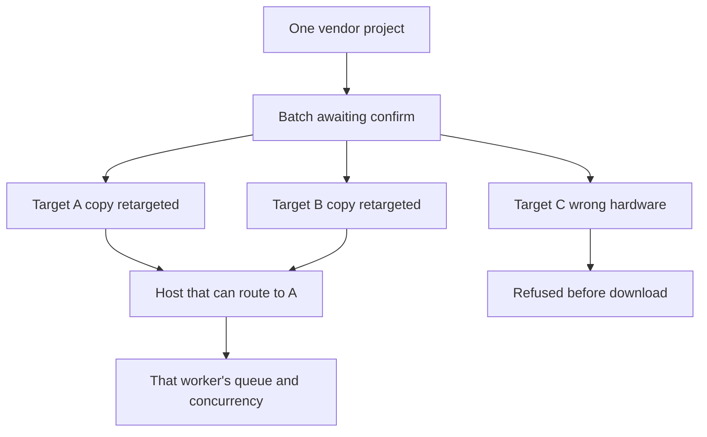
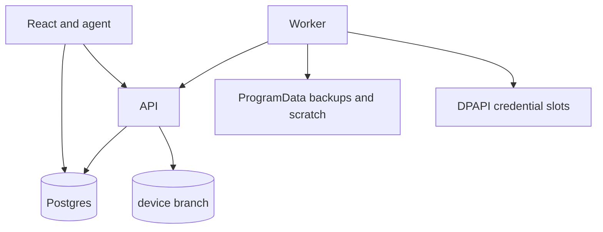

# Versio Outpost

**Date:** 2026-10-04. **This is a design record, not the live queue.** What Versio is today
lives in [`../STATUS.md`](../STATUS.md). This document is how Outpost should be built, and why
each piece sits where it does. Nothing here is implemented.

| | |
|---|---|
| Document | The Outpost design: scheduled backup of the program on a controller, a diff against what engineering committed, and a confirmed restore |
| Sibling of | The Versio desktop app. Same vendor runners and the same export. A different window, a different verb |
| First measurement | A CODESYS `upload_source` against a controller that already holds `Archive.prj`, before any of the product is built |
| Out of scope until measured | TwinCAT target recovery. A cloud VM that cannot route to the plant. Writing to a controller from a schedule |

---

## Start here

Read [`../STATUS.md`](../STATUS.md) for where Versio is. Read this for the product that talks to
controllers. The desktop app's job is the file on disk and the git mirror. Outpost's job is the
other copy of the program: the one running in the plant.

The argument, in the order a builder needs it:

1. Why it is not a button inside Versio.
2. Which processes exist, and which one is allowed to touch a PLC.
3. What a backup does, what a restore does, and what an agent is allowed to start.
4. Where the history, the vendor file, and the password live.
5. The order to build it, which starts with a measurement rather than a web page.

---

## 1. Why this exists

A PLC project in git is the program somebody meant to ship. The program on the controller is
the one the machine is running. Those two diverge whenever someone goes online, loads from a
USB stick, or downloads from a laptop that never pushed. Versio already turns a project file
into a reviewable mirror. It cannot see the controller, because the engineer's laptop is not on
the plant network at 02:00, and the desktop app was built to refuse a download.

Copia DeviceLink and octoplant already sell the missing half. DeviceLink is a Windows agent on
a PC that can reach the PLC and has the vendor IDE licensed. It polls for jobs, uploads into a
temp folder, and a server compares that with git. A difference can auto-commit onto a
`DeviceLink/…` branch, never the branch people develop on. octoplant keeps the same shape in
its own database: scheduled upload, compare, notify, restore. Some of its vendors also have a
checksum mode that can say "changed" and cannot put the program back.

Outpost takes the half Versio is already good at — the mirror, the diff, the refusal to record
a lie — and points it at the controller. It does not become octoplant. The history of what
changed is git. The list of runs is a database. The file you would load onto a replacement
controller stays on the plant PC.

### Why it is not the desktop app

The founding plan lists "anything on the PLC itself (download, online change, monitoring)" as a
non-goal ([`../phase1/PLAN.md`](../phase1/PLAN.md)). That non-goal stands for Versio. A download
stops a controller. Putting that verb in the same window as committing Structured Text means a
person who opened the app to review a diff can stop a line. Outpost is the sibling that is
allowed to do it, behind a confirmation the schedule can never give.

They share code. [`IPlcRunner`](../../src/Versio.Core/Plc/PlcJob.cs) is file-in / file-out on
purpose, and the remarks on it already say a remote runner and a local one are interchangeable.
[`docs/phase1/PLAN.md`](../phase1/PLAN.md) §13.8 parked that seam for compile-on-push. Outpost
uses the same seam for a different host: a PC on the plant network, not a build server. The
React page never implements a vendor.

A separate codebase would reimplement the CODESYS, TIA, and TwinCAT export. A separate product
name does not. The name is **Versio Outpost**. "Deployment" was rejected because it names only
the sharp edge. The thing a person opens every day is the backup and the diff. A download is
one confirmed verb inside that.

### What was decided, so it is not re-opened by accident

| Decision | Why |
|---|---|
| Outpost, not a mode of the WPF app | A download that stops a PLC does not live next to Commit |
| The worker calls out | The plant LAN does not accept inbound connections from a cloud page |
| Git holds the text that changed | That is the history a person reads. A `.project` does not diff |
| The vendor project stays on the worker's disk | That is the file you restore. A text mirror is not that file |
| A database holds every run | "Up to date" at 02:00 is a row. An empty nightly commit would bury the real ones |
| Passwords stay in DPAPI on the worker | A password in the database, in git, or in an agent chat is a password in a log |
| The schedule only reads | Restore is a different verb, confirmed by a person, for an exact file and an exact address list |
| An open IDE does not skip the backup | The worker uses a scratch project and does not take the person's window. A new version is announced on that PC's screen |
| The agent uses the same API as the page | It cannot confirm a different file from the one the person was shown |
| No vendor DLLs in the installer | Versio already locates CODESYS, Portal, and XAE. Shipping them would be the leak the seam exists to prevent |
| The same log the desktop app writes | A silent failure is a bug even when the run row is right. The worker uses `VersioLogger`: operation id, heartbeat, a daily file |

---

## 2. The pieces

Five processes. Only one of them opens a vendor IDE, and only one of them opens a session to a
controller.

| Piece | Runs where | Talks to | Never does |
|---|---|---|---|
| React page | A browser | The API over HTTPS | Open an IDE, open a PLC session, store a password, commit |
| Outpost API | Beside the database and a git clone | Postgres, git, the worker's outbound connection | Load Openness, spawn `CODESYS.exe`, route to a PLC |
| MCP server | Beside the API, or in it | The same API, with the person's token | A second path to the worker or the PLC |
| Outpost worker | One Windows PC per plant network, installed | The API, outbound. The vendor IDE, locally. The controller, through that IDE | Accept a connection from the internet. Rewrite the person's open project |
| Vendor IDE | That same PC, licensed per machine | The controller | Get shipped inside the Outpost installer |

The page and the agent are clients. The worker is the only machine that can see both the IDE
and the PLC. A cloud VM that cannot route into the plant has nothing to upload; that is why the
worker sits on the plant PC and calls out, the way Copia's agent polls, rather than the page
opening a port.

A job takes minutes. CODESYS cold start alone is 17–31 seconds
([`../vendors/codesys/DRIVING.md`](../vendors/codesys/DRIVING.md)). The page's call is "start
this" and a later "here is the outcome". One HTTP request must not wait on the controller.

### Which worker runs the job

The page does not call a server that has TIA Portal. Nothing in the cloud dials a plant PC.
Each worker calls out, and the API gives a run to a worker that can open that project.

Eligibility is the version, not a single pin. `PlcFormats` reads the project and names the
vendor. A worker's heartbeat reports what it can open without upgrading it: Portal V21, the
CODESYS profile, TwinCAT XAE 4026. A TIA V21 run may go to any worker that reported Portal
V21 and has the password slot for that device. It may not go to Portal V18, and it may not go
to a worker that reported only CODESYS. The person can mark a preferred worker. That one is
offered the run first. Preference is not ownership.

Each worker has two numbers, set on that PC:

- **Concurrency.** How many toolchain runs it will execute at once. The default is 1. CODESYS
  on one profile, and one Portal process, are the reason. Raising it is allowed only where
  that PC has been shown to run two of that IDE. The worker refuses to start a run past the
  number it was given.
- **Queue depth.** How many claimed runs it will hold behind the ones already executing. The
  queue is on the worker, first in first out, one scratch directory per run.

A run stays **Pending** until a worker claims it. The preferred worker claims it when it has a
free concurrency slot or a free queue slot. When that worker is at both limits, or its
heartbeat is stale, the next eligible worker may claim it. A claim is a lease. Two workers
never upload the same controller for the same run. A lease whose worker dies before the IDE
has started can be claimed by another eligible worker. Once the IDE has started, the run is
**Running** and it is not moved.

A worker with the right IDE and no password slot is not eligible. Saving a password forwards
it to every eligible worker that is online, and the API does not keep it. A worker that was
offline does not become eligible until the password is sent to it. The page lists those
machines. The vendor file stays on the worker that produced the run. A later restore of that
hash prefers that worker. If it is at capacity, another eligible worker can take the restore
after the holder has copied the project to it. If the holder is off, the restore waits. The
bytes are not on the other PC.

If the worker that claimed the run cannot reach the controller, the row records that attempt
and the run goes back to **Pending** for the next eligible worker, once each. When every
eligible worker has failed the reach, the outcome is **Unreachable** and it names the workers
that were tried. It does not rotate forever.

A batch uses the same rule per target. The confirm fingerprint is the file hash, the address
list, and the set of worker versions that were eligible at confirm time. A worker whose
version was not in that set cannot pick the run up. A worker that was in the set can, which
is the point of the spillover. Adding an address, or a worker of a different version, is a
new batch.

---

## 3. A scheduled backup

This is the daily path. It only reads.

1. The schedule is a row on the device: a cron expression, the vendor, the project, the
   device's name as the project tree spells it, the address, and which worker is preferred.
2. When the time comes, the API inserts a run in **Pending**. If the device was offline or
   every eligible worker was busy across several ticks, those ticks collapse into one run.
   The night does not owe one upload per missed slot.
3. An eligible worker claims the run, within its concurrency and its queue depth, preferred
   worker first. It moves the run to **Running** when a concurrency slot takes it. Each run
   has its own scratch directory so two jobs cannot mix files.
4. The worker starts the vendor IDE against that scratch directory. It does not open the project
   a person has open, and it does not log in with an online-change option. A backup must not
   download.
5. The IDE reads the controller. What comes back depends on the vendor, and is spelled out in
   §10. The result is either a vendor project in scratch, or a named failure.
6. On a project, the worker runs the export Versio already has. The export must be deterministic:
   the same project exported twice produces the same bytes. That rule already exists because a
   spurious diff destroys the reason the mirror exists. If two exports of this upload disagree,
   the outcome is **Unstable export** and nothing is committed.
7. The worker compares the mirror hash with the last committed hash for this device.
   - Same hash: outcome **Up to date**. A database row. No commit. The tray stays quiet.
   - Different hash: the worker keeps the vendor project under
     `backups/<device>/<hash>/`, sends the mirror to the API, and the API commits it on
     `device/<device>` with the run id in the message. The row stores the SHA. Outcome
     **Modified**. The tray on that PC says a new version is available, naming the device.
8. Scratch is deleted after a successful export. A failed export keeps the vendor project for a
   retention window (**Conversion failed**) and does not commit a half mirror.
9. The worker then reports the row. If the API does not accept it, the worker keeps the result
   in a local outbox and retries. A backup the page never shows is a lost backup.

The engineering branch is not updated. The desktop app's working tree, direction lock, and
`.project` are not on this path. Adopting an upload into the open project would be the merge
hole already measured as `P-M2` in [`../STATUS.md`](../STATUS.md), with a PLC attached.

The commit message says how the mirror was obtained: scheduled read, run-now, or a file a person
recorded. The next scheduled read still talks to the controller. If a recorded file was not what
is running, the next run shows the difference.

---

## 4. The IDE is already open

Versio today treats an IDE holding a project as a reason to wait or to skip an import. That is
correct for the desktop app, because an import would write the file the person is editing, and
TIA in particular cannot export the project the GUI has open
(`ExportHeldViaCopy` is false; [`../vendors/tia/DRIVING.md`](../vendors/tia/DRIVING.md)).

Outpost is not editing that file. The backup is a scratch project and a session to the
controller. The person's CODESYS, Portal, or XAE window is not the session the worker uses, and
it is not a reason to drop the job. The worker does not close their window and does not write
their document.

When the run records a new version, the tray on **that** PC notifies the person looking at it:
which device, and that a new version is available. The notice opens the diff in the page. It
does not import into the project they have open. An unchanged run does not notify.

Whether a headless Portal or a second CODESYS can sit beside the GUI on one machine is not yet
measured. Versio serialises CODESYS behind a machine-wide mutex because two instances on one
profile are not safe, and a Portal window is occupancy. The product rule is still that the
backup completes and their document is left alone. The measurement is part of building the
worker, vendor by vendor. If a vendor refuses a second process, the worker's run uses a profile
or an instance that is not the person's, and the finding is written down before anyone softens
the rule back into a skip.

A controller that already has another engineering session online is a different case
(**Busy controller**). The worker does not log that person off, does not online-change, and does
not download. That run waits for the next schedule.

---

## 5. A file a person supplies

**Run now** is a normal device run. The worker reads the controller. The row says so.

Dropping a `.project`, a CODESYS archive, a TIA archive, or a TwinCAT tree on the page is a
different source. The file did not come off the PLC, so it is not written onto `device/<device>`
as though a read had produced it.

The bytes go to the worker's scratch directory. They are not stored in the database. The worker
has to be online; the page refuses the drop when it is not, because the export needs the IDE.
The export, the hash, and the diff against the last device commit and against the engineering
branch are the same as a fetched project. The vendor project is kept on disk under its hash
either way, so it can still be opened. A partial export is **Conversion failed**, not a commit.

The person chooses after seeing the diff:

- **Compare only.** No commit. The device branch still means "what we read from the controller."
- **Record as this device's program.** They are saying this file is the one that was on the
  controller. The mirror is committed the same way as a modified run, and the message says it
  was supplied. The next scheduled read still checks the PLC.

A project whose name, or whose device name in the tree, does not match the device record is
refused before either choice. A Versio text mirror dropped on its own can be diffed and cannot
be recorded as a backup, because there is no vendor project to restore. An archive that asks for
a password uses the same host-side slot as a controller password, forwarded once and not stored
in the row.

The page says, before it accepts the file, that the worker will open it in the IDE on that PC.

---

## 6. Putting a version back

Restore uses the vendor project stored for a hash. The text mirror is not enough, and neither is
a compare-only drop that was never kept as a vendor file. The stored file is copied into scratch.
The backup directory is not modified, so a failed restore cannot damage the version you meant to
send.

Two writes exist, and the page names which one the person picked:

| Write | What the controller does | What the row may say |
|---|---|---|
| Replace the running program | A full download. The PLC stops. CODESYS application download, TIA `DownloadProvider` with an address, TwinCAT activate on the target | **Restored**, and only after a read-back matches |
| Put the source on the device | CODESYS `download_source` writes `Archive.prj` and leaves the running program alone | That the source is now on the device. Never that the machine is running that version |

An online change is the wrong tool for a restore. It applies a delta against whatever happens to
be running, and it can refuse or land halfway. Restore is a full download of a known project.

Before the download, the worker reads the controller and the page shows that diff against the
version about to be written. If the read fails, the download stays blocked until the person
confirms they are overwriting a controller whose current program is unknown. The confirmation
names the version, every controller, and that the PLC will stop. The row records who confirmed.

### One file, many controllers

One batch. Each target is its own run, its own address, and its own credential slot. The project
file has an address inside it, so each run gets a copy with the communication path pointed at
that controller. The saved device record is not rewritten unless the person asked for that
separately.

A target whose hardware type does not match the project is refused before download and does not
cancel the others. Each target is claimed by an eligible worker under the concurrency rule
above. One target failing does not roll back a target that already succeeded, and it does not
retry itself.

A download that started and did not finish is **Interrupted**. The controller may be stopped on
neither the old program nor the new one. The next step is a person. The worker does not try
again on its own.

A run is **Restored** only after a read-back matches the version that was sent. The download API
returning is not that. Busy, rejected, gateway down, would-upgrade, and needs-a-person apply
here too. A busy controller is left alone rather than logged off.

A schedule cannot start either write.

---

## 7. An agent on the same API

The page and an agent are two clients. Cursor connects through an MCP server whose tools are the
API. The token is the person's. The run row records that an agent prepared it and which person
confirmed it.

The agent can, without stopping a controller:

- List devices, hosts, schedules, and runs.
- Read a diff between two uploads, or between a controller and the engineering branch.
- Start a backup read.
- Submit a file and a list of addresses as a batch **in waiting**.

There is no tool that accepts a password. A missing slot comes back as **No credential**, and
the agent tells the person to enter it on the page. A password in the chat is a password in a
log.

"Download this file to these controllers" is four steps, and the third one is the person:

1. The agent uploads the file and the address list. The API returns a batch id, the file hash,
   and every target it understood. The addresses belong to that batch.
2. The worker reads each controller it can. The agent shows the diff, the addresses, and that
   each PLC will stop. A target that cannot be read stays blocked behind the same
   unknown-program confirmation as the page.
3. The person agrees. The agent calls confirm with that batch id and a fingerprint of the file
   hash plus the exact address list. Adding a controller or swapping the file after that makes
   the confirm fail. A new list is a new batch.
4. The worker downloads, one controller at a time. The agent reports Restored, refused, or
   Interrupted. It does not retry an Interrupted target.

A token that can prepare a batch cannot confirm a different file from the one the person was
shown. The confirm is the same gate the page uses.

---

## 8. Where each thing lives

Three stores, plus a secret store. None of them does another's job.

### Postgres, beside the API

The history the page lists. SQLite is only acceptable if one box is both the API and the only
worker, which is a development layout and not a plant.

| Table | Holds | Does not hold |
|---|---|---|
| `host` | id, display name, last seen, token hash, which IDEs the installer found and their versions | A password, a project |
| `device` | preferred worker, vendor, name in the project tree, address, repo, project path, profile, schedule, credential **slot names** and which workers have stored them | The secret itself |
| `run` | device, batch if any, source, state, outcome, times, error sentence, mirror hash, commit SHA, path of the vendor file on that host, identity JSON when there is no project, who acted, who confirmed, the confirm fingerprint | File bytes |
| `batch` | file hash, state `waiting` / `confirmed` / `running` / `done`, the fingerprint the confirm must match | A second copy of the project |

Git is a bad job queue. The row exists so the page can say the run happened when nothing was
committed.

### Git, for the text that changed

A changed export is one commit on `device/<device>`, in the repository the desktop app already
uses. The commit is the mirror: `.st`, native XML, YAML, the manifest. A `.project` or a TIA
tree does not diff, which is the reason Versio exists. The page's diff is `git diff` between two
SHAs on that branch, or between that branch and the engineering branch.

The API does the commit, not the worker. The mirror is small enough to send. The plant PC then
does not need a credential that can push the engineering remote. The vendor project, which is
the large file, never goes to git. Git LFS of a nightly 500 MB TIA tree was rejected for that
reason.

An unchanged upload does not get a commit. The row points at the previous SHA.

Copying vendor projects off the worker into object storage is a later choice, for when the page
must hand someone the binary while that PC is off. Until then, "download the project" is a
request the API forwards to the worker.

### Disk on the worker

| Path | Lifetime |
|---|---|
| `scratch/<run id>/` | The upload or the dropped file. Deleted after a successful export. Kept on conversion failure for a retention window |
| `backups/<device>/<hash>/` | One copy of the vendor project per distinct hash. This is what a restore copies from |
| `outbox/` | A finished result the API has not accepted yet |

Unchanged runs store nothing new. **Disk full** fails before the commit, and the worker does not
delete the vendor file the latest device commit already points at in order to make room.

The order on a changed run is: write the vendor file, then ask the API to commit, then mark the
row **Modified** only if the SHA is on the branch. Export succeeded and the push did not is
**Not recorded**. The vendor file stays.

### Passwords

Windows Credential Manager, protected with DPAPI, on the worker. One secret per device and slot:
device user, application password, know-how password. The database stores the slot name.

The page sends a password once, over TLS, to the API, which forwards it to the worker on the
worker's outbound connection and then forgets it. The worker writes the job file the script
reads with a locked-down ACL, outside any git repo, and deletes that file when the process
exits. Logs follow the rule already in
[`GitCliClient`](../../src/Versio.Infrastructure/Git/GitCliClient.cs): a credential never reaches
a line.

The worker authenticates to the API with its own token, stored as a hash. Reinstalling the
worker without preserving the credential store means the passwords are typed again. An upgrade
of the package must leave that store in place.

A rejected password is one failure and then a backoff. A tight retry can lock the account on the
PLC. Versio already refuses that loop for git credentials.

### Logs

The desktop rule applies unchanged: every operation says what it is doing, against what, and how
it ended. A run row that says **Unreachable** with no log is the same defect as the rolling file
sink that was written and never instantiated. Outpost uses `VersioLogger`, `BeginOperation`, and
`RollingFileSink`. It does not invent a second format.

What that means on the worker:

- One operation id per run, the same id `PlcJob` already carries. Every line from the queue, the
  IDE, and the export carries it, including lines from the CODESYS or Portal process. Filtering
  to that id is how a failed backup is explained.
- A heartbeat on `LogCategory.Perf` for anything long enough that silence looks like a hang.
  CODESYS cold start is 17–31 seconds; the log names the phase and the elapsed time the way the
  desktop panel does.
- Quiet when idle. A long-poll that finds no job collapses into one periodic line. A refused,
  coalesced, or up-to-date run still writes the outcome once. It does not write one line per
  unchanged file.
- Levels stay the four the desktop uses: Debug, Information, Warning, Error. Categories stay the
  neutral ones (`Plc`, `Git`, `Fs`, `Perf`, `App`). A vendor name appears in the message when it
  matters. It does not become a category. `VendorSeamTests` already fails the build on a
  `Codesys` constant in the neutral logger.
- The file is under `%ProgramData%\Versio\Outpost\logs`, next to the backups and the credential
  store, not under `%LOCALAPPDATA%\VersioUser\logs`. The desktop path is per user because the
  app is. The worker has to keep logging when nobody is logged on, and an upgrade must not
  delete the evidence. One file per process per local day, `outpost-<date>.log`, with the
  process id in the name when a second process is already holding the file. That is the defect
  `RollingFileSink` already fixed for two Versio windows. Rendered timestamps are local, so the
  file and the page agree. The stored timestamp stays UTC.
- Fourteen days kept, not five. The desktop window is five because someone is sitting at the
  machine. A plant backup is often looked at days later, from somewhere else.
- A password, a host token, and an enrollment code never reach a line. The redaction is the
  same rule as `GitCliClient`: strip the secret before the logger sees the text, including a
  URL that has userinfo in it.

The page shows the log of a run, not a second copy of the whole file. While the run is going,
the worker sends that operation's lines with its progress posts, heartbeats included, so the
page is not silent for the half minute the IDE is starting. When the run ends, those lines are
stored on the run row. Debug stays in the file on the worker; Information and above, and every
heartbeat, travel with the run. If the run fails, the worker also attaches the Debug tail for
that operation id, because that is the detail that explains a failure and it is useless once
the file has rolled off. The row is not a log database. Lines that belong to no run — startup,
enrollment, a poll that found nothing — stay in the file only.

The tray has **Open logs folder**, and it opens the folder the sink is actually writing. The
desktop app once opened the directory the logs would have used, after the real sink had failed
to open. The API process writes its own daily file beside the server, same shape, for the
person running the service. The page does not mix those lines into a controller's run.

---

## 9. What a run can end as

The page shows one of these. A partial mirror is never committed. A manual file uses the same
list, with the source on the row.

**The job has not finished**

| Outcome | Meaning |
|---|---|
| Pending | The schedule fired, someone pressed run, or a file has reached the worker and the toolchain has not taken it |
| Running | The worker holds its toolchain queue and is in upload or export |
| Cancelled | A person stopped it. Kill the process this run started. Leave no scratch |
| Missed, coalesced | Several scheduled times passed while the worker was offline or busy. When it returns it runs once |
| Timed out | The toolchain did not finish inside the job limit. Kill the process this run started, the way Versio's Stop reaps a CODESYS or Portal PID. Leave no scratch |

**The read finished**

| Outcome | Meaning |
|---|---|
| Up to date | Hash matches the last commit. A row only. The tray stays quiet |
| Modified | Hash differs. Vendor file kept under the new hash. Commit on `device/<device>`. The row stores the SHA. The tray on that PC says a new version is available |
| Compared | A person supplied a file and did not record it. Vendor file kept. The device branch is unchanged |
| Recorded from a file | They confirmed the supplied file stands for this device. Same commit as Modified, and the message says it was supplied |
| Identity only | The controller answered and there is no project to export. CODESYS without `Archive.prj` is this. Record the code identity. No commit, no invented diff |
| Stale source | CODESYS returned `Archive.prj`, and the running application's identity does not match it. The archive is the last source download, which can be older than an online change. Keep the file, show the diff, do not call the row up to date. A commit says the source and the running code disagree |
| Partial | The upload finished and some of it has no source: know-how protection, safety blocks, TwinCAT without type information, or a module whose device description was not on that PC. Commit only the readable mirror, and list what was missing. Not a clean backup |
| Conversion failed | A vendor project arrived and the export did not. Keep it for a retention window. Do not commit a half mirror |
| Unstable export | The same upload exported twice did not match. Do not commit noise |

**The result would have been a lie, so it was refused**

| Outcome | Meaning |
|---|---|
| Wrong program | The project name or the device name in the tree does not match the device record. A scheduled read can hit this when someone loaded a different program. No commit onto this device's branch |
| Would upgrade | Opening the project would convert it to this PC's service pack, or the IDE is the wrong version. Refuse. A backup that rewrites the program is a different program |
| Needs a person | The IDE stopped on a question the script cannot answer: a project-update prompt, a TIA language mismatch, a safety upload that was never enabled, or a device description that no eligible worker has. Name the question and, for a description, the workers that were tried. This is not a generic timeout |

**The job should not have started, or should not touch the controller**

| Outcome | Meaning |
|---|---|
| IDE open is not an outcome | The backup still runs. See §4. The tray speaks only when a new version was recorded |
| Unreachable | No session to the controller. The row names the address that was tried |
| Gateway down | The worker's own CODESYS gateway or TwinCAT route is not running. The fix is on the PC, not at the PLC |
| Busy controller | Another engineering session is online on the PLC. Do not log them off. Retry next schedule |
| No credential | The device requires a password and the slot is empty. Do not start the IDE |
| License | Scripting or Openness is not licensed. Do not retry on the timer |
| Incomplete | The transfer ended early or the archive does not open. Do not export a truncated project |

**The backup happened and the record did not**

| Outcome | Meaning |
|---|---|
| Not recorded | The export succeeded and the commit or the push did not. The row must not say Modified unless that SHA is on the branch. The vendor file stays |
| Row not written | The API did not take the row. The worker's outbox retries it |
| Disk full | Fail before the commit. Do not delete the vendor file the latest commit points at |

**The write to the controller**

| Outcome | Meaning |
|---|---|
| Restored | Read-back matches the version that was sent |
| Interrupted | The download started and did not finish. Do not retry. A person looks at the controller |
| Source stored | `Archive.prj` was written. The running program was not replaced |

One run has one claim. A second worker does not upload that controller while the claim is
alive. Another eligible worker may take the run when the preferred one is at its concurrency
and its queue depth, or when the claim dies before the IDE starts. The desktop Versio on an
engineer's laptop is not in the eligible set.

---

## 10. What each controller will actually give up

This is the part that cannot be designed past. The first build measures CODESYS. TIA is second.
TwinCAT waits.

### A missing device description

An upload reads the program off the controller and then asks the IDE on that PC to build a
project. The IDE can only build a device it has a description for: a GSD or GSDML in TIA's
catalog, a CODESYS device description, an EtherCAT ESI in TwinCAT. Without it the upload
fails, or it finishes with that module as an unknown device and the I/O configuration is not
in the project. Both are real. Neither is **Unreachable**, and neither is **Up to date**.

The worker quotes the IDE. The row names the description that was asked for, as the IDE
spelled it, and which worker was missing it. That worker is not eligible for this run
anymore. Another worker with the same Portal or CODESYS version may already have the file
installed, so the run goes back to **Pending** for the next eligible worker, once each, the
same way a worker that cannot reach the controller does. When every matching worker has
failed on the description, the outcome is **Needs a person**. The page lists the missing
name and the workers that were tried. It does not say the backup succeeded.

The worker does not download or install a device description itself. A GSD is something the
IDE loads. Putting one on the machine is a person installing it into that IDE's catalog.
The next run can then use that worker. An upload that finishes with unknown modules is
**Partial**: the readable project is kept, the unknown modules are listed, and the row is
not a clean backup of the hardware.

### CODESYS

The PLC holds source only after someone has done File → Source Download, which writes
`Archive.prj`. Copia documents that as a one-time step in the IDE. ScriptEngine can then
`upload_source` to a local archive. The worker opens that archive and exports it with the
exporter Versio already has.

Without that archive, the honest result is **Identity only**: reachable, application present, a
code id if one can be read. That is octoplant's checksum mode. There is no line diff and no
restore of the program. The probe in §12, step 0, is what decides whether a code id is actually readable.

If the archive's identity and the running application's identity disagree, the outcome is
**Stale source**. An online change after the last source download produces exactly that.

Branded CODESYS (WAGO and the like) needs that vendor's `CODESYS.exe`. The device record stores
the path the installer found. Stock CODESYS will not open their project.

Login for a backup uses a mode that does not download and does not online-change. The script is
read for that before it is trusted. The log of the probe is the evidence.

### TIA Portal

Openness `StationUploadProvider.StationUpload` pulls the station into a project from an address.
Blocks live on the CPU, so there is no separate source-download prerequisite. Know-how-protected
blocks come back without source, which is **Partial**. Safety upload depends on an option that
was set at download time; without it the run is **Needs a person** or a named failure, not a
silent skip.

A password or upload-inhibit callback that is not answered hangs Portal the same way a `--noUI`
modal hangs CODESYS. Every callback the host does not have a slot for is **Needs a person**,
with the question in the row. A language mismatch between the offline project and the online
project fails the upload the same way; Copia's TIA notes describe that failure, and the row
should quote it rather than say "timed out".

The worker needs the matching Portal plus Openness. Versio already refuses to load Openness
inside the net9 process
([`LocalTiaPortalRunner`](../../src/Versio.Plc.TiaPortal.Infrastructure/LocalTiaPortalRunner.cs));
Outpost uses that net48 host, it does not grow a second one.

An engineer may have Portal open on the same PC. The backup still runs, against scratch, and
does not take their window. §4 is the measurement.

### TwinCAT

The recoverable object is the project on the target (Open Project from Target, or the boot
folder), and only when type information was included at build. Without it, symbols come back as
raw memory, which is not a Versio diff. Leave this vendor until the CODESYS path has been
measured. The host that would drive it is the one Versio already has, COM into
`TcXaeShell.DTE.17.0`.

---

## 11. How it sits on the code that exists

`PlcOperation` today is Probe, Export, Import
([`PlcJob.cs`](../../src/Versio.Core/Plc/PlcJob.cs)). Outpost adds operations the desktop sync
orchestrator does not call:

| Operation | Neutral result | Who implements it |
|---|---|---|
| Upload | A project appeared in this scratch directory, or a named failure: unreachable, no source, identity only, stale source, needs a person | The vendor pack. CODESYS first |
| Download | Read-back matches, or interrupted, or a named refusal | The vendor pack, only after the API says the batch is confirmed |
| StoreSource | `Archive.prj` written, running program untouched | CODESYS only, and the row must not say Restored |

`PlcResult` stays small. A vendor-neutral outcome enum lives next to it. The strings `Archive.prj`,
`StationUpload`, and `TcXaeShell` do not. `VendorSeamTests` already fails the build on a leak;
the new enum and the new operation have to pass it. Nothing in `Sync/`, `Git/`, `Locking/`,
`Watching/`, or `Diff/` learns a vendor's name. The desktop orchestrator does not grow a call to
Download.

The export the worker runs after a successful upload is the existing Export operation. Outpost
does not write a second exporter.

Suggested projects, beside the ones Versio already has:

| Project | What it is |
|---|---|
| `Versio.Outpost.Api` | ASP.NET. Postgres, the job API, the git commit of a mirror, enrollment. References `Versio.Core` and the git infrastructure. No ProjectReference to a vendor pack |
| `Versio.Outpost.Worker` | Windows service, tray, queue, DPAPI, scratch and backups. References the vendor infrastructure projects the way `Versio.App` does, and registers packs in one place |
| `Versio.Outpost.Mcp` | A thin MCP server. Every tool is an API call. No vendor reference |
| `web/outpost` | The React page. Schedule, devices, run history, diff, confirm |

The worker is not `Versio.App` without a window. The app's direction lock, watcher, and commit
gate are for an engineer editing a working tree. Pulling them into the plant PC would let an
upload adopt into a checkout. The worker calls `IPlcRunner` and stops there.

---

## 12. How to build it

The order is the safety argument. A web page built before `upload_source` has been seen is a
page for a product that may not exist.

### Step 0 — Measure CODESYS before any product

One script, one real controller that already has `Archive.prj`, launched the way
[`LocalCodesysRunner`](../../src/Versio.Plc.Codesys.Infrastructure/LocalCodesysRunner.cs)
already launches `CODESYS.exe`.

1. `upload_source` into a temp archive. Confirm it opens as a project.
2. Export that project with the existing exporter and diff it against the repo mirror.
3. Repeat against a controller that was never source-downloaded, and write down what identity
   comes back. That decides whether **Identity only** is a real code id or a guess.
4. Where both the archive and the running application expose an identity, compare them. That
   decides whether **Stale source** can be detected or only documented.
5. Read the log. The script must not have downloaded and must not have online-changed.

If step 1 fails, there is no CODESYS backup product, only the question in step 3. Do not build
the page on top of a failed probe. Write the finding in [`../FINDINGS.md`](../FINDINGS.md).

TIA `StationUpload` is the second probe, on a copy of a project, with the password callback
answered in the host so Portal cannot sit on a dialog. TwinCAT is not this step.

### Step 1 — The operation, behind the seam

Add Upload to `PlcOperation`. Implement it in the CODESYS pack only. The neutral result is a
scratch project or a named failure. Tests in `Versio.Plc.Codesys.Pure.Tests` for the plan and
the refusal to download. A live test joins `Versio.Plc.Codesys.Tests` and is not part of the
fast loop. `VendorSeamTests` stays green.

### Step 2 — The API and the database

Hosts, devices, runs, batches. No file bytes, no passwords. A run can be inserted, moved
through Pending and Running, and finished with one of the outcomes in §9. The commit of a
mirror is a function the API exposes once a worker posts a hash and a tree. Unchanged hash does
not commit. This step has no IDE in it. `Versio.Core` and `Versio.Integration.Tests` cover the
git part: a device branch, a second identical post, a push that fails and leaves the row
**Not recorded**.

### Step 3 — The worker, unpackaged, on one PC

A console process is enough. It enrolls, long-polls, runs Upload, runs Export, posts the
mirror, deletes scratch, and writes the vendor file before it asks for the commit. DPAPI slots.
Outbox when the API is down. Concurrency and queue depth are the worker's own limits, defaulting to one run executing and a short queue behind it. A run the worker cannot take stays pending for another eligible worker.

Prove a scheduled read end to end against the controller from step 0. Then prove it again while
the IDE GUI is open on that PC, and write down whether the second process was allowed. The log
file has to contain the operation id, the heartbeat, and the outcome, and it has to contain no
password. The tray can be a line in that log until step 5. The product rule in §4 is not
relaxed if the second process fails; the finding names what the vendor actually did.

### Step 4 — The page

Devices, a schedule, run history, and a diff of two SHAs. Run now. The diff is the text the API
got from git. The WPF view does not move; the files do. Passwords are a form that posts once
and is not echoed back.

### Step 5 — The package and the tray

§13. A person can install the worker, enroll it, and see it on the page without copying a
folder next to Portal. A new version recorded while they are at that PC raises the tray notice.

### Step 6 — A file a person supplies

§5. Compare only, and record. Wrong project refused. Text mirror without a vendor project
refused as a backup.

### Step 7 — Restore

§6. One controller first, on a machine that is allowed to stop. Read-back is the success
condition. Then a batch of several, including one wrong hardware type that must refuse without
cancelling the others, and one interrupted download that must not retry.

### Step 8 — The agent

§7. MCP tools over the API. A test that confirm rejects a fingerprint that does not match the
batch. No password parameter on any tool.

Stop after step 0 if the probe fails. Steps 1–3 are the product. Steps 4–5 are how a person
reaches it. Steps 6–8 are the verbs that write, and they wait until a read has been seen to
work.

---

## 13. The package

Outpost on the Windows PC is an application you install. One package, the same shape as Versio's
installer (unsigned `Setup.exe` and MSI from `Build_Package.bat` today; Outpost gets its own
package id so an upgrade of one does not touch the other).

What the installer lays down:

| Piece | Why |
|---|---|
| A Windows service | Starts with the machine. Long-polls the API. Runs the queue. This is the process the API talks to |
| A tray program | The on-screen notice in §4. Also shows whether the link to the API is up, and opens the logs folder the sink is actually writing |
| The runners | The code that starts `CODESYS.exe`, the net48 Openness host, and the TwinCAT host. Built from the projects Versio already has |
| A self-contained runtime | The plant PC should not need a separate .NET install for Outpost. The TIA host stays net48, which Windows already has |

What the installer does not lay down: Siemens, Beckhoff, or CODESYS binaries. Those stay the
vendor's install. The installer checks that each IDE this PC is meant to drive is present,
records the path and the version, and refuses to call the worker ready if the one it was
enrolled for is missing. A missing Portal is a sentence in the installer and a sentence on the
page, naming what to install. It is not a host that sits online and fails every job the same way.

Enrollment is the communication path:

1. The installer asks for the API address and an enrollment code. A silent install takes the
   same two values on the command line, so a site can roll the worker out to many PCs.
2. The service calls the API, exchanges the code for a host token, and stores the token with
   DPAPI.
3. From then on the service calls out. The page sees the host come online. Nobody opens a port
   on the plant LAN.

An upgrade replaces the service, the tray, and the runners. It leaves the enrollment, the
backups directory, the log files, and the credential store in place. Those live under
`%ProgramData%\Versio\Outpost`, outside the install directory, for the same reason Versio's
settings live outside the Velopack directory: an upgrade must not take the passwords or the
evidence with it.

One IDE seat on that PC covers the controllers it can route to. A shared server for many
engineers is the licence question in [`../phase1/PLAN.md`](../phase1/PLAN.md) §13.8 and is not
this design.

---

## 14. The API, in outline

Enough that the page, the worker, and the agent are one contract. Paths can change; the shapes
should not.

**Enrollment and presence**

- `POST /enroll` with the code. Returns a host token once.
- The worker holds a long-poll. Heartbeats update `last seen`. A job is delivered on that
  poll, not by the API dialling into the plant.

**Devices and runs**

- Create and edit a device. Address and schedule are here. Slot names are here. Secrets are a
  separate post that the API forwards and does not persist.
- `POST /devices/{id}/runs` with source `schedule` or `run-now`. Inserts Pending.
- The worker posts progress, including that operation's log lines and heartbeats, then a
  completion: outcome, mirror hash, mirror tree when the hash is new, identity JSON when there
  is no tree, the vendor-file path on that host, and the lines that belong on the run row.
- The API commits when the hash is new and returns the SHA. The worker's completion is not
  **Modified** until that SHA exists.

**A supplied file and a batch**

- The file is uploaded to the API only long enough to hand it to the worker, or the page uploads
  it on the worker's outbound channel if the API should not hold the bytes. Either way the
  database stores a hash, not the file. Prefer the worker channel: a 500 MB TIA archive does not
  need to land on the API's disk.
- `POST /batches` creates `waiting`, with the file hash and the address list, and returns the
  fingerprint.
- `POST /batches/{id}/confirm` requires that fingerprint. Mismatch is a refusal, not a download.
- Each target becomes a run. The worker executes confirmed runs only.

**Diffs**

- `GET` a diff by two SHAs, or by a device and the engineering branch. The body is the text git
  already produces. The page renders `.st`, native XML, and YAML.

**Agent**

The MCP tools are these calls and nothing else: list devices, list runs, get a diff, start a
read, create a batch, confirm a batch, get a batch. Confirm takes the fingerprint. No tool
takes a password. No tool takes a "force" flag that skips the read or the confirm.

---

## 15. Rules that are not optional

These are the ones that lose a program or stop a line if they are relaxed.

- A backup does not download and does not online-change.
- A schedule does not restore and does not store source.
- Restore copies the vendor file. It does not edit the copy in the backup directory.
- Success of a restore is a read-back, not the download call returning.
- An interrupted download is not retried by the worker.
- A confirm is bound to a file hash and an address list. Changing either is a new batch.
- The device branch means reads, plus files a person explicitly recorded. A compare-only drop
  does not land there.
- The engineering branch and the desktop working tree are never updated by Outpost.
- A wrong project is not committed onto this device to keep the job green.
- A project the IDE would upgrade is not opened in a way that converts it.
- A partial mirror is not described as up to date. A missing device description is named, tried on the other workers that have the same IDE version, and then left for a person to install. The worker does not install a GSD itself.
- An unstable export is not committed.
- Passwords do not enter the database, git, the tray text, the log, or the agent.
- A run writes a log with an operation id and a heartbeat. An idle poll does not write one line
  per poll. The page can show the lines for that run after the worker is off.
- The installer does not contain vendor binaries.
- One run has one claim. Spillover is only to a worker whose version was eligible and which
  has the password slot. Two workers do not upload the same run.
- The outbox retries the row. It does not retry an interrupted download.

---

## 16. Later, on purpose

| Left out | Until |
|---|---|
| TwinCAT Open Project from Target | The CODESYS upload has been seen, and a target with type information is available to measure |
| Object storage so the page can hand out the vendor file while the worker is off | A site actually needs that. The worker disk is the backup until then |
| Compile-on-push, the §13.8 server | A different product, and a licensing question |
| Checksum-only as a product mode | Step 0 says whether an identity can be read. Until then it is not a screen |
| Retargeting a saved device's address from an agent | The batch carries addresses. Changing the stored device is a separate, explicit edit |
| Signing the worker package | Versio's own installer is still unsigned ([`../STATUS.md`](../STATUS.md) item 5). Outpost does not get ahead of that |
