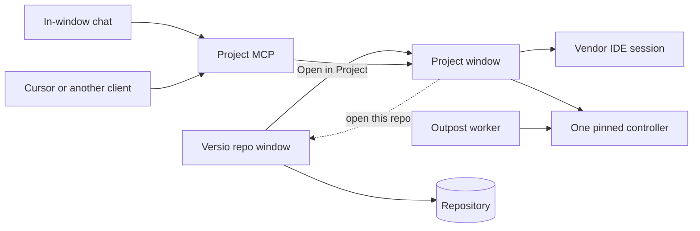

# Versio Project

**Date:** 2026-10-05.
**This is a design record, not the live queue.** What Versio is today lives in
[`../STATUS.md`](../STATUS.md). This document is how Project should be built, and why each
piece sits where it does. Nothing here is implemented.

| | |
|---|---|
| Document | The Project design: one PLC project beside the IDE, on the engineer's machine |
| Sibling of | The Versio repo window, in the same installer. Same vendor packs, a different process, a different verb |
| Also beside | [Versio Outpost](../outpost/PLAN.md), which is the unattended plant worker. Project does not take that job |
| First measurement | CODESYS, on CODESYS Control Win: whether a second session works while the IDE holds the file, read online status, compile, `upload_source` into a scratch project, and create a blank project at a chosen path. Before any window |
| Where it runs | The engineer's Windows PC, the one that has the project file, the licensed IDE, and a route to that controller |
| Out of scope until measured | TIA and TwinCAT online, safety download, a resident IDE session, force and write |

---

## Start here

Read [`../STATUS.md`](../STATUS.md) for where Versio is. Read this to build Project. The repo
window's job is many projects, the mirror, and git. Outpost's job is the program on the
controller at 02:00. Project's job is the engineer at the desk, working on one PLC project,
with the controller in reach.

The argument, in the order a builder needs it:

1. Why it is its own process inside the Versio install.
2. How a person gets a project onto the screen, including creating one.
3. Which code is reused, and which new contract is allowed to see a controller.
4. What the window does to the file, and what it may do to the PLC.
5. The one MCP server, and what a client is not allowed to call.
6. The order to build it, which starts with a measurement rather than a window.
7. What is still open (§15). Those items are not decisions, and a builder does not choose them.

---

## 1. Why this exists

Versio already turns a vendor project into a reviewable mirror and applies an agreed edit back.
That loop is the repo window. It was built to refuse the controller. The founding plan lists
download, online change, and monitoring as a non-goal, and that non-goal still stands for the
window where a person commits.

An engineer who is online wants a second surface: this project, this device, the compiler, the
objects, and a way to put an agreed change on the PLC without living entirely inside the vendor
IDE. Project is that surface. It is one project at a time. The caption names the target. A
simulation target is drawn as a different target from a named machine.

### Why it is not a mode of the repo window

A download stops a controller. The repo window is where a person opens a repository to read a
diff and commit. Those two verbs do not share a process. Project has its own launcher, its own
window, and its own taskbar identity, so closing the repo window cannot be what kills a
download, and the place a person commits cannot be the place a keystroke starts one.

### Why it is not a second installed product

Project uses the same vendor packs, the same hosts, the same theme, and the same updater.
Signing and the update feed are still open for one app. A second installer means the two can
be installed at different versions, and *Open in Project* can start the wrong one.

### Why it is not a website

Outpost is a page because the person is away from the plant and a worker on that network is
the only process allowed to open an IDE. Project is the opposite machine: the project file,
the licensed IDE, and the network adapter that can see the controller are all here. CODESYS,
TIA Portal, and TwinCAT do not run in a browser. A page would still need this local process.

### What was decided, so it is not re-opened by accident

| Decision | Why |
|---|---|
| One installer, two processes | Same packs and the same version. A separate Setup.exe drifts |
| Own launcher, window, and taskbar id | The repo window stays the place that commits. This window is the place that can download |
| Sibling of Versio, never a child of its job object | Versio puts CODESYS.exe and git.exe in a kill-on-close job. A child would die mid-download when the repo window closes |
| One MCP server for every outside client | Cursor and the in-window chat call the same tools. A server per vendor, or per client, drifts |
| That MCP is not Outpost's and not the repo window's | A tool list that can commit, edit, and prepare a plant restore can stop a line it was asked to explain |
| The model edits the mirror. The person confirms import, create, and every controller write | The same rule as an import today, and the same rule as Outpost's agent |
| Create goes through the vendor SDK | A hand-built `.project` or `.ap*` file is not a project that vendor will open |
| Git stays in the repo window | A second commit panel is the app that already exists |
| CODESYS is measured first | TIA and TwinCAT online wait until this shape is real |
| Safety download stays unavailable | TIA safety and TwinCAT safety are coverage skips until a path is measured |
| One controller contract, shared with Outpost | Project and the Outpost worker call the same online-session contract (§6). Two download paths per vendor is two places a download can be wrong |
| One writer per binding, across both processes | The repo window's sync and Project's import never both act on one project. §7.1 |
| Read-only before writing | The assistant, the checker, status, and compare ship before download. Download is built last, on top of verbs that are already trusted (§14) |
| A download names its commit | The dialog and the commissioning line say which git commit is going to the controller, and whether the files were committed. Only Versio can say that sentence |

---

## 2. The pieces

| Process | Sees the PLC | Sees git | What it is for |
|---|---|---|---|
| Versio repo window | No | Yes | Many projects, the mirror, commit, push |
| Project | Yes, the one pinned device, after a confirmation | Clean or dirty only. Commit opens Versio | One project beside the IDE |
| Project MCP | No | No | Read this project, propose a mirror edit, propose a create |
| Outpost worker | Yes, on a schedule for reads, on a confirmed restore for writes | No. Outpost keeps its own versions and does not use git ([`../outpost/PLAN.md`](../outpost/PLAN.md) §8) | Plant backup. Not this product |

Only the Project process opens a session to a controller. The MCP server is in that process,
or in a broker that only forwards to it. It does not grow its own IDE.

---

## 3. How it is installed

Project ships inside the Versio Setup.exe and MSI, at the same product version.

- Start menu entry **Versio Project**.
- *Open in Project* on a PLC project node in Versio's explorer. That menu today is only
  *Reveal in Explorer* and *Copy path*.
- The same verb on the Windows shell for `.project`, `.ap*`, and `.tsproj`.
- All three start the Project process. None of them open a second repo window.

Single-instance is per project file. Versio's handover is per repository and must not take a
Project window. Two Project windows on the same file must not both import.

Settings and logs stay under `%LOCALAPPDATA%\VersioUser\`. Theme follows the setting the repo
window already uses. Project writes its own daily log file, through `VersioLogger`, so a
download is not buried in the repo window's commit noise. A download, an upload, a login, a
create, and a refusal each say what they did, against which path or controller, and how they
ended.

One publish payload. One exe with a startup verb, or two exes, is open (§15). Two processes
and a distinct taskbar id are not open.

---

## 4. Four ways onto the screen

The empty window offers three actions. The fourth starts the process from outside.

1. **Open** an existing project file.
2. **New**, §5.
3. **Upload from controller** into a new file the person names. This is not a compare. Compare
   is a verb on a project that is already open (§8).
4. **Open in Project** from Versio or from the shell, with the project path.

A vendor whose toolchain is not installed is absent from every list that would start it. The
button is not shown disabled after the person has already picked a folder.

Project does not create a git repository. If the folder is already inside one, the window can
open that repository in Versio. Adoption, `.gitattributes`, and LFS stay the repo window's
job.

---

## 5. Creating a project

New asks three things, in this order:

1. **Vendor.** The registered packs whose toolchain probes as installed. CODESYS, TIA Portal,
   and TwinCAT are the packs that exist today. Studio 5000 appears when that pack exists.
   Project does not special-case a vendor.
2. **Destination.** A folder and a file name. If that path already holds a project, the window
   asks before anything is written.
3. **Blank, or a company template.** Blank does not need the company pack. A template does.

Creation goes through that vendor's SDK.

- **Blank** is the vendor's own new-project, saved to the chosen path. The smallest project
  that vendor considers valid. Versio does not assemble the file.
- **Template** is a company project file the SDK opens and saves to the chosen path. The
  template carries that company's libraries, tasks, and naming. A blank project does not.

The window then opens the file the SDK wrote and exports the mirror, the same as Open.

A client may propose a vendor, a path, and a template id over MCP. The SDK runs only after the
person confirms those three in the window. The proposal is not the create.

Template files live in the company pack, next to the standards (§10). The pack's layout is a
folder of rule files and a folder of template projects, one subfolder per vendor id. Anything
finer is open only where §15 says so.

---

## 6. The seam

[`PlcOperation`](../../src/Versio.Core/Plc/PlcJob.cs) is Probe, Export, and Import.
[`IPlcRunner`](../../src/Versio.Core/Plc/PlcJob.cs) is file-in / file-out so the sync
orchestrator can stay vendor-blind. Download, online status, and login are a session to a
controller. They do not join that enum. A new value there would make every sync caller able to
see them, and sync must not grow a download.

Three new vendor-neutral contracts, in `Versio.Core`, implemented by each vendor pack,
registered beside the runner:

| Contract | What it is | Who calls it |
|---|---|---|
| Create | Destination path, vendor profile, and either blank or a template path. Result is the project file the SDK wrote | Project, after the person confirms |
| Build | Compile one named application of a project. Result is messages, each resolved to the object and line it names in the mirror, or a named failure | Project. The download verbs call it first |
| Online session | Pin a device, read status, upload into a path, online change, download, run, stop, logout | Project, and the Outpost worker |

The repo window, `Sync/`, `Git/`, `Locking/`, `Watching/`, `Projects/`, and `Diff/` do not
reference any of the three. `Versio.Arch.Tests` gains a check that fails the build if they do.
Vendor names stay inside the vendor packs, the same rule as today.

Create is still a file operation, and it is still a separate contract. Sync has no reason to
create a project, and a shared enum is how it would learn to. Build is the same argument: a
compile is not an export, and a sync that can compile is one step from a sync that downloads.

**The online session is Outpost's contract too.** Outpost's plan once added Upload, Download,
and StoreSource to `PlcOperation`. That is superseded by this contract, and
[`../outpost/PLAN.md`](../outpost/PLAN.md) §11 says so. Outpost's worker calls the same
session, with its own confirmation (the batch) in front. A vendor implements upload and
download once. Outpost's StoreSource is a CODESYS-only verb on the same session, not a new
operation.

### The device pin

CODESYS keeps the gateway and the device address inside the project file. So pinning a device
in Project either writes the vendor file, outside an import, or is held beside it. It is held
beside it: the pin is local state for this machine, under `.versio/local/` (§7.1), and the
session applies it for the length of one verb. Project does not save the vendor file to change
a pin. Whether CODESYS lets a script set the address without saving is measurement 14.1.4. If
it does not, a pin change becomes an import the person confirms, with the same dialog.

### How it is tested without a controller

A fake online session in `Versio.Core.Tests` drives the window's state: refusals, the pin, the
banner leaving out absent fields, cancel being refused once a download has started. The live
test joins `Versio.Plc.Codesys.Tests` and runs against CODESYS Control Win on the same machine,
the soft PLC Outpost already rehearses on. That makes a real download testable without
hardware, and it stays out of the fast loop for the same reason every CODESYS test does.

Online status fields are a neutral record: reachable or not, run or stop, scan or cycle time,
firmware, project identity on the controller, last download identity, device version, retain
and battery when the vendor returns them, and the gateway and NIC used. A field the
measurement did not see is absent. It is not shown as an empty success.

Upload, online change, and download take the pinned device and a project path. They do not
take a free-form vendor script.

---

## 7. The window, once a project is open

Reuse the mirror, the import planner, the confirm-import dialog, the backup taken before an
import, the direction lock, and the Rendered views already built: Structured Text, member
tables, TIA ladder, TIA function block diagram. Project does not grow a second importer, a
second diff, or a new drawing for a vendor that does not have one yet.

The window is one project:

- **Tree** of that project's objects, the same tree the repo window already builds.
- **Rendered and Raw** for the selection. Compiler messages jump to the object. Line numbers
  stay the ones the Rendered view already uses, so a message can be found.
- **Target banner** names the pinned device, or says offline, or says simulation. Run and stop
  are not clicks on that banner.
- **Chat**, §9. The window works with the chat closed and with no model configured.
- **Clean or dirty**, and a way to open the repository in Versio. No commit box, no push, no
  branch list.

A project can hold several applications. Status, compare, and download name one application,
one gateway, and one node. Choosing a different device is an explicit change of the pin. The
banner updates before any later verb is offered.

Edits land in the mirror. Apply is the existing import. The dialog names creates, updates,
deletes, and renames, and a copy of the project is kept first. The direction lock still
applies when the IDE holds the file. Two writers on one file is the failure that lock exists
to stop. Whether Project attaches to an IDE the engineer already has open, or owns its own
session, is a measurement (§15). Until that measurement, Project does not open a second
writer on a file the IDE holds.

Search covers this project's objects, comments, and literals. Where-used is callers, callees,
and type links, one level, from the mirror and the declaration parser. That one level is also
what the assistant's context is allowed to include.

Library references and device files stay export-only, as they are in Versio today. The window
states a gap before a toolchain start: the reference the project asks for, against what this
machine has installed. It does not grow a library installer or a device-tree editor.

Compiler messages come from the Build contract (§6). A compile is an action the person starts,
or the first step of a download. It is not run on every save, for the same 17–31 s reason a
status poll is not.

### 7.1 One project, two processes

The mirror, the direction locks, the backups, and the auto-stash record all live in the
repository's `.versio/local/`. They were built for one Versio per repository: SAFEGUARDS §5.G is
that guard. Project opening a project inside a repository the repo window also has open is two
processes over the same state. The automatic sync would notice a Project-side mirror edit and
offer its own import of it. That is two writers, which is the failure the direction lock
exists to stop.

**One writer per binding, recorded where both can see it.**

- Project takes a **binding lease** in `.versio/local/` when it opens a project inside a
  repository. The lease names the process, the Windows user, and the time.
- While the lease is held, the repo window's sync does not export, import, or offer an import
  for that binding. Its project row says *Open in Versio Project* and why it is waiting. It
  still shows the diff and still commits. Committing a mirror is not writing the vendor file.
- Project imports, backs up, and takes the direction lock for that binding, through the same
  orchestrator, not a copy of it.
- Closing Project releases the lease. A lease whose process is gone is recovered the way a
  stale direction lock already is (`LockRecovery`), and the recovery is logged.
- If the repo window already has an import or export in flight for that binding, Project opens
  read-only and says so. It does not wait silently and it does not take the binding mid-run.
- §5.G's handover stays per repository and never hands over to, or takes, a Project window.

A `propose_edit` from the assistant (§9) lands in a binding Project holds, so the import it
leads to is Project's dialog, not a banner in the other window.

**A project that is not in a repository.** Project still exports a mirror and still keeps a
backup and a direction lock before an import. They go where the format's
`ConventionalExportPath` puts the mirror, with a `.versio/local/` beside it in the project's
folder. That is the same layout adoption writes, so adopting the folder later in the repo window
finds state it already understands. Project does not write `.gitignore`; adoption does. Whether
a folder that is not a repository should hold `.versio/` at all is open (§15).

---

## 8. The controller

Status is read first. The first slice is a **Read status** action, not a poll. A cold CODESYS
start is 17–31 s, and a timer that pays that on a loop is not a status line. A resident
session, if the measurement says it is safe, is what makes a quiet poll possible. That is
later (§11). It is open decision 5 on the status page, and this product is the reason to
measure it.

What Read status shows, when the vendor returns it:

- Reachable or not, and which gateway and NIC were used. The wrong adapter is a common
  "PLC not found".
- Run or stop, scan or cycle.
- Firmware, device version, and a mismatch against the device the project expects. A mismatch
  is a common reason a download fails, so it is shown before the download is offered.
- Project identity on the controller and the last download identity, set beside this file's
  identity, so "the controller is not this file" is a sentence the window can say.
- **The commit the controller is running**, when Project recorded the download that put it
  there (see the commissioning line below), or "matches no recorded commit". The vendor IDE
  cannot say this. It is the reason this verb belongs in Versio rather than only in the IDE.
- Serial or node name when the vendor returns it, so a replaced PLC is obvious.
- Retain and battery when the vendor returns them.

Unmeasured fields are left out.

### Upload is three verbs

| Verb | Writes | What the person sees |
|---|---|---|
| Compare | A scratch project only | A diff against the open file and against HEAD. The open file is untouched |
| Upload into a new project | The path the person names | A new file, then that file opens. The open project is untouched |
| Replace this project | The open project | A confirmation with the same weight as an import that deletes. A copy is kept first |

Compare is how a person looks at the plant's program. Upload-into-new is how a controller
becomes a project. Replace is how work on disk is thrown away, so it is asked, not implied by
the other two.

A controller with no source, or with blocks the vendor will not upload, says so. An empty
tree is not a successful upload.

### Download is two verbs

Online change and full download are separate actions. The dialog names the pinned controller,
says whether it will stop, and shows the compare. It names the git commit the project is at
and says, in words, when the files that will be downloaded are not committed. That is a
warning, not a refusal: commissioning downloads uncommitted work every day, and refusing would
send the engineer back to the IDE, where nothing is recorded at all. The download compiles
first (the Build contract), and a compile error stops it before the controller is touched.
Boot application and "include source" are
checkboxes on that dialog, defaulting to off until the measurement says what the vendor
itself defaults to. They are never hidden.

The dialog is the only way either verb runs. There is no keyboard shortcut for them. The IDE's
keys are how a download happens in the wrong window.

Safety controllers stay unavailable until that vendor path is measured. The control is absent,
not a button that fails afterwards. TIA safety and TwinCAT safety stay coverage skips.

### Operating state

Run, stop, and logout are their own confirmations. Each names the controller. None of them is
a click on the status banner.

### With the first online slice, also

- The identity pin above, including device-version mismatch.
- A commissioning line in Project's log: what was sent, online change or full download, to
  which node, at what time, from which commit, and whether the files were committed. The
  Windows user is the who. Engineers paste that line into a report. The same record, kept per
  controller under `.versio/local/`, is what lets Read status name the commit the controller
  runs.
- A watch list of named variables while online. The list is local to this machine. It is not
  committed. Forcing a value is not this slice.

---

## 9. What the assistant may do

One MCP server, named Versio Project. Cursor, the in-window chat, and any later client are
clients of it. There is no CODESYS server, no TIA server, and no server written so that one
chat product can do something the others cannot. A client asks for an object or proposes an
edit. It does not learn a vendor API.

The endpoint is stable on the machine: a **named pipe whose ACL admits only the current Windows
user**, with its name recorded under `%LOCALAPPDATA%\VersioUser\`. Not a localhost port: any
process on the PC, under any account, can connect to a port, and this server reads the plant's
program. A client that speaks only HTTP gets a small stdio bridge that connects to the pipe as
the user who started it. Third-party software configures it once. The server fronts every
Project window on this PC. A call names the project path. With one window open, the path may
be omitted and that project is used. With two open, an omitted path is a refusal that lists
the open projects. With none open, a read fails and says so. The server does not start an IDE
to answer.

The in-window chat calls the same implementations as the MCP tools. A refusal in the chat and
a refusal over the pipe are one refusal.

### Tools

| Tool | Effect |
|---|---|
| `list_projects` | The Project windows open on this machine, by path |
| `get_context` | The snapshot below, for the named project |
| `list_objects` | The tree |
| `read_object` | One object's mirror text, or its rendered form when the caller asks |
| `search` | Objects, comments, literals, in this project |
| `where_used` | One level |
| `get_diagnostics` | Compiler messages from the last compile the person ran. It does not compile |
| `get_online_status` | The last status the window read. It does not itself log in |
| `list_vendors` | Installed toolchains |
| `list_templates` | Templates in the configured company pack |
| `check_standards` | The checker in §10, no model |
| `propose_edit` | Writes mirror files only. Does not import |
| `propose_create` | Records vendor, path, and template id. Does not call the SDK |

There is no tool that logs in, downloads, runs, stops, logs out, forces, writes a variable,
confirms an import, or confirms a create. Those stay buttons in the window.

`get_context` is one snapshot, not the project: the selected object and its text, one level of
where-used, compiler messages for it, the target banner, the dirty set, and the standard
rules that match the selection. The whole project is not pasted into a turn.

`propose_edit` is undoable by the existing discard of those mirror files. Applying the edit is
the import dialog. **For an edit the model proposed, that dialog shows the text diff, not only
the object names, and says the model proposed it.** Naming objects is enough when the person
made the edit themselves. It is not enough when they did not write it.

Object text is untrusted input to the model. A program uploaded from a controller carries
comments somebody else wrote, and a comment is a natural place for an instruction aimed at the
model. Nothing in the text can widen the tool list, because the tool list has no write to the
vendor file or the controller. The diff in the import dialog is what catches an edit the person
did not ask for.

A call to a tool that does not exist, including a guessed `download` or `force`, returns a
structured refusal: the tool is not offered, and controller writes are buttons in the window.
It is not a bare "unknown method", which a client could read as "try another name". `propose_create` opens the New confirmation with the three fields filled.
The person can change them. Closing the dialog drops the proposal.

Controller passwords and the model key stay in DPAPI. A password typed into the chat is not
forwarded and is not written to the log. The log records that a secret was refused, not the
secret.

The chat still explains a selection with the write tools off. The window still edits, imports,
and reads status with no model configured.

---

## 10. Company standards

Standards are files the engineer can open. A hidden prompt and a separate checklist are how a
standard drifts, so the checker and the model share the files.

Each rule has an id, a statement, and a check the checker can run without a model: naming, a
required header, an empty handler, a magic literal. The model cites a rule id when it suggests
or edits. A judgement the checker cannot run is still a file, marked as advice, and the model
may quote it. It does not become a green check.

The checker runs on the mirror. It does not start the IDE.

The company pack is the standards folder plus the template folder from §5. Where that pack
lives when the project is not inside a git repo is open (§15). A path in Project's settings is
the stand-in until that is decided. A blank create does not read the pack. A template create
refuses, and says why, when the pack is unset or the chosen template file is missing.

---

## 11. Soon after the first slice

Still this product, after the build order in §14 is done. The standards checker used to be
here; it moved into §14.3, because it needs no controller and no measurement.

- **Resident toolchain session** for the life of the window, if the measurement says an IDE
  can stay open without taking the file the engineer is editing. Until then, every online verb
  is an action the person starts.
- **Rename and delete** go through the existing import planner, so a GUID and a task reference
  survive. The model does not search-and-replace object names.
- **Explain** a network or a function block in the vocabulary of the loaded standards. This is
  the chat, with the snapshot, and it writes nothing.
- **Generate a POU** as mirror text, then the existing create-import. The person confirms the
  import. The model does not create objects inside the vendor file itself.

---

## 12. Later

Named so they are not built early and not forgotten.

- Trace a few variables to a CSV while commissioning.
- Force and write. Each is confirmed, logged, and a force left on stays listed until it is
  cleared.
- Breakpoints and stepping. Only after status and download are already trusted. This is the
  slice most likely to become a worse copy of the IDE.
- CODESYS `NetworkList` and TwinCAT PLCopen ladder in the Rendered view. TIA ladder and
  function block diagram already draw. Project uses those views.
- Studio 5000, when that pack exists.

---

## 13. Leave out

- A second installer, and a browser UI.
- An MCP per vendor, an MCP per client, and one MCP shared with Outpost or the repo window.
- Scheduled backup and fleet restore. That is Outpost.
- A git UI, a second diff engine, or a second import planner.
- HMI, safety-program download, TIA know-how-protected blocks, and device-tree writes. Those
  are coverage skips or export-only. A button would pretend they work.
- A keyboard shortcut that downloads or stops a PLC.
- Multi-user presence beyond the occupancy marker Versio already has.

---

## 14. Order to build

Each step ends before the next one starts. A step that needs a vendor fact it does not have
stops and writes the fact down. It does not invent the field.

**The order is read before write.** Nothing up to 14.5 writes the controller, and nothing
writes a vendor file except a create or an import the person confirmed. Download is 14.6, built last on top of a status
read, a compile, and a compare that have already been trusted against the same controller. Download
is part of the product. Where it sits in the order is the safety argument.

### 14.1 Measure CODESYS, before a window

Against **CODESYS Control Win**, the soft PLC on this machine, holding a known project, and
against an empty destination folder. It is the controller Outpost rehearses on too, and it is
what lets the live tests download without hardware. A real controller follows once the notes
exist. Record the ScriptEngine calls that actually worked, in
[`../vendors/codesys/DRIVING.md`](../vendors/codesys/DRIVING.md), the same way the export
calls are recorded. The product is built against that record.

1. **The engineer's IDE holds the file.** With CODESYS open on the project, as an engineer has
   it beside Project: can a second, scripted CODESYS read status or upload from the same
   controller? Can the scripting attach to the IDE that is already running? Which of the two
   takes the file, and does either corrupt it? This is first because it decides whether the
   rest of the product works in the case it was designed for. If both answers are no, stop and
   bring it to the owner before 14.2. The shape changes; the window does not get built around a
   session that cannot exist.
2. Log in, read the status fields §8 lists, and write down which ones came back.
3. **Compile** one application and record how messages come back: object, line, severity.
   Whether a compile needs a login, and whether it writes the file.
4. **The device pin.** Whether a script can set the gateway and address for one session
   without saving the project (§6).
5. `upload_source` into a scratch project. Export it with the runner that already exists.
   Diff that mirror against the project that was downloaded to the controller.
6. Create a blank project at a chosen path. Open it with CODESYS by hand once, enough to see
   that the vendor accepts it. Export it.
7. Open a copy of a real company project, or of `RefrigeratorControl` standing in for one,
   and save it to a second path. That is the template shape. Confirm the copy opens and is a
   different file from the template.

Do not download in this step. Do not leave the IDE running afterwards. TIA and TwinCAT are
not in this step. Outpost's plan already names `upload_source` as its first measurement.
Project needs the attach question, the status read, the compile, and the create beside it. One
session can serve both, and the notes go to both documents.

Done when the notes answer item 1, say which calls worked and which status fields exist, show
the shape of a compile message, and show that a blank file and a saved-as file both open in
CODESYS.

### 14.2 The process, the empty window, and the binding lease

A Project entry point in the existing installer payload. Open, New, and Upload on an empty
window. New runs the create contract from §6 against the CODESYS pack only, blank first.
Template follows once 14.1.7 has a file to point at. Open exports and shows the tree and the
Rendered view by reusing the repo window's code, not by copying it into a second
implementation.

The binding lease from §7.1 lands here, before anything in Project can import. The repo window
learns to stand back from a leased binding in the same step, because the first import Project
runs is the first time two writers are possible.

*Open in Project* from the explorer can land in this step or the next. The shell verb can
land with the installer work. Neither blocks 14.3.

Done when a blank CODESYS project can be created at a chosen path and opened in the Project
window, an existing project can be opened without starting the repo window, and, with both
windows open on one repository, a mirror edit is offered for import by Project only. The
mutation check: delete the repo window's lease check, and a test goes red.

### 14.3 MCP, chat, and the checker

The server from §9 on its named pipe, the chat on the same tools, and the checker from §10.
None of it needs a controller or a 14.1 fact beyond the window existing, which is why it comes
before status. Templates in the pack are what New already offers, listed by `list_templates`.
`get_online_status` and `get_diagnostics` answer "not read yet" until 14.4 exists.

Done when Cursor and the in-window chat both `read_object` the selection, `propose_edit`
changes only the mirror, and the import dialog, showing the text diff and saying the model
proposed it, is still the only way that edit reaches the vendor file. Done when a test calls
an absent `download` tool and gets the structured refusal from §9, and when a second Windows
user cannot open the pipe.

### 14.4 Read status and compile

A pinned device and **Read status**, using the calls 14.1 recorded. The banner shows what
came back and leaves out the rest. No download, no poll. **Compile** through the Build contract,
messages jumping to the object and line in the Rendered view.

Done when the banner matches a CODESYS online session on the same controller, field for field,
for the fields the measurement returned, and a deliberate compile error lands on the right
line of the right object.

### 14.5 Compare and identity

Compare-by-upload into a scratch project, diffed against the open file and against HEAD with
the diff Project already reuses. The controller set against the recorded commits (§8):
"running commit `abc1234`", or "matches no recorded commit".

Done when compare on an unchanged controller reports no difference, and a change made in the
IDE and downloaded from there shows up as exactly that change.

### 14.6 Download

Online change and full download, each behind the dialog in §8: the compare, the commit, the
uncommitted warning, a compile first. Each writes the commissioning line and the per-controller
record that 14.5 reads.

Done when a deliberate one-line mirror edit, imported, then downloaded, is the program the
next compare uploads back, and Read status then names the commit it came from. Done when Stop
during a download is specified by the measurement rather than by killing the IDE. Killing the
IDE mid-download is how a controller is left interrupted. If the measurement cannot show a safe
cancel, cancel stops before the download starts and is absent once it has started. That is the
same rule Outpost recorded for its restore. The live test runs against CODESYS Control Win in
`Versio.Plc.Codesys.Tests`.

---

## 15. Open points

A builder does not choose these. They stay open until the owner does, or until a measurement
closes them.

| # | Question | What is already fixed around it |
|---|---|---|
| 1 | One exe with a startup verb, or two exes? | Two processes, one installer, a distinct taskbar id |
| 2 | Does Project attach to the engineer's IDE, or own a session? | Measured first, in 14.1.1, and a "no" to both stops the build. It does not open a second writer on a held file. Resident session is §11 |
| 3 | Which status fields does each vendor return? | CODESYS is answered by 14.1. Other vendors stay out of the banner until their own measurement. Absent fields are omitted |
| 4 | Where does the company pack live when the new project is not in a git repo? | Settings hold a path meanwhile. Blank create does not need the pack. Template create fails closed without it |
| 5 | Which model endpoint? | A URL and a DPAPI key in settings. Project does not pick a model vendor |
| 6 | Does *Open in Project* from Versio pass the selected object, or only the project path? | The path alone is enough for 14.2. Selection is a later convenience |
| 7 | What does CODESYS do if Project cancels a download that has started? | 14.6. Until the notes exist, cancel is only available before the download starts |
| 8 | Can the device pin be applied without saving the vendor file? | Measured in 14.1.4. The pin lives in `.versio/local/` either way. If a save is needed, a pin change is a confirmed import |
| 9 | Should a folder that is not a git repository hold `.versio/` at all? | §7.1 puts it there, in the layout adoption writes. The alternative is per-user state under `%LOCALAPPDATA%\VersioUser\`, which adoption would then have to migrate |
| 10 | The product's name | "Project" collides with the CODESYS project file, the `Projects/` folder, and the project panel, so "Open in Project" and "the Project window" read ambiguously in docs, searches, and the log. A distinct name before 14.2 costs a rename of this file; after, it costs the installer, the shell verb, and the MCP server name |

---

## 16. How this relates to the queue

This file is not an item on [`../STATUS.md`](../STATUS.md) *What is next*. It becomes one when
the owner puts it there. Until then, a session that is building the repo window does not pick
up §14.
