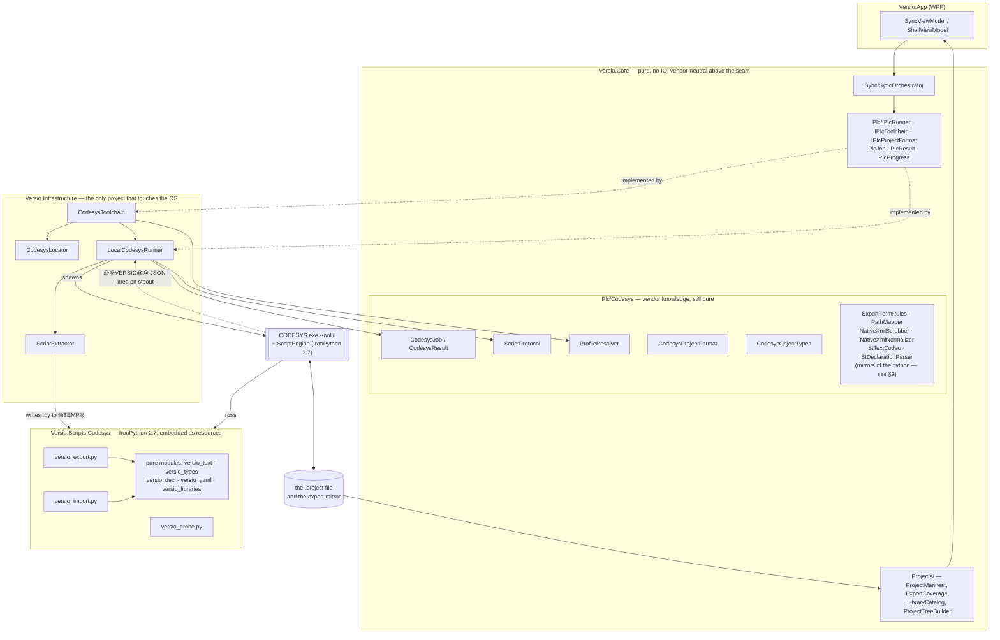
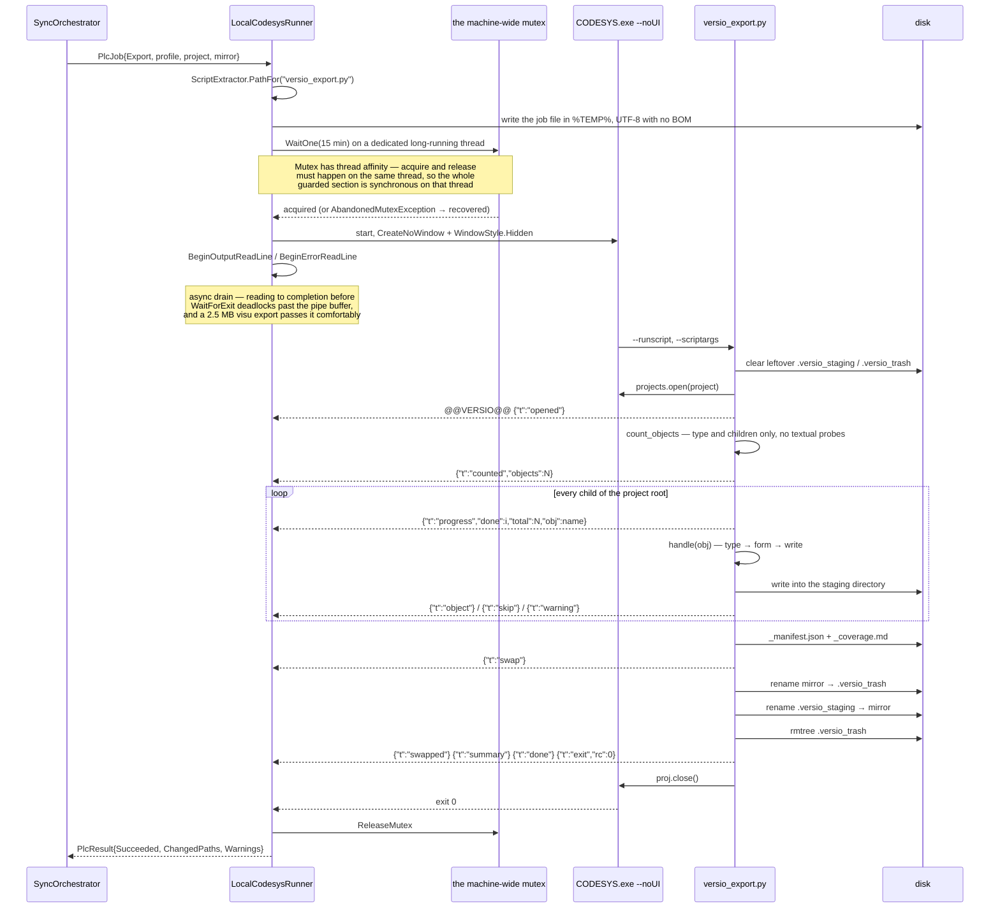
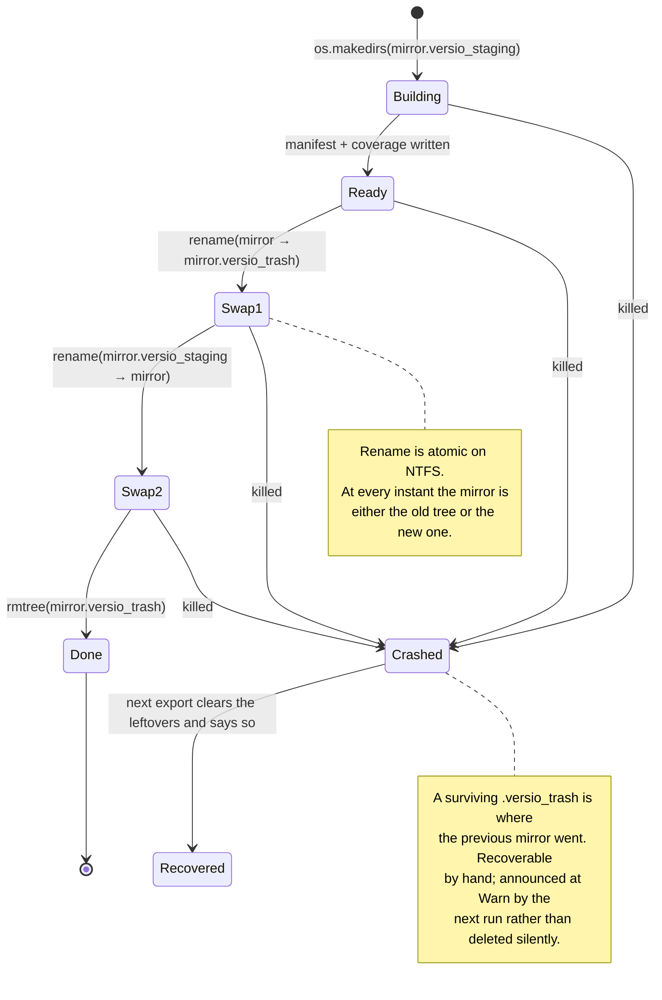
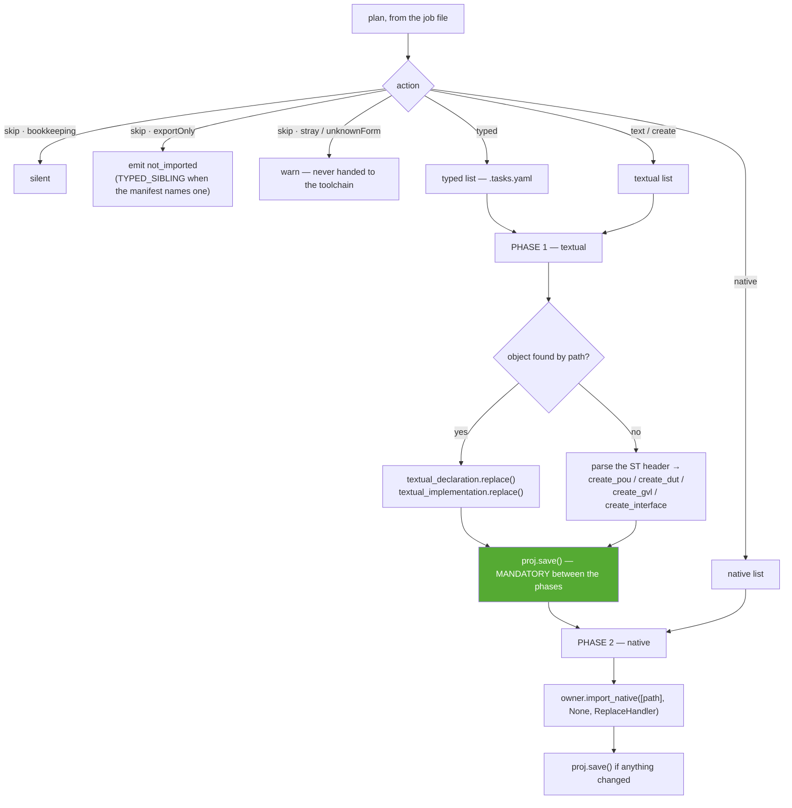

# Versio — how CODESYS is driven

**Date:** 2026-08-14 · Written against `0286d1f`, audited and revised on `08a8239`

| | |
|---|---|
| Document | **The CODESYS integration, end to end.** Which CODESYS interface Versio uses, how the process is launched, what crosses the boundary in each direction, what every script does, and where the seams and the gaps are |
| Audience | An engineer who has to change the export, the import, the runner or the scripts — or add a second vendor beside them |
| Related | [`PLAN.md`](../../PLAN.md) — the architecture · [`PHASE0-FINDINGS.md`](../../PHASE0-FINDINGS.md) — what was measured against real CODESYS · [`STATUS.md`](../../STATUS.md) — where the project is · [`SAFEGUARDS.md`](../../SAFEGUARDS.md) — what Versio refuses or waits for |
| Audit | §12 is a standing audit of this integration. Every finding it raised is fixed; each entry is kept, with what changed and why. The rest of the document describes the system as it actually behaves, not as it is meant to |

---

## Handover — read this first

**The python is the implementation. The C# is a specification of it.** At run time nothing in
`Versio.Core` decides an object's form, builds a file name, scrubs a timestamp or splits a `.st`
file — `versio_export.py` and its pure modules do all of it, inside CODESYS's own IronPython 2.7.
The C# mirrors (§9) exist to be compared against, and to be the shape a future non-CODESYS
implementation would take. Reading `ExportFormRules.cs` as "what happens" is the single most
likely way to misread this codebase, and it is how two of the audit's findings survived.

**Three rules that are not style preferences.** Each has already cost something:

1. **The export must be byte-identical across runs** (§7). No clock, no dict-order dependence,
   no un-scrubbed `Timestamp`. A spurious diff in every commit destroys the reason the mirror
   exists.
2. **A rule that lives in both languages must be compared by output, not by inspection.**
   `PythonFileNameParityTests` runs both implementations over one corpus. Table comparison
   caught none of the four drifts in §9 — the tables were identical and the behaviour differed.
3. **A silent failure is a bug even when the code is correct.** Skips carry reasons, the
   coverage report names gaps, the swap announces itself, and an export-only file says so in
   four places. When adding a path that can do nothing, make it say so.

**Before changing the exporter or the importer**, know that the fixture round trip is not a
byte comparison (§6.6): textual and export-only must match exactly, native XML is *expected* to
differ, and `tools/codesys/Test-RoundTrip.ps1 -MutateFirst` is the command that tells you which. Without
`-MutateFirst` it cannot fail.

**To verify a change against real CODESYS**, in increasing cost: `dotnet test tests\Versio.Core.Tests`
(no CODESYS, ~0.3 s) → the round-trip harness (~2 min, 4 CODESYS launches) → the full
integration suite (~7–11 min). A path the fixture cannot reach — an unmapped object type, for
instance — is best exercised by patching a **copy** of the scripts and pointing
`tools/codesys/Run-Codesys.ps1` at it, which is how §12 C1 was verified.

---

## 0. In one paragraph

Versio never parses a `.project` file. A CODESYS `.project` is a binary compound document with
no published format, so Versio asks **CODESYS itself** to read and write it, by launching
`CODESYS.exe` headless with a Python script. That script walks the project's object tree and
writes one text file per object (`.st` for Structured Text, native CODESYS `.xml` for anything
graphical), or reads such a tree back and applies it to the project. The script talks back to
the C# host over stdout using a line protocol with a `@@VERSIO@@` marker, because CODESYS shares
that stdout and cannot be silenced. Everything else in Versio — git, the diff, the direction
lock, the change gate — is vendor-neutral and sits above a seam that CODESYS knowledge is not
allowed to cross.

---

## 1. Which CODESYS interface is used

### 1.1 The ScriptEngine, not a file format and not an API DLL

CODESYS 3.5 ships a scripting plug-in — **CODESYS ScriptEngine** — that hosts **IronPython 2.7**
inside the IDE process and exposes the project object model as a module named `scriptengine`.
That module is the entire integration surface. Versio does not reference any CODESYS assembly,
does not use the Automation Platform SDK, and does not read the project file itself.

Consequences that shape everything else in this document:

| Constraint | Consequence |
|---|---|
| The interpreter is **IronPython 2.7** | The scripts are Python 2 source. `unicode`, `unichr`, `io.open` and `u""` literals are load-bearing, not legacy. Plain `open()` in Python 2 encodes unicode as ASCII and dies on the accented characters that appear in real PLC comments |
| `pip` is not available | **No third-party Python dependencies at all.** The YAML emitter and the JSON-lines protocol are hand-written (`versio_yaml.py`), and the C# side that reads them is hand-written too |
| The interpreter runs **inside CODESYS** | Running a script means paying CODESYS's cold start — measured **17–31 s** ([PHASE0-FINDINGS §4](../../PHASE0-FINDINGS.md)) — on every invocation |
| CODESYS is a desktop IDE, not a server | Two concurrent headless instances on one profile are not safe. The runner serialises them behind a machine-wide mutex |

### 1.2 The command-line surface

```
CODESYS.exe --profile="<profile name>" --noUI --runscript="<script.py>" --scriptargs:"<job.json>"
```

Four facts about this line, each of them measured rather than assumed:

1. **`--profile` is mandatory in `--noUI` mode.** Without it CODESYS exits 1 with
   `When running in --noUI mode, you must specify a profile using --profile=`. The runner
   recognises that exact string and turns it into an actionable message rather than a bare
   non-zero exit — `ProfileResolver.MissingProfileMessage`.
2. **The profile name cannot be derived from the install folder.** The folder is
   `CODESYS 3.5.22.20`; the profile is `CODESYS V3.5 SP22 Patch 2`. "22.20" is SP22 Patch 2,
   not Patch 20. It must be read from `…\CODESYS\Profiles\*.profile.xml`.
3. **The quotes wrap the value, not the `--name=value` pair.** `ProcessStartInfo.ArgumentList`
   produces `"--profile=CODESYS V3.5 SP22 Patch 2"`, which CODESYS rejects by exiting 1 in under
   a second with no output at all. `LocalCodesysRunner.BuildArguments` builds the string by
   hand for exactly this reason, and `ArgumentBuildingTests` pins it.
4. **The CLI is not internally consistent:** `--runscript=` takes an equals sign,
   `--scriptargs:` takes a colon. Both are pinned by tests.

### 1.3 The `scriptengine` members Versio actually uses

Every one of these was confirmed against CODESYS 3.5.22.20 (SP22 Patch 2); gate 0.10 in
PHASE0-FINDINGS records that the SP22 behaviour matches the SP11 documentation.

| Member | Used by | Notes |
|---|---|---|
| `scriptengine.projects.open(path)` | every script | Returns the project root object |
| `proj.save()`, `proj.close()`, `proj.path`, `proj.dirty` | export, import, probe | |
| `obj.get_children()` | every script | Positional iteration |
| `obj.get_name()`, `obj.guid`, `obj.type`, `obj.is_folder` | every script | `obj.type` is a **type GUID**, see §4 |
| `obj.has_textual_declaration` / `has_textual_implementation` | export, import | **Raise** for object kinds they do not apply to — probing them is normal control flow, hence the `safe()` wrapper everywhere |
| `obj.textual_declaration.text` / `.replace(text)` | export, import | The in-place update path |
| `obj.textual_implementation.text` / `.replace(text)` | export, import | |
| `obj.export_native(path, recursive)` | export | Writes CODESYS's own XML to a file |
| `obj.import_native([path], filter, handler)` | import | **The argument must be a list.** A bare string can bind to the `IEnumerable<string>` overload and be iterated into characters — the reported `Could not cast: System.String in System.Char` failure |
| `scriptengine.NativeImportHandler` (subclassed) | import | `conflict` / `progress` / `skipped` callbacks |
| `scriptengine.NativeImportResolve.replace` | import | See §6.4 — this is what makes the import replace in place instead of pasting a duplicate |
| `obj.create_pou/create_dut/create_gvl/create_interface` | import | Object creation |
| `scriptengine.PouType`, `ImplementationLanguages`, `DutType` | import | Enum arguments to the factories |
| `libman.references` (a `ScriptLibraryReference` collection) | libraries | **Indexed by id, not by position** — `refs[0]` raises on any project whose first reference has a non-zero id. It is iterated instead |
| `obj.remove()` | import (delete phase) | **Removes a referenced object silently** — no exception, no cascade, no warning (P3). Every precondition around a deletion exists because of that |
| `obj.rename(name)` | import (rename phase) | Preserves the GUID, measured in session and across a save and reopen |
| `obj.move(parent, -1)` | import (rename phase) | **The index must be `-1`**: `move(dest, 0)` raises *"index must be -1 if the new parent node does not have sorted children"*, and one-argument `move(dest)` raises a `NullReferenceException`. **Which moves it performs was measured on 2026-08-17** (P11), nine ordered moves each re-resolved afterwards — and measured *twice*, because the first run's ninth step never executed and its absence went unread; see the probe finding in `FINDINGS.md`. Performed, GUID intact, surviving a reopen: a POU into a folder under `Application`, into a folder inside that one, and back out into `Application`; a GVL to **the project root**; an **empty folder into `Plc Logic`**; an **empty folder into an ordinary folder**. Accepted and ignored: a POU into `Device`, a visualisation into `Plc Logic`, a **folder holding a POU** into `Plc Logic`. **Not one of the nine raised** — it returns `None` either way, so the outcome is re-checked afterwards and that check is the whole signal. **The destination is not what decides**: an empty folder goes where a POU cannot, and the same folder stops going there once a POU is inside it, so this cannot be a table of sensible destinations written from outside |
| `task.pous` | export, import | A `ScriptPouObjectList` of plain **str**, not of objects, and **stored by name** — which is why renaming a POU leaves its task naming something that no longer exists unless the list is rewritten. Every spelling but one is a trap: `pous[i] = name` raises, **`remove(name)` reports success and does nothing**, `remove(index)` raises *"not found in the specified Collection"*, `replace(name, name)` raises *"expected int, got str"*. **`replace(index, name)` works** and survives a save and reopen |
| `obj.create_folder(name)` | probe | **Returns `None`.** The folder is created regardless and has to be found by name afterwards — using the return value as a destination makes the next call a no-op against `None` |
| `fb.create_method(name, "BOOL")` | fixture | **The second argument is a RETURN TYPE, not a language**, which is not what `create_pou` and `create_action` beside it take. Passing `ImplementationLanguages.st` raises `TypeError: expected str, got Guid`. The one-argument form works too |
| `fb.create_action(name, lang)` | fixture | Takes the language, unlike `create_method`. The object it returns has a textual **implementation and no declaration** — which is what `ST_IMPL` means |
| `fb.create_property(name, "INT", lang)` | fixture | Creates the property **and its `Get` and `Set` children**, which is why a property exports as `NATIVE_R`: the recursive payload already contains them and they are never separate manifest records |
| `obj.textual_declaration.replace(text)` | import, fixture | **`.text` is READ-ONLY.** Assigning to it raises `AttributeError: can't assign to read-only property text of type 'ScriptTextDocument'`. `versio_import.py` has always called `replace()`; the fixture builder was written without reading it and lost a run to the fifth wrong spelling this API has produced |

> `libman.get_libraries()` is deliberately **not** used: it returns a list of bare strings
> (`"#Standard"`) with no version, company or flags. `libman.references` is the one that carries
> the project's actual declaration.

### 1.4 Attribution

The object-type GUID table is adopted from **[greenforge-labs/codescribe](https://github.com/greenforge-labs/codescribe)**
(Apache-2.0), `src/object_type.py`. CODESYS publishes no list of these GUIDs and deriving them
independently costs days. Entries marked `[VERSIO]` in `versio_types.py` and
`CodesysObjectType.cs` were discovered by probing a real SP22 project and are not in
codescribe's table. Several of codescribe's findings are also load-bearing here and are cited
where they are used (the visualisation-manager skip, the "do not rewrite GUIDs" warning).

---

## 2. Component map



**The seam is `IPlcRunner` / `IPlcToolchain` / `IPlcProjectFormat`.** Above it nothing knows
what a profile is, what a `.~u` file is, or what a `@@VERSIO@@` line looks like.
`LocalCodesysRunner.RunAsync(PlcJob, …)` is the exact translation point: it converts a `PlcJob`
into a `CodesysJob`, runs it, and converts the JSON-lines events back into plain paths and
sentences. 22 architecture tests (`VendorSeamTests`) read assembly metadata to assert the leak
does not reopen.

---

## 3. The two boundaries

There are exactly two data formats crossing between C# and Python, and both were shaped by a
measured failure.

### 3.1 Inbound — the job file

Windows `--scriptargs` quoting is bad enough that **only one path is allowed to cross on the
command line**; everything else travels as JSON inside the file it names.

`CodesysJob.ToJson()` (`src/Versio.Core/Plc/Codesys/CodesysJob.cs`) writes:

```json
{
  "op": "export",
  "schema": 2,
  "operationId": "a1b2c3d4",
  "profile": "CODESYS V3.5 SP22 Patch 2",
  "scrubTimestamps": true,
  "emitPlcopen": false,
  "save": true,
  "project": "C:\\repo\\plc\\Machine.project",
  "out": "C:\\repo\\plc\\Machine",
  "bindingId": "6d3f8855e205",
  "projects": [ { "bindingId": "…", "project": "…", "path": "…" } ]
}
```

| Key | Written when | Read by |
|---|---|---|
| `project` | one project in the job | export, import, probe, both probe helpers, delete-objects |
| `out` | **export** with one project | export (mirror root), probe (**report path — see finding A3**) |
| `src` | **import** with one project | import (mirror root) |
| `save` | always | import only |
| `bindingId` | one project in the job | export — stamped into `_manifest.json` |
| `plan` | **import** with one project | import — the whole of what it does; see section 6 |
| `schema` | always | **import**, which refuses any value but 2 before opening the project — a stale script meeting a newer job file must die loudly, not half-execute. Export and probe still ignore it |
| `op`, `operationId`, `profile` | always | **nothing** — see finding B3, which this schema row partially supersedes |
| `scrubTimestamps`, `emitPlcopen` | always | **nothing** — the scrub is unconditional in `versio_text.scrub_native_xml`; PLCopen is not implemented |
| `projects[]` | always | **nothing** — see finding A2 |

The file is written to `%TEMP%\Versio\jobs\job-<opId>-<guid>.json` and deleted in a `finally`.
It **must be UTF-8 without a BOM**: IronPython 2.7's `json.load` fails on a BOM with
`No JSON object could be decoded`. PowerShell 5.1's `-Encoding utf8` writes one, which is why
both `LocalCodesysRunner.WriteJobFile` and `tools/codesys/Run-Codesys.ps1` use
`UTF8Encoding($false)` explicitly.

### 3.2 Outbound — the `@@VERSIO@@` JSON-lines protocol

CODESYS writes its own localised chatter to the same stdout and cannot be silenced. Scraping
prose was never an option — the messages are localised and change between service packs — so
every structured line is prefixed:

```
@@VERSIO@@{"t": "object", "path": "Device/Plc Logic/Application/Simulation.st", "type": "POU", "form": "ST_FULL", "hash": "sha256:…"}
```

`ScriptProtocol.Parse` (`src/Versio.Core/Plc/Codesys/ScriptProtocol.cs`) splits a run's stdout
into three buckets and is **deliberately total** — a malformed line is collected, never thrown
on, because a script that dies mid-write is exactly when the diagnostics matter:

- `Events` — parsed protocol objects, each with a `t` discriminator
- `Chatter` — everything else, including any prose CODESYS wrote *before* the marker on the
  same line
- `Malformed` — carried the marker but would not parse as JSON

#### Event catalogue

| `t` | Emitted by | What the C# host does with it |
|---|---|---|
| `start` | export, import, probe | Debug line |
| `opened` | export, import, probe, native-import probe | Progress report, phase `opened` |
| `counted` | export | Debug — the progress denominator, said once, so `walked N` can be checked against what the export expected to walk |
| `progress` | export, one per object walked | **Drives the progress bar** — `done` / `total` / `obj`. Logged at no level, because it already did its job and `object` covers the ones that produced a file |
| `phase` | import (`textual`, `native`) | Progress report with a file count |
| `phase_saved` | import | Debug line |
| `object` | export | **`PlcResult.ChangedPaths`**, plus one Debug line each |
| `skip` | export | Info: `not exported (<reason>): <path> [<type>]` |
| `libraries` | export | Info: reference count and how many are system libraries |
| `warning` | export, import | **`PlcResult.Warnings`** as `"<code>: <path>"` |
| `staging-cleared` | export | **Warn** — a previous export was killed |
| `trash-cleared` | export | **Warn** — a previous export died inside the swap; says where the old mirror went |
| `swap` / `swapped` | export | Info — the file counts before and after the directory replacement |
| `updated`, `created`, `native_imported` | import | `created` is Info; the others Debug. **This row described handling that did not exist until 2026-08-15** — `updated` and `native_imported` had no `case`, so they fell through to `· <type>`. A protocol table is a claim about the C# side, and this one had drifted into being a claim about the python side alone |
| **`task_set`** | import | **Info**, and deliberately louder than its neighbours: it is Versio writing a task's priority, interval or **CPU core binding** — a change to what the machine runs. There are a handful of tasks in a project, so the volume argument that keeps one-per-object lines at Debug does not apply. It had **no handler at all** until 2026-08-15 and logged as the literal string `· task_set` |
| **`native_partial`** | import | **Warn** — a native file where some objects imported and others did not. `import_native` does not raise for a per-object failure; it calls the handler and carries on, so without this the run looks entirely successful |
| **`task_pou_retargeted`** | import | **Info** — a task's POU list repointed at an object this import renamed. It is the line that says the project was *corrected* rather than merely changed: the list is stored by name, a rename does not update it, and without this step the task would name a POU that is not there |
| **`removed`**, **`renamed`**, `already_gone` | import | `removed` and `renamed` are **Info**: they are the two structural changes an import can make, and they are the lines somebody goes looking for when an object is not where they expect. `renamed` says "moved X to Y" or "renamed X to Y" depending on which it was, because being told "renamed" about a file that only changed folder reads as a bug in the tool. `already_gone` is Debug — the mirror and the project agree, so nothing happened |
| `not_imported` | import | Info — an export-only file the import left alone. **Not** a warning, on purpose: one that fires on every import is how a real one gets read past |
| `nothing_to_save`, `saved` | import | `saved` and `nothing_to_save` are Info — "I edited the mirror and nothing happened" is a question somebody asks, and `nothing_to_save` is the line that answers it. `phase_saved` stays Debug |
| `summary` | export, import, probe | Info — the roll-up line, **and it has two forms.** It is keyed on the job's operation, not on which fields are present: the export's `walked / wrote / skipped / gaps`, and the import's `import: N updated, N native, … — N warning(s)` with zero-valued fields omitted. Reading an import's summary with the exporter's field names logged a line of blanks for the whole life of the import path; see the finding in [`STATUS.md`](../../STATUS.md) |
| `fatal` | all | **Error**, and becomes `CodesysResult.FailureReason` |
| `exit` | all | `ScriptOutput.ScriptExitCode` |
| `done` | all | `ScriptOutput.Completed` |
| `before`, `call_ok`, `call_failed`, `conflict_callback`, `progress_callback`, `skipped_callback` | `versio_probe_native_import.py` only | Debug (`· <type>`) |
| `removed` | `versio_delete_objects.py` only | Debug |

**Success is three conditions, not one.** `CodesysResult.Succeeded` requires the process to
exit 0, the script's own `rc` to be 0, **and** a `done` event to have been seen. A script that
dies silently must not count as a success just because the process exited 0.

---

## 4. Object identity and the type table

Every CODESYS object carries a **type GUID** in `obj.type`. That GUID, not the object's name and
not its position, is what tells the exporter what it is looking at.

The table exists twice, on purpose:

- `src/Versio.Scripts.Codesys/versio_types.py` — `GUID_TYPE_MAPPING`, used by the exporter
- `src/Versio.Core/Plc/Codesys/CodesysObjectType.cs` — `CodesysObjectTypes.ByGuid`, used by the app

They are two copies of the same knowledge, so `TypeTablePartityTests`
(`tests/Versio.Core.Tests/Plc/Codesys/CodesysObjectTypeTests.cs`) reads the Python source and
asserts the GUID sets, the `SUFFIX` table and the `INFIX` table have not drifted. That test
exists because they *did* drift once, and it cost a file (§5.3).

**An unmapped GUID is never a crash and never a silent drop.** It resolves to `UNKNOWN`, is
warned about with code `UNKNOWN_TYPE_GUID`, and falls back to native export — because a newer
CODESYS adding a type must not quietly lose objects.

Two `[VERSIO]` entries were found by probing that were not in codescribe's table:

| GUID | Object | Why it matters |
|---|---|---|
| `40b404f9-e5dc-42c6-907f-c89f4a517386` | **Plc Logic** | Structural node under a Device |
| `639b491f-5557-464c-af91-1471bac9f549` | **Application** | codescribe finds this **by name**, which breaks the moment a project renames it |

**Object GUIDs are identity and are never rewritten.** codescribe tried canonicalising GUIDs and
Ids in exported XML and it broke visualisations. Versio scrubs only `Timestamp` (§7).

---

## 5. Export

`versio_export.py` — 675 lines, the largest script. Job: `{ project, out, bindingId }`.

### 5.1 The run



### 5.2 The per-object form decision

`versio_types.decide_form(obj_type, has_textual_impl, has_textual_decl)` is a pure table lookup
with four fallbacks. It is pure — no `scriptengine` import — precisely so it can be exercised on
CPython.

| Form | On disk | Types |
|---|---|---|
| `CONTAINER` | becomes a **directory**, children walked into it | `FOLDER`, `DEVICE`, `PLC_LOGIC`, `APPLICATION` |
| `ST_FULL` | declaration + delimiter + implementation, one `.st` | `POU`, `INTERFACE`, `METHOD`, `METHOD_NORET` |
| `ST_DECL` | declaration only, one `.st` | `DUT` |
| `ST_IMPL` | implementation only (no declaration exists) | `ACTION`, `TRANSITION` |
| `GVL_BOTH` | **two files** — `.gvl.xml` for structure, `.gvl.st` for a readable diff **and for import**. The *decision* is `GVL_BOTH`; the two files are **recorded** `GVL_NATIVE` and `ST_DECL`, because only the `.st` is applied back | `GVL`, `GVL_PERSISTENT` |
| `GVL_NATIVE` | **recorded, never decided.** The `.gvl.xml` half above, marked so the manifest says it is export-only. It carried plain `NATIVE` until 2026-08-16 — an *importable* form, so both halves were applied and the later phase won. That is G12; see the finding in [`STATUS.md`](../../STATUS.md) | — |
| `NATIVE` | `obj.export_native(path, False)` | `EVC`, `VISUALISATION`, `TEXTLIST`, `GLOBAL_TEXTLIST`, `IMAGEPOOL`, `PROJECT_INFORMATION` |
| `NATIVE_R` | `obj.export_native(path, True)` — owns children not walked separately | `PROPERTY` |
| `NATIVE_WITH_CHILDREN` | the node natively **and** a subdirectory for its children | **no type maps to it** — only an *unmapped* type that has children |
| `LIBRARIES` | `<manager>.libraries.yaml`, **export-only** | `LIBRARY_MANAGER` |
| `TASK_BOTH` | **two files** — `.xml` (recursive) for fidelity, `<name>.tasks.yaml` for review **and for import**. The *decision* is `TASK_BOTH`; the two files are **recorded** `TASK_NATIVE` and `TASK_BOTH`, because only the YAML is applied back | `TASK_CONFIGURATION` |
| `TASK_NATIVE` | **recorded, never decided.** The `.xml` half above, marked so the manifest says it is export-only. It carried `NATIVE_R` until 2026-08-15, which is an *importable* form — see the finding in [`STATUS.md`](../../STATUS.md) | — |
| `SKIP` | nothing, but the reason is recorded | see below |

**The fallbacks are the interesting part.** A POU declared in ST but *drawn* in CFC / LD / FBD
has no textual implementation, so `ST_FULL` degrades to `NATIVE` rather than writing a `.st`
that silently discards the graphical layout. The same guard applies to `ST_DECL`, `ST_IMPL` and
`GVL_BOTH`. On the fixture this is not theoretical: **2 of 3 POUs are graphical** and correctly
fall back.

**An unmapped type is never dropped, and never flattened.** The type table is incomplete by
nature — probing a 25-object toy project found two missing GUIDs, and a real machine project
will find more. An unmapped type with no children exports natively; one *with* children becomes
`NATIVE_WITH_CHILDREN`, which writes the node's own payload **and** gives its children a
subdirectory, so the subtree shape survives a type nobody has heard of.

Measured, by unmapping `APPLICATION` in a copy of the scripts and exporting the fixture for
real:

```
warning UNKNOWN_TYPE_GUID  639b491f-…  Device/Plc Logic/Application

Device/Plc Logic/Application.xml              ← the node's own payload
Device/Plc Logic/Application/Simulation.st    ← children keep their place
Device/Plc Logic/Application/PLC_PRG.xml
…
```

Treating it as a plain leaf would have put those ten files directly in `Plc Logic/`.

**A skip records a reason, not just a count**, and the reasons split into two very different
things:

| Reason | Meaning | Types |
|---|---|---|
| `SERVICE_OBJECT` | Deliberate. Exporting it makes every later import raise an interactive overwrite dialog (codescribe's finding); the project template carries it | `VISUALISATION_MANAGER`, `TARGET_VISUALISATION`, `WEB_VISUALISATION`, `VISUALISATION_STYLE` |
| `TEMPLATE_ONLY` | Deliberate. Diffable in principle, changed in the IDE | `PROJECT_SETTINGS` |
| `COVERED_ELSEWHERE` | Deliberate. Already inside another object's recursive export | `TASK`, `CALL_TO_POU` |
| **`NOT_IMPLEMENTED`** | **A real gap.** The object holds state no exported file records, so a change to it moves nothing through the hash gate and reaches no diff | the default for any `SKIP` with no reason recorded |

`skip_reason()` defaults to `NOT_IMPLEMENTED` on purpose: a type marked `SKIP` without a reason
beside it is far more likely to be an oversight than a considered omission, and the cost of
saying so wrongly is one line in a report.

### 5.3 File naming

`versio_text.safe_file_stem(name)` turns a CODESYS object name into a Windows-legal file stem.
CODESYS names are much freer than file names, so:

- characters Windows forbids are **percent-encoded** (`weird<name>` → `weird%3Cname%3E`),
  which keeps the mapping reversible so two objects cannot collapse onto one file;
- trailing spaces and dots are encoded, because Windows strips them silently;
- reserved device names get a `%20` suffix (`CON` → `CON%20`);
- **a name that is really a path** is shortened to its last segment plus a 6-hex digest.
  CODESYS gives an external-file reference an identity like
  `{00000000-…}|C:\Users\m.lamp\Documents\license.txt`; percent-encoding that produced a
  120-character filename carrying somebody's username and directory layout into a shared
  repository. It now becomes `license.txt~3f9a1c`. Found in a real mirror, not in a test;
  now covered by `PythonFileNameTests`;
- anything over 80 characters is shortened the same way, because Windows still enforces a
  260-character path in most configurations.

> **What that shortening does *not* do, measured 2026-08-16.** It bounds one **segment**, not
> the path — and the wording here, in `versio_text.py` and in `CodesysPathMapper.cs` all said
> otherwise for months ("a deep CODESYS folder chain plus this still clears Windows'
> 260-character limit"). Two things make it false. The shortened form is `tail[:80] + "~" +
> six hex`, so the cap is **87**. And the parent prefix below puts **two** shortened stems in
> one file name: **190 characters** at worst, a `TRANSITION` exported as native XML. With
> `Device/Plc Logic/Application` — the chain every project has — and a one-character project
> name, that leaves **19 characters for the repository root**. `C:\GIT\Versio` is 13 and fits
> by six; anything under a user profile does not.
>
> **So no deep folder chain is needed**, which is what G9 assumed for its whole life. The path
> is guarded by `too_long_for_any_machine` and `too_long_for_this_machine`, per **file** rather
> than per object — a `GVL_BOTH` writes two, and its `.gvl.xml` is the longer of the pair.
> `The_longest_legal_file_name_leaves_no_room_for_an_ordinary_checkout` derives the number
> rather than asserting it. See the Finding in [`STATUS.md`](../../STATUS.md).

Then a **type infix** keeps same-named objects of different kinds apart — a `Main`
visualisation and a `Main` POU are a common real collision:

```
<stem>[.vis|.gvl|.action|.transition][.st|.xml|.libraries.yaml]
```

and a **sub-POU member is prefixed with its owner** (`clsLight.Light.xml`), because methods,
actions, transitions and properties live in the same folder as the POU that owns them.

> **The bug this table caused once.** `FORM_GVL_BOTH` was missing from the Python `SUFFIX`
> table, so `file_name_for()` fell through to the `.xml` default. A GVL writes two files; both
> resolved to the same path, and the ST write **destroyed the native export**, leaving a file
> called `Glob_Var.gvl.xml` that contained 238 bytes of Structured Text. The C# `PathMapper`
> had it right all along and the parity test compared GUID tables only, so it sailed past. The
> parity test now covers `SUFFIX` and `INFIX` as well.

### 5.4 The output tree

```
plc/Machine.project              ← binary, git-lfs, -diff -merge
plc/Machine/                     ← the mirror
├─ Device/
│  └─ Plc Logic/
│     └─ Application/
│        ├─ Simulation.st                    ST_FULL   (textual POU)
│        ├─ PLC_PRG.xml                      NATIVE    (graphical POU)
│        ├─ Glob_Var.gvl.st                  ST_DECL   ┐ one object,
│        ├─ Glob_Var.gvl.xml                 NATIVE    ┘ two files, one GUID
│        ├─ Live_Visu.vis.xml                NATIVE    (2.5 MB on the fixture)
│        ├─ Task Configuration.xml           TASK_NATIVE ┐ one object, two files,
│        ├─ Task Configuration.tasks.yaml    TASK_BOTH   ┘ one GUID; only the yaml imports
│        └─ Library Manager.libraries.yaml   LIBRARIES (export-only)
├─ GlobalTextList.xml
├─ Library Manager.libraries.yaml
├─ _manifest.json                ← what the application reads
└─ _coverage.md                  ← what a person reads in a pull request
```

**`_manifest.json` is at schema 8.** The schema number is not decoration — each bump exists
because an older manifest's *silence* would otherwise be misread:

| Schema | Adds | The ambiguity it resolves |
|---|---|---|
| 2 | `skipped[]` | A schema-1 manifest lists nothing skipped because nobody was counting, not because coverage was complete |
| 3 | `LIBRARIES` records | On schema 2, "no LIBRARIES records" means nobody was writing them; on schema 3 it means the project has no library manager |
| 4 | `parent` on members | A schema-3 manifest carries no parents at all, so the tree reads as flat rather than as broken, and starts nesting on the next export |
| 7 | `shash` on full ST records | A bounded fingerprint of the file's lines — 16 values, 128 characters, whatever the POU's size. It is what pairs a renamed-**and-edited** POU when the mirror was never committed, so git has no old copy: schema 6 and earlier simply have no record of what the departed file looked like, and such a rename falls back to a delete and a create |
| 6 | `ihash` on full ST records | A schema-5 manifest has no implementation hash because nothing wrote one, not because the object has no body. It is what pairs a **renamed POU** with the file it became — the whole-file hash cannot, since `PROGRAM Simulation` is inside the file — so without it a rename falls back to a delete and a create, losing the GUID |
| 5 | `nhash` on native records | A schema-4 manifest has no normalised hash because nothing wrote one, not because the object is unchanged — reading absence as agreement would delete work on every mirror exported before 2026-08-15. Without it a native deletion stays refused |
| 8 | `vendor` | Two vendors' mirrors were otherwise indistinguishable on disk — and `type` holds a *toolchain's own* tree vocabulary (`PLC_LOGIC`, `CALL_TO_POU`, `GVL_PERSISTENT` are CODESYS's words, not IEC 61131-3's), so a reader that has to guess whose words it holds cannot render them without guessing too. Absent reads as CODESYS, which is a fact rather than a guess: every mirror written before this was written by CODESYS |

Two invariants worth knowing before touching the manifest:

- **The GUID is the identity, the path is not.** A GVL produces two records sharing one GUID.
  Treating the path as identity shows one object as two and turns a rename into a delete plus an
  add.
- **A skipped object records no GUID.** CODESYS re-mints the project-level
  `__VisualizationStyle`'s GUID on *every open*, so recording it made `_manifest.json` differ on
  every export — a spurious diff in every commit, which is exactly what the `Timestamp` scrub
  exists to prevent.

`_coverage.md` is rendered from the same lists as the manifest, in the same run, so the two
cannot disagree. It is **deterministic on purpose**: sorted throughout, with no timestamp
anywhere.

### 5.5 The three-rename swap

The most destructive thing an export does is replace the mirror directory. It used to be
`rmtree(out_root)` followed by `rename(staging, out_root)`, and a kill, a crash or a power cut
between those two statements left the project with **no export at all** — not stale, not
partial, none. `rmtree` over a 2.5 MB visualisation tree is not instantaneous, so the window was
real.



The two directory names are one convention in two languages —
`BindingConventions.StagingSuffix` / `TrashSuffix` in C#, string literals in the exporter — so
`SwapDirectoryTests` reads the exporter's own source and asserts they agree, that the staging
rename still precedes the trash delete, and that `rmtree(out_root)` has not come back. That is
an unusual test and a deliberate one: the alternative is an integration test that kills CODESYS
mid-swap, and the thing worth pinning is that two files agree about a string.

### 5.6 Library references

`LIBRARY_MANAGER` used to be `SKIP` while a comment beside it claimed its content was captured
in a `config/libraries.yaml` that **nothing had ever written**. Adding a library or bumping a
version changed nothing in the mirror, moved nothing through the hash gate, and appeared in no
diff. That gap is what `_coverage.md` was built to make impossible, and it is now closed.

`versio_libraries.py` reads `libman.references` and emits a vendor-neutral document via
`versio_yaml.py`. Three things are **deliberately not recorded**, each because recording them
would put a diff in every commit or make the mirror machine-specific:

| Not recorded | Why |
|---|---|
| `ref.id` | Re-minted on every open. Two consecutive runs over an untouched project differed in 68 lines and **every one was an id** |
| Effective resolution / resolution info / resolver | Describes which libraries are installed *here*, not what the project asks for. Two engineers sharing a repository would produce different bytes and neither would be wrong |
| `hide_when_referenced_as_depencency` | A display hint rather than something a diff needs. **The spelling is CODESYS's own typo**, one `d` short — this table said the correctly spelled property "raises on all 34 references on this CODESYS version", which was the wrong conclusion from a true observation: it raises because it does not exist under that name. It reads `False`. Corrected 2026-08-17, and it is now a choice rather than a limitation |
| `managed_library.version` / `.company` / `.title` | **Describes the library as INSTALLED here**, so it belongs in the row above rather than in the export. The exporter read these until 2026-08-17 — see below |

A `redirection` **is** recorded: a placeholder pinned to a fixed version is a choice stored in
the project, so it belongs in the mirror.

**A managed reference records its version, and not from where you would expect.** A
fixed-version reference — `is_managed`, as against `is_placeholder` — carries `version`,
`company` and `title`, and they are **parsed from the reference's own `name`**, which CODESYS
spells `"Title, Version (Company)"`. The obvious source is `ref.managed_library`, and it is the
wrong one twice over: it answers only on a machine that has that library installed (on one that
does not, `is_managed` still reads `True` and every field raises `NullReferenceException`), and
what it answers is installation state, which is the second row of the table above. The name is
project state and is the same everywhere. Measured both ways on 3.5.22.20 — see G8 in
[`IMPORT-PLAN.md`](IMPORT-PLAN.md) and the Finding.

The parse is strict: last `" ("`, last `", "`, closing bracket required, version must be digits
and dots. A name that is not that shape yields **no version at all** plus
`LIBRARY_MANAGED_NAME_UNPARSED`, rather than a plausible guess — an absent version is a gap a
reader can see, a wrong one is a diff somebody acts on. A reference answering `False` to both
discriminators raises `LIBRARY_REFERENCE_UNCLASSIFIED`; nothing in this version produces one,
which is why it is worth a code.

The file is **export-only** (§6.5). `versio_yaml.py` is a hand-written emitter covering exactly
one document shape — mappings of scalars, and a list of mappings — with key order supplied by
the caller rather than taken from dict order, because IronPython 2.7 and CPython 3 do not agree
about dict order and the export must be byte-identical across runs.

---

## 6. Import

`versio_import.py`. Job: `{ schema: 2, project, src, save, plan }`. This is the direction that
writes into a binary file the user cannot diff afterwards, so the orchestrator logs it at
**Warn**, and copies the `.project` aside first — a failed backup fails the import.

**Plan-driven since 2026-08-15.** The script used to walk the mirror and classify every file
from its name; that walk was the shared root cause of gaps G3–G6 and it is gone. The plan is
computed C#-side by `CodesysImportPlanner` — pure, from `_manifest.json` and a directory
listing, before CODESYS starts — and arrives in the job file: per file, an action (`text`,
`typed`, `native`, `create`, `skip`), the object's **verbatim name**, and a **resolve chain**
of real decoded names from the project root. Files the plan does not mention are warned about
(`NOT_IN_PLAN`) and never touched.

**Decided where it can be agreed to, since 2026-08-15.** `SyncViewModel` computes the plan
*before* it asks the confirmation question and hands it on — `SyncJob.Plan` →
`PlcProjectJob.Plan` → the CODESYS job → the job file — so the plan a person agreed to is the
plan the script executes, rather than one recomputed after they clicked against a mirror that
may have moved while the dialog was open. `LocalCodesysRunner` still computes one when its
caller has not (the watcher's path, and a test driving the runner directly), so every import is
plan-driven whichever door it came through.

The walk itself is **`ImportPlanReader`** (`Versio.Core/Plc/`), on `IFileSystem` and shared by
both callers: the manifest read, the directory listing, and text loaded for exactly the files
`NeedsTextToPlan` names. One walk rather than two, because it has a convention inside it —
**mirror-relative paths, never absolute** — that is completely silent when got wrong, and
§9 counts four drifts from the same shape of duplication.

> **A missing mirror is refused, and it took moving this walk to notice.** An empty plan is a
> valid instruction meaning "touch no file", so an import of a mirror that is not there ran,
> changed nothing and reported **success**. It had been caught by accident:
> `Directory.EnumerateFiles` throws on a missing directory and the old walk called it straight,
> while `IFileSystem.EnumerateFiles` answers `[]`. `ImportAsync` now refuses before the backup,
> and the reader says so in the log. **An *emptied* mirror is a different case** — the folder
> exists, the plan is empty, everything lands in `MissingFromMirror`, and that is Phase 2's
> question rather than this one.

### 6.1 Two phases, with a save between them



**The save between the phases is not tidiness.** Creating an object mutates CODESYS's internal
name dictionary. Running a native import in the same session immediately afterwards makes its
conflict resolution enumerate that dictionary while it is still being modified:

```
System.InvalidOperationException: Collection was modified; enumeration operation may not execute.
  at _3S.CoDeSys.ObjectManager.Project.GetUniqueName(...)
```

Worse, the exception is **swallowed by `import_native`'s progress callback**, so the import
silently does nothing and the result *looks* correct. Separating the phases and saving in
between lets the object manager settle.

### 6.2 Textual objects — updated in place

ST objects are located in the tree by name and updated via `textual_declaration.replace()` /
`textual_implementation.replace()`. **No removal, no re-creation, no conflict resolution.** The
object keeps its GUID and everything CODESYS hangs off it. This is both safer and simpler than
codescribe's remove-and-recreate cycle, and it is why gate 0.5 (round-trip losslessness for the
textual path) passed with a real mutation surviving verbatim.

The `.st` payload is split back apart by `versio_text.split_st`, the exact inverse of the
`join_st` the exporter used:

```
<declaration>

// --- BEGIN IMPLEMENTATION ---

<implementation>
```

The delimiter is a legal ST comment so the file stays readable in any editor. Content that
*itself* contains the delimiter is escaped with `//!VERSIO-ESC!` before joining — found by a
randomised round-trip test that generated a declaration containing the literal delimiter, which
made the split cut in the wrong place and **silently move code from the declaration into the
implementation**. Normal files contain neither marker, so both replacements are no-ops.
`StTextCodec.cs` must stay byte-identical in behaviour; `StTextCodecTests` asserts
`Split(Join(d,i)) == (d,i)` over adversarial input.

### 6.3 Creating objects that do not exist

`versio_decl.parse_declaration` reads the ST header and works out which factory to call —
everything `create_pou` / `create_dut` / `create_interface` need is stated in the declaration
itself, so it is parsed rather than guessed.

| Header | Created as |
|---|---|
| `PROGRAM X` | `create_pou(X, PouType.Program, st)` |
| `FUNCTION_BLOCK X EXTENDS A IMPLEMENTS B, C` | `create_pou(X, FunctionBlock, st, None, A, [B,C])` |
| `FUNCTION X : INT` | `create_pou(X, Function, st, "INT")` |
| `INTERFACE X` | `create_interface(X)` |
| `TYPE X : STRUCT` / `(…)` / `: BASE` / `UNION` | `create_dut(X, Structure / Enumeration / Alias / Union, base)` |
| a `.gvl.st` file | `create_gvl(name)` — a GVL body has no POU keyword, so the *filename* is what identifies it |
| anything else | `CANNOT_IDENTIFY_DECLARATION` warning, **nothing created** |

Comments, attributes and modifiers are stripped before tokenising. Anything not confidently
recognised comes back `UNKNOWN` and is reported, because **creating the wrong kind of object is
worse than creating none**.

### 6.4 Native objects — replaced in place, GUID preserved

codescribe reports that `import_native` pastes rather than replaces, and works around it by
removing the existing object first — the single most dangerous step in any import. **That is
only true with the default handler.** Measured on 3.5.22.20 with a custom
`NativeImportHandler` returning `NativeImportResolve.replace`
(`versio_probe_native_import.py`):

```
verdict             REPLACED_IN_PLACE
childCountBefore    11        childCountAfter  11
added               []        removed          []
guidPreserved       true      conflictCallbacks 1
```

No removal, no duplicate, GUID preserved — and the same call *creates* an object that does not
exist yet, so it solves creation for native types at the same time. `ReplaceHandler` hard-codes
`replace`: `rename` would silently produce `Signals_1`, and `skip` would silently drop the
incoming change. It is hard-coded on purpose and must not become a user preference.

### 6.5 Files the import deliberately does not apply

The export tree holds **three** kinds of file, not two:

| Kind | Examples | Import behaviour |
|---|---|---|
| Objects | `.st`, `.xml` | Applied |
| Versio bookkeeping | `_manifest.json`, `_coverage.md` (`VERSIO_FILES`) | Ignored |
| **Export-only project state** | `*.libraries.yaml` (`EXPORT_ONLY_SUFFIXES`) | Emitted as `not_imported`, never handed to the toolchain |

The third category exists because of a real defect: when `_coverage.md` was added, the importer
knew about `_manifest.json` **by name, in two places**, and the new file was added to neither —
so CODESYS was handed Markdown as native XML. Both the file list and `handle_file` now guard,
and the set lives in `versio_types.py` beside the exporter's own table so the two halves cannot
drift.

Library YAML is diff-only rather than merely unimplemented: adding a library through the
scripting API is a *different operation* from importing an object, and doing it wrongly rewires
what the machine compiles against. Both `_coverage.md` and `ExportCoverage.IsExportOnly` say so
out loud, because a file that looks editable and is silently ignored is its own kind of gap.

It is no longer the only such file. **A task configuration's native `.xml` joined it on
2026-08-15**, when the `.tasks.yaml` beside it became the importable half — and the predicate
named here used to live on `ExportFormRules`, where it had no caller and could not answer for
the new one. One-wayness is a property of the manifest's recorded `form` now, read from one
list per side: `EXPORT_ONLY_FORMS` in `versio_types.py`, `ExportCoverage.IsExportOnly` in C#.

### 6.6 How the round trip is judged

`export → import → export` does not have one fidelity rule, so `tools/codesys/Test-RoundTrip.ps1` does
not give it one verdict. The layers are judged separately, and only some of them can fail:

| Layer | Rule | Fatal? |
|---|---|---|
| **textual** (`.st`) | must be **byte-identical** — this is the layer an engineer edits, and the one the round trip actually proves | **yes** |
| **export-only** (`.libraries.yaml`) | must be **byte-identical**. The import never applies it, so a re-export has nothing to perturb: a difference here means the *export* is non-deterministic | **yes** |
| **native** (`.xml`) | **expected to differ.** Byte comparison is the wrong instrument (§7) | no — reported, and explicitly not verified here |
| **bookkeeping** (`_manifest.json`, `_coverage.md`) | derived; the manifest records native hashes, so it differs whenever the native layer does | no |
| **structure** (added / removed) | a file that appeared or vanished is a structural failure at any layer | **yes** |
| **probe** (`-MutateFirst`) | the injected edit must come back out of CODESYS | **yes** |

On the fixture that reads:

```
  LAYER VERDICTS
    textual (.st)        LOSSLESS - byte-identical
    export-only (.yaml)  LOSSLESS - byte-identical
    native (.xml)        5 file(s) differ - EXPECTED, not verified here
    bookkeeping          1 file(s) differ - derived from the above
    structure            intact - nothing added or removed
    probe                SURVIVED - the harness is not vacuous

  VERDICT: PASS
```

**The native layer's semantic check is not duplicated in PowerShell.** It lives once, in C#, in
`RealRoundTripEquivalenceTests` over `NativeXmlNormalizer` — and the harness prints the command
to run it rather than reimplementing the masking rules. That restraint is the direct lesson of
§9: this repository has already been bitten twice by one rule living in two languages and
drifting. `-UpdateEquivalenceFixtures` regenerates that test's committed inputs from a real run,
which is what the test's own remarks have always claimed was possible.

> Calling the C# normaliser from the harness was considered and is not available: `Versio.Core`
> targets net9.0, and Windows PowerShell 5.1 runs on .NET Framework, which cannot load it. It
> would need `pwsh` on a matching runtime, or a CLI project that does not exist yet.

---

## 7. Determinism

Two exports of an unchanged project must be **byte-identical**, or every commit carries a
spurious diff and the mirror stops being reviewable. Three rules produce that:

1. **`Timestamp` is scrubbed, and only `Timestamp`.** CODESYS re-mints
   `<Single Name="Timestamp" Type="long">` on every native export.
   `versio_text.scrub_native_xml` zeroes it; `NativeXmlScrubber.cs` is the C# mirror, with an
   idempotence property test. **GUIDs and Ids are deliberately untouched** — codescribe's source
   carries the warning that overwriting Ids broke visualisations.
2. **Every file is written UTF-8 without a BOM, LF, with one trailing newline.**
   `io.open(..., newline="")` stops Python translating `\n` into `\r\n`; a CRLF here would change
   every file's hash on Windows and make the whole tree look modified. `.gitattributes` pins
   `eol=lf` on the mirror for the same reason from git's side.
3. **Nothing depends on a clock or on dict order.** `_coverage.md` has no timestamp; the manifest
   is `sort_keys=True` with sorted object and skip lists; the YAML emitter takes its key order
   from the caller.

Verified: three consecutive exports byte-identical across all files (2.9 MB), 9 `Timestamp`
fields zeroed.

### The one direction that was *not* byte-stable

> **✅ It is now, as of Phase 5 on 2026-08-16.** `Measure-ImportStability.ps1` prints
> `P7: SETTLES` and `UniqueIdGenerator` reads flat across three cycles. The rest of this section
> describes what the round trip does to the bytes, which is unchanged and is still what a reader
> needs — what changed is that the **export no longer writes them**: when a fresh native payload
> is `versio_native_equiv`-equivalent to the file already in the mirror, the existing bytes are
> kept, so the three classes below stop reaching the diff. The masking described here is
> therefore load-bearing in two places now: the comparison, and the decision not to rewrite.

`export → import → export` is **semantically lossless but not byte-stable for native objects**.
Re-exporting after a native import produced 5 of 10 files differing at *identical byte lengths*,
in three non-semantic classes:

| Class | Example | Scale |
|---|---|---|
| Counters | `UniqueIdGenerator` 26 → 29 | 1 per visualisation |
| Unordered collections reordered | `UseInitValue` / `DescriptionTextId` swapped | ~58 of 107 lines in one visu |
| Internal reference GUIDs re-minted | `EventPOUGuid`, `GuidInit`/`GuidReInit`/`GuidExitX` | 49 of 107 lines in one visu |

`NativeXmlNormalizer` masks all three **in memory, for a comparison only — never on disk**, and
resolves 4 of the 5 files. Note the distinction from codescribe: they broke visualisations by
*rewriting* GUIDs in the file.

> **⚠️ One deviation that is not volatile — and is now fixed at source.** `Task
> Configuration.xml` differed after normalisation on exactly one line: `Core2: -1 → -2`,
> directly beside an unchanged `Core: -1`. That is a task's **CPU core affinity**, and
> `import_native` changed it without being asked. It is deliberately **not** masked, and is
> pinned by `RealRoundTripEquivalenceTests.Task_configuration_import_mutates_Core2_and_ONLY_Core2`.
>
> **Phase 4 removed the cause rather than tolerating it (2026-08-15).** A task configuration
> exports as `TASK_BOTH` and is applied back through typed property assignment, so
> `import_native` is never handed the object and there is nothing left to mutate — measured as
> `Core2: -2,-1` across four consecutive snapshots, and `Task Configuration.xml` has dropped
> out of the churn set. It is **no longer diff-only**; the `.xml` half is export-only
> (`TASK_NATIVE`) and the `.tasks.yaml` beside it is the importable one.
>
> **`-2,-1` is `MainTask,VISU_TASK`, and only one of those numbers was ever the defect.**
> `fixtures/equivalence/baseline/Task Configuration.xml`, captured *before* an import, already
> has MainTask at `Core2 = -2`; VISU_TASK is at `-1` and reads `-2` in the roundtrip capture.
> So **VISU_TASK's `-1` is what G7 destroyed** — MainTask's `-2` is its own value and was never
> touched. The sentence above says "one line" for that reason. Anyone reading a diff of this
> file should know that **both tasks reading `-2` is the bug**, not either one of them alone.
>
> **Read the test for what it is.** It runs against bytes captured *before* Phase 4, so it
> passes whatever the importer does today — it records the measurement rather than guarding the
> live path, and it would keep passing if Phase 4 were reverted.
>
> **The guard for the live path is
> `AdoptAndExportTests.A_task_priority_edited_in_the_mirror_reaches_the_project_and_survives_a_second_import`**,
> written 2026-08-15. It edits a priority in the mirror, imports twice against real CODESYS with
> the `.opt` pair and the compile cache present, and reads the value back out of the project
> through a fresh export. It asserts VISU_TASK's `Core2` as well, which is the canary above.
> Deleting either half of Phase 4 — the typed write, or the `TYPED_SIBLING` skip — turns it
> red; both were tried.

---

## 8. Discovery, profiles and occupancy

### 8.1 Finding the installation

`CodesysLocator` walks `%ProgramFiles%` and `%ProgramFiles(x86)%` for `CODESYS*` directories
containing `CODESYS\Common\CODESYS.exe`, and reads `CODESYS\Profiles\*.profile.xml` —
`TopDirectoryOnly` on purpose, because the `Informational\` subfolder holds historical
`*.profile` files going back to V3.3 which are **not** usable.

`ProfileResolver.Resolve` then decides:

| Outcome | When | What happens |
|---|---|---|
| `Resolved` | exactly one profile, or a pinned one that exists | used |
| `AmbiguousNeedsUserChoice` | several profiles | **the user picks.** Guessing risks silently upgrading a project to a newer service pack, which is not recoverable |
| `NoProfileFound` | an install with no profile, **or a pinned profile that is no longer installed** | refused loudly, with the installed list |
| `NoInstallFound` | nothing | export and import unavailable; the app still runs and says why |

`CodesysToolchain.CreateRunner` never returns null — an unavailable toolchain gets an
`UnavailableToolchainRunner` that fails every job with the reason, so the locks, their
persistence and their recovery all keep working on a machine that cannot export.

### 8.2 Is the project open in the IDE?

CODESYS writes a sidecar while it holds a project. The extension is **replaced, not appended**:
`Machine.project` is locked by `Machine.~u`. Contents, measured:

```
elli_          ← user
ROG-JVM        ← machine
45812          ← pid
639221606143479369
```

Parsed defensively — a file that exists at all means somebody has it, and every field beyond
that is used only for wording. A future CODESYS writing a fourth field, or none, must not turn
"somebody has this open" into "nobody does", which is the one way this could lose work.

`ProjectOccupancyProbe.Resolve` then decides whether to believe it:

- **another machine → always believed.** The pid means nothing here, and a project on a share
  really can be open on somebody else's desk;
- **this machine, pid not alive → `Stale`, treated as free.** The alternative is a crashed IDE
  blocking every sync until somebody finds and deletes a file they have never heard of;
- **unreadable (being written as we read it) → `Held`.** That is an IDE doing something with the
  project right now.

The marker is rewritten every few seconds while the IDE holds the project, and each rewrite goes
via `Machine.~u~` — **trailing tilde** — which then disappears. Measured: 20 seconds of an idle
open project produced 7 events for `.~u~` and 4 for `.~u`. So `TransientPatternsFor` returns
`<stem>.~u*`, not `<stem>.~u`. The narrower rule left a file git had never been told to ignore
appearing and vanishing in the working tree, and cost a `git status` on each one.

The other sidecars — `Machine-AllUsers.opt` and `Machine-<user>-<machine>.opt` — **persist**;
they are per-user settings, not locks. The per-user one carries the username and machine name
**in its filename**, so committing it writes both into history permanently and guarantees a
different file for every engineer. Adoption writes project-scoped ignore rules for both, never
repository-wide `*.opt`.

**Export while the IDE holds the project works** — the lock is a sidecar on the path, so Versio
copies the `.project` aside and exports the copy. **Import while it is held cannot be made to
work**: the IDE would revert it on the next save. Neither direction marks the binding failed.

---

## 9. The C# mirror modules — what they are for

Seven C# types restate logic that also exists in Python:

| C# | Python counterpart | Referenced today by | Compared against the python by |
|---|---|---|---|
| `CodesysObjectTypes` | `GUID_TYPE_MAPPING` | the app (tree, manifest reading) | `TypeTableParityTests` — reads the python source |
| `ExportFormRules` | `TYPE_FORM` / `decide_form` | **tests only** | `PythonFileNameParityTests` — **runs** the python, 33 GUIDs × 8 combinations |
| `PathMapper` | `safe_file_stem` / `file_name_for` | **tests only** | `PythonFileNameParityTests` — **runs** the python, 35 names |
| `NativeXmlScrubber` | `scrub_native_xml` | **tests only** | nothing — an open gap |
| `StTextCodec` | `join_st` / `split_st` | **tests only** | `PythonFileNameParityTests` **(2026-08-16)** — **runs** the python: 27 payloads, 81 splits, and the two trim sets compared directly. **It found a divergence on its first run** |
| `StDeclarationParser` | `parse_declaration` | **tests only** | nothing — an open gap |
| `NativeXmlNormalizer` | `versio_native_equiv.py` **(2026-08-15)** | C#: `RealRoundTripEquivalenceTests`. Python: **nothing yet** — Phases 2 and 5 are its callers | `PythonFileNameParityTests` — **runs** the python, 2.9 MB of real CODESYS output plus 18 measured cases, both maskings |

> **`NativeXmlScrubber` and `StDeclarationParser` are where the next drift will happen.**
> ~~`StTextCodec` in particular~~ — **closed 2026-08-16, and it was the highest-consequence
> row here**: a bug in `split_st` silently moves code between a declaration and an
> implementation, and the test found one on its first run. Two languages' default `trim`
> disagreed about four characters, which would have cost a renamed POU its GUID. See the
> Finding in [`STATUS.md`](../../STATUS.md). **This row is why the remaining two are worth doing
> rather than reasoning about**: reading the two sources side by side had caught none of the
> four drifts below, and it did not catch this one either.

> **The normaliser's row was written the other way round, and it is the one to copy.** Its
> python half and its parity test landed in the same commit, so the pair has never had a
> moment of being uncompared — which is the state every row above it was created in, and the
> state all four drifts below happened in. **The parity test is not a follow-up item.** Two of
> its cases exist only because writing it that way found them: deleting the python's ordinal
> sort key left the whole suite green until a corpus case above the BMP was added, and the
> order of the two container tables was unobservable until a line naming two of them was.

This is worth being explicit about, because it is easy to read the C# as the implementation.
**It is not.** At run time the Python is the only code that decides an object's form, builds a
filename, scrubs a timestamp or splits a `.st` file. The C# copies exist as (a) an executable
specification the parity tests compare against, and (b) the shape a future in-process or
non-CODESYS implementation would use.

That arrangement has a cost, and it has been paid three times now — a fix landing on one side
only, in *both* directions:

| Drift | Right | Wrong | Found by |
|---|---|---|---|
| `FORM_GVL_BOTH` missing from the python `SUFFIX` table, so a GVL's ST write destroyed its own native export | C# | python | the round-trip harness |
| `NativeWithChildren` for an unmapped container (§12 C1) | C# | python | this audit |
| Path-like and over-long name shortening (§12 C2) | python | C# | this audit |
| Trailing space or dot collapsing two names onto one file (§12 C2) | C# | python | porting the previous row |

**A different kind of drift, and it had nothing watching it at all until 2026-08-16.** The
rows above are two *implementations* disagreeing. There is also one side reading a **literal**
the other side stopped writing — a manifest `form`, a skip reason, a warning code. Nothing in
the pure suite can see it, because every C# test builds its fixture from the same constant it
asserts against: setting `ExportCoverage.FailureCode` to `EXPORT_FAILEDX` left all 1,492 unit
tests green. `ScriptContractTests` reads the **embedded** script — the copy that runs, not the
one on disk — and pins the codes, plus the invariant that every warning the exporter can raise
is classified as losing an object or not.

**Comparing tables was never going to catch these.** The GUID tables were byte-identical every
time; the *behaviour* differed. `PythonFileNameParityTests` therefore runs both implementations
over one corpus and compares **outputs** — file stems over 35 names, and the export-form decision
over 33 type GUIDs × 8 input combinations. It is the only check in the repository that would have
failed on all four rows above.

---

## 10. Script inventory

All twelve `.py` files are embedded into `Versio.Plc.Codesys.Infrastructure` by a glob
(`<EmbeddedResource Include="Scripts\*.py" LinkBase="Scripts" />`) and extracted at run time by
`ScriptExtractor` into `%TEMP%\Versio\scripts\<content-stamp>\`. The directory is **versioned by
content hash**, so an upgrade cannot pick up old scripts and a downgrade cannot pick up new ones
— a stale copy on disk would produce failures that look like CODESYS bugs.

| Script | Lines | `scriptengine`? | Role |
|---|---|---|---|
| `versio_export.py` | 1029 | yes | The exporter. Invoked by `CodesysOperation.Export` |
| `versio_import.py` | 1166 | yes | The importer. Invoked by `CodesysOperation.Import`, and since Phase 1 it **executes a plan and decides nothing** — which is most of why it doubled |
| `versio_probe.py` | 149 | yes | Phase 0 tree probe; writes a `report.json`. Invoked by `CodesysOperation.Probe` (see finding A3) |
| `versio_probe_native_import.py` | 194 | yes | One-off probe that answered "does `import_native` replace in place?". Never invoked by the app |
| `versio_delete_objects.py` | 79 | yes | Test fixture helper — deletes named objects so the importer must recreate them. **Never part of the product**, but is embedded in it (finding B4) |
| `versio_types.py` | 442 | **no** | The GUID table, the form decision, the suffix/infix tables, the skip reasons, the export-only rules |
| `versio_text.py` | 432 | **no** | `join_st` / `split_st`, the timestamp scrub, `content_hash`, `safe_file_stem` |
| `versio_decl.py` | 186 | **no** | ST declaration-header parser for object creation |
| `versio_libraries.py` | 312 | **no** | Shapes `ScriptLibraryReference` objects into neutral records |
| `versio_tasks.py` | 212 | **no** | Shapes `ScriptTaskObject`s into neutral records, and applies a `.tasks.yaml` back through typed property assignment (Phase 4) |
| `versio_yaml.py` | 358 | **no** | Hand-written YAML emitter for one fixed document shape, and — since Phase 4 — the reader for it |
| `versio_native_equiv.py` | 192 | **no** | The python half of `NativeXmlNormalizer`: is this native payload semantically the same as that one? **No caller yet**; Phases 2 and 5 are what it was written for |

The **seven** pure modules import no `scriptengine` and run on **CPython 3 as well as IronPython
2.7** — deliberately, so the functions most likely to harbour a silent data-loss bug can be
exercised without a 17–31 s CODESYS launch. `PythonFileNameTests` and
`PythonFileNameParityTests` do exactly that, shelling out to `python` and skipping cleanly when
it is absent.

> **This table said "ten files" and "five pure modules" until 2026-08-15**, having missed
> `versio_tasks.py` and `versio_yaml.py`'s reader when Phase 4 landed — and every line count in
> it was stale, two of them by more than 60%. **It went stale again by 2026-08-17**, and further:
> five of the twelve had moved, `versio_export.py` by 276 lines and `versio_import.py` by 431,
> and the paragraph above still named a project and a glob that the structure audit had
> replaced. Re-derive the whole table rather than editing the number you think changed — the
> one row somebody edits by hand is the row that was already right:
>
> ```
> cd src/Versio.Plc.Codesys.Infrastructure/Scripts && for f in *.py; do printf "%-32s %s\n" "$f" "$(grep -c '' "$f")"; done
> ```

### The PowerShell harnesses

`tools/` holds the harnesses written before the C# runner existed. They remain the fastest way to
poke at CODESYS directly.

| Tool | Does |
|---|---|
| `Run-Codesys.ps1` | Launches one script with a hashtable job. Does exactly what the runner must: BOM-free job file, async drain, timeout + `taskkill /T /F`, protocol split |
| `Compare-Exports.ps1` | Byte-compares two export trees — the determinism gate, where a byte comparison is exactly right. `-Quiet` returns the result without the banner, for a caller presenting its own verdict |
| `Test-RoundTrip.ps1` | export → copy → import → export → compare, **judged one layer at a time** (§6.6). **Use `-MutateFirst`** — without a deliberate change the comparison can pass while the import did nothing, and a green result that cannot fail is worse than a red one. `-UpdateEquivalenceFixtures` refreshes the inputs `RealRoundTripEquivalenceTests` reads |
| `Probe-ImportApi.ps1` | Runs the Phase 0 import-API probes, **one scratch copy per probe** because every one of them mutates and P3 removes a referenced object. Answers what `rename`, `move`, `remove`, `find`, the task fields and `add_library` actually accept -- four of which the plan had wrong. `-Probes P5` runs one |
| `Measure-ImportStability.ps1` | Runs the round trip **N times over one mirror**, re-exporting into it, and reports what differs per cycle plus every `UniqueIdGenerator` as a series. `Test-RoundTrip.ps1` answers "is one round trip lossless"; this answers "does it ever *stop*", which is a different question and the one that found G11. Prints `P7: SETTLES` or `P7: CHURNS`; **it settles, as of Phase 5 on 2026-08-16** — it churned from the day it was written until then, and the record of what it churned is in [`PHASE0-FINDINGS.md`](../../PHASE0-FINDINGS.md). **A clean byte verdict is not enough on its own — check the warning count too**, or a failing import hides under a settled mirror |

> **⚠️ These harnesses do not take the machine-wide mutex.** `LocalCodesysRunner` serialises
> every CODESYS launch behind `Global\Versio.Codesys.SingleInstance`; `Run-Codesys.ps1` starts
> the process directly and knows nothing about it. So running one of these **while Versio is
> open on the same repository** can put two headless CODESYS instances on one profile, which is
> the situation the mutex exists to prevent. Close Versio first, or accept that a concurrent
> automatic export is a real possibility.

---

## 11. Cost, concurrency and cancellation

| Property | Value | Why it is designed around |
|---|---|---|
| Cold start | **31.5 s first run, 17.6 s subsequent** | Every export pays it. Managed by the coalescer (one pending job per project) and a 10 s minimum interval, not avoided |
| Batching several projects into one session | **not built** | Designed, documented as built, and refused by `CodesysJob.ToJson()` since it cannot work — §12 A2 |
| Export pre-count | one extra tree walk, `.type` + `get_children()` per node | The progress denominator. Noise against the cold start, and the alternative is a bar that cannot move for 17–31 s |
| Concurrency | One CODESYS at a time, **machine-wide** | `Global\Versio.Codesys.SingleInstance`. Not per-process: two Versio windows, or two user sessions, must not launch competing instances |
| Mutex wait | 15 minutes, then `TimeoutException` | A wait over 1 s is logged, because it is the explanation for an export that appeared to hang before it started |
| Crash recovery | `AbandonedMutexException` → **recover and continue** | A named `Semaphore` would dodge the thread-affinity problem and be the wrong fix: a process dying while holding it leaves the count permanently decremented and every future export on the machine blocks forever |
| Job timeout | 10 minutes, then **process-tree kill** | A `--noUI` CODESYS sitting on a hidden modal never exits, and it spawns children that outlive a plain `Process.Kill()` |
| Window | `CreateNoWindow` **and** `WindowStyle.Hidden` | Different subsystems. `CREATE_NO_WINDOW` suppresses a *console* child's console; CODESYS.exe is a GUI app and under `--noUI` still creates a top-level window, so `SW_HIDE` is needed as well |
| Cancellation | An export may be cancelled; an **import may not** | The export stages and swaps; the import writes into the binary project. Enforced by `InterruptionGuard`, not by convention |

The mutex is acquired and released on **one dedicated long-running thread**
(`TaskCreationOptions.LongRunning`), because a named `Mutex` has thread affinity: acquiring
inside `Task.Run` and releasing in a `finally` after an `await` lands on a different pool thread
and throws `ApplicationException: Object synchronization method was called from an
unsynchronized block of code`.

---

## 12. Audit — what is broken, stale or divergent

State of the suite when this audit was taken: **`Versio.Core.Tests` 1363 passed**, and
**`Versio.Integration.Tests` 154 passed, 0 skipped, 10 m 37 s** against real CODESYS 3.5.22.20.
Nothing on a tested path was failing. Everything below was either off the tested paths or a
documentation-level defect.

> **Status, 2026-08-14 — every finding in A, B, C and E is fixed.** Each entry records what
> changed and why, rather than being deleted: the reason a defect existed outlives it. **D** is
> the exception and always was — it is by design throughout, never a defect list, and is here
> because only one of its six entries was written down anywhere before this document.
>
> Two patterns are worth more than any individual defect here.
>
> **Documentation claimed things the code did not do** — four times. Batching (A2), the
> operation id (B3), the regenerable equivalence fixtures (A4), and `NativeWithChildren` being
> an active mitigation (C1). Each was written in good faith, describing an intent; none was
> ever checked against the running code.
>
> **The C# and the python drifted in both directions at once, and each side's tests passed.**
> C1 had the C# right and the python wrong; C2 had the python right and the C# wrong — and
> while fixing C2 the python turned out to *also* be wrong about trailing characters, in a way
> that silently collapsed two objects onto one file. A GUID-table comparison could catch none of
> it, because the tables were identical and the *behaviour* differed. `PythonFileNameParityTests`
> now runs both implementations over one corpus and compares outputs — file stems and form
> decisions both. That is the check that would have caught every one of these.
>
> Fixed findings are kept rather than deleted. The reason a defect existed outlives the defect,
> and A2 in particular is a worked example of a green test holding up a false belief.

### A. Broken — will fail if used

**A1 · ✅ FIXED · `tools/codesys/Test-RoundTrip.ps1` pointed at a folder that does not exist.**
*(High — a documented command failed on the first line that used it.)*

```
tools/codesys/Test-RoundTrip.ps1:29   $scripts = Join-Path $repoRoot "src\Versio.Scripts"
```

The folder was renamed to `src\Versio.Scripts.Codesys`. All three invocations (lines 39, 64, 75)
therefore passed a non-existent script path to `Run-Codesys.ps1`, and CODESYS exited without
running anything. `README.md:256` documents this exact command as the way to prove the round
trip. Fixed by naming the real folder.

**A2 · ✅ FIXED (by refusing, not by batching) · a multi-project job could not work, and both job
types said it was the point.** *(Medium.)*

`CodesysJob`'s doc comment stated that carrying a list of projects was the design ("Two projects
cost ~19 s batched versus ~35 s sequentially"), `PlcJob` repeated it, and `PLAN.md` §12.4 and R5
presented it as built. But `ToJson()` wrote the flat `project` / `out` / `src` keys **only when
`Projects.Count == 1`**, and **no script reads `job["projects"]`** — `versio_export.py` and
`versio_import.py` read `job["project"]` unconditionally. A second project omitted that key
(`JsonIgnoreCondition.WhenWritingNull`) and the script died on a `KeyError`, reported as a
`fatal` event **after** CODESYS had started and the 17–31 s cold start had been paid.

> **A green test was holding the belief up.** `CodesysJobTests.A_multi_project_job_batches_them_into_one_session`
> asserted that a two-project job serialises both binding ids and omits the ambiguous flat
> fields. Both assertions were true, and neither had anything to do with batching — the omission
> the test called correct is precisely what killed the run. This audit initially recorded
> "nothing constructs a multi-project job today", which was wrong: that test did, and its name
> is why the gap survived. It has been replaced by
> `A_multi_project_job_is_refused_here_rather_than_by_python`.

`ToJson()` now throws `InvalidOperationException` for any job not carrying exactly one project,
naming the count and pointing at the remarks. `PlcJob` keeps its list — batching is a legitimate
capability for a vendor whose tool has it, and the limitation is CODESYS's script protocol
rather than the abstraction's. **Building the batch is still worth doing and is now honestly
marked unbuilt** in `PLAN.md` §12.4.

**A3 · ✅ FIXED · `CodesysOperation.Probe` through the runner could not succeed.** *(Low — latent.)*

`versio_probe.py:132` writes its report to `job["out"]`, but `ToJson()` set `out` only for
`Export`. A probe job therefore walked the whole tree, emitted every `object` event, and then
died with a `KeyError` on its last statement. Nothing reached this — `IPlcToolchain.ProbeAsync`
uses `CodesysLocator`, not the runner — but `LocalCodesysRunner` maps every unrecognised
`PlcOperation` to `CodesysOperation.Probe`, so the path was one caller away. `out` is now
written for `Probe` as well as `Export`, with a test.

**A4 · ✅ FIXED · `Test-RoundTrip.ps1` reported `Lossless: False` on a healthy project, and the
README presented it as the way to prove the round trip.** *(Medium — found by fixing A1.)*

Un-breaking A1 made the harness runnable, and the first thing it does is contradict itself.
Measured on the fixture just now:

```
PROBE SURVIVED the round trip - the harness is not vacuous
Lossless : False
Differing: Diagnosis.vis.xml, Task Configuration.xml, GlobalTextList.xml, Live_Visu.vis.xml, …
```

Both halves are correct and the verdict is still misleading. The textual path **is** lossless —
the injected probe came back out of CODESYS verbatim. The native files differ for the three
reasons §7 sets out and PHASE0-FINDINGS gate 0.5b measured: re-minted `UniqueIdGenerator`
counters, reordered unordered collections, and internal reference GUIDs regenerated by
`import_native`. Sampled from this run, they are exactly those classes and nothing else.

The problem is the instrument. `Compare-Exports.ps1` is a **byte** comparison, and
PHASE0-FINDINGS states outright that the fidelity check *"cannot be a byte comparison for native
objects — it must be semantic"*. `Test-RoundTrip.ps1` calls it anyway and prints a single
`Lossless` verdict over both paths. So the documented way to prove the round trip prints
**False** on a project where nothing is wrong, and `README.md:256` sends people to it with no
warning.

That is worse than the broken path it replaced: a script that does not run gets investigated,
and a green-then-red script gets believed.

**Fixed by judging the layers separately** — the rules and the output are in §6.6. Textual and
export-only must be byte-identical and are fatal; native differences are reported and are not;
bookkeeping is derived; anything added or removed fails at any layer. The same run that used to
print `Lossless: False` now prints `VERDICT: PASS` with the native differences listed and
labelled expected.

Three things were deliberately *not* done:

- **The masking rules were not reimplemented in PowerShell.** They live once, in C#. The harness
  prints the `dotnet test --filter RealRoundTripEquivalence` command instead. Calling the C#
  directly is not available here — `Versio.Core` targets net9.0 and Windows PowerShell 5.1 runs
  on .NET Framework, which cannot load it.
- **`Compare-Exports.ps1` keeps its byte verdict.** It is the determinism gate, where byte
  equality is exactly the right question. It gained only `-Quiet`, so a caller with its own
  verdict is not preceded by a red `DIFFERING : 9`.
- **The `_manifest.json` exclusion was removed rather than extended.** It was excluded only under
  `-MutateFirst`, which explained one of the two reasons it differs and hid the other — it also
  differs on every ordinary run, because it records the hashes of native files the import
  perturbed. It is classified as derived bookkeeping now, and reported.

**A second false claim closed on the way past.** `RealRoundTripEquivalenceTests` has always said
its fixtures "can be regenerated with `tools/codesys/Test-RoundTrip.ps1`", and nothing in that script did
it — the committed fixtures were whatever somebody copied by hand. `-UpdateEquivalenceFixtures`
now refreshes them by name from a real run, and refuses to run alongside `-MutateFirst`, which
would bake the probe comment into the fixture that asserts byte-identical textual round-tripping.

### B. Stale or incorrect references

**B1 · Three documents and one XML doc comment still name the old script folder.**

| Location | Says | Should say |
|---|---|---|
| `src/Versio.Core/Plc/Codesys/CodesysObjectType.cs:11` | `src/Versio.Scripts/versio_types.py` | `src/Versio.Scripts.Codesys/…` |
| `docs/PHASE0-FINDINGS.md:253` | `src\Versio.Scripts\` in the tree diagram | |
| `docs/PLAN.md:1705, 1723` | `Versio.Scripts/` | |

**B2 · ✅ FIXED · the parity test class was misspelled, and the doc comment pointed at the
spelling that did not exist.** `CodesysObjectType.cs:12` says "The `TypeTableParityTests`
assert…"; the class was `TypeTablePartityTests`, so grepping for the documented name found
nothing. The class is now spelled as documented.

**B3 · ✅ FIXED · `LocalCodesysRunner:118` claimed the scripts stamp the operation id on their
output.** They do not — no script reads `job["operationId"]` or emits it. Correlation works
anyway, because the log scope wraps the whole run in C#, but the stated mechanism was not the
real one. The comment now describes what actually attributes the events.

**B4 · ✅ FIXED · `versio_delete_objects.py:3` cited `Test-ObjectCreation.ps1`, which is not in
`tools/`.** Replaced with the `Run-Codesys.ps1` invocation that actually drives it. The file is
still described as "never part of the product" while being embedded into the shipping assembly
by the `*.py` glob — that is now stated in the file rather than contradicted by it. Harmless,
since nothing invokes it, but it is a script that removes objects from a project sitting inside
the product.

**B5 · ✅ FIXED · dead protocol branch, now fed.** `LocalCodesysRunner.cs` handled
`case "progress":` with `done` / `total` / `obj` fields and **no script emitted one**. An export
reported progress exactly once (`opened`) and an import three times (`opened` + two `phase`
events), which is why the bar was indeterminate for the whole 17–31 s.

Resolved by making the exporter emit what the host was already waiting for, rather than by
deleting the branch:

- `versio_types.descends_into_children(obj_type)` answers, **from the type GUID alone**, whether
  the walk descends. That is what makes a pre-count affordable: it needs one `get_children()`
  and one `.type` per node and **not** `has_textual_declaration` / `has_textual_implementation`,
  which are the expensive properties and the two that raise. It is sound because `decide_form`
  only ever downgrades `ST_*` / `GVL_BOTH` to `FORM_NATIVE`, which still descends — it can never
  turn a descending type into a non-descending one, so the count and the walk cannot disagree.
- `count_objects()` runs that walk before the export and emits `{"t":"counted","objects":N}`.
- `Exporter.progress()` emits `{"t":"progress","done":…,"total":…,"obj":…}` per object, **before**
  writing it, so the name shown is the object being worked on — which matters exactly for the
  objects slow enough to still be on screen. The fixture's `Live_Visu` is 2.5 MB by itself.
- `total` is **omitted** when nobody counted, which the host already reads as an indeterminate
  bar, so an older script and a newer host still agree.
- The host logs `progress` at no level at all: it already drove the bar, there is one per object
  walked, and the objects that produced a file are logged by `object`. Letting it fall through
  to the default would have doubled every export's Debug volume to say nothing new.

The cost is one extra tree walk per export. Measured against a 17–31 s cold start it is noise;
on a project large enough for that to stop being true, the denominator is also the thing most
worth having.

### C. Divergences between the two implementations

**C1 · The unknown-container guard exists only in C#.** *(Medium.)*

`ExportFormRules.Decide` returns `NativeWithChildren` for an unmapped type that has children
(`CodesysExportForm.cs:134`), with a comment explaining that treating an unknown container as a
plain leaf "flattens its children into the parent's folder and quietly destroys the tree shape".
`versio_types.decide_form` has no such form and returns plain `FORM_NATIVE`
(`versio_types.py:262`) — and `versio_export.handle` then walks that node's children into the
**parent's** directory. So the exporter that actually runs has the defect the C# guard was
written to prevent. It is not hypothetical: probing a 25-object toy project found two unmapped
structural nodes (`Plc Logic`, `Application`), and the fix was to add their GUIDs to the table
rather than to handle the general case.

**✅ FIXED.** `versio_types` gained `FORM_NATIVE_WITH_CHILDREN`, `decide_form` takes
`has_children` as the C# always has, and `handle` gives such a node a subdirectory — see §5.2 for
the form and the measured output. `PLAN.md` R32, which listed this mitigation among those already
in place, is corrected.

**Verified against real CODESYS, on a path the fixture cannot reach on its own.** Every type
GUID in the fixture is now mapped, so the case was manufactured: `APPLICATION` was unmapped in a
*copy* of the scripts and the fixture exported through it. The node came back as
`Application.xml` with its ten children under `Application/`, and `counted 18 == walked 18` still
held. Unmapping a GUID in a copy is the honest way to test this — the alternative is a unit test
standing in for the thing, which is what let the divergence live in the first place.

**C2 · ✅ FIXED · the username-leak defence existed only in Python, and the C# contradicted it
under test.** *(Low — `PathMapper` has no production caller, so nothing was wrong in the field.)*

`safe_file_stem` shortens path-like and over-long names to `tail~digest`; `PathMapper.EncodeStem`
percent-encoded and stopped, so it would still have produced the 120-character file name carrying
a username that prompted the python fix. The shortening is now ported, and `EncodeStem` is
documented as **no longer total-reversible** — which it cannot be, since a shortened name
deliberately does not carry what it came from.

`Characters_Windows_forbids_are_encoded_reversibly` asserted the opposite for `a/b`, `a\b` and
`a:b`; it now covers only the characters that really are encoded, and a second test asserts those
three are shortened instead.

> **The drift ran both ways, which is why only comparing outputs finds it.** While porting, the
> python turned out to be wrong in the other direction: `safe_file_stem` did
> `stem.rstrip(" .")`, mapping `"Pump "` and `"Pump."` onto the **same** stem — a real collision
> of two distinct objects onto one file, which is the exact thing the encoding exists to prevent,
> and which the C# had right all along by encoding the trailing character. The python now encodes
> it too.
>
> Both directions are now closed by `PythonFileNameParityTests`, which runs **both**
> implementations over one 35-name corpus and compares, and separately asserts that neither maps
> two names onto one stem. A companion test does the same for the form decision — 33 type GUIDs ×
> 8 input combinations — because a GUID-table comparison could never have caught C1: both tables
> were identical and the *decision* differed.

### D. Real limitations of the import path

None of these are bugs — they are properties of the design that a reader must know. They are
listed here because only one of them is currently written down anywhere.

| # | Limitation | Consequence |
|---|---|---|
| D1 | ~~**Deletions do not propagate.**~~ — **closed outright 2026-08-15, textual and native.** The *decision* exists: `CodesysImportPlanner` proposes `ImportPlan.Deletions` from the manifest, behind five preconditions (a trusted manifest, every file for the GUID gone, export-only records neither voting nor vetoing, nothing surviving inside it at any depth, an owner chain recorded rather than guessed). The execution exists too: `deletions` crosses the wire and `versio_import.py` runs a delete phase **last**, after everything that adds. A textual file is rebuilt and compared byte for byte; **a native one is re-exported, normalised, and compared against the manifest's `nhash`** (schema 5), which is what a re-export can be compared against when the raw bytes churn | Removing a `.st` from the mirror removes the POU from the project, and removing both of a GVL's files removes the GVL — proven against real CODESYS. An object edited in the IDE since the export is kept (`DELETE_CONTENT_CHANGED`): a missing file is not permission to destroy work that exists nowhere else. A native object on a pre-schema-5 mirror is refused (`DELETE_UNVERIFIABLE`) until the next export. See G1 in [`vendors/codesys/IMPORT-PLAN.md`](IMPORT-PLAN.md) |
| D2 | ~~**Filenames are never decoded.**~~ — **closed 2026-08-15 by the plan-driven import.** Resolution chains are built C#-side by `CodesysImportPlanner` from the manifest's verbatim names, with directory segments decoded through `PathMapper.DecodeStem` — which gained its first production caller in the process. The script compares real names against real names | An object or folder whose name needed encoding resolves now. A *shortened* stem (digest tail) still cannot be recovered from the path alone — the object it names simply does not resolve, and the script reports it rather than guessing |
| D3 | ~~**A dot in an object name breaks the owner split.**~~ — **closed 2026-08-15 for recorded objects**: the manifest's `parent` GUID chain decides ownership, and for pre-schema-4 mirrors the recorded *name* disambiguates the split — a name equal to the whole stem is not split, however many dots the filename carries. **Still true for a manifest-absent create**, where only the filename exists; P5 measured that such names cannot be created, so that residue is unreachable by the only door left | `My.Thing.xml` recorded as `My.Thing` resolves as one object. A brand-new dotted file with no manifest record would still be read as owner and member — and CODESYS would refuse to create it anyway |
| D4 | ~~**Any stray non-`.st` file in the mirror is handed to `import_native`.**~~ — **closed 2026-08-15.** The planner classifies from the manifest, and a file that is neither a recorded object, bookkeeping, nor a recognisable source is **skipped with a warning, never handed to the toolchain** — including a YAML the manifest does not record, and including files that appear between planning and execution (`NOT_IN_PLAN`) | Proven live: a `README.md` dropped into the mirror is warned about and never imported, in the same run that catches a corrupt native file — see `ImportLoggingTests` |
| D5 | **`*.libraries.yaml` is export-only** | Editing it changes nothing. Stated in the file's own header, in `_coverage.md`, in the manifest and by a lock glyph in the UI |
| D6 | ~~**Task Configuration is diff-only**~~ — **closed 2026-08-15**, both halves of it | This row carried two defects. `import_native` mutated `Core2` (§7); and — *not* the same defect, though this row said so for an afternoon — every import run with a `<project>_project.precompilecache` beside the project threw on `MainTask` and `VISU_TASK` while reporting `failed: 0`. **Phase 4 removed both by removing the shared cause**: task configuration exports as `TASK_BOTH` and imports through typed property assignment, so `import_native` is never handed the object. Measured over three cycles with the cache present: **zero warnings**, where cycles 2 and 3 used to throw twice each. Versio deletes nothing of CODESYS's. See G7 and G11 in [`vendors/codesys/IMPORT-PLAN.md`](IMPORT-PLAN.md) and the findings in [`STATUS.md`](../../STATUS.md). **What replaces it, and it is smaller:** the `.xml` half is export-only, a task named in the YAML but absent from the project is warned about rather than created, and a task deleted from the YAML is left alone until Phase 2 |

### E. Smaller observations

- **E1 · ✅ FIXED · `CodesysToolchain` reported `installs[0]` regardless of which install the
  profile came from.** `ProfileResolver.Resolve` flattens profiles across *all* installs, so on a
  machine where the first install found has no profiles and the second does, the status reported
  the second install's profile beside the **first** install's executable path and version — and
  `CreateRunner` then launched that executable, with a profile it may not have had. It now picks
  the install that owns the resolved profile. `CodesysRunnerTests` had been working around this
  all along with `FirstOrDefault(i => i.Profiles.Count > 0)`, which is a workaround that reads
  as a preference.
- **E2 · ✅ FIXED · `versio_export.main` called `json.dumps(manifest)` three times** in one
  expression to decide whether the result was bytes — on a document holding every object in the
  project. Serialised once now.
- **E3 · ✅ FIXED · `proj.close()` was skipped on the exception path** in both the exporter and
  the importer. It is not free: CODESYS writes `<project>.~u` while it holds a project and
  removes it on close, so a script dying between the two left a marker behind that the *next*
  run had to treat as a crashed IDE and reason about — work caused entirely by us, on a project
  nobody had open. Both scripts now close in a `finally`, at most once, never raising, and warn
  with `PROJECT_CLOSE_FAILED` if the close itself fails. It matters more on the import side,
  which runs with the project writeable and has already saved by the native phase.
- **E4 · Not a defect. The manifest's exact bytes are IronPython-specific.** Python 2's
  `json.dumps(indent=…)` writes a trailing space after each separator — visible in the committed
  fixture. Regenerating the file with CPython 3 would produce a whole-file diff with no semantic
  change. Nothing to fix; worth knowing before anyone "tidies" the serialisation.
- **E5 · ✅ FIXED · `.gitignore` covered `*.versio_staging/` but not `*.versio_trash/`** at the
  repository level; only the project-scoped block Versio wrote for the fixture named the trash
  directory. A crash inside the swap window in a repository set up before that rule existed left
  an untracked directory that *Stage all* would cheerfully commit — and the trash is the more
  valuable of the pair, because it holds the *previous* mirror.

---

## 13. Adding a second vendor

The seam is `IPlcToolchain` + `IPlcProjectFormat` + `IPlcRunner`. A new vendor implements those
three and registers its format with `PlcFormats.Register`. **Nothing in `Sync/`, `Git/`,
`Locking/`, `Watching/` or `Diff/` should need to change** — if it does, vendor knowledge has
leaked past the seam and the leak is the bug. 22 architecture tests read assembly metadata to
assert that.

What the CODESYS implementation shows a second vendor it will have to answer:

- how to find the tool and what "version" means for it (`ProbeAsync` → `PlcToolchainStatus.Profile`,
  opaque above the seam);
- how the tool records that it has a project open, if it does (`OccupancyMarkerFor`,
  `ParseOccupancy`) — returning `null` is a valid answer and yields `Free`;
- what it leaves beside a project that git should not keep (`TransientPatternsFor`), scoped to
  the project rather than blanket extensions;
- what it can actually do (`PlcCapabilities`), including `TypicalStartupCost`, which drives sync
  behaviour;
- a runner that turns a `PlcJob` into whatever its tool wants and a `PlcResult` back out.

Two pieces are already vendor-neutral and should be reused rather than reinvented:
`versio_yaml.py` (nothing in it knows what a PLC is) and the `LibraryReference` /
`LibraryCatalog` pair in `Versio.Core/Projects/` — every toolchain has some notion of a
dependency on a versioned library, and all of them answer the same three questions a reviewer
asks: what is it, which version, and did anybody pin it.

---

## 14. References

| | |
|---|---|
| **CODESYS ScriptEngine** | The scripting plug-in shipped with CODESYS 3.5. Its API reference is installed with the product and published in the CODESYS Online Help under *Scripting*. Everything Versio uses is listed in §1.3, and every member was confirmed against 3.5.22.20 |
| **greenforge-labs/codescribe** (Apache-2.0) | `https://github.com/greenforge-labs/codescribe` — source of the object-type GUID table (`src/object_type.py`), the visualisation-manager skip, and the "do not rewrite Ids" warning. Where Versio departs from it, §5–§6 say so and why |
| [`docs/PHASE0-FINDINGS.md`](../../PHASE0-FINDINGS.md) | The measurements: determinism, cold start, the native-import probe, the `Core2` deviation, the two bugs that only appear against a real process |
| [`docs/PLAN.md`](../../PLAN.md) | The architecture, the tier model (§3.10), the vendor seam |
| [`docs/SAFEGUARDS.md`](../../SAFEGUARDS.md) | The interruption guard, the staging swap, and what Versio refuses |
| `fixtures/projects/RefrigeratorControl.project` | 383 KB, 25 objects. The project the whole suite runs against, with its committed mirror beside it |

### Where to start reading the code

| To understand | Read |
|---|---|
| The process, the arguments, the mutex, the timeouts | `src/Versio.Infrastructure/Plc/Codesys/LocalCodesysRunner.cs` |
| What crosses the boundary | `src/Versio.Core/Plc/Codesys/CodesysJob.cs` and `ScriptProtocol.cs` |
| The export decisions | `src/Versio.Scripts.Codesys/versio_types.py`, then `versio_export.py` |
| The import, and why it is two phases | `src/Versio.Scripts.Codesys/versio_import.py` |
| The `.st` file format | `src/Versio.Scripts.Codesys/versio_text.py` and `src/Versio.Core/Iec/StTextCodec.cs` |
| The seam | `src/Versio.Core/Plc/IPlcToolchain.cs` and `PlcJob.cs` |
